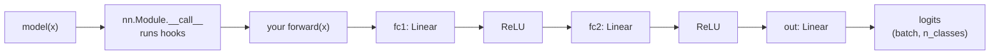

Your NumPy network from Module 17 kept its weights in a dictionary or a handful of variables, had a `forward` function that multiplied and activated layer by layer, and needed you to remember which arrays were parameters so that the update step could find them. PyTorch's `torch.nn` package turns that bookkeeping into a pattern. You write a class that inherits from `nn.Module`, create layers in `__init__`, describe the computation in `forward`, and PyTorch tracks every parameter for you so that an optimiser can update them all in one call. Every model you will meet, from a two-layer classifier to a large language model, is built this way.

## From NumPy layers to nn.Linear

In [forward propagation](/learn/neural-network-fundamentals/forward-propagation) a dense layer was `X @ W + b` followed by an activation, with `W` and `b` created by you. `nn.Linear` packages exactly that: it creates and initialises the weight and bias as **parameters** (tensors with `requires_grad=True` that the module registers) and applies $XW^\top + b$ when called.

```python
import torch
from torch import nn

torch.manual_seed(0)

layer = nn.Linear(in_features=3, out_features=2)
print(layer.weight.shape, layer.bias.shape)
print(layer.weight.requires_grad)

X = torch.randn(4, 3)
out = layer(X)
print(out.shape)
print(torch.allclose(out, X @ layer.weight.T + layer.bias))
```

```output
torch.Size([2, 3]) torch.Size([2])
True
torch.Size([4, 2])
True
```

Note the orientation: PyTorch stores the weight as `(out_features, in_features)`, the transpose of the `(in, out)` layout many NumPy tutorials use. You rarely touch it directly, but it matters when you inspect or copy weights.

`nn.Linear` also initialises its weights sensibly (uniformly in the range $\pm 1/\sqrt{n_\text{in}}$, where $n_\text{in}$ is `in_features`), so you do not need to remember the initialisation rules from Module 17 unless you want to override them.

## Writing a model as an nn.Module

Here is a two-hidden-layer classifier, the same architecture you built by hand, as a PyTorch module:

```python
class MLP(nn.Module):
    def __init__(self, n_in, n_hidden, n_classes):
        super().__init__()                     # required: sets up parameter tracking
        self.fc1 = nn.Linear(n_in, n_hidden)
        self.fc2 = nn.Linear(n_hidden, n_hidden)
        self.out = nn.Linear(n_hidden, n_classes)
        self.act = nn.ReLU()

    def forward(self, x):
        x = self.act(self.fc1(x))
        x = self.act(self.fc2(x))
        return self.out(x)                     # raw scores (logits), no softmax

model = MLP(n_in=4, n_hidden=16, n_classes=3)
print(model)
```

```output
MLP(
  (fc1): Linear(in_features=4, out_features=16, bias=True)
  (fc2): Linear(in_features=16, out_features=16, bias=True)
  (out): Linear(in_features=16, out_features=3, bias=True)
  (act): ReLU()
)
```

Three rules make this work:

1. **Call `super().__init__()` first.** It creates the internal registries. Assigning a layer before it raises an error.
2. **Assign layers as attributes** (`self.fc1 = ...`). Assigning an `nn.Module` or `nn.Parameter` to an attribute is what registers it. Layers stored in a plain Python list are invisible to PyTorch; use `nn.ModuleList` for a variable number of layers.
3. **Call the model, not `forward`.** Write `model(x)`. Calling the instance runs `forward` plus PyTorch's hooks; calling `model.forward(x)` directly skips them.



The forward pass returns **logits**, not probabilities. As you will see in [loss functions](/learn/pytorch/loss-functions), `nn.CrossEntropyLoss` applies the softmax internally, so adding one to the model is a bug.

```python
x = torch.randn(5, 4)
logits = model(x)
print(logits.shape)
print(logits.softmax(dim=1).sum(dim=1))   # probabilities when you need them
```

```output
torch.Size([5, 3])
tensor([1.0000, 1.0000, 1.0000, 1.0000, 1.0000], grad_fn=<SumBackward1>)
```

## Parameters: what the optimiser sees

Because the layers are registered, `model.parameters()` yields every weight and bias in the network, recursively. This replaces the list of arrays you passed around in NumPy.

```python
for name, p in model.named_parameters():
    print(f"{name:12s} {tuple(p.shape)}")

n_params = sum(p.numel() for p in model.parameters())
print("total:", n_params)
```

```output
fc1.weight   (16, 4)
fc1.bias     (16,)
fc2.weight   (16, 16)
fc2.bias     (16,)
out.weight   (3, 16)
out.bias     (3,)
total: 403
```

Check the total against the formula from [neural network architecture](/learn/neural-network-fundamentals/neural-network-architecture): each dense layer has $n_\text{in} \times n_\text{out} + n_\text{out}$ parameters, so $4 \cdot 16 + 16 + 16 \cdot 16 + 16 + 16 \cdot 3 + 3 = 403$.

When you need a learnable tensor that is not a whole layer, such as a learnable temperature or scale, wrap it in `nn.Parameter` and assign it as an attribute:

```python
class ScaledLinear(nn.Module):
    def __init__(self, n_in, n_out):
        super().__init__()
        self.linear = nn.Linear(n_in, n_out)
        self.scale = nn.Parameter(torch.ones(1))

    def forward(self, x):
        return self.scale * self.linear(x)

print([n for n, _ in ScaledLinear(3, 2).named_parameters()])
```

```output
['scale', 'linear.weight', 'linear.bias']
```

## nn.Sequential for simple stacks

When the forward pass is just "apply each layer in order", `nn.Sequential` saves you writing a class:

```python
seq_model = nn.Sequential(
    nn.Linear(4, 16),
    nn.ReLU(),
    nn.Linear(16, 16),
    nn.ReLU(),
    nn.Linear(16, 3),
)
print(seq_model(torch.randn(2, 4)).shape)
print(seq_model[0])          # index into it like a list
```

```output
torch.Size([2, 3])
Linear(in_features=4, out_features=16, bias=True)
```

| Approach | Use when | Limitation |
| --- | --- | --- |
| `nn.Sequential` | A straight pipeline of layers | No branches, skip connections or multiple inputs |
| Subclass `nn.Module` | Anything else | Slightly more code |
| `nn.ModuleList` | A variable number of similar layers you loop over in `forward` | You write the loop yourself |
| `nn.ModuleDict` | Layers chosen by name, such as one head per task | Same |

Real models mix them: a custom `nn.Module` whose attributes are `nn.Sequential` blocks. A residual connection, for example, needs a custom `forward` because the input is added back after the block:

```python
class ResidualBlock(nn.Module):
    def __init__(self, dim):
        super().__init__()
        self.block = nn.Sequential(nn.Linear(dim, dim), nn.ReLU(), nn.Linear(dim, dim))

    def forward(self, x):
        return torch.relu(x + self.block(x))

print(ResidualBlock(8)(torch.randn(3, 8)).shape)
```

```output
torch.Size([3, 8])
```

## Common layers

| Layer | Does | Module 17 equivalent |
| --- | --- | --- |
| `nn.Linear(in, out)` | $XW^\top + b$ | Your dense layer |
| `nn.ReLU()`, `nn.Sigmoid()`, `nn.Tanh()`, `nn.GELU()` | Activations | [activation functions](/learn/neural-network-fundamentals/activation-functions) |
| `nn.Dropout(p)` | Randomly zeroes activations in training | [dropout](/learn/neural-network-fundamentals/dropout) |
| `nn.BatchNorm1d(features)` | Normalises over the batch | [batch normalization](/learn/neural-network-fundamentals/batch-normalization) |
| `nn.LayerNorm(features)` | Normalises over features | Used in transformers |
| `nn.Flatten()` | `(B, C, H, W)` to `(B, C*H*W)` | `reshape` before a dense layer |
| `nn.Embedding(vocab, dim)` | Lookup table from token ids to vectors | Indexing a weight matrix |
| `nn.Conv2d(in_ch, out_ch, k)` | 2-D convolution | Covered in [Computer Vision](/learn/computer-vision/convolutional-neural-networks-cnns) |

Activations also exist as plain functions in `torch.nn.functional` (conventionally imported as `F`): `F.relu(x)`. Use whichever reads better; layers with no parameters behave identically either way.

## train() and eval() modes

Dropout and batch normalisation behave differently during training and evaluation. Dropout zeroes units only during training; batch norm uses batch statistics in training and running averages at evaluation time. Every module carries a `training` flag, and `model.train()` and `model.eval()` set it recursively on every submodule.

```python
net = nn.Sequential(nn.Linear(4, 4), nn.Dropout(p=0.5))
x = torch.ones(1, 4)

net.train()
print(net.training, net(x))
net.eval()
print(net.training, net(x))
print(torch.equal(net(x), net(x)))     # deterministic in eval mode
```

```output
True tensor([[ 1.3500, -0.4400,  0.0000, -1.7257]], grad_fn=<MulBackward0>)
False tensor([[ 0.6750, -0.2200,  0.2092, -0.8629]], grad_fn=<AddmmBackward0>)
True
```

In training mode some outputs are zeroed and the survivors are scaled by $1/(1-p) = 2$ (inverted dropout, as in Module 17). In eval mode dropout does nothing.

> [!WARNING]
> `model.eval()` does not turn off gradient tracking, and `torch.no_grad()` does not switch dropout off. They solve different problems, and evaluation code needs both.

## Exercises

**1.** Build an `nn.Sequential` for 784-pixel inputs with hidden layers of 256 and 64 units, ReLU activations, dropout of 0.2 after each hidden layer, and 10 outputs. Print its parameter count.

<details>
<summary>Show solution</summary>

```python
mnist_mlp = nn.Sequential(
    nn.Linear(784, 256), nn.ReLU(), nn.Dropout(0.2),
    nn.Linear(256, 64), nn.ReLU(), nn.Dropout(0.2),
    nn.Linear(64, 10),
)
print(sum(p.numel() for p in mnist_mlp.parameters()))
```

```output
218058
```

That is $784 \cdot 256 + 256 + 256 \cdot 64 + 64 + 64 \cdot 10 + 10$. Dropout has no parameters.

</details>

**2.** This model reports zero parameters. Why, and how do you fix it?

```python
class Broken(nn.Module):
    def __init__(self):
        super().__init__()
        self.layers = [nn.Linear(4, 4) for _ in range(3)]

    def forward(self, x):
        for layer in self.layers:
            x = layer(x)
        return x

print(sum(p.numel() for p in Broken().parameters()))
```

```output
0
```

<details>
<summary>Show solution</summary>

A plain Python list is not registered, so PyTorch cannot see the layers, the optimiser would never update them, and they would not be saved. Use `nn.ModuleList`:

```python
class Fixed(Broken):
    def __init__(self):
        super().__init__()
        self.layers = nn.ModuleList([nn.Linear(4, 4) for _ in range(3)])

print(sum(p.numel() for p in Fixed().parameters()))
```

```output
60
```

</details>

**3.** Write a module `TwoTower` that takes two inputs `a` (dimension 5) and `b` (dimension 3), passes each through its own `nn.Linear` to 8 units, concatenates them and maps to one output. Why can this not be an `nn.Sequential`?

<details>
<summary>Show solution</summary>

```python
class TwoTower(nn.Module):
    def __init__(self):
        super().__init__()
        self.a_net = nn.Linear(5, 8)
        self.b_net = nn.Linear(3, 8)
        self.head = nn.Linear(16, 1)

    def forward(self, a, b):
        h = torch.cat([torch.relu(self.a_net(a)), torch.relu(self.b_net(b))], dim=1)
        return self.head(h)

print(TwoTower()(torch.randn(2, 5), torch.randn(2, 3)).shape)
```

```output
torch.Size([2, 1])
```

`nn.Sequential` passes one tensor from layer to layer; two inputs and a concatenation need a custom `forward`.

</details>

```quiz
[
  {
    "q": "What shape is the `weight` of `nn.Linear(10, 4)`?",
    "options": ["`(10, 4)`", "`(4,)`", "`(40,)`", "`(4, 10)`"],
    "answer": 3,
    "why": "PyTorch stores linear weights as (out_features, in_features) and computes x @ W.T + b."
  },
  {
    "q": "Why should you call `model(x)` rather than `model.forward(x)`?",
    "options": [
      "`forward` does not exist on built-in layers",
      "Calling the module runs registered hooks around `forward`, which direct calls skip",
      "`model(x)` automatically disables gradients",
      "`model(x)` moves `x` to the right device"
    ],
    "answer": 1,
    "why": "`nn.Module.__call__` wraps `forward` with hook handling that libraries and tools rely on."
  },
  {
    "q": "Which statement about `model.eval()` is true?",
    "options": [
      "It switches dropout and batch norm to evaluation behaviour",
      "It disables gradient tracking",
      "It freezes the parameters so the optimiser cannot change them",
      "It moves the model to the CPU"
    ],
    "answer": 0,
    "why": "It only sets the `training` flag. Use `torch.no_grad()` to stop gradient tracking."
  },
  {
    "q": "A classifier for `nn.CrossEntropyLoss` should end with:",
    "options": ["`nn.Softmax(dim=1)`", "`nn.Sigmoid()`", "A `nn.Linear` producing raw logits", "`nn.ReLU()`"],
    "answer": 2,
    "why": "The loss applies log-softmax itself; the model should output unnormalised scores."
  }
]
```
