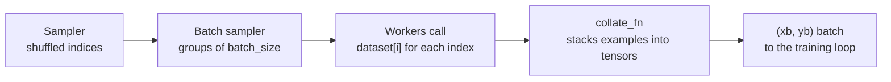

In Module 17 your mini-batch loop was a few lines of NumPy: shuffle an index array, slice it into chunks, and index the data with each chunk. That is fine when the whole dataset is one array in memory. Real datasets are folders of images, millions of text files or rows in a database, and they need decoding, augmentation and padding before they become tensors, ideally in parallel with training so the GPU never waits. PyTorch splits this job into two pieces. A **`Dataset`** knows how to fetch and prepare one example. A **`DataLoader`** turns a dataset into an iterator of shuffled, batched tensors, optionally using several worker processes. Every PyTorch project, including the Hugging Face libraries you will use later, is built on these two classes.

## The Dataset contract

A map-style dataset is any class with two methods:

| Method | Must return |
| --- | --- |
| `__len__(self)` | The number of examples |
| `__getitem__(self, idx)` | Example number `idx`, usually a tuple such as `(features, label)` |

That is the whole contract. Here is a dataset that generates noisy samples from a known function, so you can see every piece:

```python
import torch
from torch.utils.data import Dataset, DataLoader, TensorDataset, random_split

torch.manual_seed(0)

class SineDataset(Dataset):
    def __init__(self, n, noise=0.1):
        self.x = torch.linspace(-3, 3, n).unsqueeze(1)          # (n, 1)
        self.y = torch.sin(self.x) + noise * torch.randn(n, 1)  # (n, 1)

    def __len__(self):
        return len(self.x)

    def __getitem__(self, idx):
        return self.x[idx], self.y[idx]

ds = SineDataset(100)
print(len(ds))
x0, y0 = ds[0]
print(x0, y0)
```

```output
100
tensor([-3.]) tensor([-0.2537])
```

For data that is already a set of tensors, you do not need a class at all. `TensorDataset` wraps tensors that share a first dimension:

```python
features = torch.randn(10, 4)
labels = torch.randint(0, 3, (10,))
tds = TensorDataset(features, labels)
print(len(tds), tds[3][0].shape, tds[3][1])
```

```output
10 torch.Size([4]) tensor(0)
```

## Datasets that load lazily

The point of `__getitem__` is that it can do work on demand. A dataset of image files keeps only the list of paths in memory and opens each file when asked for it:

```python
from pathlib import Path
from PIL import Image

class ImageFolderDataset(Dataset):
    def __init__(self, root, class_names, transform=None):
        self.samples = [
            (path, label)
            for label, name in enumerate(class_names)
            for path in sorted(Path(root, name).glob("*.jpg"))
        ]
        self.transform = transform

    def __len__(self):
        return len(self.samples)

    def __getitem__(self, idx):
        path, label = self.samples[idx]
        image = Image.open(path).convert("RGB")       # loaded only when needed
        if self.transform is not None:
            image = self.transform(image)             # e.g. resize, augment, to tensor
        return image, label
```

This is the pattern behind `torchvision.datasets.ImageFolder`, which does the same thing for a folder with one subfolder per class. Keep `__init__` cheap (paths and labels) and put the expensive work in `__getitem__`, so that it can run in parallel workers.

## The DataLoader

A `DataLoader` wraps a dataset and yields batches. Its job breaks down into four stages:



```python
loader = DataLoader(ds, batch_size=32, shuffle=True)
print(len(loader))                       # number of batches
for xb, yb in loader:
    print(xb.shape, yb.shape)
```

```output
4
torch.Size([32, 1]) torch.Size([32, 1])
torch.Size([32, 1]) torch.Size([32, 1])
torch.Size([32, 1]) torch.Size([32, 1])
torch.Size([4, 1]) torch.Size([4, 1])
```

Four batches of 32, 32, 32 and 4. The default collate function stacked 32 tensors of shape `(1,)` into one of shape `(32, 1)`, exactly the `torch.stack` you met in [tensor operations](/learn/pytorch/tensor-operations).

| Argument | Default | What it controls |
| --- | --- | --- |
| `batch_size` | 1 | Examples per batch |
| `shuffle` | `False` | Reshuffle the order every epoch. `True` for training, `False` for validation and test |
| `drop_last` | `False` | Drop a final incomplete batch. Useful when batch norm misbehaves on a batch of 1 |
| `num_workers` | 0 | Worker processes that load data in parallel. 0 means load in the main process |
| `pin_memory` | `False` | Put batches in page-locked memory for faster copying to a CUDA GPU |
| `collate_fn` | stacks tensors | How a list of examples becomes a batch |
| `persistent_workers` | `False` | Keep workers alive between epochs instead of restarting them |
| `generator` | global RNG | A `torch.Generator` that makes shuffling reproducible on its own |

### Shuffling and reproducibility

`shuffle=True` draws a new permutation at the start of every epoch, which matters: without it the model sees the same batches in the same order every epoch and, if the data is sorted by class, learns from long runs of a single class. To make shuffling reproducible independently of everything else that uses the global random state, pass a seeded generator:

```python
g = torch.Generator().manual_seed(42)
small = TensorDataset(torch.arange(8))
loader = DataLoader(small, batch_size=4, shuffle=True, generator=g)
for epoch in range(2):
    print([batch[0].tolist() for batch in loader])
```

```output
[[4, 6, 2, 3], [0, 7, 1, 5]]
[[7, 4, 3, 1], [5, 0, 2, 6]]
```

Each epoch gets a different order, but rerunning the script produces the same two orders.

## Splitting into train and validation

`random_split` divides a dataset into non-overlapping subsets without copying the data. Each subset is a `Subset` that maps its own indices onto the original dataset.

```python
train_ds, val_ds = random_split(ds, [80, 20], generator=torch.Generator().manual_seed(0))
print(len(train_ds), len(val_ds))
print(type(train_ds).__name__, train_ds.indices[:5])
```

```output
80 20
Subset [44, 19, 93, 90, 71]
```

You can also pass fractions, such as `[0.8, 0.2]`. If the data has groups or a time order, split by those yourself, as discussed in [training, validation and testing](/learn/machine-learning-fundamentals/training-validation-and-testing); a random split would leak information.

## Custom collate functions

The default collate fails when examples have different shapes, which is the normal case for text. A custom `collate_fn` receives the list of examples for one batch and builds the batch however you like, here by padding variable-length token sequences:

```python
from torch.nn.utils.rnn import pad_sequence

sequences = [torch.tensor([5, 2, 9]), torch.tensor([7]), torch.tensor([3, 3, 1, 4, 8])]
seq_labels = [0, 1, 0]
seq_ds = list(zip(sequences, seq_labels))     # a list of pairs works as a dataset too

def pad_collate(batch):
    seqs, labels = zip(*batch)
    lengths = torch.tensor([len(s) for s in seqs])
    padded = pad_sequence(seqs, batch_first=True, padding_value=0)
    return padded, lengths, torch.tensor(labels)

for padded, lengths, labels in DataLoader(seq_ds, batch_size=3, collate_fn=pad_collate):
    print(padded)
    print(lengths, labels)
```

```output
tensor([[5, 2, 9, 0, 0],
        [7, 0, 0, 0, 0],
        [3, 3, 1, 4, 8]])
tensor([3, 1, 5]) tensor([0, 1, 0])
```

Without `collate_fn`, the same loader raises an error because it cannot stack tensors of lengths 3, 1 and 5.

## Parallel loading with num_workers

With `num_workers=0`, the main process loads each batch and then trains on it, so the GPU sits idle while images are decoded. With `num_workers=4`, four background processes prepare upcoming batches while the model trains on the current one.

```python
train_loader = DataLoader(
    train_ds,
    batch_size=64,
    shuffle=True,
    num_workers=4,              # parallel loading processes
    pin_memory=True,            # faster host-to-GPU copies
    persistent_workers=True,    # do not restart workers every epoch
)
```

Practical guidance:

- Start with a number of workers around the number of CPU cores available, then measure. More is not always faster, and each worker holds a copy of the dataset object.
- On macOS and Windows, worker processes are started with *spawn*, which re-imports your script. Put the training code under `if __name__ == "__main__":`, and define the dataset class at module level, or the workers will fail or rerun your whole script.
- In a notebook, a dataset class defined in a cell often cannot be sent to spawned workers. Use `num_workers=0` there, or move the class into a `.py` file.
- Each worker has its own random state. Libraries that use NumPy's global RNG for augmentation may need a `worker_init_fn` that seeds each worker differently.

> [!TIP]
> To find out whether loading is your bottleneck, time an epoch that only iterates the `DataLoader` without training. If that alone takes most of the epoch time, add workers or move expensive preprocessing out of `__getitem__` into a one-off preprocessing step.

## Handling class imbalance in the loader

When one class is rare, a `WeightedRandomSampler` draws examples with probability proportional to a weight, so batches are more balanced. It replaces `shuffle=True` (the two are mutually exclusive):

```python
from torch.utils.data import WeightedRandomSampler

imb_labels = torch.tensor([0] * 90 + [1] * 10)
imb_ds = TensorDataset(torch.randn(100, 3), imb_labels)
class_counts = torch.bincount(imb_labels)
weights = 1.0 / class_counts[imb_labels].float()      # one weight per example

sampler = WeightedRandomSampler(weights, num_samples=len(weights), replacement=True,
                                generator=torch.Generator().manual_seed(0))
drawn = torch.cat([yb for _, yb in DataLoader(imb_ds, batch_size=20, sampler=sampler)])
print(torch.bincount(drawn))
```

```output
tensor([53, 47])
```

The rare class now appears roughly as often as the common one. The alternative, weighting the loss, is covered in [loss functions](/learn/pytorch/loss-functions); the Module 16 lesson on [imbalanced-learn](/learn/machine-learning-libraries/imbalanced-learn) discusses the trade-offs.

## Exercises

**1.** Write a `Dataset` called `SquaresDataset(n)` whose item `i` is `(tensor([float(i)]), tensor([float(i * i)]))`. Load it with `batch_size=4` and no shuffling, and print the second batch.

<details>
<summary>Show solution</summary>

```python
class SquaresDataset(Dataset):
    def __init__(self, n):
        self.n = n

    def __len__(self):
        return self.n

    def __getitem__(self, i):
        return torch.tensor([float(i)]), torch.tensor([float(i * i)])

batches = list(DataLoader(SquaresDataset(10), batch_size=4))
print(batches[1])
```

```output
[tensor([[4.],
        [5.],
        [6.],
        [7.]]), tensor([[16.],
        [25.],
        [36.],
        [49.]])]
```

</details>

**2.** A dataset has 1,000 examples. How many batches does a `DataLoader` with `batch_size=64` produce, and how many with `drop_last=True`? Check with code.

<details>
<summary>Show solution</summary>

$1000 / 64 = 15.6$, so 16 batches (the last has 40 examples), or 15 with `drop_last=True`.

```python
big = TensorDataset(torch.zeros(1000, 1))
print(len(DataLoader(big, batch_size=64)), len(DataLoader(big, batch_size=64, drop_last=True)))
```

```output
16 15
```

</details>

**3.** Why should the validation `DataLoader` use `shuffle=False`?

<details>
<summary>Show solution</summary>

Shuffling changes nothing about the validation metrics, which are averages over the whole set, so it only costs time. A fixed order also makes it easy to line predictions up with the original examples for error analysis.

</details>

```quiz
[
  {
    "q": "Which two methods must a map-style `Dataset` implement?",
    "options": ["`__iter__` and `__next__`", "`__len__` and `__getitem__`", "`forward` and `backward`", "`load` and `transform`"],
    "answer": 1,
    "why": "The DataLoader asks for the length to build indices and calls `__getitem__` for each index."
  },
  {
    "q": "What does `collate_fn` receive?",
    "options": [
      "The whole dataset",
      "A single example",
      "A list of the examples that make up one batch",
      "The indices of the batch only"
    ],
    "answer": 2,
    "why": "It turns a list of `__getitem__` results into batch tensors; the default stacks them."
  },
  {
    "q": "A script with `num_workers=4` reruns its top-level code repeatedly on macOS. What is the fix?",
    "options": [
      "Set `pin_memory=False`",
      "Use `shuffle=False`",
      "Increase `batch_size`",
      "Put the training code under `if __name__ == \"__main__\":`"
    ],
    "answer": 3,
    "why": "Spawned workers re-import the main module; the guard stops them running the training code."
  },
  {
    "q": "When is `pin_memory=True` useful?",
    "options": [
      "When training on a CUDA GPU, to speed up host-to-device copies",
      "When training on CPU only",
      "When the dataset does not fit on disk",
      "When using a custom `collate_fn`"
    ],
    "answer": 0,
    "why": "Page-locked host memory allows faster, asynchronous transfers to an NVIDIA GPU."
  }
]
```
