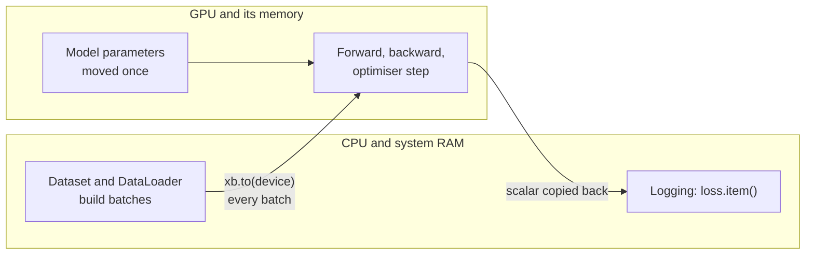

Training a neural network is dominated by a few kinds of operation, above all large matrix multiplications, and each of them consists of millions of independent multiply-adds. A CPU has a handful of powerful cores that work through such a job a chunk at a time; a GPU has thousands of simpler cores that do it all at once. For deep learning that difference is often the gap between a model that trains in an hour and one that trains in days. NumPy, which you used in Module 17, runs only on the CPU. PyTorch runs the same code on NVIDIA GPUs (through CUDA), on Apple silicon (through Metal, the `mps` device) and on CPUs, and switching between them is mostly a matter of putting tensors in the right place. This lesson shows how to do that correctly and how to avoid the usual slowdowns.

> [!NOTE]
> The examples on this page that need a GPU are shown without outputs, because the results depend on your hardware. Everything is written to run unchanged on a CPU-only machine, falling back automatically.

## Choosing a device

Pick the device once, at the top of the script, and refer to it everywhere else. This is the device-agnostic pattern you saw briefly in [tensors](/learn/pytorch/tensors):

```python
import torch
from torch import nn

if torch.cuda.is_available():
    device = torch.device("cuda")          # NVIDIA GPU (cuda:0 by default)
elif torch.backends.mps.is_available():
    device = torch.device("mps")           # Apple silicon GPU
else:
    device = torch.device("cpu")

print(f"Using {device}")
```

Useful queries on an NVIDIA machine:

```python
if torch.cuda.is_available():
    print(torch.cuda.device_count())               # number of visible GPUs
    print(torch.cuda.get_device_name(0))           # for example the card's model name
    print(torch.cuda.memory_allocated() / 1e6, "MB in use by tensors")
```

On the command line, `nvidia-smi` shows each GPU's memory and utilisation, and the environment variable `CUDA_VISIBLE_DEVICES=1` restricts a process to one particular GPU (which then appears to PyTorch as `cuda:0`).

## Moving models and data

Two things must be on the device: the **model's parameters** and **every batch of data**. The rule for each is slightly different.



`module.to(device)` moves a model's parameters **in place** and returns the same module. `tensor.to(device)` returns a **new** tensor and leaves the original where it was. You can see the difference on a CPU by changing dtype instead of device, since `.to` treats both the same way:

```python
torch.manual_seed(0)

model = nn.Linear(2, 2)
model.to(torch.float64)            # no assignment needed for modules
print(model.weight.dtype)

t = torch.ones(2)
t.to(torch.float64)                # result discarded
print(t.dtype)
t = t.to(torch.float64)            # assignment needed for tensors
print(t.dtype)
```

```output
torch.float64
torch.float32
torch.float64
```

Forgetting the assignment for a tensor is a very common bug: the batch stays on the CPU and the forward pass fails with *Expected all tensors to be on the same device*. Writing `model = model.to(device)` is harmless and keeps both forms consistent.

The device-aware training step changes in only one place, the first line of the loop body:

```python
model = MyModel().to(device)                       # 1. move the model first
optimizer = torch.optim.AdamW(model.parameters(), lr=1e-3)   # 2. then build the optimiser

for xb, yb in train_loader:
    xb, yb = xb.to(device), yb.to(device)          # 3. move each batch
    optimizer.zero_grad()
    loss = loss_fn(model(xb), yb)
    loss.backward()
    optimizer.step()
```

Moving the model before creating the optimiser is the safe order. Anything created inside the model's `forward` must also be on the right device: create it with `device=x.device` (for example `torch.zeros(n, device=x.device)`) rather than relying on the default CPU.

> [!WARNING]
> Results you want to inspect with NumPy, Matplotlib or pandas must come back to the CPU first: `preds.detach().cpu().numpy()`. Calling `.numpy()` on a GPU tensor raises an error.

## Keeping the GPU busy

A GPU only helps if it spends its time computing rather than waiting. Three things commonly starve it.

### Data loading

If the `DataLoader` decodes images in the main process, the GPU idles between batches. Use worker processes and pinned memory, as described in [Dataset and DataLoader](/learn/pytorch/dataset-and-dataloader), and request asynchronous copies:

```python
train_loader = torch.utils.data.DataLoader(
    train_ds, batch_size=128, shuffle=True,
    num_workers=4, pin_memory=True, persistent_workers=True,
)
for xb, yb in train_loader:
    xb = xb.to(device, non_blocking=True)   # overlaps the copy with GPU work
    yb = yb.to(device, non_blocking=True)
    ...
```

`non_blocking=True` only makes the copy asynchronous when the source is in pinned memory, which is why the two settings go together. `pin_memory` applies to CUDA; it gives no benefit on `mps` or CPU.

### Synchronisation points

GPU work is **asynchronous**: Python queues operations and moves on without waiting for them to finish. Anything that needs a value back on the CPU forces Python to wait until the queue drains. `loss.item()`, `print(tensor)`, `.cpu()` and `if tensor > 0:` all synchronise. Calling `.item()` once per batch for logging is normal; calling it on every intermediate value inside the model is not.

This also means naive timing is wrong. To time GPU code, synchronise before reading the clock:

```python
import time

a = torch.randn(4096, 4096, device=device)
if device.type == "cuda":
    torch.cuda.synchronize()
start = time.perf_counter()
for _ in range(10):
    c = a @ a
if device.type == "cuda":
    torch.cuda.synchronize()             # wait for the queued work to finish
print(f"{(time.perf_counter() - start) / 10 * 1000:.1f} ms per matmul")
```

### Small workloads

Launching work on a GPU has a fixed overhead. A tiny model on a batch of 8 can be slower on a GPU than on a CPU. GPUs pay off with large matrices: bigger batches, wider layers, convolutions and attention over long sequences.

## Mixed precision

GPUs can multiply 16-bit numbers much faster than 32-bit ones, and 16-bit tensors take half the memory. **Automatic mixed precision** runs the operations that are safe in 16 bits (matrix multiplications, convolutions) in `float16` or `bfloat16`, and keeps the sensitive ones (reductions, softmax, losses) and the master copy of the weights in `float32`. `torch.autocast` chooses per operation.

You can see the mechanism on a CPU, which supports `bfloat16` autocast:

```python
layer = nn.Linear(4, 4)
x = torch.randn(2, 4)
with torch.autocast(device_type="cpu", dtype=torch.bfloat16):
    out = layer(x)
print(out.dtype, layer.weight.dtype)
```

```output
torch.bfloat16 torch.float32
```

The output of the linear layer is `bfloat16`, while the weights remain `float32`. On a CUDA GPU the full training step looks like this:

```python
scaler = torch.amp.GradScaler("cuda")             # only needed for float16

for xb, yb in train_loader:
    xb, yb = xb.to(device, non_blocking=True), yb.to(device, non_blocking=True)
    optimizer.zero_grad()
    with torch.autocast(device_type="cuda", dtype=torch.float16):
        logits = model(xb)                         # forward pass in mixed precision
        loss = loss_fn(logits, yb)
    scaler.scale(loss).backward()                  # backward outside autocast
    scaler.step(optimizer)                         # unscales, skips step on inf/nan
    scaler.update()
```

| Format | Range | Needs `GradScaler`? | Hardware |
| --- | --- | --- | --- |
| `float16` | Narrow: small gradients can underflow to zero | Yes | Most NVIDIA GPUs with tensor cores |
| `bfloat16` | Same exponent range as `float32`, fewer mantissa bits | No | Recent NVIDIA GPUs, TPUs, many CPUs |

The **gradient scaler** multiplies the loss by a large factor before `backward()` so that small `float16` gradients do not round to zero, then divides the gradients back before the optimiser step and skips any step that produced infinities. With `bfloat16` the range problem does not arise, so you drop the scaler and call `loss.backward()` and `optimizer.step()` as usual. If you clip gradients with a scaler, call `scaler.unscale_(optimizer)` before `clip_grad_norm_`.

## Running out of memory

`CUDA out of memory` is the error you will see most on a GPU. Memory holds the parameters, the gradients, the optimiser state (two extra copies for Adam) and the activations saved for the backward pass. Activations scale with the batch size, so the remedies, roughly in order of ease, are:

1. Reduce the batch size, and use gradient accumulation (from [training loops](/learn/pytorch/training-loops)) to keep the effective batch size.
2. Use mixed precision.
3. Wrap evaluation in `torch.no_grad()` so activations are not kept.
4. Make sure you are not holding references to old tensors, such as a list of loss tensors instead of `loss.item()` values.

`torch.cuda.empty_cache()` returns cached but unused memory to the driver so other processes can use it; it does not free memory your tensors still occupy.

> [!TIP]
> Training on several GPUs uses `torch.nn.parallel.DistributedDataParallel`, one process per GPU, launched with the `torchrun` command. The single-GPU loop in this lesson is the building block; the parallel version mainly adds process setup and a distributed sampler.

## Exercises

**1.** This code fails on a GPU machine with a device mismatch. Find the bug, and explain why the similar-looking `model.to(device)` line is not one.

```text
model = Net()
model.to(device)
optimizer = torch.optim.SGD(model.parameters(), lr=0.1)
for xb, yb in loader:
    xb.to(device)
    loss = loss_fn(model(xb), yb.to(device))
    ...
```

<details>
<summary>Show solution</summary>

`xb.to(device)` discards its result, so `xb` stays on the CPU: write `xb = xb.to(device)`. `model.to(device)` without assignment is fine, because modules move their parameters in place. `yb.to(device)` is used directly in the expression, so it is also correct.

</details>

**2.** Write a function `to_device(batch, device)` that moves every tensor in a batch to the device, where the batch may be a tensor, a tuple or list of tensors, or a dictionary of tensors (as Hugging Face tokenisers return). Test it on the CPU.

<details>
<summary>Show solution</summary>

```python
def to_device(batch, device):
    if isinstance(batch, torch.Tensor):
        return batch.to(device)
    if isinstance(batch, dict):
        return {k: to_device(v, device) for k, v in batch.items()}
    if isinstance(batch, (list, tuple)):
        return type(batch)(to_device(v, device) for v in batch)
    return batch

b = {"input_ids": torch.tensor([[1, 2]]), "labels": (torch.tensor([0]), "meta")}
moved = to_device(b, torch.device("cpu"))
print(moved["input_ids"].device, moved["labels"][0].device, moved["labels"][1])
```

```output
cpu cpu meta
```

</details>

**3.** A colleague times a training step at a fraction of a millisecond on a GPU and concludes the model is extremely fast. What is probably wrong with the measurement?

<details>
<summary>Show solution</summary>

GPU operations run asynchronously, so the timer stopped as soon as the work was queued, not when it finished. Call `torch.cuda.synchronize()` before reading the clock at both ends, or time many steps that include a synchronising call such as `loss.item()`.

</details>

```quiz
[
  {
    "q": "What is the difference between `model.to(device)` and `x.to(device)` for a tensor `x`?",
    "options": [
      "There is none; both return new objects and leave the original unchanged",
      "The module is moved in place; the tensor version returns a new tensor that you must assign",
      "Only tensors can be moved to a GPU",
      "The module version copies the optimiser too"
    ],
    "answer": 1,
    "why": "Modules move their parameters in place; tensors are immutable in location, so `.to` returns a copy."
  },
  {
    "q": "Why does mixed-precision training with `float16` use a `GradScaler`?",
    "options": [
      "To move gradients to the CPU",
      "To make the learning rate adaptive",
      "To stop small gradients underflowing to zero in the narrow float16 range",
      "Because autocast cannot run the backward pass"
    ],
    "answer": 2,
    "why": "Scaling the loss scales every gradient up into the representable range; they are unscaled before the step."
  },
  {
    "q": "Which of these forces the CPU to wait for queued GPU work to finish?",
    "options": ["`loss.item()`", "`a @ b` on GPU tensors", "`model(xb)`", "`optimizer.zero_grad()`"],
    "answer": 0,
    "why": "Returning a Python number requires the result to exist, so it synchronises."
  },
  {
    "q": "Your model trains with batch size 256 but raises CUDA out of memory. What is the most direct fix that preserves the effective batch size?",
    "options": [
      "Call `torch.cuda.empty_cache()` every step",
      "Switch the optimiser from AdamW to Adam",
      "Set `num_workers=0`",
      "Use batch size 64 with gradient accumulation over 4 steps"
    ],
    "answer": 3,
    "why": "Activation memory scales with the batch; accumulation recovers the larger effective batch."
  }
]
```
