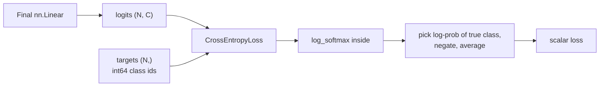
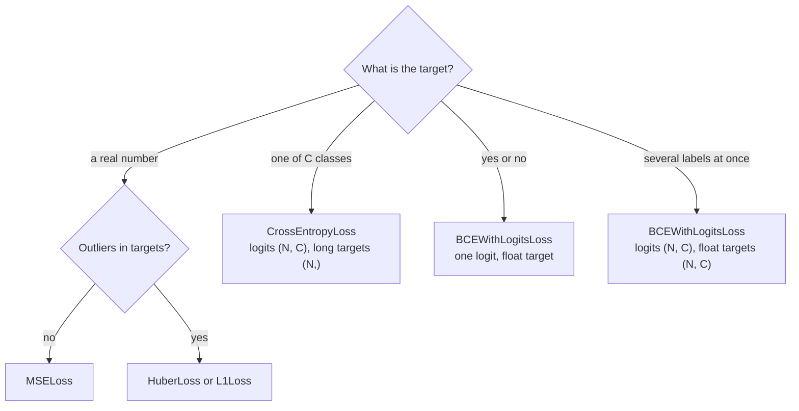

You already know what the common losses mean and where they come from: Module 17's [loss functions](/learn/neural-network-fundamentals/loss-functions) lesson derived mean squared error and cross-entropy, and Module 6 connected cross-entropy to [maximum likelihood](/learn/essential-mathematics-for-machine-learning/maximum-likelihood-estimation). This lesson is about using PyTorch's implementations correctly. That is less trivial than it sounds, because each loss expects specific shapes, dtypes and, above all, a specific kind of model output. Feed `nn.CrossEntropyLoss` probabilities instead of logits and training still runs, just worse. Most "my model will not learn" questions on forums turn out to be a loss function used with the wrong inputs.

## Loss modules and the functional API

Losses exist in two forms that compute the same thing:

```python
import torch
from torch import nn
import torch.nn.functional as F

torch.manual_seed(0)

pred = torch.tensor([2.5, 0.0, 2.0])
target = torch.tensor([3.0, -0.5, 2.0])

mse = nn.MSELoss()                        # a module, created once
print(mse(pred, target))
print(F.mse_loss(pred, target))           # the same as a function
print(((pred - target) ** 2).mean())      # what you wrote in NumPy
```

```output
tensor(0.1667)
tensor(0.1667)
tensor(0.1667)
```

All losses take `(input, target)` in that order, with the model's output first. Most accept a `reduction` argument: `"mean"` (the default) averages over elements, `"sum"` adds them, and `"none"` returns one loss per element, which is useful for weighting or inspecting individual examples.

```python
print(nn.MSELoss(reduction="none")(pred, target))
```

```output
tensor([0.2500, 0.2500, 0.0000])
```

## Regression losses

| Loss | Formula per element | Use when |
| --- | --- | --- |
| `nn.MSELoss` | $(\hat{y} - y)^2$ | The default for regression; penalises large errors heavily |
| `nn.L1Loss` | $\lvert \hat{y} - y \rvert$ | Outliers in the targets should not dominate |
| `nn.HuberLoss(delta)` | Quadratic within `delta`, linear beyond | A compromise: smooth near zero, robust to outliers |
| `nn.SmoothL1Loss(beta)` | Huber divided by `beta` | Common in object detection |

```python
pred = torch.tensor([1.0, 2.0, 10.0])
target = torch.tensor([1.5, 2.0, 2.0])     # last example is an outlier
for loss_fn in [nn.MSELoss(), nn.L1Loss(), nn.HuberLoss(delta=1.0)]:
    print(f"{type(loss_fn).__name__:10s} {loss_fn(pred, target).item():.3f}")
```

```output
MSELoss    21.417
L1Loss     2.833
HuberLoss  2.542
```

One error of 8 contributes 64 to the MSE sum but only 8 to the L1 sum, which is why MSE-trained models chase outliers.

> [!WARNING]
> Regression losses need predictions and targets of the **same shape**. A model with one output unit returns `(batch, 1)`; if your targets are `(batch,)`, broadcasting silently computes a `(batch, batch)` matrix of differences. PyTorch prints a `UserWarning` for `MSELoss` in this case, but it is easy to miss. Use `target.unsqueeze(1)` or `pred.squeeze(1)`.

## CrossEntropyLoss for multi-class classification

`nn.CrossEntropyLoss` is the loss for choosing one of $C$ classes. It expects:

- **input**: raw, unnormalised **logits** of shape `(N, C)`, straight from the final `nn.Linear`;
- **target**: class **indices** of shape `(N,)` with dtype `torch.long`, each in `0` to `C - 1`.

Internally it applies log-softmax and then the negative log-likelihood, in one numerically stable step. For one example with logits $z$ and true class $y$:

$$
\ell = -\log \frac{e^{z_y}}{\sum_{j=1}^{C} e^{z_j}} = -z_y + \log \sum_{j=1}^{C} e^{z_j}
$$

where $z_j$ is the logit for class $j$. The loss is the mean of $\ell$ over the batch.

```python
logits = torch.tensor([[2.0, 0.5, -1.0],
                       [0.1, 0.2, 3.0]])
labels = torch.tensor([0, 2])

ce = nn.CrossEntropyLoss()
print(ce(logits, labels))

manual = -F.log_softmax(logits, dim=1)[torch.arange(2), labels].mean()
print(manual)
```

```output
tensor(0.1755)
tensor(0.1755)
```



### The softmax bug

Because the loss applies softmax itself, a model that ends in `nn.Softmax` gets softmax applied **twice**. Nothing crashes. The squashed outputs all lie between 0 and 1, so the second softmax can never produce confident probabilities, the loss cannot get close to zero, and gradients shrink.

```python
confident = torch.tensor([[10.0, -10.0, -10.0]])
label = torch.tensor([0])
print(ce(confident, label))                         # correct: near zero
print(ce(torch.softmax(confident, dim=1), label))   # double softmax: stuck
```

```output
tensor(0.)
tensor(0.5514)
```

A perfectly correct, highly confident prediction still scores a loss of about 0.55, and no amount of training can push it below that floor. The fix is to return logits from the model and apply `softmax` only when you need probabilities for reporting.

> [!KEY]
> PyTorch losses with "logits" in their contract do the squashing for you. Give `CrossEntropyLoss` and `BCEWithLogitsLoss` raw scores, never softmax or sigmoid outputs.

### Other CrossEntropyLoss inputs and options

| Situation | What to pass |
| --- | --- |
| Labels are `float` or shape `(N, 1)` | Convert: `labels.long().squeeze(1)` |
| Sequence or pixel predictions | Logits `(N, C, L)` or `(N, C, H, W)`; targets `(N, L)` or `(N, H, W)`. The class dimension is always dim 1 |
| Padding tokens that should not count | `ignore_index=pad_id`; targets equal to it are skipped |
| Imbalanced classes | `weight=torch.tensor([...])`, one weight per class |
| Over-confident predictions | `label_smoothing=0.1` spreads a little target probability over other classes |
| Soft targets (probabilities, for distillation or mixup) | Targets of shape `(N, C)` as floats, each row summing to 1 |

The class-dimension rule catches people working with language models, whose output is naturally `(N, L, C)`. Either permute it to `(N, C, L)` or flatten both: `ce(logits.view(-1, C), targets.view(-1))`.

```python
N, L, C = 2, 4, 5
lm_logits = torch.randn(N, L, C)
lm_targets = torch.randint(0, C, (N, L))
lm_targets[1, 2:] = -100                      # padding positions
lm_ce = nn.CrossEntropyLoss(ignore_index=-100)
print(lm_ce(lm_logits.reshape(-1, C), lm_targets.reshape(-1)))
print(lm_ce(lm_logits.permute(0, 2, 1), lm_targets))
```

```output
tensor(2.1083)
tensor(2.1083)
```

Both forms give the same value. `-100` is the default `ignore_index`, which is why you will see it used for padding in many libraries.

## Binary and multi-label classification

For a yes-or-no output, use one logit per example and `nn.BCEWithLogitsLoss`, which combines a sigmoid with binary cross-entropy. Targets are **floats** of the same shape as the logits.

```python
bin_logits = torch.tensor([3.0, -2.0, 0.5])
bin_targets = torch.tensor([1.0, 0.0, 0.0])
print(nn.BCEWithLogitsLoss()(bin_logits, bin_targets))
print(nn.BCELoss()(torch.sigmoid(bin_logits), bin_targets))   # same, less stable
```

```output
tensor(0.3832)
tensor(0.3832)
```

Prefer `BCEWithLogitsLoss`. `BCELoss` takes probabilities, and once a sigmoid output rounds to exactly 0 or 1 in `float32` the logarithm has to be clamped and gradients are lost; the logits version uses the log-sum-exp trick and stays accurate.

The same loss handles **multi-label** problems, where each example can belong to several classes at once (an image tagged both "beach" and "sunset"): logits and targets of shape `(N, C)`, with each column treated as an independent yes-or-no question. For imbalanced binary problems, `pos_weight` scales the loss on positive examples:

```python
ml_logits = torch.randn(4, 3)
ml_targets = torch.tensor([[1, 0, 1], [0, 0, 1], [1, 1, 0], [0, 0, 0]], dtype=torch.float32)
print(nn.BCEWithLogitsLoss(pos_weight=torch.tensor([1.0, 3.0, 1.0]))(ml_logits, ml_targets))
```

```output
tensor(1.0759)
```

## Choosing a loss



| Task | Final layer | Loss | Target dtype and shape |
| --- | --- | --- | --- |
| Regression | `nn.Linear(h, 1)` | `MSELoss` | float, `(N, 1)` |
| Multi-class | `nn.Linear(h, C)` | `CrossEntropyLoss` | long, `(N,)` |
| Binary | `nn.Linear(h, 1)` | `BCEWithLogitsLoss` | float, `(N, 1)` |
| Multi-label | `nn.Linear(h, C)` | `BCEWithLogitsLoss` | float, `(N, C)` |

## Exercises

**1.** A classifier's labels are stored as `torch.tensor([[1.], [0.], [2.]])`. Passing them to `CrossEntropyLoss` with logits of shape `(3, 3)` fails. Fix the labels and compute the loss for `logits = torch.zeros(3, 3)`. What value do you expect, and why?

<details>
<summary>Show solution</summary>

The labels must be `long` with shape `(3,)`. With all-zero logits every class has probability $1/3$, so the loss is $\ln 3 \approx 1.0986$, the loss of uniform guessing.

```python
bad_labels = torch.tensor([[1.], [0.], [2.]])
fixed = bad_labels.squeeze(1).long()
print(nn.CrossEntropyLoss()(torch.zeros(3, 3), fixed))
```

```output
tensor(1.0986)
```

This is also a handy sanity check: at initialisation, a $C$-class model should start with a loss near $\ln C$.

</details>

**2.** Compute per-example cross-entropy losses for the two-example `logits` and `labels` from this lesson, and identify which example the model got more wrong.

<details>
<summary>Show solution</summary>

```python
per_example = nn.CrossEntropyLoss(reduction="none")(logits, labels)
print(per_example)
```

```output
tensor([0.2413, 0.1096])
```

The first example has the larger loss: its true class 0 had a logit lead of 1.5, while the second example's true class led by 2.8.

</details>

**3.** You are predicting whether each of 20 genres applies to a film. Which final layer and loss do you use, and what shape and dtype are the targets?

<details>
<summary>Show solution</summary>

This is multi-label: `nn.Linear(hidden, 20)` with `nn.BCEWithLogitsLoss`, and targets of shape `(N, 20)` as `float32` zeros and ones. `CrossEntropyLoss` would wrongly force the genres to compete for a single probability mass.

</details>

```quiz
[
  {
    "q": "What should the model pass as input to `nn.CrossEntropyLoss`?",
    "options": [
      "Softmax probabilities",
      "Log-probabilities from `log_softmax`",
      "Raw logits from the final linear layer",
      "The predicted class indices from `argmax`"
    ],
    "answer": 2,
    "why": "The loss applies log-softmax internally. Probabilities cause a double softmax; argmax is not differentiable."
  },
  {
    "q": "For a batch of 16 examples and 10 classes, what targets does `CrossEntropyLoss` expect by default?",
    "options": [
      "A `long` tensor of shape `(16,)` with values 0 to 9",
      "A `float` tensor of shape `(16, 1)`",
      "A `long` tensor of shape `(16, 10)`",
      "A `float` tensor of shape `(10,)`"
    ],
    "answer": 0,
    "why": "Class-index targets are int64 with one entry per example."
  },
  {
    "q": "Why is `BCEWithLogitsLoss` preferred over `sigmoid` followed by `BCELoss`?",
    "options": [
      "It supports more classes",
      "It is numerically stable because it combines the sigmoid and log in one operation",
      "It does not need targets",
      "It applies softmax across the batch"
    ],
    "answer": 1,
    "why": "Fusing the operations avoids taking the log of values that have rounded to 0 or 1."
  },
  {
    "q": "A language model outputs logits of shape `(N, L, C)`. What is a correct way to compute cross-entropy against targets `(N, L)`?",
    "options": [
      "`ce(logits, targets)` directly",
      "`ce(logits.softmax(-1), targets)`",
      "`ce(logits.sum(1), targets)`",
      "`ce(logits.reshape(-1, C), targets.reshape(-1))`"
    ],
    "answer": 3,
    "why": "CrossEntropyLoss wants the class dimension at position 1; flattening the positions into the batch is the usual fix."
  }
]
```
