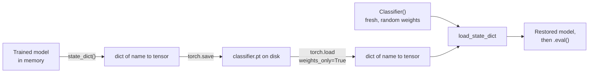

A trained model exists only in the memory of the Python process that trained it. When the process ends, so does the model, unless you saved it. Saving matters for more than the final result: long training runs crash, cloud machines are pre-empted, and you will want to resume from the best epoch rather than the last one. Later in the curriculum you will load other people's pretrained weights constantly, and you need to do that safely. PyTorch's approach is simple once you see it: a model's learned state is a dictionary of tensors, called the **state dict**, and you save that dictionary, not the Python object.

## The state dict

`model.state_dict()` returns an ordered dictionary mapping each parameter and buffer name to its tensor. The names are the attribute paths you saw from `named_parameters()` in [building neural networks](/learn/pytorch/building-neural-networks).

```python
import torch
from torch import nn

torch.manual_seed(0)

class Classifier(nn.Module):
    def __init__(self, n_in=4, n_hidden=16, n_classes=3):
        super().__init__()
        self.body = nn.Sequential(nn.Linear(n_in, n_hidden), nn.BatchNorm1d(n_hidden), nn.ReLU())
        self.head = nn.Linear(n_hidden, n_classes)

    def forward(self, x):
        return self.head(self.body(x))

model = Classifier()
for name, tensor in model.state_dict().items():
    print(f"{name:28s} {tuple(tensor.shape)}")
```

```output
body.0.weight                (16, 4)
body.0.bias                  (16,)
body.1.weight                (16,)
body.1.bias                  (16,)
body.1.running_mean          (16,)
body.1.running_var           (16,)
body.1.num_batches_tracked   ()
head.weight                  (3, 16)
head.bias                    (3,)
```

The state dict also contains **buffers**: tensors that are part of the model's state but not trained by gradient descent, such as batch norm's running mean and variance. That is one reason to save the state dict rather than just `model.parameters()`: a model restored without its running statistics would behave differently in eval mode.

## Saving and loading weights

The recommended pattern saves only the state dict, and recreates the model from code when loading:

```python
torch.save(model.state_dict(), "classifier.pt")

restored = Classifier()                                   # 1. build the architecture
state = torch.load("classifier.pt", weights_only=True)    # 2. load the tensors
restored.load_state_dict(state)                           # 3. copy them in
restored.eval()                                           # 4. eval mode for inference

x = torch.randn(5, 4)
model.eval()
print(torch.equal(model(x), restored(x)))
```

```output
True
```



The file extension is a convention; `.pt` and `.pth` are both common. Remember the last step: a freshly constructed model is in training mode, so without `restored.eval()` dropout and batch norm behave as in training and predictions will be wrong or noisy.

### Mismatched keys

`load_state_dict` is strict by default: every key in the model must be in the file and vice versa, with matching shapes. That catches real mistakes, such as loading weights into the wrong architecture:

```python
wrong = Classifier(n_classes=5)
try:
    wrong.load_state_dict(state)
except RuntimeError as e:
    print(str(e).splitlines()[0])
    print(str(e).splitlines()[1].strip())
```

```output
Error(s) in loading state_dict for Classifier:
size mismatch for head.weight: copying a param with shape torch.Size([3, 16]) from checkpoint, the shape in current model is torch.Size([5, 16]).
```

When you deliberately load only part of a model, as in [transfer learning](/learn/pytorch/transfer-learning), pass `strict=False`. It returns the keys that did not match, which you should always inspect:

```python
partial = {k: v for k, v in state.items() if k.startswith("body.")}
result = wrong.load_state_dict(partial, strict=False)
print(result.missing_keys)
print(result.unexpected_keys)
```

```output
['head.weight', 'head.bias']
[]
```

Shape mismatches are still errors with `strict=False`, which only relaxes missing and unexpected keys, so filter out keys whose shapes differ before loading.

## Security: weights_only

`torch.save` uses Python's `pickle` format, and unpickling can execute arbitrary code. A malicious `.pt` file can run any command on your machine the moment you load it. `weights_only=True` restricts `torch.load` to tensors, primitive types and plain containers (dictionaries, lists, tuples), refusing anything that would need to run code to reconstruct. Since PyTorch 2.6, `torch.load` uses `weights_only=True` by default, but writing it explicitly documents the intent and protects you on older versions.

> [!WARNING]
> Never load a checkpoint from an untrusted source with `weights_only=False`. For sharing weights publicly, the `safetensors` format, used by the Hugging Face Hub, stores raw tensors with no code at all and is the safer choice. You will meet it in the [Hugging Face Ecosystem](/learn/hugging-face-ecosystem/model-hub) module.

The restriction is also why you should not pickle a whole model with `torch.save(model, path)`. That stores a reference to your class by its import path, so the file only loads if the same class exists under the same module name, and it cannot be loaded with `weights_only=True`. The full error message goes on to explain that `weights_only=False` would work but can execute arbitrary code:

```python
torch.save(model, "whole_model.pt")
try:
    torch.load("whole_model.pt", weights_only=True)
except Exception as e:
    print(type(e).__name__, "-", str(e).split(".")[0])
```

Run as a script, this prints:

```output
UnpicklingError - Weights only load failed
```

## Checkpoints for resuming training

To resume training exactly where it stopped, you need more than the weights. Adam's moment estimates, the scheduler's position, the epoch number and the best validation score all affect what happens next, as the [optimizers](/learn/pytorch/optimizers) lesson explained. A **checkpoint** is a dictionary holding all of them:

```python
optimizer = torch.optim.AdamW(model.parameters(), lr=1e-3)
scheduler = torch.optim.lr_scheduler.CosineAnnealingLR(optimizer, T_max=20)

def save_checkpoint(path, model, optimizer, scheduler, epoch, best_val_loss):
    torch.save({
        "epoch": epoch,
        "model": model.state_dict(),
        "optimizer": optimizer.state_dict(),
        "scheduler": scheduler.state_dict(),
        "best_val_loss": best_val_loss,
    }, path)

def load_checkpoint(path, model, optimizer, scheduler, device="cpu"):
    ckpt = torch.load(path, map_location=device, weights_only=True)
    model.load_state_dict(ckpt["model"])
    optimizer.load_state_dict(ckpt["optimizer"])
    scheduler.load_state_dict(ckpt["scheduler"])
    return ckpt["epoch"] + 1, ckpt["best_val_loss"]       # next epoch to run
```

Train a few steps, checkpoint, then resume into fresh objects and confirm the optimiser state survived:

```python
X, y = torch.randn(64, 4), torch.randint(0, 3, (64,))
model.train()
for epoch in range(3):
    optimizer.zero_grad()
    loss = nn.functional.cross_entropy(model(X), y)
    loss.backward()
    optimizer.step()
    scheduler.step()
save_checkpoint("checkpoint.pt", model, optimizer, scheduler, epoch=2, best_val_loss=loss.item())

model2 = Classifier()
opt2 = torch.optim.AdamW(model2.parameters(), lr=1e-3)
sched2 = torch.optim.lr_scheduler.CosineAnnealingLR(opt2, T_max=20)
start_epoch, best = load_checkpoint("checkpoint.pt", model2, opt2, sched2)

print(start_epoch, round(best, 4))
print(opt2.state_dict()["state"][0]["step"])
print(sched2.get_last_lr() == scheduler.get_last_lr())
```

```output
3 1.1712
tensor(3.)
True
```

The main loop then becomes `for epoch in range(start_epoch, num_epochs):`. Save a checkpoint every epoch (overwriting `last.pt`), and separately save `best.pt` whenever validation improves. If you want bit-for-bit reproducible resumption, also store the random number generator states from `torch.get_rng_state()` and restore them with `torch.set_rng_state()`.

> [!TIP]
> Write checkpoints atomically: save to a temporary file and then rename it over the old one (`os.replace`). If the process dies halfway through writing, you still have the previous complete checkpoint instead of a corrupted file.

## Loading across devices

A tensor saved from a GPU remembers its device. Loading it on a machine without that GPU fails unless you tell PyTorch where to put the tensors with `map_location`:

```python
device = torch.device("cuda" if torch.cuda.is_available() else "cpu")
state = torch.load("classifier.pt", map_location=device, weights_only=True)
model = Classifier().to(device)
model.load_state_dict(state)
```

Passing `map_location="cpu"` is a safe habit for any file whose origin you do not know. `load_state_dict` copies values into the model's existing tensors, so the model's own device wins once loaded.

## What to save, and when

| You want to | Save | Load with |
| --- | --- | --- |
| Use the model for inference | `model.state_dict()` | Build model, `load_state_dict`, `eval()` |
| Resume training | Checkpoint dict: model, optimizer, scheduler, epoch, metrics | `load_checkpoint` above |
| Share weights publicly | `safetensors` file plus the model code or config | The library's loader |
| Deploy without Python model code | An exported graph (`torch.export`, ONNX) | Covered in the deployment modules |

## Exercises

**1.** Save the state dict of `nn.Sequential(nn.Linear(3, 2))`, then load it into a newly built model with the same architecture and verify the weights are equal.

<details>
<summary>Show solution</summary>

```python
src = nn.Sequential(nn.Linear(3, 2))
torch.save(src.state_dict(), "tiny.pt")
dst = nn.Sequential(nn.Linear(3, 2))
dst.load_state_dict(torch.load("tiny.pt", weights_only=True))
print(all(torch.equal(a, b) for a, b in zip(src.state_dict().values(), dst.state_dict().values())))
```

```output
True
```

</details>

**2.** A checkpoint was saved from `nn.DataParallel`, so every key starts with `module.` (for example `module.head.weight`). Write a line that strips the prefix so the weights load into a plain `Classifier`.

<details>
<summary>Show solution</summary>

```python
dp_state = {"module." + k: v for k, v in Classifier().state_dict().items()}   # simulate
clean = {k.removeprefix("module."): v for k, v in dp_state.items()}
print(Classifier().load_state_dict(clean))
```

```output
<All keys matched successfully>
```

`load_state_dict` returns a result listing missing and unexpected keys; both empty means a perfect match.

</details>

**3.** Your resumed training run's loss jumps sharply in the first few steps after restarting, then recovers. You saved and loaded only `model.state_dict()`, and the optimiser is Adam. Explain the jump.

<details>
<summary>Show solution</summary>

The fresh Adam optimiser starts with zero moment estimates and a step count of zero. Its first updates therefore use different effective step sizes from the ones the run had settled into. The learning-rate scheduler also restarts from its initial value, possibly much higher than where it had decayed to. Save and restore the optimiser and scheduler state dicts too.

</details>

```quiz
[
  {
    "q": "What is the recommended way to save a PyTorch model for later inference?",
    "options": [
      "`torch.save(model, path)`",
      "`torch.save(model.state_dict(), path)`",
      "`pickle.dump(model.parameters(), f)`",
      "`model.save(path)`"
    ],
    "answer": 1,
    "why": "Saving the state dict keeps the file independent of your class's import path and loadable with `weights_only=True`."
  },
  {
    "q": "What does `weights_only=True` in `torch.load` protect against?",
    "options": [
      "Loading a file saved on a GPU",
      "Shape mismatches between file and model",
      "Arbitrary code execution from a malicious pickled file",
      "Loading optimiser state by accident"
    ],
    "answer": 2,
    "why": "It refuses to unpickle anything beyond tensors and simple types, so a crafted file cannot run code."
  },
  {
    "q": "Which items does a checkpoint for resuming Adam training with a scheduler need?",
    "options": [
      "Model, optimiser and scheduler state dicts, plus the epoch",
      "Only the model state dict",
      "The model and the training data",
      "Only the optimiser state dict"
    ],
    "answer": 0,
    "why": "Adam's moments and the scheduler's position change what the next update does."
  },
  {
    "q": "You load weights for inference and predictions vary between runs on the same input. What did you most likely forget?",
    "options": [
      "`map_location`",
      "`strict=False`",
      "`torch.manual_seed`",
      "`model.eval()`"
    ],
    "answer": 3,
    "why": "A new model starts in training mode, so dropout stays active until you call `eval()`."
  }
]
```
