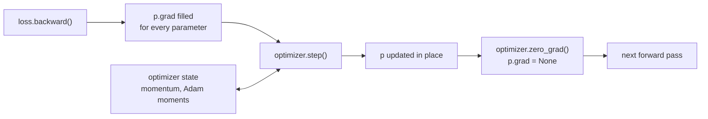

In Module 17's [optimizers](/learn/neural-network-fundamentals/optimizers) lesson you implemented SGD, momentum and Adam by hand: for each weight array you kept a velocity or moment array alongside it and wrote the update rule yourself. `torch.optim` packages those same algorithms. You hand an optimiser the model's parameters once; after each `loss.backward()` it reads every `p.grad`, updates every `p` in place, and keeps whatever per-parameter state the algorithm needs. On top of that, `torch.optim.lr_scheduler` changes the [learning rate](/learn/neural-network-fundamentals/learning-rates) over the course of training, which in practice matters as much as the choice of optimiser.

## What step() does

The optimiser holds references to the parameter tensors. `step()` loops over them and applies the update rule; `zero_grad()` clears their gradients. For plain SGD, `step()` is exactly your NumPy update:

$$
\theta \leftarrow \theta - \eta \, \nabla_\theta L
$$

where $\theta$ is a parameter, $\eta$ the learning rate and $\nabla_\theta L$ its gradient, stored in `p.grad`.

```python
import torch
from torch import nn

torch.manual_seed(0)

model = nn.Linear(3, 1)
opt = torch.optim.SGD(model.parameters(), lr=0.1)

x, y = torch.randn(8, 3), torch.randn(8, 1)
loss = nn.MSELoss()(model(x), y)
loss.backward()

expected = model.weight.detach() - 0.1 * model.weight.grad
opt.step()
print(torch.allclose(model.weight.detach(), expected))

opt.zero_grad()
print(model.weight.grad)
```

```output
True
None
```

`zero_grad()` sets gradients to `None` rather than filling them with zeros (the `set_to_none=True` default), which saves memory and a kernel launch. The next `backward()` simply creates fresh gradient tensors.



> [!WARNING]
> Create the optimiser **after** the model is built and moved to its device, and never rebuild the model afterwards. The optimiser holds references to specific tensors; if you replace the model, it keeps updating the old, unused parameters and the new model never learns.

## The main optimisers

| Optimiser | Key arguments | Notes |
| --- | --- | --- |
| `torch.optim.SGD` | `lr`, `momentum=0`, `nesterov=False`, `weight_decay=0` | With `momentum=0.9`, still a strong choice for vision models with a good schedule |
| `torch.optim.Adam` | `lr=1e-3`, `betas=(0.9, 0.999)`, `eps=1e-8`, `weight_decay=0` | Adaptive per-parameter step sizes; works well with little tuning |
| `torch.optim.AdamW` | as Adam, `weight_decay=1e-2` | Adam with decoupled weight decay; the usual default for transformers |
| `torch.optim.RMSprop` | `lr=1e-2`, `alpha=0.99` | Older adaptive method, still seen in reinforcement learning |

Each implements an update rule you have already written. For example Adam, with gradient $g_t$ at step $t$:

$$
m_t = \beta_1 m_{t-1} + (1-\beta_1) g_t, \qquad v_t = \beta_2 v_{t-1} + (1-\beta_2) g_t^2
$$

$$
\theta_t = \theta_{t-1} - \eta \, \frac{\hat{m}_t}{\sqrt{\hat{v}_t} + \epsilon}
$$

where $\hat{m}_t = m_t / (1 - \beta_1^t)$ and $\hat{v}_t = v_t / (1 - \beta_2^t)$ are the bias-corrected moment estimates. PyTorch keeps $m$ and $v$ for every parameter in `optimizer.state`:

```python
adam = torch.optim.Adam(model.parameters(), lr=1e-3)
nn.MSELoss()(model(x), y).backward()
adam.step()
state = adam.state[model.weight]
print(sorted(state.keys()))
print(state["exp_avg"].shape, state["step"])
```

```output
['exp_avg', 'exp_avg_sq', 'step']
torch.Size([1, 3]) tensor(1.)
```

That state is why Adam uses roughly three times the parameter memory (weights, $m$, $v$), and why a checkpoint for resuming training must save the optimiser as well as the model.

### Comparing them on the same problem

The moons data from [training loops](/learn/pytorch/training-loops), trained with full-batch updates for 200 steps from the same initialisation:

```python
from sklearn.datasets import make_moons

X, yc = make_moons(n_samples=500, noise=0.2, random_state=0)
X, yc = torch.tensor(X, dtype=torch.float32), torch.tensor(yc)

def run(make_opt, steps=200):
    torch.manual_seed(0)
    net = nn.Sequential(nn.Linear(2, 32), nn.Tanh(), nn.Linear(32, 2))
    opt = make_opt(net.parameters())
    for _ in range(steps):
        opt.zero_grad()
        loss = nn.functional.cross_entropy(net(X), yc)
        loss.backward()
        opt.step()
    return loss.item()

configs = {
    "SGD lr=0.1": lambda p: torch.optim.SGD(p, lr=0.1),
    "SGD lr=0.1 momentum=0.9": lambda p: torch.optim.SGD(p, lr=0.1, momentum=0.9),
    "Adam lr=1e-2": lambda p: torch.optim.Adam(p, lr=1e-2),
    "AdamW lr=1e-2 wd=1e-2": lambda p: torch.optim.AdamW(p, lr=1e-2, weight_decay=1e-2),
}
for name, make in configs.items():
    print(f"{name:26s} final loss {run(make):.4f}")
```

```output
SGD lr=0.1                 final loss 0.2901
SGD lr=0.1 momentum=0.9    final loss 0.0983
Adam lr=1e-2               final loss 0.0874
AdamW lr=1e-2 wd=1e-2      final loss 0.0882
```

Momentum and Adam reach a much lower loss than plain SGD in the same number of steps, as Module 17 predicted. Treat this as one small example, not a ranking: on other problems the order changes, and a well-tuned SGD with a schedule often generalises as well as or better than Adam.

## Weight decay and parameter groups

`weight_decay` adds L2-style shrinkage (see [regularization](/learn/neural-network-fundamentals/regularization)). In `SGD` and `Adam` it is added to the gradient; `AdamW` instead shrinks the weights directly, decoupled from the adaptive scaling, which works better with adaptive methods.

An optimiser can treat groups of parameters differently. Pass a list of dictionaries; keys you leave out take the defaults given after the list. A common use is excluding biases and normalisation weights from weight decay:

```python
net = nn.Sequential(nn.Linear(4, 8), nn.LayerNorm(8), nn.Linear(8, 2))
decay = [p for n, p in net.named_parameters() if p.ndim >= 2]      # weight matrices
no_decay = [p for n, p in net.named_parameters() if p.ndim < 2]    # biases, norm weights

opt = torch.optim.AdamW(
    [{"params": decay, "weight_decay": 0.01},
     {"params": no_decay, "weight_decay": 0.0}],
    lr=3e-4,
)
for g in opt.param_groups:
    print(len(g["params"]), g["lr"], g["weight_decay"])
```

```output
2 0.0003 0.01
4 0.0003 0.0
```

The same mechanism gives different learning rates to different layers, which you will use in [transfer learning](/learn/pytorch/transfer-learning).

## Learning-rate schedulers

A scheduler adjusts `lr` in each parameter group as training progresses. You create it from the optimiser and call `scheduler.step()` after `optimizer.step()`, usually once per epoch (or once per batch for schedules defined in steps, such as `OneCycleLR`).

```python
model = nn.Linear(2, 1)
opt = torch.optim.SGD(model.parameters(), lr=0.1)
sched = torch.optim.lr_scheduler.StepLR(opt, step_size=3, gamma=0.5)

for epoch in range(8):
    # ... train for one epoch: zero_grad, backward, opt.step() ...
    opt.step()
    print(epoch, round(sched.get_last_lr()[0], 4))
    sched.step()
```

```output
0 0.1
1 0.1
2 0.1
3 0.05
4 0.05
5 0.05
6 0.025
7 0.025
```

| Scheduler | Behaviour | Typical use |
| --- | --- | --- |
| `StepLR(step_size, gamma)` | Multiply by `gamma` every `step_size` epochs | Simple baselines |
| `MultiStepLR(milestones, gamma)` | Multiply at chosen epochs | Classic image classification recipes |
| `CosineAnnealingLR(T_max)` | Smooth cosine decay to `eta_min` over `T_max` steps | Very common default |
| `OneCycleLR(max_lr, total_steps)` | Warm up, then anneal; stepped every batch | Fast training of CNNs |
| `LinearLR` + `SequentialLR` | Linear warm-up, then another schedule | Transformers |
| `ReduceLROnPlateau(mode, factor, patience)` | Cut the rate when a metric stops improving | When you do not know the right schedule; call `step(val_loss)` |

Warm-up followed by cosine decay, the shape used for most transformer training:

```python
opt = torch.optim.AdamW(model.parameters(), lr=1e-3)
warmup = torch.optim.lr_scheduler.LinearLR(opt, start_factor=0.1, total_iters=3)
cosine = torch.optim.lr_scheduler.CosineAnnealingLR(opt, T_max=7)
sched = torch.optim.lr_scheduler.SequentialLR(opt, schedulers=[warmup, cosine], milestones=[3])

lrs = []
for step in range(10):
    opt.step()
    lrs.append(round(sched.get_last_lr()[0], 6))
    sched.step()
print(lrs)
```

```output
[0.0001, 0.0004, 0.0007, 0.001, 0.00095, 0.000812, 0.000611, 0.000389, 0.000188, 5e-05]
```

> [!TIP]
> If PyTorch warns that `lr_scheduler.step()` was called before `optimizer.step()`, your calls are in the wrong order and the first value of the schedule is skipped. The order is always: backward, optimiser step, scheduler step.

## Exercises

**1.** Using `run` from this lesson, try `SGD` with `lr` values of 0.01, 0.1 and 1.0. Which reaches the lowest loss in 200 steps?

<details>
<summary>Show solution</summary>

```python
for lr in [0.01, 0.1, 1.0]:
    print(lr, round(run(lambda p: torch.optim.SGD(p, lr=lr)), 4))
```

```output
0.01 0.3993
0.1 0.2901
1.0 0.1016
```

On this problem the largest rate wins because 200 full-batch steps is a short budget. Push the rate high enough and training becomes unstable instead.

</details>

**2.** Create an `Adam` optimiser for `nn.Sequential(nn.Linear(4, 8), nn.ReLU(), nn.Linear(8, 2))` in which the first layer uses `lr=1e-4` and the last uses `lr=1e-3`. Print each group's learning rate.

<details>
<summary>Show solution</summary>

```python
net = nn.Sequential(nn.Linear(4, 8), nn.ReLU(), nn.Linear(8, 2))
opt = torch.optim.Adam([
    {"params": net[0].parameters(), "lr": 1e-4},
    {"params": net[2].parameters()},
], lr=1e-3)
print([g["lr"] for g in opt.param_groups])
```

```output
[0.0001, 0.001]
```

The second group has no `lr` key, so it takes the default passed after the list.

</details>

**3.** Why is it important to save `optimizer.state_dict()` when checkpointing Adam, but less important for plain SGD without momentum?

<details>
<summary>Show solution</summary>

Adam keeps per-parameter moment estimates and a step count. Restarting with fresh state resets the bias correction and the running averages, causing a jolt in training. Plain SGD has no state beyond the learning rate, so there is nothing to lose, though saving it anyway is good practice.

</details>

```quiz
[
  {
    "q": "What does `optimizer.step()` use to update each parameter?",
    "options": [
      "The loss value",
      "The parameter's `.grad`, plus any state the algorithm keeps",
      "The model's forward function",
      "The learning-rate scheduler's output only"
    ],
    "answer": 1,
    "why": "Gradients must already be in `p.grad` from `backward()`; the optimiser reads them and updates in place."
  },
  {
    "q": "What is the main difference between `Adam(weight_decay=...)` and `AdamW`?",
    "options": [
      "AdamW does not use momentum",
      "AdamW only works on GPUs",
      "AdamW applies weight decay directly to the weights, decoupled from the adaptive gradient scaling",
      "There is no difference"
    ],
    "answer": 2,
    "why": "In Adam, decay added to the gradient gets rescaled by the adaptive denominator; AdamW avoids that."
  },
  {
    "q": "In what order should these calls appear in a training step?",
    "options": [
      "`loss.backward()`, `optimizer.step()`, `scheduler.step()`",
      "`scheduler.step()`, `loss.backward()`, `optimizer.step()`",
      "`optimizer.step()`, `loss.backward()`, `scheduler.step()`",
      "`loss.backward()`, `scheduler.step()`, `optimizer.step()`"
    ],
    "answer": 0,
    "why": "Gradients first, then the update, then the learning-rate adjustment for the next step."
  },
  {
    "q": "You rebuild your model after creating the optimiser. What happens during training?",
    "options": [
      "The optimiser automatically switches to the new model",
      "An error is raised immediately",
      "Training is twice as fast",
      "The optimiser keeps updating the old parameters, so the new model never changes"
    ],
    "answer": 3,
    "why": "The optimiser holds references to the original parameter tensors."
  }
]
```
