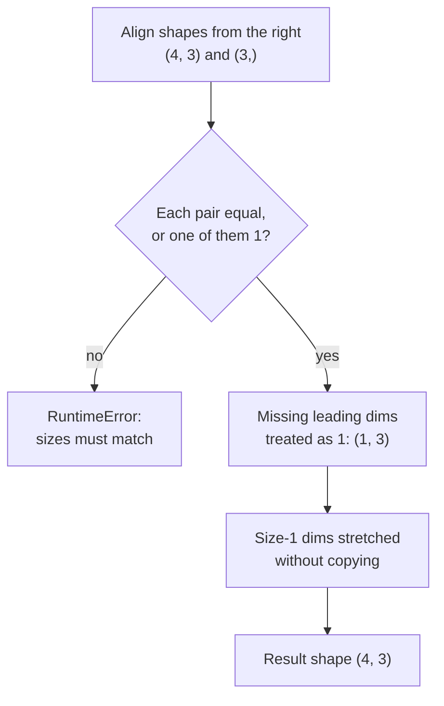

A neural network is, underneath, a long chain of tensor operations: matrix multiplications, additions that broadcast a bias across a batch, reshapes between layers, reductions that turn a batch of errors into one loss number. In Module 17 you wrote all of these with NumPy, so the ideas are familiar. This lesson shows the PyTorch spelling, highlights the handful of places where PyTorch differs from NumPy (`dim` instead of `axis`, `view` versus `reshape`, in-place operations with a trailing underscore), and builds the shape intuition you need to read real model code.

## Elementwise arithmetic and maths functions

Arithmetic operators work elementwise, exactly as with NumPy arrays, and every common maths function exists both as `torch.fn(t)` and as a method `t.fn()`.

```python
import torch

torch.manual_seed(0)

a = torch.tensor([1.0, 2.0, 3.0])
b = torch.tensor([10.0, 20.0, 30.0])

print(a + b, a * b, b / a, a ** 2)
print(torch.exp(a))
print(a.sqrt(), a.log())
print(torch.clamp(torch.tensor([-2.0, 0.5, 3.0]), min=0.0, max=1.0))
```

```output
tensor([11., 22., 33.]) tensor([10., 40., 90.]) tensor([10., 10., 10.]) tensor([1., 4., 9.])
tensor([ 2.7183,  7.3891, 20.0855])
tensor([1.0000, 1.4142, 1.7321]) tensor([0.0000, 0.6931, 1.0986])
tensor([0.0000, 0.5000, 1.0000])
```

Comparison operators return `bool` tensors that you can use as masks, which is how you implement ReLU by hand or compute accuracy:

```python
z = torch.tensor([-1.5, 0.0, 2.0, -0.3])
print(z > 0)
print(z * (z > 0))          # ReLU, the way you wrote it in NumPy
print(torch.relu(z))        # the built-in
print(torch.where(z > 0, z, 0.01 * z))   # leaky ReLU
```

```output
tensor([False, False,  True, False])
tensor([-0., 0., 2., -0.])
tensor([0., 0., 2., 0.])
tensor([-0.0150,  0.0000,  2.0000, -0.0030])
```

Multiplying by a boolean mask treats `True` as 1 and `False` as 0. The `-0.` values are negative zero from `-1.5 * 0`; they compare equal to zero and are harmless.

## Reductions and the `dim` argument

Reductions such as `sum`, `mean`, `max` and `argmax` collapse one or more dimensions. PyTorch calls the argument `dim` (NumPy calls it `axis`, and PyTorch accepts that too). The rule is the same as in NumPy: **`dim` is the dimension that disappears**.

```python
scores = torch.tensor([[0.1, 2.0, 0.3],
                       [1.5, 0.2, 0.1]])   # 2 examples, 3 classes

print(scores.sum())              # everything
print(scores.sum(dim=0))         # down the batch: one value per class
print(scores.mean(dim=1))        # across classes: one value per example
print(scores.argmax(dim=1))      # predicted class per example
print(scores.max(dim=1))         # values and indices together
print(scores.sum(dim=1, keepdim=True).shape)
```

```output
tensor(4.2000)
tensor([1.6000, 2.2000, 0.4000])
tensor([0.8000, 0.6000])
tensor([1, 0])
torch.return_types.max(
values=tensor([2.0000, 1.5000]),
indices=tensor([1, 0]))
torch.Size([2, 1])
```

`keepdim=True` keeps the reduced dimension with size 1, so the result still broadcasts against the original. That is exactly what you need for a numerically stable softmax:

```python
def softmax(x):
    shifted = x - x.max(dim=1, keepdim=True).values
    e = shifted.exp()
    return e / e.sum(dim=1, keepdim=True)

p = softmax(scores)
print(p)
print(p.sum(dim=1))
print(torch.allclose(p, torch.softmax(scores, dim=1)))
```

```output
tensor([[0.1123, 0.7506, 0.1371],
        [0.6583, 0.1794, 0.1623]])
tensor([1.0000, 1.0000])
True
```

## Matrix multiplication

The `@` operator (or `torch.matmul`) is the workhorse. A fully connected layer applied to a batch is one matrix multiplication plus a broadcast bias, the same expression as your NumPy forward pass from [forward propagation](/learn/neural-network-fundamentals/forward-propagation):

$$
Z = XW^\top + b
$$

where $X$ is the `(batch, in_features)` input, $W$ is the `(out_features, in_features)` weight matrix (PyTorch stores it in this orientation), and $b$ is the `(out_features,)` bias.

```python
X = torch.randn(4, 3)       # batch of 4, 3 features
W = torch.randn(2, 3)       # 2 outputs, 3 inputs
bias = torch.randn(2)

Z = X @ W.T + bias
print(Z.shape)
```

```output
torch.Size([4, 2])
```

`@` also handles batches: when both operands have more than two dimensions, the leading dimensions are treated as a batch and the last two are multiplied. This is how attention computes many score matrices at once.

```python
Q = torch.randn(8, 5, 16)   # 8 sequences, 5 tokens, 16-dim
K = torch.randn(8, 5, 16)
print((Q @ K.transpose(-2, -1)).shape)
```

```output
torch.Size([8, 5, 5])
```

| Operation | Use | Note |
| --- | --- | --- |
| `a * b` | Elementwise product | Not matrix multiplication |
| `a @ b`, `torch.matmul` | Matrix product, batched if 3-D or more | The one you want almost always |
| `torch.mm` | Strictly 2-D matrix product | No broadcasting |
| `torch.bmm` | Strictly 3-D batched product | Batch sizes must match |
| `torch.dot` | 1-D dot product | Both inputs 1-D |

## Broadcasting

Broadcasting follows NumPy's rules exactly; see [NumPy broadcasting](/learn/numpy/broadcasting) for the full treatment. Shapes are compared from the right, and two dimensions are compatible when they are equal or one of them is 1.



The bias addition above is a broadcast: `(4, 2) + (2,)`. Normalising each feature by its batch statistics is another:

```python
X = torch.randn(5, 3) * 10 + 4
X_norm = (X - X.mean(dim=0)) / X.std(dim=0)
print(X_norm.mean(dim=0))
print(X_norm.std(dim=0))
```

```output
tensor([ 3.5763e-08,  2.3842e-08, -4.7684e-08])
tensor([1.0000, 1.0000, 1.0000])
```

The means are zero up to `float32` rounding error (around `1e-8`), which is normal. Compare floating-point tensors with `torch.allclose`, never `==`.

> [!WARNING]
> Broadcasting can silently produce the wrong shape instead of an error. If `pred` has shape `(64, 1)` and `target` has shape `(64,)`, then `pred - target` broadcasts to `(64, 64)` and your loss is the mean of 4,096 meaningless numbers. Training still runs. Always check that predictions and targets have identical shapes before computing a loss.

```python
pred = torch.randn(4, 1)
target = torch.randn(4)
print((pred - target).shape)
print((pred.squeeze(1) - target).shape)
```

```output
torch.Size([4, 4])
torch.Size([4])
```

## Reshaping: view, reshape, permute, squeeze, unsqueeze

Moving data between layers constantly requires changing shapes without changing values.

```python
t = torch.arange(24)
print(t.view(2, 3, 4).shape)
print(t.reshape(4, -1).shape)        # -1 means "infer this one"

img = torch.randn(2, 3, 8, 8)        # (batch, channels, H, W)
print(img.flatten(start_dim=1).shape)        # flatten all but batch
print(img.permute(0, 2, 3, 1).shape)         # to channels-last

v = torch.tensor([1.0, 2.0, 3.0])
print(v.unsqueeze(0).shape, v.unsqueeze(1).shape)
print(torch.zeros(1, 3, 1).squeeze().shape)
```

```output
torch.Size([2, 3, 4])
torch.Size([4, 6])
torch.Size([2, 192])
torch.Size([2, 8, 8, 3])
torch.Size([1, 3]) torch.Size([3, 1])
torch.Size([3])
```

| Method | What it does |
| --- | --- |
| `view(shape)` | New shape over the same memory; requires a contiguous layout |
| `reshape(shape)` | Like `view` when possible, copies otherwise; the safe default |
| `permute(dims)` / `transpose(a, b)` | Reorders dimensions; returns a non-contiguous view |
| `unsqueeze(d)` / `squeeze(d)` | Adds or removes a size-1 dimension |
| `flatten(start_dim)` | Merges dimensions from `start_dim` onwards |

`permute` and `transpose` only change how memory is read, so their results are not **contiguous**, and `view` refuses them:

```python
m = torch.arange(6).reshape(2, 3)
mt = m.T
print(mt.is_contiguous())
print(mt.reshape(6))
mt.view(6)
```

```output
False
tensor([0, 3, 1, 4, 2, 5])
RuntimeError: view size is not compatible with input tensor's size and stride (at least one dimension spans across two contiguous subspaces). Use .reshape(...) instead.
```

The fix is `mt.contiguous().view(6)` or simply `reshape`.

### Joining tensors

`torch.cat` joins along an existing dimension; `torch.stack` creates a new one. Collating individual examples into a batch is a `stack`.

```python
x1, x2 = torch.ones(2, 3), torch.zeros(2, 3)
print(torch.cat([x1, x2], dim=0).shape)
print(torch.cat([x1, x2], dim=1).shape)
print(torch.stack([x1, x2]).shape)
```

```output
torch.Size([4, 3])
torch.Size([2, 6])
torch.Size([2, 2, 3])
```

## In-place operations

Methods ending in an underscore modify the tensor in place instead of returning a new one: `add_`, `mul_`, `zero_`, `clamp_`, `fill_`. Augmented assignment such as `x += 1` is also in place.

```python
x = torch.ones(3)
y = x.add(1)        # new tensor, x unchanged
print(x, y)
x.add_(1)           # x itself changes
print(x)

w = torch.ones(3)
alias = w           # same tensor, not a copy
w.mul_(0.5)
print(alias)
```

```output
tensor([1., 1., 1.]) tensor([2., 2., 2.])
tensor([2., 2., 2.])
tensor([0.5000, 0.5000, 0.5000])
```

In-place operations save memory, and PyTorch's own optimisers use them to update weights. In your own model code, prefer the out-of-place versions. Autograd needs the original values of many tensors to compute gradients, and overwriting one in place raises an error during `backward()`, as the [autograd](/learn/pytorch/autograd) lesson shows. When you do need a real copy, use `t.clone()`.

> [!KEY]
> Most PyTorch debugging is shape debugging. When something goes wrong, print `.shape`, `.dtype` and `.device` of every tensor involved before you read anything else.

## Exercises

**1.** Given `logits = torch.tensor([[2.0, 0.5, 0.1], [0.2, 0.3, 3.0], [1.0, 1.2, 0.9]])` and `labels = torch.tensor([0, 2, 0])`, compute the accuracy as a Python float in one line.

<details>
<summary>Show solution</summary>

```python
logits = torch.tensor([[2.0, 0.5, 0.1], [0.2, 0.3, 3.0], [1.0, 1.2, 0.9]])
labels = torch.tensor([0, 2, 0])
print((logits.argmax(dim=1) == labels).float().mean().item())
```

```output
0.6666666865348816
```

`argmax(dim=1)` gives `[0, 2, 1]`, which matches two of the three labels. Booleans must be cast to float before `mean`.

</details>

**2.** A batch of images has shape `(32, 28, 28)` with no channel dimension. Produce `(32, 1, 28, 28)` for a convolutional layer, then `(32, 784)` for a fully connected layer.

<details>
<summary>Show solution</summary>

```python
imgs = torch.randn(32, 28, 28)
with_channel = imgs.unsqueeze(1)
flat = with_channel.flatten(start_dim=1)
print(with_channel.shape, flat.shape)
```

```output
torch.Size([32, 1, 28, 28]) torch.Size([32, 784])
```

</details>

**3.** Without running it, give the shape of `torch.randn(5, 1, 4) + torch.randn(3, 1)`. Then check.

<details>
<summary>Show solution</summary>

Aligned from the right: `(5, 1, 4)` and `(1, 3, 1)`. Each pair has a 1 or matches, so the result is `(5, 3, 4)`.

```python
print((torch.randn(5, 1, 4) + torch.randn(3, 1)).shape)
```

```output
torch.Size([5, 3, 4])
```

</details>

```quiz
[
  {
    "q": "`scores` has shape `(64, 10)`. What is the shape of `scores.argmax(dim=1)`?",
    "options": ["`(10,)`", "`(64, 1)`", "`(64,)`", "`(1, 10)`"],
    "answer": 2,
    "why": "The dimension named by `dim` disappears, leaving one index per example."
  },
  {
    "q": "Why does `m.T.view(-1)` raise an error while `m.T.reshape(-1)` works?",
    "options": [
      "`view` only works on 1-D tensors",
      "The transpose is not contiguous, and `view` cannot reinterpret non-contiguous memory; `reshape` copies when needed",
      "`reshape` is deprecated",
      "`.T` creates a copy with a different dtype"
    ],
    "answer": 1,
    "why": "`view` never copies, so it needs a compatible memory layout. `reshape` falls back to a copy."
  },
  {
    "q": "`pred` has shape `(32, 1)` and `target` has shape `(32,)`. What does `((pred - target) ** 2).mean()` compute?",
    "options": [
      "The correct mean squared error",
      "An error is raised",
      "A mean over a `(32, 32)` broadcast matrix, which is wrong but raises no error",
      "The mean over the first column only"
    ],
    "answer": 2,
    "why": "Broadcasting turns the subtraction into a 32 by 32 matrix. Squeeze or reshape so the shapes match."
  },
  {
    "q": "What is the difference between `x.add(1)` and `x.add_(1)`?",
    "options": [
      "`add_` modifies `x` in place; `add` returns a new tensor",
      "`add_` works on the GPU only",
      "`add_` also tracks gradients",
      "There is no difference"
    ],
    "answer": 0,
    "why": "A trailing underscore marks an in-place operation in PyTorch."
  }
]
```
