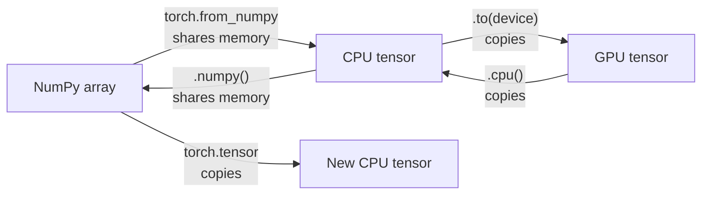

In the previous module you built neural networks from scratch with NumPy arrays: you wrote the forward pass, derived every gradient by hand and updated the weights yourself. That was the right way to learn what a network does. It is the wrong way to build one for real, because every new layer means new hand-written derivatives and NumPy cannot use a GPU. **PyTorch** removes both problems. Its central object, the **tensor**, is a NumPy-style array with two extra powers: it can live on a GPU, and it can record the operations applied to it so that gradients are computed automatically. This lesson covers the tensor itself; the rest of the module builds everything else on top of it.

## A tensor is an n-dimensional array

If you know NumPy arrays from [arrays and dimensions](/learn/numpy/arrays-and-dimensions), you already know most of what a tensor is: a block of numbers with a **shape**, a single element type (**dtype**), and fast vectorised maths.

```python
import torch

torch.manual_seed(0)

x = torch.tensor([[1.0, 2.0, 3.0],
                  [4.0, 5.0, 6.0]])
print(x)
print(x.shape)
print(x.ndim)
print(x.dtype)
print(x.device)
```

```output
tensor([[1., 2., 3.],
        [4., 5., 6.]])
torch.Size([2, 3])
2
torch.float32
cpu
```

Three attributes describe every tensor, and most PyTorch errors you will ever see are a mismatch in one of them.

| Attribute | Meaning | Typical value |
| --- | --- | --- |
| `shape` (or `size()`) | Length of each dimension | `torch.Size([32, 3, 224, 224])` for a batch of images |
| `dtype` | Element type | `torch.float32` for weights and inputs, `torch.int64` for class labels |
| `device` | Where the memory lives | `cpu`, `cuda:0` (NVIDIA GPU), `mps` (Apple silicon) |

`torch.Size` is a subclass of tuple, so you can index it (`x.shape[0]`) and unpack it (`rows, cols = x.shape`).

Deep learning code uses dimensions by convention. Recognising them at a glance saves hours of debugging:

| Data | Shape convention | Example |
| --- | --- | --- |
| Tabular batch | `(batch, features)` | `(64, 20)` |
| Image batch | `(batch, channels, height, width)` | `(32, 3, 224, 224)` |
| Token sequence batch | `(batch, sequence_length)` of integer ids | `(8, 512)` |
| Embedded sequences | `(batch, sequence_length, embedding_dim)` | `(8, 512, 768)` |

The first dimension is almost always the **batch** dimension: PyTorch layers process many examples at once, just as your NumPy forward pass multiplied a whole matrix of inputs by the weights.

## Creating tensors

You rarely type numbers in by hand. The factory functions mirror NumPy's:

```python
print(torch.zeros(2, 3))
print(torch.ones(2, 2, dtype=torch.int64))
print(torch.arange(0, 10, 3))
print(torch.linspace(0, 1, 5))
print(torch.eye(2))
print(torch.full((2, 2), 7.0))
```

```output
tensor([[0., 0., 0.],
        [0., 0., 0.]])
tensor([[1, 1],
        [1, 1]])
tensor([0, 3, 6, 9])
tensor([0.0000, 0.2500, 0.5000, 0.7500, 1.0000])
tensor([[1., 0.],
        [0., 1.]])
tensor([[7., 7.],
        [7., 7.]])
```

For random tensors, fix the seed with `torch.manual_seed` so that runs are reproducible:

```python
torch.manual_seed(42)
print(torch.rand(2, 3))      # uniform on [0, 1)
print(torch.randn(2, 3))     # standard normal
print(torch.randint(0, 10, (5,)))
```

```output
tensor([[0.8823, 0.9150, 0.3829],
        [0.9593, 0.3904, 0.6009]])
tensor([[ 1.1561,  0.3965, -2.4661],
        [ 0.3623,  0.3765, -0.1808]])
tensor([7, 6, 9, 6, 3])
```

The `*_like` variants copy the shape, dtype and device of an existing tensor, which is handy when you need a buffer that matches something else:

```python
w = torch.randn(3, 4)
print(torch.zeros_like(w).shape, torch.ones_like(w).dtype)
```

```output
torch.Size([3, 4]) torch.float32
```

## dtypes and why they matter

PyTorch defaults to **`float32`** for floating-point tensors, where NumPy defaults to `float64`. Thirty-two bits is plenty of precision for neural networks and halves the memory and bandwidth, which is the real bottleneck on a GPU. Integer literals become `int64`, which is what PyTorch expects for class labels and indices.

```python
print(torch.tensor([1, 2, 3]).dtype)
print(torch.tensor([1.0, 2.0]).dtype)
print(torch.tensor([True, False]).dtype)

a = torch.tensor([1, 2, 3])
print(a.float(), a.float().dtype)
print(a.to(torch.float16).dtype)
```

```output
torch.int64
torch.float32
torch.bool
tensor([1., 2., 3.]) torch.float32
torch.float16
```

| dtype | Bits | Used for |
| --- | --- | --- |
| `torch.float32` | 32 | Default for weights, activations, inputs |
| `torch.float16` / `torch.bfloat16` | 16 | Mixed-precision training and inference on GPUs |
| `torch.float64` | 64 | Rarely in deep learning; scientific code |
| `torch.int64` (`torch.long`) | 64 | Class labels, token ids, indices |
| `torch.bool` | 8 | Masks |

Operations between mismatched dtypes either promote or fail depending on the operation. Matrix multiplication is strict:

```python
a = torch.ones(2, 2)                      # float32
b = torch.ones(2, 2, dtype=torch.float64)
print((a + b).dtype)                      # elementwise ops promote
a @ b                                     # matmul does not
```

```output
torch.float64
RuntimeError: expected m1 and m2 to have the same dtype, but got: float != double
```

> [!WARNING]
> A classic first bug: building a tensor from a NumPy array that holds `float64` data, then feeding it to a model whose weights are `float32`. You get an error like the one above. Convert once at the boundary with `.float()` or `torch.tensor(arr, dtype=torch.float32)`.

## Tensors and NumPy

PyTorch and NumPy interoperate cheaply, but you must know when memory is shared.

```python
import numpy as np

arr = np.array([1.0, 2.0, 3.0])

shared = torch.from_numpy(arr)   # shares memory, keeps float64
copied = torch.tensor(arr)       # copies

arr[0] = 100.0
print(shared)
print(copied)

back = shared.numpy()            # also shares memory (CPU tensors only)
print(type(back), back.dtype)
```

```output
tensor([100.,   2.,   3.], dtype=torch.float64)
tensor([1., 2., 3.], dtype=torch.float64)
<class 'numpy.ndarray'> float64
```



Two rules follow from the diagram. `.numpy()` only works on CPU tensors, so results computed on a GPU need `.cpu()` first. And a tensor that is tracking gradients (the next lesson but one) must be detached first: the idiom is `t.detach().cpu().numpy()`.

To get a single Python number out of a one-element tensor, use `.item()`. You will call it on every loss value you log:

```python
loss = torch.tensor(0.6931)
print(loss.item(), type(loss.item()))
print(torch.tensor([[1, 2], [3, 4]]).tolist())
```

```output
0.6930999755859375 <class 'float'>
[[1, 2], [3, 4]]
```

The odd digits in `0.6930999755859375` are not a bug: `0.6931` cannot be stored exactly in `float32`, and `.item()` shows you the nearest representable value as a 64-bit Python float. `.tolist()` does the same for whole tensors.

## Devices: CPU and GPU

Every tensor lives on exactly one device, and an operation needs all its inputs on the same device. The standard pattern picks the best available device once, at the top of a script:

```python
device = torch.device(
    "cuda" if torch.cuda.is_available()
    else "mps" if torch.backends.mps.is_available()
    else "cpu"
)
x = torch.randn(3, 3, device=device)   # create directly on the device
y = torch.randn(3, 3).to(device)       # or move an existing tensor
```

`.to(device)` returns a **new** tensor on the target device; it does not move the original in place. Mixing devices raises an error such as *Expected all tensors to be on the same device*. The [GPU acceleration](/learn/pytorch/gpu-acceleration) lesson covers this properly.

## Indexing and slicing

Indexing follows NumPy exactly, including negative indices, slices, boolean masks and integer arrays (see [NumPy indexing and slicing](/learn/numpy/indexing-and-slicing)).

```python
t = torch.arange(12).reshape(3, 4)
print(t)
print(t[0])           # first row
print(t[:, 1])        # second column
print(t[1:, -2:])     # bottom-right block
print(t[t > 6])       # boolean mask, returns 1-D
print(t[[0, 2]])      # rows 0 and 2
```

```output
tensor([[ 0,  1,  2,  3],
        [ 4,  5,  6,  7],
        [ 8,  9, 10, 11]])
tensor([0, 1, 2, 3])
tensor([1, 5, 9])
tensor([[ 6,  7],
        [10, 11]])
tensor([ 7,  8,  9, 10, 11])
tensor([[ 0,  1,  2,  3],
        [ 8,  9, 10, 11]])
```

As in NumPy, basic slices are **views** that share memory with the original; boolean and integer-array indexing produce copies. Changing a view changes the original, which the next lesson returns to.

## Exercises

**1.** Create a tensor representing a batch of 16 RGB images of size 32 by 32 in the standard PyTorch layout, filled with standard-normal noise using seed 0. Print its shape, dtype and the total number of elements (`numel()`).

<details>
<summary>Show solution</summary>

```python
torch.manual_seed(0)
images = torch.randn(16, 3, 32, 32)
print(images.shape, images.dtype, images.numel())
```

```output
torch.Size([16, 3, 32, 32]) torch.float32 49152
```

The layout is `(batch, channels, height, width)`, and `16 * 3 * 32 * 32 = 49152`.

</details>

**2.** You load labels with `np.array([0, 2, 1])` and features with `np.random.default_rng(0).normal(size=(3, 4))`. Convert both to tensors with the dtypes a classifier expects, and print the dtypes.

<details>
<summary>Show solution</summary>

```python
rng = np.random.default_rng(0)
features = torch.tensor(rng.normal(size=(3, 4)), dtype=torch.float32)
labels = torch.tensor(np.array([0, 2, 1]), dtype=torch.long)
print(features.dtype, labels.dtype)
```

```output
torch.float32 torch.int64
```

Features must match the model's `float32` weights; class labels for `CrossEntropyLoss` must be `int64`.

</details>

**3.** Predict, then check: after `a = torch.zeros(3); b = a[1:]; b[0] = 5`, what is `a`?

<details>
<summary>Show solution</summary>

```python
a = torch.zeros(3)
b = a[1:]
b[0] = 5
print(a)
```

```output
tensor([0., 5., 0.])
```

The slice `b` is a view onto `a`'s memory, so writing through it changes `a[1]`.

</details>

```quiz
[
  {
    "q": "What is the default dtype of `torch.tensor([1.5, 2.5])`?",
    "options": ["`torch.float64`", "`torch.float16`", "`torch.float32`", "`torch.int64`"],
    "answer": 2,
    "why": "PyTorch's default floating-point dtype is float32, unlike NumPy's float64."
  },
  {
    "q": "A batch of 8 greyscale images, each 28 by 28 pixels, in the usual PyTorch layout has which shape?",
    "options": ["`(28, 28, 8)`", "`(8, 1, 28, 28)`", "`(8, 28, 28, 1)`", "`(1, 8, 28, 28)`"],
    "answer": 1,
    "why": "PyTorch uses (batch, channels, height, width); greyscale has one channel."
  },
  {
    "q": "Which conversion shares memory with the original NumPy array?",
    "options": ["`torch.from_numpy(arr)`", "`torch.tensor(arr)`", "`torch.tensor(arr).to(\"cuda\")`", "`torch.tensor(arr.tolist())`"],
    "answer": 0,
    "why": "`torch.from_numpy` wraps the same buffer; `torch.tensor` always copies."
  },
  {
    "q": "How do you get a plain Python float from a one-element loss tensor?",
    "options": ["`float32(loss)`", "`loss.numpy()`", "`loss[0]`", "`loss.item()`"],
    "answer": 3,
    "why": "`.item()` returns a Python number. `loss[0]` fails on a 0-dimensional tensor and would still return a tensor."
  }
]
```
