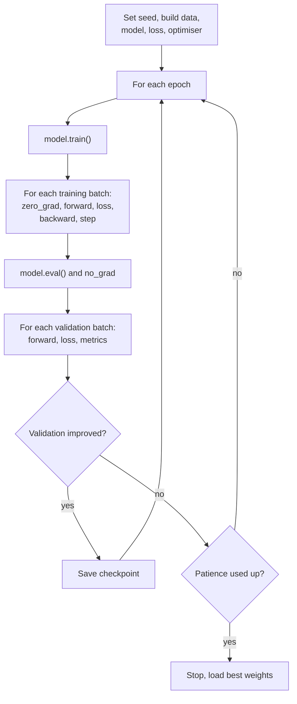

Libraries like scikit-learn hide training behind `fit()`. PyTorch deliberately does not: you write the training loop yourself. That sounds like more work, and it is a little, but it means every step is visible and changeable, which is why research code, fine-tuning scripts and large-scale training all look recognisably alike. The loop is the same one you wrote in NumPy in Module 17 (forward, loss, backward, update, repeat over [epochs](/learn/neural-network-fundamentals/epochs) and [batches](/learn/neural-network-fundamentals/batch-size)), with autograd doing the backward pass and an optimiser doing the update. This lesson builds a complete, idiomatic training and validation loop that you can reuse for almost any supervised model.

## The five lines at the heart of training

Every PyTorch training step is these five lines, in this order:

```text
optimizer.zero_grad()          # 1. clear old gradients
logits = model(xb)             # 2. forward pass
loss = loss_fn(logits, yb)     # 3. compute the loss
loss.backward()                # 4. backpropagate: fill p.grad for every parameter
optimizer.step()               # 5. update every parameter using p.grad
```

| Line | Your NumPy equivalent from Module 17 |
| --- | --- |
| `optimizer.zero_grad()` | Nothing: you overwrote gradient arrays each step. PyTorch accumulates, so you must clear them |
| `model(xb)` | Your `forward(X)` function |
| `loss_fn(logits, yb)` | Your loss function |
| `loss.backward()` | Your entire hand-written `backward()` |
| `optimizer.step()` | `W -= lr * dW` for every array |

The [autograd](/learn/pytorch/autograd) lesson explained why `zero_grad` is needed: gradients add up across `backward()` calls.

## A complete example

The data is synthetic: two interleaving half-moons from scikit-learn, split into training and validation sets, then wrapped in a `TensorDataset` and `DataLoader` (the next lesson covers those in depth).

```python
import torch
from torch import nn
from torch.utils.data import TensorDataset, DataLoader
from sklearn.datasets import make_moons

torch.manual_seed(0)

X, y = make_moons(n_samples=1000, noise=0.2, random_state=0)
X = torch.tensor(X, dtype=torch.float32)
y = torch.tensor(y, dtype=torch.long)

train_ds = TensorDataset(X[:800], y[:800])
val_ds = TensorDataset(X[800:], y[800:])
train_loader = DataLoader(train_ds, batch_size=32, shuffle=True)
val_loader = DataLoader(val_ds, batch_size=256)

model = nn.Sequential(nn.Linear(2, 32), nn.ReLU(), nn.Linear(32, 32), nn.ReLU(), nn.Linear(32, 2))
loss_fn = nn.CrossEntropyLoss()
optimizer = torch.optim.Adam(model.parameters(), lr=1e-2)
```

Now the two functions that do the work. Writing training and evaluation as separate functions keeps the main loop short and makes it hard to forget a mode switch.

```python
def train_one_epoch(model, loader, loss_fn, optimizer):
    model.train()                                  # dropout / batch norm in training mode
    total_loss, total_correct, n = 0.0, 0, 0
    for xb, yb in loader:
        optimizer.zero_grad()
        logits = model(xb)
        loss = loss_fn(logits, yb)
        loss.backward()
        optimizer.step()

        total_loss += loss.item() * len(xb)        # .item(): a float, not a graph
        total_correct += (logits.argmax(dim=1) == yb).sum().item()
        n += len(xb)
    return total_loss / n, total_correct / n


@torch.no_grad()                                   # no graph needed for evaluation
def evaluate(model, loader, loss_fn):
    model.eval()                                   # dropout off, batch norm uses running stats
    total_loss, total_correct, n = 0.0, 0, 0
    for xb, yb in loader:
        logits = model(xb)
        total_loss += loss_fn(logits, yb).item() * len(xb)
        total_correct += (logits.argmax(dim=1) == yb).sum().item()
        n += len(xb)
    return total_loss / n, total_correct / n
```

`@torch.no_grad()` works as a decorator as well as a context manager. Multiplying each batch's mean loss by its size and dividing by the total at the end gives a correct average even when the last batch is smaller.

```python
for epoch in range(1, 11):
    train_loss, train_acc = train_one_epoch(model, train_loader, loss_fn, optimizer)
    val_loss, val_acc = evaluate(model, val_loader, loss_fn)
    if epoch % 2 == 0 or epoch == 1:
        print(f"epoch {epoch:2d}  train loss {train_loss:.3f} acc {train_acc:.3f}  "
              f"val loss {val_loss:.3f} acc {val_acc:.3f}")
```

```output
epoch  1  train loss 0.372 acc 0.854  val loss 0.236 acc 0.915
epoch  2  train loss 0.215 acc 0.917  val loss 0.178 acc 0.925
epoch  4  train loss 0.114 acc 0.963  val loss 0.139 acc 0.950
epoch  6  train loss 0.091 acc 0.966  val loss 0.166 acc 0.940
epoch  8  train loss 0.091 acc 0.968  val loss 0.140 acc 0.945
epoch 10  train loss 0.080 acc 0.974  val loss 0.154 acc 0.945
```

Training loss keeps falling, but validation loss is lowest around epoch 4 and then wobbles upwards: the model has learned most of what the data can teach it and is starting to fit noise. The next section turns that observation into code.

The structure of a full run:



> [!KEY]
> Read the two curves together, as in [underfitting and overfitting](/learn/machine-learning-fundamentals/underfitting-and-overfitting). Training loss falling while validation loss rises means overfitting; both stuck high means underfitting or a bug.

## Keeping the best model and stopping early

Training longer is not always better. A common pattern tracks the best validation loss, keeps a copy of the weights that achieved it, and stops once validation has not improved for a set number of epochs (the **patience**).

```python
import copy

torch.manual_seed(0)
model = nn.Sequential(nn.Linear(2, 32), nn.ReLU(), nn.Linear(32, 32), nn.ReLU(), nn.Linear(32, 2))
optimizer = torch.optim.Adam(model.parameters(), lr=1e-2)

best_loss, best_state, patience, bad_epochs = float("inf"), None, 3, 0
for epoch in range(1, 51):
    train_one_epoch(model, train_loader, loss_fn, optimizer)
    val_loss, val_acc = evaluate(model, val_loader, loss_fn)
    if val_loss < best_loss:
        best_loss, bad_epochs = val_loss, 0
        best_state = copy.deepcopy(model.state_dict())
    else:
        bad_epochs += 1
        if bad_epochs >= patience:
            print(f"stopping at epoch {epoch}, best val loss {best_loss:.3f}")
            break

model.load_state_dict(best_state)
print(evaluate(model, val_loader, loss_fn))
```

```output
stopping at epoch 8, best val loss 0.098
(0.09799902886152267, 0.97)
```

`copy.deepcopy` matters: `model.state_dict()` returns references to the live tensors, so without a copy your "best" weights would keep changing as training continues. In real projects you save the best state to disk instead, as shown in [model saving and loading](/learn/pytorch/model-saving-and-loading).

## Two common additions

### Gradient clipping

If gradients occasionally explode, a single bad batch can wreck the weights. Clipping rescales the whole gradient vector when its norm exceeds a threshold. It goes **between** `backward()` and `step()`, the only place where the gradients exist and have not yet been used:

```text
loss.backward()
torch.nn.utils.clip_grad_norm_(model.parameters(), max_norm=1.0)
optimizer.step()
```

### Gradient accumulation

When the batch you want does not fit in memory, run several smaller batches, let their gradients accumulate, and step once. Divide each loss by the number of accumulation steps so the result is the average, not the sum:

```python
accum_steps = 4
model.train()
optimizer.zero_grad()
for i, (xb, yb) in enumerate(train_loader):
    loss = loss_fn(model(xb), yb) / accum_steps
    loss.backward()                         # gradients add up across batches
    if (i + 1) % accum_steps == 0:
        optimizer.step()                    # effective batch: 4 x 32 = 128
        optimizer.zero_grad()
```

## Bugs that do not raise errors

The worst training bugs run without complaint. These are the ones to check first when a model will not learn.

| Symptom | Likely cause |
| --- | --- |
| Loss decreases then explodes or oscillates wildly | Missing `optimizer.zero_grad()`, or learning rate too high |
| Loss never changes | `optimizer.step()` missing, the optimiser was given the wrong parameters, or the model was rebuilt after creating the optimiser |
| Validation accuracy noisy and worse than expected | Forgot `model.eval()`, so dropout is still active |
| Memory grows every batch | `total_loss += loss` instead of `loss.item()` |
| Loss is fine but accuracy stuck near chance | Softmax applied before `CrossEntropyLoss`, or labels misaligned with inputs |
| Validation much better than training | Evaluating on training data, or dropout active only in training (normal and mild) |

> [!TIP]
> Before a long run, check the loop can **overfit one small batch**: train on the same 32 examples for a hundred steps and confirm the loss approaches zero. If it cannot, the problem is in the code, not the data or model size.

## Exercises

**1.** Rewrite the training step so the loop clips gradients to a maximum norm of 0.5 and records the gradient norm before clipping (the function returns it). Print the mean norm for one epoch.

<details>
<summary>Show solution</summary>

`clip_grad_norm_` returns the total norm computed before clipping.

```python
torch.manual_seed(0)
model = nn.Sequential(nn.Linear(2, 32), nn.ReLU(), nn.Linear(32, 2))
optimizer = torch.optim.SGD(model.parameters(), lr=0.1)
norms = []
model.train()
for xb, yb in train_loader:
    optimizer.zero_grad()
    loss = loss_fn(model(xb), yb)
    loss.backward()
    norms.append(nn.utils.clip_grad_norm_(model.parameters(), max_norm=0.5).item())
    optimizer.step()
print(f"{len(norms)} steps, mean pre-clip norm {sum(norms) / len(norms):.3f}")
```

```output
25 steps, mean pre-clip norm 0.477
```

</details>

**2.** Implement the overfit-one-batch check: take the first 32 training examples, train a fresh model on them for 200 steps with Adam at `lr=1e-2`, and print the final loss.

<details>
<summary>Show solution</summary>

```python
torch.manual_seed(0)
xb, yb = X[:32], y[:32]
model = nn.Sequential(nn.Linear(2, 64), nn.ReLU(), nn.Linear(64, 64), nn.ReLU(), nn.Linear(64, 2))
optimizer = torch.optim.Adam(model.parameters(), lr=1e-2)
for step in range(200):
    optimizer.zero_grad()
    loss = loss_fn(model(xb), yb)
    loss.backward()
    optimizer.step()
print(f"final loss {loss.item():.4f}")
```

```output
final loss 0.0000
```

A loss close to zero shows the forward pass, loss, backward pass and update are all wired correctly.

</details>

**3.** A colleague's validation accuracy changes every time they run evaluation on the same trained model. Their model contains dropout. What is the likely bug?

<details>
<summary>Show solution</summary>

They did not call `model.eval()` before evaluating, so dropout is still randomly zeroing activations. Calling `model.eval()` makes evaluation deterministic; remember to call `model.train()` again before the next training epoch, which the `train_one_epoch` function above does for you.

</details>

```quiz
[
  {
    "q": "What is the correct order of a training step?",
    "options": [
      "`backward`, `zero_grad`, forward, `step`",
      "forward, `step`, `backward`, `zero_grad`",
      "`zero_grad`, forward, loss, `backward`, `step`",
      "forward, loss, `step`, `backward`"
    ],
    "answer": 2,
    "why": "Clear old gradients, compute new ones from a fresh forward pass, then update."
  },
  {
    "q": "Where must `clip_grad_norm_` be called?",
    "options": [
      "Before the forward pass",
      "Between `loss.backward()` and `optimizer.step()`",
      "After `optimizer.step()`",
      "Inside `torch.no_grad()` before `zero_grad()`"
    ],
    "answer": 1,
    "why": "Gradients only exist after backward and must be clipped before the optimiser uses them."
  },
  {
    "q": "Why is `best_state = copy.deepcopy(model.state_dict())` used instead of `best_state = model.state_dict()`?",
    "options": [
      "The state dict holds references to the live parameters, which keep changing as training continues",
      "`state_dict()` returns only the optimiser state",
      "`deepcopy` moves the tensors to the CPU",
      "It is required by `load_state_dict`"
    ],
    "answer": 0,
    "why": "Without a copy, the saved 'best' weights would silently track the current weights."
  },
  {
    "q": "With gradient accumulation over 4 batches, why is each loss divided by 4?",
    "options": [
      "To reduce memory use",
      "So that the learning rate is effectively four times larger",
      "Because `backward` can only be called on small values",
      "So the accumulated gradient equals the average over the effective batch rather than the sum"
    ],
    "answer": 3,
    "why": "Accumulation sums gradients; dividing makes it match a single large batch with a mean loss."
  }
]
```
