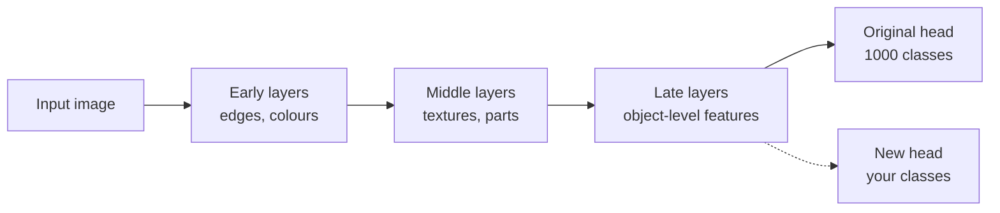
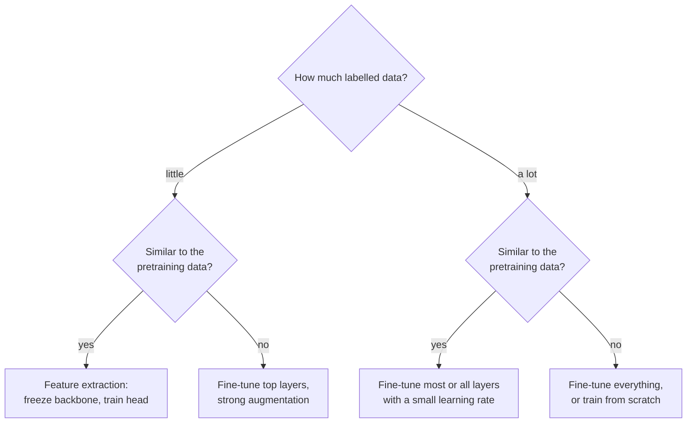

Training a large network from random weights needs a large labelled dataset and a lot of compute. Most real tasks come with neither: you might have a few thousand labelled product photos, or a few hundred medical scans. **Transfer learning** solves this by starting from a model that someone else has already trained on a huge dataset, keeping the general-purpose features it learned, and adapting only what is specific to your task. It is the default way to build image and text models in practice, and every fine-tuning workflow you will meet later (Hugging Face models, LoRA adapters for language models) is a variation of what this lesson does by hand in PyTorch: load a model, freeze some of it, replace the output layer, and train with a small learning rate.

## Why it works

A convolutional network trained on a large image dataset learns a hierarchy of features. Early layers detect edges, colours and textures, which are useful for almost any image. Middle layers combine those into parts and patterns. Only the last layers are specific to the original task's classes. The same is true of language models: lower layers capture syntax and word meaning that transfer across tasks.



So you keep the **backbone** (everything up to the final features) and replace the **head** (the final classifier layer) with a new one sized for your classes. The [Computer Vision transfer learning lesson](/learn/computer-vision/transfer-learning) discusses the vision-specific choices in more depth; here the focus is the PyTorch mechanics, which are the same for any architecture.

## Loading a torchvision model

`torchvision.models` provides standard architectures. Each builder takes a `weights` argument. With `weights=None` you get the architecture with random weights, which is what the runnable examples on this page use so that nothing needs downloading:

```python
import torch
from torch import nn
from torchvision import models

torch.manual_seed(0)

model = models.resnet18(weights=None)        # architecture only, random weights
print(model.fc)
print(sum(p.numel() for p in model.parameters()))
```

```output
Linear(in_features=512, out_features=1000, bias=True)
11689512
```

In a real project you load pretrained weights instead. The weights enum also carries the exact preprocessing the model was trained with, which you must reuse, because a pretrained model expects inputs resized and normalised the way its training data was:

```python
from torchvision.models import ResNet18_Weights

weights = ResNet18_Weights.DEFAULT                 # the best available pretrained weights
model = models.resnet18(weights=weights)           # downloads and caches the weights once
preprocess = weights.transforms()                  # matching resize, crop and normalisation
```

Inspect the top-level structure to find the head. For ResNet it is the attribute `fc`; other families name it differently, so always print the model first.

```python
for name, child in model.named_children():
    print(name, type(child).__name__)
```

```output
conv1 Conv2d
bn1 BatchNorm2d
relu ReLU
maxpool MaxPool2d
layer1 Sequential
layer2 Sequential
layer3 Sequential
layer4 Sequential
avgpool AdaptiveAvgPool2d
fc Linear
```

| Family | Head attribute | Replace with |
| --- | --- | --- |
| ResNet | `model.fc` | `nn.Linear(model.fc.in_features, n)` |
| EfficientNet, MobileNet V2/V3 | `model.classifier[-1]` | `nn.Linear(model.classifier[-1].in_features, n)` |
| Vision Transformer (`vit_b_16`) | `model.heads.head` | `nn.Linear(model.heads.head.in_features, n)` |

## Freezing the backbone and replacing the head

**Feature extraction** is the simplest form of transfer learning: freeze every pretrained parameter, so it receives no gradient and never changes, and train only a new head.

```python
num_classes = 5
model = models.resnet18(weights=None)   # for real use: weights=ResNet18_Weights.DEFAULT

for p in model.parameters():
    p.requires_grad_(False)                       # freeze everything

model.fc = nn.Linear(model.fc.in_features, num_classes)   # new head: trainable by default

trainable = [n for n, p in model.named_parameters() if p.requires_grad]
n_trainable = sum(p.numel() for p in model.parameters() if p.requires_grad)
print(trainable)
print(n_trainable)
```

```output
['fc.weight', 'fc.bias']
2565
```

The order matters: freeze first, then replace the head. A newly created layer has `requires_grad=True`, so it is the only part left trainable. Only about 2,500 of the model's 11 million parameters will train, so each step is much cheaper, and you cannot overfit a small dataset as badly.

Give the optimiser only the parameters that require gradients. Passing everything also works, because frozen parameters have no gradient and are skipped, but filtering makes the intent explicit and avoids allocating optimiser state for them:

```python
optimizer = torch.optim.Adam((p for p in model.parameters() if p.requires_grad), lr=1e-3)
loss_fn = nn.CrossEntropyLoss()
```

### Training it, and checking the freeze

A few steps on synthetic images confirm that the backbone does not move while the head does:

```python
images = torch.randn(16, 3, 64, 64)
labels = torch.randint(0, num_classes, (16,))

backbone_before = model.layer1[0].conv1.weight.clone()
head_before = model.fc.weight.clone()

model.train()
for step in range(5):
    optimizer.zero_grad()
    loss = loss_fn(model(images), labels)
    loss.backward()
    optimizer.step()
    print(step, round(loss.item(), 4))

print("backbone changed:", not torch.equal(backbone_before, model.layer1[0].conv1.weight))
print("head changed:", not torch.equal(head_before, model.fc.weight))
```

```output
0 1.6864
1 1.5077
2 1.4062
3 1.3463
4 1.3031
backbone changed: False
head changed: True
```

> [!WARNING]
> Freezing with `requires_grad_(False)` does **not** freeze batch normalisation's running statistics. In `model.train()` mode, every forward pass still updates the running mean and variance of the frozen backbone's batch norm layers, slowly shifting the pretrained features towards your small dataset. For pure feature extraction, put the frozen batch norm layers in eval mode after calling `model.train()`, as in exercise 2.

## Fine-tuning deeper layers

Feature extraction works well when your data resembles the original training data. When it differs more (medical images versus everyday photos, say) or you have more data, **fine-tuning** also updates some of the pretrained layers. The usual recipe is:

1. Train the new head with the backbone frozen for a few epochs, so that the randomly initialised head stops producing large, noisy gradients.
2. Unfreeze the top block or blocks of the backbone.
3. Continue training with a **smaller learning rate** for the pretrained layers than for the head, so that good features are adjusted gently rather than overwritten.

Parameter groups from the [optimizers](/learn/pytorch/optimizers) lesson implement step 3:

```python
for p in model.layer4.parameters():
    p.requires_grad_(True)                        # unfreeze the last residual stage

optimizer = torch.optim.AdamW([
    {"params": model.layer4.parameters(), "lr": 1e-4},   # pretrained: small steps
    {"params": model.fc.parameters(), "lr": 1e-3},       # new head: larger steps
], weight_decay=0.01)

print(sum(p.numel() for p in model.parameters() if p.requires_grad))
print([g["lr"] for g in optimizer.param_groups])
```

```output
8396293
[0.0001, 0.001]
```

Now about 8.4 million parameters train, but the pretrained ones move ten times more slowly. A scheduler with a short warm-up, as shown in the optimizers lesson, also helps protect pretrained weights early on.

> [!KEY]
> The large-scale version of this is the same idea. Fine-tuning a language model means loading pretrained weights, adding or reusing a head, and training with a learning rate far smaller than was used for pretraining. Parameter-efficient methods such as LoRA go further: they freeze the whole model and train small added matrices instead.

## Choosing a strategy



| Strategy | Trainable | Learning rate | Risk |
| --- | --- | --- | --- |
| Feature extraction | Head only | Normal, such as `1e-3` | Underfits if the domain differs |
| Partial fine-tuning | Top blocks and head | Smaller for backbone, such as `1e-4` | Moderate |
| Full fine-tuning | Everything | Small throughout, such as `1e-5` to `1e-4` | Overfitting and forgetting with little data |

These learning rates are typical starting points for Adam-style optimisers, not rules; tune them on validation data.

### A cheaper alternative: precompute features

With a frozen backbone, the backbone's output for each image never changes. You can run every image through it once, save the feature vectors, and train a small head (or even a logistic regression) on those vectors. Replacing the head with `nn.Identity()` turns the model into a feature extractor:

```python
extractor = models.resnet18(weights=None)
extractor.fc = nn.Identity()
extractor.eval()
with torch.no_grad():
    feats = extractor(torch.randn(4, 3, 64, 64))
print(feats.shape)
```

```output
torch.Size([4, 512])
```

This makes each training epoch almost free, at the cost of giving up data augmentation, since the features are computed from fixed images.

## Exercises

**1.** Load `models.resnet18(weights=None)`, replace the head for a 2-class problem, freeze everything except `layer4` and the new head, and print the number of trainable parameters.

<details>
<summary>Show solution</summary>

```python
m = models.resnet18(weights=None)
m.requires_grad_(False)                           # Module method: applies to every parameter
m.fc = nn.Linear(m.fc.in_features, 2)
m.layer4.requires_grad_(True)
print(sum(p.numel() for p in m.parameters() if p.requires_grad))
```

```output
8394754
```

`layer4` has 8,393,728 parameters and the new head $512 \times 2 + 2 = 1026$.

</details>

**2.** Write a function `set_frozen_bn_eval(model)` that, after `model.train()`, puts every `BatchNorm2d` layer whose parameters are frozen into eval mode. Verify it on the feature-extraction model from exercise 1 before unfreezing `layer4`.

<details>
<summary>Show solution</summary>

```python
def set_frozen_bn_eval(model):
    for module in model.modules():
        if isinstance(module, nn.BatchNorm2d) and not any(p.requires_grad for p in module.parameters()):
            module.eval()

m = models.resnet18(weights=None)
m.requires_grad_(False)
m.fc = nn.Linear(512, 2)
m.train()
set_frozen_bn_eval(m)
print(m.bn1.training, m.fc.training)
```

```output
False True
```

Call it at the start of every training epoch, straight after `model.train()`, because `train()` switches every submodule back to training mode.

</details>

**3.** Why is it a mistake to fine-tune all layers of a pretrained model with the same learning rate you would use to train it from scratch?

<details>
<summary>Show solution</summary>

A large learning rate makes big updates driven by the randomly initialised head's noisy early gradients, which can destroy the pretrained features in the first few hundred steps (often called catastrophic forgetting). The pretrained weights are already in a good region; small steps adjust them without throwing that away.

</details>

```quiz
[
  {
    "q": "In feature extraction, which parameters are trained?",
    "options": [
      "All parameters, with a small learning rate",
      "Only the batch norm layers",
      "Only the new head",
      "Only the first convolutional layer"
    ],
    "answer": 2,
    "why": "The pretrained backbone is frozen and only the replacement classifier learns."
  },
  {
    "q": "You run `for p in model.parameters(): p.requires_grad_(False)` and then `model.fc = nn.Linear(512, 5)`. Which parameters require gradients?",
    "options": [
      "None",
      "Only the new `fc` layer's weight and bias",
      "All parameters",
      "Everything except `fc`"
    ],
    "answer": 1,
    "why": "Newly created layers have `requires_grad=True`; the freeze applied only to parameters that existed at the time."
  },
  {
    "q": "Why use a smaller learning rate for unfrozen pretrained layers than for the new head?",
    "options": [
      "To adjust useful pretrained features gently instead of overwriting them",
      "Because pretrained layers cannot store large values",
      "Because AdamW requires it",
      "To save GPU memory"
    ],
    "answer": 0,
    "why": "The head starts random and needs large updates; the backbone starts good and needs small ones."
  },
  {
    "q": "What does `weights.transforms()` give you for a torchvision pretrained model?",
    "options": [
      "Data augmentation tuned to your dataset",
      "A function that freezes the weights",
      "The training loop used for pretraining",
      "The preprocessing (resize, crop, normalisation) the model expects"
    ],
    "answer": 3,
    "why": "Pretrained models expect inputs prepared exactly as during their training."
  }
]
```
