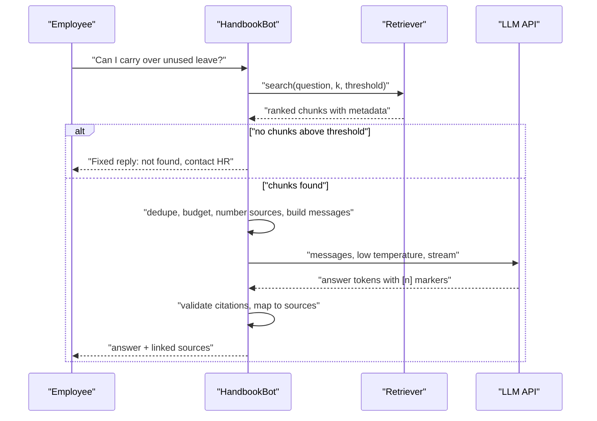

Everything so far has prepared for one call: sending the constructed prompt to an LLM and getting back an answer. This lesson completes HandbookBot's query path. You will make the model call, stream the answer to the user, turn the model's `[1]` markers into real citations, check that those citations are valid, and handle the cases where retrieval found nothing or the model declined to answer. The LLM call itself uses the same SDK patterns as [OpenAI API](/learn/working-with-llms/openai-api); what is new is the RAG-specific logic around it.

## The query path end to end



## Making the call

The messages come from `build_messages` in [Context construction](/learn/rag-fundamentals/context-construction). This code needs an API key, so it is shown without output:

```python
from openai import OpenAI

client = OpenAI()
MODEL = "your-chat-model"          # a current model name from your provider's docs

def generate(messages):
    response = client.chat.completions.create(
        model=MODEL,
        messages=messages,
        temperature=0,             # factual answers: favour the most likely tokens
        max_tokens=400,            # cap the answer length, and therefore its cost
    )
    return response.choices[0].message.content
```

A low [temperature](/learn/generative-ai-fundamentals/temperature) suits RAG: you want the answer most strongly supported by the sources, not creative variation. A low temperature makes outputs more consistent but not perfectly deterministic, and it does not by itself prevent unsupported claims; the grounding instructions and the checks below do that work.

## Streaming

A RAG answer arrives after retrieval and a model call, so perceived latency matters. **Streaming** shows tokens as they are generated, as covered in [Streaming responses](/learn/working-with-llms/streaming-responses):

```python
def generate_stream(messages):
    stream = client.chat.completions.create(
        model=MODEL, messages=messages, temperature=0, stream=True,
    )
    for chunk in stream:
        if chunk.choices and chunk.choices[0].delta.content:
            yield chunk.choices[0].delta.content

full = []
for piece in generate_stream(messages):
    print(piece, end="", flush=True)       # show it to the user immediately
    full.append(piece)
answer = "".join(full)                     # keep the whole text for citation checks
```

Two practical points. First, accumulate the full text as you stream, because citation validation needs the complete answer. Second, sources can be shown **before** the answer starts streaming, since you already know which chunks were sent; the user sees "Searching the handbook... 2 sources found" while the model is still thinking.

## From markers to citations

The model was told to cite sources as `[1]`, `[2]`. Your code turns those markers back into documents. For a runnable demonstration, the answer below is a hand-written example of the kind of text a model returns for the carry-over question; a real model's wording will differ.

```python
import re

sources = [   # the numbered chunks that were sent in the prompt
    {"n": 1, "title": "Employee Handbook", "section": "4.2 Carrying over leave", "page": 18,
     "uri": "https://intranet.example/handbook.pdf#page=18"},
    {"n": 2, "title": "Employee Handbook", "section": "4.2 Carrying over leave", "page": 18,
     "uri": "https://intranet.example/handbook.pdf#page=18"},
]

example_answer = ("Yes. You can carry over up to 5 days of unused annual leave into the "
                  "next year [1]. Carried-over days must be used by 31 March or they are lost [2].")

def cited_numbers(answer):
    return [int(n) for n in re.findall(r"\[(\d+)\]", answer)]

def check_citations(answer, sources):
    cited = cited_numbers(answer)
    valid = {s["n"] for s in sources}
    return {
        "cited": sorted(set(cited)),
        "invalid": sorted(set(cited) - valid),      # numbers that match no source
        "uncited_sources": sorted(valid - set(cited)),
        "has_citation": bool(cited),
    }

print(check_citations(example_answer, sources))
print(check_citations("You get 30 days [3].", sources))
```

```output
{'cited': [1, 2], 'invalid': [], 'uncited_sources': [], 'has_citation': True}
{'cited': [3], 'invalid': [3], 'uncited_sources': [1, 2], 'has_citation': True}
```

The second case shows a model citing a source that does not exist, a sign the answer may be invented. Each check result suggests an action:

| Check | Finding | Action |
| --- | --- | --- |
| `invalid` is non-empty | Cites a source that was not provided | Strip the marker and flag the answer, or regenerate |
| `has_citation` is false and the answer is not a refusal | Unsupported answer | Add a warning, regenerate, or fall back |
| `uncited_sources` is non-empty | Some sources were unused | Normal; useful for evaluating retrieval precision |

Finally, render the citations for the user, listing each cited source once:

```python
def render(answer, sources):
    used = {s["n"]: s for s in sources if s["n"] in cited_numbers(answer)}
    lines = [answer, "", "Sources:"]
    seen = set()
    for n in sorted(used):
        s = used[n]
        key = (s["title"], s["section"], s["page"])
        marker = f"[{n}]"
        if key in seen:
            lines.append(f"  {marker} (same as above)")
            continue
        seen.add(key)
        lines.append(f"  {marker} {s['title']}, {s['section']}, p. {s['page']}  {s['uri']}")
    return "\n".join(lines)

print(render(example_answer, sources))
```

```output
Yes. You can carry over up to 5 days of unused annual leave into the next year [1]. Carried-over days must be used by 31 March or they are lost [2].

Sources:
  [1] Employee Handbook, 4.2 Carrying over leave, p. 18  https://intranet.example/handbook.pdf#page=18
  [2] (same as above)
```

> [!TIP]
> If you need machine-readable output, ask the model for JSON with an `answer` field and a `citations` list of source numbers, using the structured-output features from [Structured outputs](/learn/working-with-llms/structured-outputs). That removes the regular expression, though you should still validate the numbers.

## Handling no results and refusals

There are two different "I don't know" paths, and the application should treat them the same way from the user's point of view:

1. **Retrieval found nothing** above the threshold. Do not call the model at all.
2. **The model declined**, replying with the exact refusal sentence from the system prompt because the sources did not answer the question.

The function below wires the whole query path together. The retriever and the model are passed in as functions, so the logic can be tested without an API key. Here they are simple stubs; in HandbookBot they are the retriever from [Retrieval mechanisms](/learn/rag-fundamentals/retrieval-mechanisms) and `generate` above.

```python
REFUSAL = "I couldn't find this in the handbook."
FALLBACK = REFUSAL + " You can ask HR directly at the HR help desk."

def answer_question(question, retrieve, llm):
    chunks = retrieve(question)
    if not chunks:
        return {"answer": FALLBACK, "sources": [], "status": "no_results"}
    numbered = [dict(c, n=i) for i, c in enumerate(chunks, start=1)]
    text = llm(question, numbered)
    if text.strip() == REFUSAL:
        return {"answer": FALLBACK, "sources": [], "status": "model_refused"}
    report = check_citations(text, numbered)
    status = "ok" if report["has_citation"] and not report["invalid"] else "needs_review"
    return {"answer": text, "sources": report["cited"], "status": status}

# Stubs for demonstration only
def stub_retrieve(q):
    return [] if "dress code" in q else [{"title": "Employee Handbook", "text": "..."}]

def stub_llm(q, numbered):
    return REFUSAL if "pension" in q else "Up to 5 days can be carried over [1]."

for q in ["What is the dress code?", "What is the pension match?", "Can I carry over leave?"]:
    print(answer_question(q, stub_retrieve, stub_llm))
```

```output
{'answer': "I couldn't find this in the handbook. You can ask HR directly at the HR help desk.", 'sources': [], 'status': 'no_results'}
{'answer': "I couldn't find this in the handbook. You can ask HR directly at the HR help desk.", 'sources': [], 'status': 'model_refused'}
{'answer': 'Up to 5 days can be carried over [1].', 'sources': [1], 'status': 'ok'}
```

The `status` field is valuable beyond the user interface. Log it for every question: a rising share of `no_results` points to gaps in the corpus (people asking about documents you have not ingested), and `needs_review` answers are the first place to look for hallucinations.

> [!KEY]
> Never let an empty or failed retrieval reach the model silently. Decide in code, give a consistent fallback, and log the outcome so coverage gaps become visible.

## Follow-up questions

In a chat interface, the user's second message is often "and what about part-timers?". Embedded on its own, that question retrieves poorly because it does not mention leave. The usual fix is to **rewrite** the follow-up into a standalone question using the conversation history ("How much annual leave do part-time employees get?") before retrieval, often with a small LLM call. The history may also be included in the generation prompt, but retrieval should run on the rewritten question. [Query transformation](/learn/advanced-rag/query-transformation) covers this in Module 30.

## Exercises

**1.** Extend `check_citations` to also report whether the answer contains any sentence with no citation at all. Test it on `"You can carry over 5 days [1]. Ask your manager first."`.

<details>
<summary>Show solution</summary>

```python
def uncited_sentences(answer):
    sentences = [s for s in re.split(r"(?<=[.!?])\s+", answer.strip()) if s]
    return [s for s in sentences if not re.search(r"\[\d+\]", s)]

print(uncited_sentences("You can carry over 5 days [1]. Ask your manager first."))
```

```output
['Ask your manager first.']
```

An uncited sentence is not necessarily wrong (it may be a connecting phrase), but in a policy assistant it deserves scrutiny: "Ask your manager first" is not in the sources and may be invented.

</details>

**2.** Add a fourth status, `"invalid_citation"`, to `answer_question` for answers that cite a source number that was not provided, and show it with a stub model that returns `"You get 30 days [4]."`.

<details>
<summary>Show solution</summary>

```python
def answer_question_v2(question, retrieve, llm):
    result = answer_question(question, retrieve, llm)
    if result["status"] == "needs_review":
        numbered = [dict(c, n=i) for i, c in enumerate(retrieve(question), start=1)]
        if check_citations(result["answer"], numbered)["invalid"]:
            result["status"] = "invalid_citation"
    return result

print(answer_question_v2("How much leave?", stub_retrieve, lambda q, n: "You get 30 days [4]."))
```

```output
{'answer': 'You get 30 days [4].', 'sources': [4], 'status': 'invalid_citation'}
```

In a cleaner design you would compute the citation report once inside `answer_question`; wrapping it here keeps the example short.

</details>

**3.** Why should sources be shown to the user even when the answer is streamed, and when should they be displayed?

<details>
<summary>Show solution</summary>

Sources let the user verify the answer and build trust. The retrieved chunks are known before generation starts, so they can be displayed immediately as "sources consulted", and then narrowed to the sources actually cited once the full answer has arrived and its citations have been validated.

</details>

```quiz
[
  {
    "q": "Why is a low temperature usually chosen for RAG answer generation?",
    "options": [
      "It makes the model read more chunks",
      "It favours the most likely, best-supported wording over creative variation",
      "It guarantees the answer is correct",
      "It reduces the number of input tokens"
    ],
    "answer": 1,
    "why": "Low temperature concentrates sampling on high-probability tokens, which suits factual answers. It does not guarantee correctness on its own."
  },
  {
    "q": "The retriever returns no chunks above the threshold. What should HandbookBot do?",
    "options": [
      "Call the LLM without sources and let it answer from its own knowledge",
      "Lower the threshold to zero and retry",
      "Return a fixed fallback reply without calling the LLM, and log the question",
      "Return the highest-scoring chunk as the answer"
    ],
    "answer": 2,
    "why": "Calling the model without sources invites ungrounded answers. A fixed fallback is consistent, cheaper and lets you track coverage gaps."
  },
  {
    "q": "A model's answer cites `[3]`, but only sources [1] and [2] were provided. What does this indicate?",
    "options": [
      "The answer may be unsupported and should be flagged or regenerated",
      "Source 3 was deduplicated",
      "Streaming lost a token",
      "The citation is correct but numbered differently"
    ],
    "answer": 0,
    "why": "A citation to a non-existent source is a warning sign of invented content and should fail validation."
  },
  {
    "q": "Why accumulate the full answer text while streaming it to the user?",
    "options": [
      "Streaming APIs require it",
      "To reduce latency",
      "To count input tokens",
      "Citation validation and logging need the complete answer"
    ],
    "answer": 3,
    "why": "Checks such as citation validity and refusal detection operate on the whole answer, which only exists once all streamed pieces are joined."
  }
]
```
