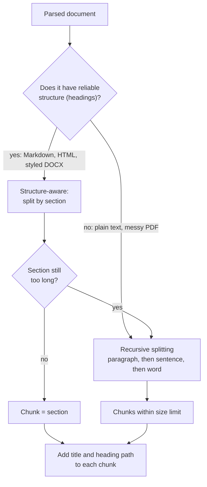
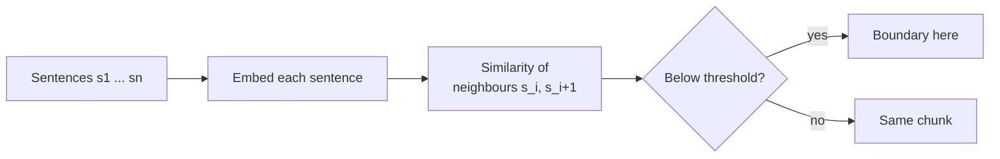

Fixed-size windows from [Text chunking](/learn/rag-fundamentals/text-chunking) produce chunks of the right length but the wrong shape: they cut sentences in half and ignore the document's own structure. Documents already tell you where the natural boundaries are, through paragraphs, sentences and headings. This lesson covers four strategies that use those boundaries, from simple to sophisticated, and shows how to choose between them for HandbookBot.

## The landscape



In practice strategies are combined, as the diagram shows: split by structure first, and fall back to recursive splitting for sections that are still too long.

| Strategy | Boundary | Strength | Weakness |
| --- | --- | --- | --- |
| Fixed-size | Every N tokens | Simple, predictable size | Cuts mid-sentence |
| Sentence / paragraph | Sentence or blank line | Chunks are readable units | Sizes vary widely |
| Recursive | Largest separator that fits | Respects structure, bounded size | Needs sensible separators |
| Structure-aware | Headings | Chunks match topics; free section metadata | Needs reliable headings |
| Semantic | Where the topic shifts | Adapts to content | Costs an embedding per sentence; harder to tune |

## Sentence and paragraph packing

The simplest improvement is to never cut inside a sentence. Split the text into sentences, then **pack** consecutive sentences into a chunk until adding the next would exceed the size limit.

```python
import re

def split_sentences(text):
    # A simple rule: a sentence ends with . ! or ? followed by whitespace.
    return [s for s in re.split(r"(?<=[.!?])\s+", text.strip()) if s]

def pack(units, max_words):
    chunks, current = [], []
    for unit in units:
        if current and len(" ".join(current + [unit]).split()) > max_words:
            chunks.append(" ".join(current))
            current = []
        current.append(unit)
    if current:
        chunks.append(" ".join(current))
    return chunks

section = (
    "Full-time employees receive 25 days of paid annual leave per year. "
    "Up to 5 days of unused leave can be carried over into the next year. "
    "Carried-over days must be used by 31 March or they are lost. "
    "Requests to carry over more than 5 days need director approval."
)
for c in pack(split_sentences(section), max_words=25):
    print(len(c.split()), c)
```

```output
11 Full-time employees receive 25 days of paid annual leave per year.
15 Up to 5 days of unused leave can be carried over into the next year.
23 Carried-over days must be used by 31 March or they are lost. Requests to carry over more than 5 days need director approval.
```

Compare this with the fixed-size output in the previous lesson: every chunk now starts and ends on a sentence boundary. The regular expression is deliberately naive and will split on "e.g. " or "Dr. "; libraries such as NLTK and spaCy (see [Tokenization](/learn/nlp-fundamentals/tokenization)) provide proper sentence segmenters.

## Recursive splitting

**Recursive splitting** generalises packing. You give it an ordered list of separators, from coarse to fine, such as paragraph break, line break, sentence end, space. It tries the coarsest separator first; any piece still too large is split again with the next separator, and so on. Small pieces are then packed back together up to the limit. The effect is that chunks break at the most meaningful boundary that keeps them within size.

This is the idea behind LangChain's popular `RecursiveCharacterTextSplitter` (configured with `chunk_size` and `chunk_overlap`). Writing a minimal version yourself makes the behaviour clear:

```python
SEPARATORS = (r"\n\n", r"\n", r"(?<=[.!?])\s+", r"\s+")   # paragraph, line, sentence, word

def recursive_split(text, max_words, separators=SEPARATORS):
    if len(text.split()) <= max_words:
        return [text.strip()]
    sep, *finer = separators
    pieces = [p for p in re.split(sep, text) if p.strip()]
    if len(pieces) == 1 and finer:            # this separator does not occur: try a finer one
        return recursive_split(text, max_words, tuple(finer))
    small = []
    for p in pieces:
        if len(p.split()) > max_words and finer:
            small.extend(recursive_split(p, max_words, tuple(finer)))
        else:
            small.append(p.strip())
    return pack(small, max_words)

policy = """Remote work

Employees may work remotely up to three days per week with their manager's agreement.

Equipment

The company provides a laptop and a monitor. Home internet costs are not reimbursed. Employees must keep company equipment secure at all times and report any loss to the IT service desk immediately."""

for c in recursive_split(policy, max_words=20):
    print(len(c.split()), repr(c[:70]))
```

```output
17 'Remote work Employees may work remotely up to three days per week with'
14 'The company provides a laptop and a monitor. Home internet costs are n'
19 'Employees must keep company equipment secure at all times and report a'
```

The paragraphs were tried first. The equipment paragraph (33 words) was over the limit, so it was split at sentence boundaries and its sentences re-packed into chunks of 14 and 19 words, all ending on full stops. The short pieces were packed together, and that exposes a weakness: the first chunk is "Remote work", its paragraph, and then the word "Equipment", which is the heading of the *next* section, now separated from the text it introduces. Recursive splitting sees a heading as just a short paragraph. Structure-aware chunking fixes this by treating headings as metadata rather than content.

## Structure-aware chunking

When a document has headings (Markdown, HTML, DOCX with heading styles, or PDF converted by a layout-aware parser as in [Document parsing](/learn/rag-fundamentals/document-parsing)), the headings are the best boundaries you will get, because the author chose them to separate topics. Split at headings and record the **heading path** for each chunk:

```python
def split_markdown(md, doc_title):
    chunks, path, lines = [], [], []

    def flush():
        body = " ".join(l.strip() for l in lines if l.strip())
        if body:
            chunks.append({"heading_path": " > ".join([doc_title] + path), "text": body})
        lines.clear()

    for line in md.splitlines():
        m = re.match(r"^(#{1,6})\s+(.*)", line)
        if m:
            flush()
            level = len(m.group(1))
            path[:] = path[:level - 1] + [m.group(2).strip()]
        else:
            lines.append(line)
    flush()
    return chunks

handbook_md = """# 4 Leave
## 4.1 Annual leave
Full-time employees receive 25 days of paid annual leave per year.
## 4.2 Carrying over leave
Up to 5 days of unused leave can be carried over into the next year.
# 5 Working arrangements
## 5.1 Remote work
Employees may work remotely up to three days per week."""

for c in split_markdown(handbook_md, "Employee Handbook"):
    print(c["heading_path"])
    print("   ", c["text"])
```

```output
Employee Handbook > 4 Leave > 4.1 Annual leave
    Full-time employees receive 25 days of paid annual leave per year.
Employee Handbook > 4 Leave > 4.2 Carrying over leave
    Up to 5 days of unused leave can be carried over into the next year.
Employee Handbook > 5 Working arrangements > 5.1 Remote work
    Employees may work remotely up to three days per week.
```

Every chunk now knows exactly where it sits in the document, which gives you citations for free. Sections longer than your limit go through `recursive_split`, and each resulting piece inherits the section's heading path.

## Contextual chunk headers

A chunk such as "Up to 5 days of unused leave can be carried over" is clear on its own, but many are not: "This applies to contractors from their second year" means nothing without its section. A cheap and effective fix is to **prepend the heading path to the text that is embedded**:

```python
def text_for_embedding(chunk):
    return f"{chunk['heading_path']}\n{chunk['text']}"

print(text_for_embedding(split_markdown(handbook_md, "Employee Handbook")[1]))
```

```output
Employee Handbook > 4 Leave > 4.2 Carrying over leave
Up to 5 days of unused leave can be carried over into the next year.
```

The embedding now carries "carrying over leave" and "Employee Handbook" even if the body text never repeats them. Store the body and the header separately so you can choose what to show the model and the user. [Contextual retrieval](/learn/advanced-rag/contextual-retrieval) in Module 30 takes this further by having an LLM write a short context sentence for each chunk.

> [!TIP]
> Prepending headings is one of the highest-value, lowest-cost improvements in a RAG pipeline. Try it before reaching for more complex techniques.

## Semantic chunking

Structure-aware chunking needs headings. For long unstructured text, such as a meeting transcript, **semantic chunking** looks for boundaries in the meaning itself:

1. Split the text into sentences.
2. Embed each sentence (you will learn how in [Embedding generation](/learn/rag-fundamentals/embedding-generation)).
3. Compute the similarity between each pair of neighbouring sentences.
4. Start a new chunk wherever similarity drops sharply, which suggests a change of topic.



Given neighbour similarities like these (illustrative values), the breakpoints are the low points:

```python
similarities = [0.81, 0.77, 0.32, 0.85, 0.79, 0.28, 0.74]   # between sentence i and i+1
threshold = 0.5
breaks = [i + 1 for i, s in enumerate(similarities) if s < threshold]
print("start new chunks before sentences:", breaks)
```

```output
start new chunks before sentences: [3, 6]
```

A common variant sets the threshold from the data, for example at a low percentile of all neighbour similarities, rather than as a fixed number. Semantic chunking is appealing but costs an embedding call per sentence at ingestion time, and its gains over good structure-aware or recursive chunking are not guaranteed: measure before adopting it. More advanced methods are covered in [Advanced chunking](/learn/advanced-rag/advanced-chunking).

> [!KEY]
> Respect the document's boundaries in this order of preference: headings, paragraphs, sentences, words. Use fixed-size cuts only as a last resort, and always attach the heading path.

## Exercises

**1.** Run `recursive_split(policy, max_words=40)` and print each chunk in full. Where does the "Equipment" heading end up, and what would a better result look like?

<details>
<summary>Show solution</summary>

```python
for c in recursive_split(policy, max_words=40):
    print(len(c.split()), c)
```

```output
17 Remote work Employees may work remotely up to three days per week with their manager's agreement. Equipment
33 The company provides a laptop and a monitor. Home internet costs are not reimbursed. Employees must keep company equipment secure at all times and report any loss to the IT service desk immediately.
```

The text is split into its four paragraphs, which `pack` then merges greedily up to 40 words. "Remote work", its paragraph and "Equipment" fit together (17 words), but adding the 33-word equipment paragraph would exceed 40, so that paragraph starts a new chunk. The heading "Equipment" is stranded at the end of the remote-work chunk, and the equipment chunk has no heading at all. A better result is two chunks, one per section, each with its heading attached as metadata: exactly what `split_markdown` produces when the headings are marked up.

</details>

**2.** Modify `split_markdown` so that sections longer than `max_words` are further split with `recursive_split`, each piece keeping the section's heading path.

<details>
<summary>Show solution</summary>

```python
def split_markdown_bounded(md, doc_title, max_words):
    out = []
    for section in split_markdown(md, doc_title):
        for piece in recursive_split(section["text"], max_words):
            out.append({"heading_path": section["heading_path"], "text": piece})
    return out

for c in split_markdown_bounded(handbook_md, "Employee Handbook", max_words=8):
    print(c["heading_path"].split(" > ")[-1], "|", c["text"])
```

```output
4.1 Annual leave | Full-time employees receive 25 days of paid annual
4.1 Annual leave | leave per year.
4.2 Carrying over leave | Up to 5 days of unused leave can
4.2 Carrying over leave | be carried over into the next year.
5.1 Remote work | Employees may work remotely up to three days
5.1 Remote work | per week.
```

With a realistic `max_words` of a few hundred, these short sections would stay whole.

</details>

**3.** HandbookBot's IT articles are Markdown, the handbook is a PDF converted to Markdown by a layout-aware parser, and the board-meeting minutes are plain transcripts with no headings. Which strategy would you use for each?

<details>
<summary>Show solution</summary>

IT articles and the converted handbook: structure-aware splitting on headings, with recursive splitting for long sections and heading paths prepended for embedding. Meeting transcripts: recursive splitting on paragraphs and sentences as a baseline, with semantic chunking as an experiment to compare against it on an evaluation set.

</details>

```quiz
[
  {
    "q": "How does recursive splitting decide where to cut?",
    "options": [
      "It always cuts every N characters",
      "It asks an LLM to choose the boundaries",
      "It tries the coarsest separator first and only uses finer ones for pieces that are still too large",
      "It cuts wherever two sentences have low embedding similarity"
    ],
    "answer": 2,
    "why": "Separators are tried from paragraph breaks down to spaces, so chunks break at the most meaningful boundary that keeps them within size."
  },
  {
    "q": "What is the main advantage of structure-aware chunking on headings?",
    "options": [
      "Chunks align with the author's topics and come with a heading path for citations",
      "All chunks are exactly the same length",
      "It needs no parsing",
      "It removes the need for embeddings"
    ],
    "answer": 0,
    "why": "Headings mark topic boundaries chosen by the author, and recording the heading path gives each chunk context and a citation."
  },
  {
    "q": "In semantic chunking, where is a new chunk started?",
    "options": [
      "After every heading",
      "Where similarity between neighbouring sentences drops sharply",
      "Every 200 tokens",
      "At the end of every page"
    ],
    "answer": 1,
    "why": "A drop in similarity between consecutive sentences suggests a topic change, which is used as a boundary."
  },
  {
    "q": "Why prepend the heading path to a chunk's text before embedding it?",
    "options": [
      "To make chunks longer so they pass a minimum size",
      "Because embedding models require a title",
      "To make the chunk unique in the index",
      "So the embedding captures context, such as the section topic, that the body text does not repeat"
    ],
    "answer": 3,
    "why": "Many chunks rely on their section for meaning. Including the heading path in the embedded text puts that context into the vector."
  }
]
```
