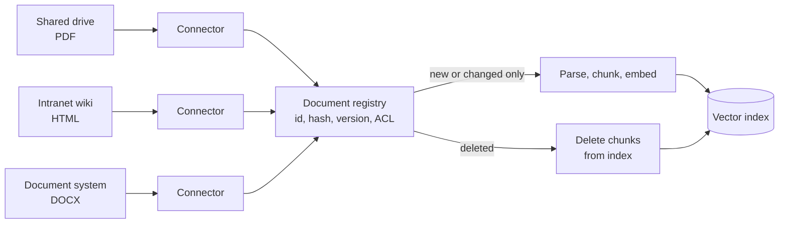
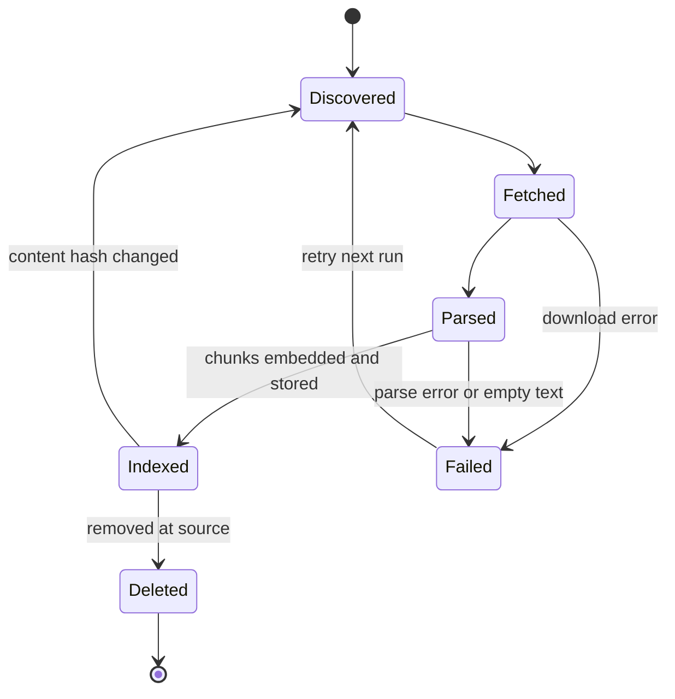

Ingestion is the first stage of the pipeline: getting documents from wherever they live into your system, and keeping that copy in step with the original as documents are added, edited and deleted. It sounds like plumbing, and it is, but it decides what your RAG system can possibly know. A policy that was never ingested cannot be retrieved, and a withdrawn policy that was never removed will be retrieved and quoted with full confidence.

This lesson covers where documents come from, what record you should keep for each one, and how to make ingestion **incremental**, so that a change to one page of the handbook does not mean reprocessing everything.

## Where HandbookBot's documents live

Real organisations scatter knowledge across many systems. For Larkspur Analytics:

| Source | Format | How you get it | Changes |
| --- | --- | --- | --- |
| Employee handbook | PDF | Shared drive or object storage (for example an S3 bucket) | A few times a year |
| HR policy pages | HTML | Intranet wiki API or a crawler | Weekly |
| Travel and expenses policy | DOCX | Document management system | Occasionally |
| IT help articles | Markdown | Git repository | Often |

Each source needs a **connector**: code that lists the available documents, fetches their bytes, and reports their metadata (identifier, last-modified time, owner, permissions). Frameworks such as LlamaIndex and LangChain ship many ready-made connectors (often called loaders or readers), covered in [Module 32](/learn/agent-frameworks/llamaindex). Whether you use one or write your own, the job is the same.



## The document record

For every document you ingest, keep a record separate from its chunks. This is your **document registry**, often a table in an ordinary SQL database (see [SQL and Databases](/learn/sql-and-databases)).

| Field | Example | Why you need it |
| --- | --- | --- |
| `doc_id` | `handbook` | Stable identifier, used to find and replace all its chunks |
| `source_uri` | `s3://larkspur-docs/hr/handbook.pdf` | Where to fetch it again, and the link shown in citations |
| `content_hash` | SHA-256 of the bytes | Detect whether the content actually changed |
| `version` / `modified_at` | `2026-09-01` | Show users how current an answer is |
| `title` | `Employee Handbook` | Displayed in citations |
| `acl` | `["all-staff"]` | Permission filtering at retrieval time |
| `status` | `indexed`, `failed` | Monitoring and retries |

Every chunk derived from the document carries `doc_id` and a copy of the fields it needs at query time (title, URI, ACL). That link from chunk back to document is what makes citations, deletions and updates possible.

> [!KEY]
> Choose a `doc_id` that stays the same when the content changes, such as the file path or the wiki page ID, not a hash of the content. The `doc_id` answers "which document is this?"; the content hash answers "has it changed?". You need both.

## Change detection with content hashes

The naive ingestion job reprocesses every document every night. That wastes compute and, more importantly, money: embedding is usually the most expensive ingestion step, and most documents do not change between runs.

The fix is to hash each document's bytes. If the hash matches the one stored in the registry, skip it. The standard library's `hashlib` is all you need:

```python
import hashlib

def content_hash(data: bytes) -> str:
    return hashlib.sha256(data).hexdigest()

print(content_hash(b"Full-time employees receive 25 days of paid annual leave.")[:16])
print(content_hash(b"Full-time employees receive 26 days of paid annual leave.")[:16])
```

```output
6884ad7ff1c269f9
034231b4e67153b8
```

A one-character change produces a completely different hash, so any edit is detected, while an untouched file always produces the same hash. Modification timestamps are a cheaper first check, but they change when a file is merely copied or re-saved, so the hash is the reliable test.

## Incremental ingestion

Comparing what the connectors report now with what the registry remembers gives three lists: new documents, changed documents and deleted documents. The function below does exactly that, using dictionaries as a stand-in for the connectors and the registry.

```python
def plan_sync(current: dict[str, bytes], registry: dict[str, str]) -> dict[str, list[str]]:
    """current: doc_id -> bytes from the sources; registry: doc_id -> stored hash."""
    plan = {"add": [], "update": [], "delete": [], "unchanged": []}
    for doc_id, data in current.items():
        h = content_hash(data)
        if doc_id not in registry:
            plan["add"].append(doc_id)
        elif registry[doc_id] != h:
            plan["update"].append(doc_id)
        else:
            plan["unchanged"].append(doc_id)
    plan["delete"] = [d for d in registry if d not in current]
    return plan

# What the registry remembers from last night's run
registry = {
    "handbook": content_hash(b"Annual leave: 25 days. Remote work: 2 days per week."),
    "expenses": content_hash(b"Submit expenses within 30 days."),
    "old-car-policy": content_hash(b"Company cars are available to directors."),
}

# What the sources contain today
current = {
    "handbook": b"Annual leave: 25 days. Remote work: 3 days per week.",   # edited
    "expenses": b"Submit expenses within 30 days.",                          # same
    "it-security": b"Passwords must be at least 14 characters.",            # new
}                                                                            # car policy withdrawn

for action, ids in plan_sync(current, registry).items():
    print(f"{action:<9} {ids}")
```

```output
add       ['it-security']
update    ['handbook']
delete    ['old-car-policy']
unchanged ['expenses']
```

Each action then maps to work on the index:

- **add**: parse, chunk, embed and insert; create the registry row.
- **update**: delete every chunk whose `doc_id` matches, then process the new version as an add. Deleting first matters: if the new version produces fewer chunks, the leftovers from the old version would otherwise linger and be retrieved.
- **delete**: remove all chunks with that `doc_id` and mark the registry row deleted. This is how the withdrawn car policy stops appearing in answers.
- **unchanged**: nothing at all.

> [!WARNING]
> Deletions are the step teams most often forget, because a connector that only looks for new files never notices one has gone. A stale chunk is worse than a missing one: the model will quote it as current policy, with a citation that makes it look authoritative.

## The lifecycle of a document

A document moves through a small set of states. Modelling them explicitly makes failures visible instead of silent.



The `Failed` state deserves attention. A scanned PDF with no text layer can parse "successfully" into an empty string; treat zero extracted characters as a failure, not as an empty document, or the handbook's scanned appendix will silently vanish from HandbookBot's knowledge.

## Practical concerns

**Idempotency.** Running the same ingestion job twice should leave the index in the same state as running it once. Using a deterministic chunk ID such as `f"{doc_id}:{chunk_number}"` and "delete then insert" per document achieves this, so a crashed job can simply be re-run.

**Near-duplicate documents.** The same PDF often exists in three folders. Identical hashes across different `doc_id`s reveal exact copies; index one and record the others as aliases, otherwise retrieval returns three copies of the same passage and crowds out other useful context.

**Scheduling.** Small corpora can be fully re-synced on a schedule (nightly is common). Large or fast-changing ones use event-driven ingestion: the source system sends a notification (a webhook, or a storage event) when a document changes, and only that document is processed. Background job tools from [FastAPI background tasks](/learn/fastapi/background-tasks) to workflow schedulers all fit here.

**Provenance and freshness.** Store `modified_at` on each chunk so answers can say "according to the handbook, last updated 1 September". Users trust answers more when they can see how current the source is.

## Exercises

**1.** Extend `plan_sync` so that it also detects exact duplicates: two different `doc_id`s in `current` with the same content hash. Return them as a list of `(kept_id, duplicate_id)` pairs under the key `"duplicates"`.

<details>
<summary>Show solution</summary>

```python
def find_duplicates(current: dict[str, bytes]) -> list[tuple[str, str]]:
    first_seen, dupes = {}, []
    for doc_id, data in current.items():
        h = content_hash(data)
        if h in first_seen:
            dupes.append((first_seen[h], doc_id))
        else:
            first_seen[h] = doc_id
    return dupes

docs = {"handbook": b"A", "hr/handbook-copy": b"A", "expenses": b"B"}
print(find_duplicates(docs))
```

```output
[('handbook', 'hr/handbook-copy')]
```

Call this before `plan_sync` and drop the duplicates from `current`.

</details>

**2.** The handbook used to produce 120 chunks. After an edit that shortened it, it produces 112. Describe what goes wrong if the update step inserts the new chunks with IDs `handbook:0` to `handbook:111` (overwriting existing ones) but does not delete anything first.

<details>
<summary>Show solution</summary>

Chunks `handbook:112` to `handbook:119` from the old version remain in the index. They contain outdated text, still carry the handbook's title and citation, and will be retrieved and quoted as current policy. Deleting all chunks for the `doc_id` before inserting the new ones avoids this.

</details>

**3.** Why is a content hash a better change signal than a file's last-modified time? Give one case where the timestamp changes but the content does not, and say what that would cost you.

<details>
<summary>Show solution</summary>

Copying, restoring from backup or re-saving a file without edits changes its modification time but not its bytes. With timestamps alone you would re-parse and re-embed an unchanged document, paying for embedding calls and churning the index for no benefit. The hash only changes when the content does.

</details>

```quiz
[
  {
    "q": "What should `doc_id` be based on?",
    "options": [
      "A hash of the document's content",
      "A stable identity such as the source path or page ID",
      "The time the document was ingested",
      "The first sentence of the document"
    ],
    "answer": 1,
    "why": "The identifier must stay the same across edits so the new version replaces the old one. The content hash is stored separately to detect changes."
  },
  {
    "q": "When a document is updated, why delete its old chunks before inserting the new ones?",
    "options": [
      "Vector indexes cannot overwrite records",
      "It makes embedding cheaper",
      "Leftover chunks from the old version would otherwise remain and be retrieved",
      "It is required for hashing to work"
    ],
    "answer": 2,
    "why": "If the new version produces fewer chunks, the extra old ones would linger as stale, citable content."
  },
  {
    "q": "A scanned PDF parses into zero characters. What should the ingestion pipeline do?",
    "options": [
      "Mark it as failed (or route it to OCR) so the gap is visible",
      "Index it as an empty document",
      "Skip it silently",
      "Delete it from the source system"
    ],
    "answer": 0,
    "why": "An empty parse almost always means a problem such as a missing text layer. Treating it as success hides missing knowledge."
  }
]
```
