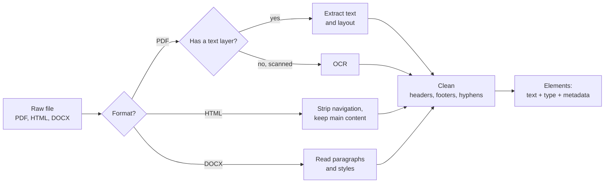

Ingestion gives you bytes. Parsing turns those bytes into clean text that a chunker can split and an embedding model can understand, together with the **metadata** that later lets you filter results and cite sources. It is the least glamorous stage of a RAG pipeline and one of the most consequential: a table flattened into a jumble of numbers, a page footer repeated a hundred times, or a scanned page that produced no text at all will damage every later stage, and no clever retrieval can recover information that parsing destroyed.

## What a parser must produce

The goal is not "all the text". It is a sequence of **elements** (headings, paragraphs, list items, tables), each with its text and metadata, in correct reading order, with the noise removed.



For HandbookBot, a good parse of one handbook paragraph looks like this:

```json
{
  "text": "Up to 5 days of unused annual leave can be carried over into the next year.",
  "type": "paragraph",
  "doc_id": "handbook",
  "title": "Employee Handbook",
  "section": "4.2 Carrying over leave",
  "page": 18,
  "source_uri": "s3://larkspur-docs/hr/handbook.pdf"
}
```

The `section` and `page` fields become the citation "[Employee Handbook, 4.2, p. 18]". If you do not capture them now, they are gone.

## PDFs: the hard case

PDF is a format for printing, not for reading text. A PDF page is essentially a list of instructions such as "draw these glyphs at these coordinates". There is no guaranteed notion of a paragraph, a reading order or a table. Parsers reconstruct those from positions, which is why PDF extraction is never perfect.

### Text layer versus scanned pages

A PDF exported from a word processor has a **text layer**: the characters are stored and can be extracted directly. A scanned PDF is just images of pages; extracting text returns nothing (or garbage), and you need **optical character recognition (OCR)**, for example the open-source Tesseract engine, to read the pixels. OCR is slower and makes errors (a common one: "l" read as "1"), so detect which case you are in and only OCR when necessary.

A simple rule: if a page yields almost no characters but the file has pages, it is probably scanned.

### Python libraries

| Library | Good at | Notes |
| --- | --- | --- |
| `pypdf` | Fast, pure-Python text extraction and document metadata | Little layout awareness; tables come out as loose text |
| `pdfplumber` | Character positions, table extraction, cropping regions | Slower; good for forms and tabular PDFs |
| `unstructured` | One `partition` call for many formats, returning typed elements (Title, NarrativeText, Table...) | Larger dependency; can call OCR for scanned pages |
| Docling | Layout-aware conversion of PDFs and office files to structured output or Markdown, including tables | Uses ML layout models; heavier but often much better structure |

The basic calls are short. With `pypdf`:

```python
from pypdf import PdfReader

reader = PdfReader("handbook.pdf")
print(reader.metadata)              # title, author, dates if the PDF has them
pages = [page.extract_text() for page in reader.pages]
```

With `pdfplumber`, which can also pull tables out as lists of rows:

```python
import pdfplumber

with pdfplumber.open("handbook.pdf") as pdf:
    for number, page in enumerate(pdf.pages, start=1):
        text = page.extract_text()
        tables = page.extract_tables()      # each table is a list of rows
```

And with Docling, converting a whole document to Markdown that keeps headings and tables:

```python
from docling.document_converter import DocumentConverter

result = DocumentConverter().convert("handbook.pdf")
markdown = result.document.export_to_markdown()
```

These need the libraries and a real file, so no output is shown. Always inspect the output of whichever tool you pick on your own documents; quality varies enormously between documents.

### Tables

Tables are where naive extraction fails worst. The leave-entitlement table in the handbook might come out of a plain text extractor as `Grade Days A 25 B 27 C 30`, which no model can reliably read back. Better options, in order of effort: extract the table with `pdfplumber` or Docling and serialise it as a Markdown table; or convert each row to a sentence ("Grade B employees receive 27 days of annual leave"). Keep each table in one chunk with its caption and column headers, since a row without its headers is meaningless.

### Headers, footers and other noise

Most handbook pages begin with "Larkspur Analytics - Employee Handbook" and end with "Confidential | Page 18 of 60". Left in, these lines appear in every chunk, make chunks look similar to each other, and occasionally get quoted as content. A robust trick is to remove lines that repeat on most pages. Text extractors also leave hyphenated line breaks ("entitle-\nment") and ragged whitespace.

```python
import re
from collections import Counter

pages = [
    "Larkspur Analytics - Employee Handbook\n4.1 Annual leave\nFull-time employees receive 25 days of paid annual leave per year.\nConfidential | Page 17",
    "Larkspur Analytics - Employee Handbook\n4.2 Carrying over leave\nUp to 5 days of unused annual leave can be carried over into the next year. Requests need man-\nager approval.\nConfidential | Page 18",
    "Larkspur Analytics - Employee Handbook\n5.1 Remote work\nYou may work remotely up to three days per week.\nConfidential | Page 19",
]

def normalise(line):
    return re.sub(r"\d+", "N", line.strip())    # 'Page 17' and 'Page 18' both become 'Page N'

def strip_repeated_lines(pages, threshold=0.6):
    counts = Counter(normalise(l) for p in pages for l in set(p.splitlines()))
    noisy = {l for l, n in counts.items() if n / len(pages) >= threshold}
    return ["\n".join(l for l in p.splitlines() if normalise(l) not in noisy) for p in pages]

def clean(text):
    text = re.sub(r"(\w)-\n(\w)", r"\1\2", text)     # join hyphenated line breaks
    text = re.sub(r"[ \t]+", " ", text)
    return text.strip()

for i, page in enumerate(strip_repeated_lines(pages), start=17):
    print(f"--- page {i} ---")
    print(clean(page))
```

```output
--- page 17 ---
4.1 Annual leave
Full-time employees receive 25 days of paid annual leave per year.
--- page 18 ---
4.2 Carrying over leave
Up to 5 days of unused annual leave can be carried over into the next year. Requests need manager approval.
--- page 19 ---
5.1 Remote work
You may work remotely up to three days per week.
```

Normalising digits before counting is the key detail: the page-number footer differs on every page, but "Confidential | Page N" is identical. The threshold matters too; set it too low on a short document and you will strip genuine repeated content.

## HTML

Web pages are easier because the structure is explicit in the tags, but most of a page is not content: navigation menus, cookie banners, sidebars, footers. The usual approach is to keep the main content element (often `main` or `article`) and drop `nav`, `header`, `footer`, `script` and `style`. Libraries such as BeautifulSoup make this a few lines, and dedicated extractors such as trafilatura automate boilerplate removal. Crucially, keep the headings: `h1` to `h3` tell you which section each paragraph belongs to, which you will use for chunking and citation.

## DOCX

Word documents store paragraphs with **styles**. With the `python-docx` library, each paragraph exposes its text and style name, so headings are easy to detect when authors used the built-in heading styles:

```python
import docx

document = docx.Document("travel-policy.docx")
for para in document.paragraphs:
    if para.style.name.startswith("Heading"):
        print("SECTION:", para.text)
```

The catch is authors who make headings by setting bold, larger text instead of using a heading style. Then you must fall back on heuristics or a layout-aware tool, or convert the file to Markdown or PDF and parse that.

## Capturing metadata

Collect metadata at parse time, because it is far harder to reconstruct later:

| Metadata | Source | Used for |
| --- | --- | --- |
| Title, author, dates | File properties, registry | Citations, freshness |
| Section heading path | Headings seen before this text | Citations, chunk context, structure-aware chunking |
| Page number | PDF page index | Citations ("p. 18") |
| Element type | Parser (table, list, paragraph) | Keeping tables whole |
| Language | Detector or source | Choosing an embedding model |
| Access groups | Registry | Permission filtering |

> [!TIP]
> Keep the parsed output on disk (for example as JSON lines) in addition to the index. When you later change chunking or the embedding model, you can rebuild from parsed text without re-running slow OCR or layout models.

> [!WARNING]
> Spot-check parsed output by eye before indexing anything. Print a few pages from each document type, especially ones with tables, columns and scans. Ten minutes of reading parsed text catches problems that would take days to diagnose from wrong answers.

## Exercises

**1.** A two-column PDF is extracted line by line across the whole page width, so the output interleaves sentences from the left and right columns. Which kind of tool from the table would you reach for, and why?

<details>
<summary>Show solution</summary>

A layout-aware tool such as Docling (or `unstructured` with a layout-detecting strategy) that detects text blocks and their reading order before extracting. Position-only extraction joins text by vertical position, which merges the columns; layout analysis treats each column as a separate block.

</details>

**2.** Write a function `looks_scanned(page_texts, min_chars=50)` that returns `True` if more than half of the pages contain fewer than `min_chars` non-whitespace characters. Test it on `["", "  ", "Real text " * 20]`.

<details>
<summary>Show solution</summary>

```python
def looks_scanned(page_texts, min_chars=50):
    sparse = sum(1 for t in page_texts if len("".join(t.split())) < min_chars)
    return sparse > len(page_texts) / 2

print(looks_scanned(["", "  ", "Real text " * 20]))
print(looks_scanned(["Real text " * 20, "Real text " * 20]))
```

```output
True
False
```

</details>

**3.** The leave table extracts as `Grade Days A 25 B 27 C 30`. Write Python that turns the rows `[["Grade", "Days"], ["A", "25"], ["B", "27"], ["C", "30"]]` (as `pdfplumber` would return them) into a Markdown table string.

<details>
<summary>Show solution</summary>

```python
rows = [["Grade", "Days"], ["A", "25"], ["B", "27"], ["C", "30"]]
header, *body = rows
lines = ["| " + " | ".join(header) + " |", "|" + " --- |" * len(header)]
lines += ["| " + " | ".join(r) + " |" for r in body]
print("\n".join(lines))
```

```output
| Grade | Days |
| --- | --- |
| A | 25 |
| B | 27 |
| C | 30 |
```

</details>

```quiz
[
  {
    "q": "Text extraction from a PDF returns empty strings for every page. What is the most likely cause?",
    "options": [
      "The PDF is encrypted with a password",
      "The PDF is scanned images with no text layer, so it needs OCR",
      "The PDF uses a non-English language",
      "The pages are too long"
    ],
    "answer": 1,
    "why": "Scanned PDFs contain only images of pages. Text extraction finds no characters; OCR is needed to read them."
  },
  {
    "q": "Why replace digits with a placeholder before counting repeated lines across pages?",
    "options": [
      "To make the text shorter",
      "Because embedding models cannot read numbers",
      "So footers like 'Page 17' and 'Page 18' are recognised as the same repeated line",
      "To remove all numbers from the document"
    ],
    "answer": 2,
    "why": "Page numbers change on every page, so without normalisation the footer never looks repeated."
  },
  {
    "q": "What is the best way to handle a table in a RAG pipeline?",
    "options": [
      "Keep it whole, with its headers, serialised as Markdown or as one sentence per row",
      "Drop it, because models cannot read tables",
      "Split it into one chunk per cell",
      "Keep only the first row"
    ],
    "answer": 0,
    "why": "A table's meaning depends on its headers and rows together. Markdown or row sentences preserve that structure in text form."
  },
  {
    "q": "Which piece of metadata is needed to produce a citation like '[Employee Handbook, 4.2, p. 18]'?",
    "options": [
      "The file size",
      "The embedding model name",
      "The chunk's vector",
      "The section heading and page number captured during parsing"
    ],
    "answer": 3,
    "why": "Section and page must be recorded while parsing, because the chunk text alone does not contain them."
  }
]
```
