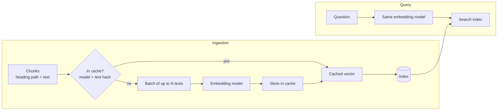
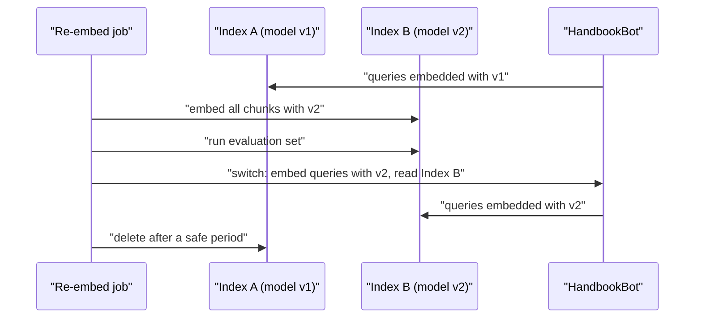

HandbookBot now has clean, well-shaped chunks. To search them by meaning rather than by exact words, each chunk must become a vector: an **embedding**. You met embeddings as a concept in [Embeddings](/learn/generative-ai-fundamentals/embeddings) and their ancestors in [Word embeddings](/learn/nlp-fundamentals/word-embeddings). This lesson is about the engineering: calling an embedding model on thousands of chunks efficiently, choosing which model to use, avoiding paying twice for the same work, and what to do when you change models.

## What an embedding model does in RAG

A text embedding model maps a piece of text to a fixed-length vector of floating-point numbers, typically a few hundred to a few thousand dimensions. It is trained so that texts with similar meaning land close together. In RAG you use it twice:

- at **ingestion**, once per chunk, storing the vectors in the index;
- at **query time**, once per question, to find the nearest chunk vectors.



The models used for retrieval are usually **bi-encoders**: the question and the chunk are embedded independently, so chunk vectors can be computed once in advance and only the question is embedded at query time. (A **cross-encoder** reads the question and chunk together and scores them jointly; it is more accurate but cannot be precomputed, so it is used for reranking a shortlist. See [Reranking](/learn/vector-databases/reranking).)

## Calling an embedding model

Two common routes are a local open-source model and a hosted API. With the `sentence-transformers` library, which runs models from the [Hugging Face Hub](/learn/hugging-face-ecosystem/model-hub) on your own machine:

```python
from sentence_transformers import SentenceTransformer

model = SentenceTransformer("all-MiniLM-L6-v2")      # a small, widely used English model
texts = ["Up to 5 days of unused leave can be carried over.",
         "Report a lost laptop to the IT service desk."]
vectors = model.encode(texts, batch_size=32, normalize_embeddings=True)
print(vectors.shape)          # (2, 384) for this model
```

With a hosted API, here the OpenAI SDK from [OpenAI API](/learn/working-with-llms/openai-api), the request takes a list of inputs and returns one embedding per input, in order:

```python
from openai import OpenAI

client = OpenAI()
response = client.embeddings.create(
    model="your-embedding-model",       # take a current name from the provider's docs
    input=texts,
)
vectors = [item.embedding for item in response.data]
```

Neither block runs here (they need the library and model download, or an API key), so no output is shown. The shape of the work is the same either way: a list of strings in, a list of equal-length vectors out.

> [!WARNING]
> Some embedding models expect a different **prefix** or instruction for queries and for documents. The E5 family, for example, is trained with inputs beginning `query: ` and `passage: `. Using the wrong format, or none, silently lowers retrieval quality. Always read the model card.

## Choosing a model

Public leaderboards such as MTEB (the Massive Text Embedding Benchmark) rank models across many retrieval and similarity tasks and are a good place to build a shortlist. They are not a substitute for testing on your own data: a model at the top of a general benchmark may not be best for HR policy in British English. Weigh these criteria:

| Criterion | Question to ask | Why it matters |
| --- | --- | --- |
| Retrieval quality on your data | What is recall@k on my evaluation set? | The only number that really counts |
| Language and domain | Does it handle my languages, jargon and code? | Models trained mostly on English web text struggle elsewhere |
| Maximum input length | How many tokens per input before truncation? | Must exceed your chunk size plus heading |
| Dimension | How many numbers per vector? | Storage, memory and search speed scale with it |
| Hosting | API or self-hosted? | Data privacy, cost model, latency, operational effort |
| Cost and throughput | Price per token or GPU time per million chunks? | Ingestion of large corpora and re-embedding |
| Stability | Will this exact model stay available? | Changing models means re-embedding everything |

The dimension's effect on storage is easy to compute: a float32 is 4 bytes, so $n$ vectors of dimension $d$ need $4nd$ bytes before any index overhead.

```python
def storage_mb(n_chunks, dim, bytes_per_value=4):
    return n_chunks * dim * bytes_per_value / 1e6

for dim in (384, 768, 1536, 3072):
    print(f"dim {dim:>4}: {storage_mb(100_000, dim):8.1f} MB for 100,000 chunks")
```

```output
dim  384:    153.6 MB for 100,000 chunks
dim  768:    307.2 MB for 100,000 chunks
dim 1536:    614.4 MB for 100,000 chunks
dim 3072:   1228.8 MB for 100,000 chunks
```

For HandbookBot's few thousand chunks, any of these is trivial. For a hundred million chunks, dimension becomes a hardware decision, which is one reason vector databases offer compression ([Module 29](/learn/vector-databases/vector-indexing)).

## Batching

Embedding one chunk per call wastes time on network round trips or under-uses the GPU. Send chunks in **batches**. APIs cap the number of inputs and total tokens per request, and local models have a memory limit per batch, so batch size is a tuning knob, not "as large as possible".

The code below uses a stand-in embedder, so it runs anywhere and you can count calls. It produces deterministic pseudo-vectors from a hash of the text; the numbers mean nothing, but the batching logic is exactly what you would wrap around a real model.

```python
import hashlib
import numpy as np

class FakeEmbedder:
    """Stand-in for a real model: deterministic vectors, counts calls."""
    name = "fake-embed-v1"
    dim = 4

    def __init__(self):
        self.calls = 0

    def embed(self, texts: list[str]) -> np.ndarray:
        self.calls += 1
        rows = []
        for t in texts:
            seed = int(hashlib.sha256(t.encode()).hexdigest()[:8], 16)
            v = np.random.default_rng(seed).normal(size=self.dim)
            rows.append(v / np.linalg.norm(v))
        return np.array(rows)

def embed_in_batches(embedder, texts, batch_size):
    out = []
    for start in range(0, len(texts), batch_size):
        out.append(embedder.embed(texts[start:start + batch_size]))
    return np.vstack(out)

chunks = [f"chunk number {i}" for i in range(250)]
embedder = FakeEmbedder()
vectors = embed_in_batches(embedder, chunks, batch_size=64)
print(vectors.shape, "in", embedder.calls, "calls")
```

```output
(250, 4) in 4 calls
```

250 chunks in batches of 64 needs $\lceil 250/64 \rceil = 4$ calls instead of 250. In production you would also add retries with exponential backoff for rate-limit errors, and sort texts by length before batching for local models, which reduces wasted padding.

## Caching

Re-ingesting a document whose content has not changed should cost nothing. The content-hash check from [Document ingestion](/learn/rag-fundamentals/document-ingestion) skips unchanged documents, but a finer-grained **embedding cache** also saves money when a document changes only slightly: most of its chunks are identical to last time.

The cache key must include **the model name** as well as the text, because the same text has a different vector under every model.

```python
class CachedEmbedder:
    def __init__(self, embedder):
        self.embedder = embedder
        self.cache = {}                      # in production: a database table or key-value store

    def key(self, text):
        return (self.embedder.name, hashlib.sha256(text.encode()).hexdigest())

    def embed(self, texts, batch_size=64):
        missing = [t for t in dict.fromkeys(texts) if self.key(t) not in self.cache]
        if missing:
            new = embed_in_batches(self.embedder, missing, batch_size)
            for t, v in zip(missing, new):
                self.cache[self.key(t)] = v
        return np.array([self.cache[self.key(t)] for t in texts])

cached = CachedEmbedder(FakeEmbedder())
v1 = cached.embed(chunks)                                  # first ingestion
edited = chunks[:240] + [f"edited chunk {i}" for i in range(10)]
v2 = cached.embed(edited)                                  # 10 chunks changed
print("model calls:", cached.embedder.calls, "| cached vectors:", len(cached.cache))
print("unchanged chunk has identical vector:", np.array_equal(v1[0], v2[0]))
```

```output
model calls: 5 | cached vectors: 260
unchanged chunk has identical vector: True
```

The second run embedded only the 10 new texts, in one extra call. `dict.fromkeys` also removes duplicate texts within a batch, which are common: boilerplate paragraphs repeat across many documents.

## When the model changes: re-embedding

Sooner or later you will switch embedding models, because a better one appears, a hosted model is retired, or you move from an API to self-hosting. Vectors from different models are **not comparable**, so every chunk must be re-embedded, and you cannot mix old and new vectors in one index.

Plan for this from the start:

1. Store the model name (and version) alongside every vector, and on the index itself.
2. Keep the parsed, chunked text, so re-embedding does not require re-parsing.
3. Build the new index alongside the old one, run your evaluation set against both, then switch queries over in one step. This is the blue-green pattern familiar from deployment.



> [!KEY]
> The query embedder and the index must always use the same model. Make that impossible to get wrong in code: read the model name from the index's own metadata rather than from a separate setting.

## Exercises

**1.** Your corpus has 2 million chunks and you are choosing between a 768-dimensional and a 3072-dimensional model. Using `storage_mb`, how much raw vector storage does each need?

<details>
<summary>Show solution</summary>

```python
print(storage_mb(2_000_000, 768), storage_mb(2_000_000, 3072))
```

```output
6144.0 24576.0
```

About 6 GB versus about 25 GB of float32 vectors, before index overhead. The larger model must earn that fourfold cost with measurably better retrieval on your evaluation set.

</details>

**2.** In `CachedEmbedder`, what would go wrong if the key were only the text hash, and you later switched `FakeEmbedder` for a real model?

<details>
<summary>Show solution</summary>

The cache would return old-model vectors for every text it had seen, mixed with new-model vectors for new texts. Similarity between a new-model query vector and old-model chunk vectors is meaningless, so retrieval would degrade silently with no error. Including the model name in the key makes the switch a clean cache miss.

</details>

**3.** Run `cached.embed(chunks + chunks)` on a fresh `CachedEmbedder`. How many model calls are made, and why?

<details>
<summary>Show solution</summary>

```python
fresh = CachedEmbedder(FakeEmbedder())
out = fresh.embed(chunks + chunks)
print(out.shape, fresh.embedder.calls)
```

```output
(500, 4) 4
```

Four calls: `dict.fromkeys` removes the duplicates, leaving 250 unique texts in batches of 64. The output still has 500 rows, one per input, in order.

</details>

```quiz
[
  {
    "q": "Why must the cache key for an embedding include the model name?",
    "options": [
      "Model names are shorter than text hashes",
      "The same text has a different vector under each model, and vectors from different models are not comparable",
      "APIs require it",
      "It makes the cache smaller"
    ],
    "answer": 1,
    "why": "Without the model name, a model switch would silently serve stale vectors from the old model's space."
  },
  {
    "q": "Why are bi-encoders used for the main retrieval step rather than cross-encoders?",
    "options": [
      "Bi-encoders are always more accurate",
      "Cross-encoders cannot process questions",
      "Bi-encoders embed chunks independently, so chunk vectors can be precomputed once",
      "Cross-encoders produce vectors that are too large"
    ],
    "answer": 2,
    "why": "Precomputing chunk vectors means only the question is embedded at query time. Cross-encoders score each pair jointly, which is too slow for a whole corpus."
  },
  {
    "q": "You switch HandbookBot to a new embedding model. What must happen?",
    "options": [
      "Re-embed every chunk with the new model and query with the same model",
      "Only embed new documents with the new model",
      "Nothing, as long as both models have the same dimension",
      "Fine-tune the LLM on the new vectors"
    ],
    "answer": 0,
    "why": "Vectors from different models live in different spaces, even if their dimensions match. The whole index must be rebuilt with the new model."
  },
  {
    "q": "How much raw float32 storage do 1,000,000 vectors of dimension 1,000 need?",
    "options": [
      "1 MB",
      "1 GB",
      "4 MB",
      "4 GB"
    ],
    "answer": 3,
    "why": "4 bytes x 1,000,000 x 1,000 = 4,000,000,000 bytes, about 4 GB."
  }
]
```
