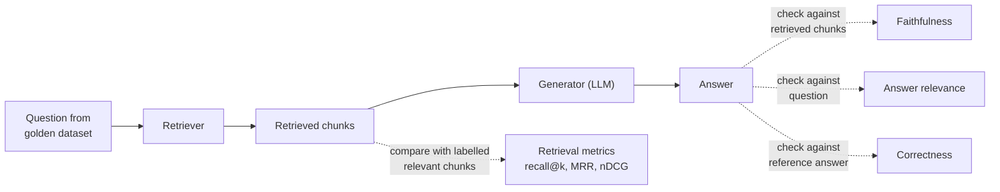
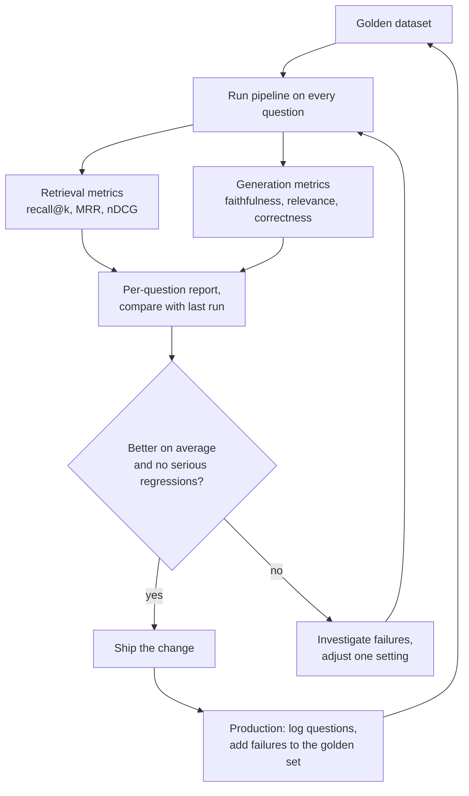

Every lesson in this module has ended with "measure it": the chunk size, the embedding model, k, the threshold, the MMR setting, the prompt wording. This lesson provides the measuring instruments. Without them, RAG development is guesswork: you change the chunker, try three questions, the answers look a bit better, and you ship a change that quietly broke twenty other questions. With them, every change becomes an experiment with a number attached.

RAG evaluation splits naturally along the pipeline. **Retrieval metrics** ask whether the right chunks were found. **Generation metrics** ask whether the answer used them faithfully and actually addressed the question. You need both, because they fail independently. General LLM evaluation was introduced in [Model evaluation](/learn/working-with-llms/model-evaluation) and prompt testing in [Prompt testing and evaluation](/learn/prompt-engineering/prompt-testing-and-evaluation); this lesson applies those ideas to RAG.

## What to measure, and where



## The golden dataset

Everything starts with a **golden dataset**: a set of realistic questions, each labelled with the chunks that answer it and, ideally, a reference answer. For HandbookBot, a row looks like this:

```json
{
  "question": "Can I carry over unused annual leave?",
  "relevant": {"leave-02": 2, "wiki-leave": 2, "leave-03": 1},
  "reference_answer": "Yes, up to 5 days, which must be used by 31 March."
}
```

The numbers are **graded relevance**: 2 means the chunk answers the question, 1 means it is useful supporting context. How to build a good set:

- **Use real questions** where possible: search logs, support tickets, questions people asked HR. Invented questions tend to reuse the documents' own wording, which flatters lexical retrieval.
- **Cover the space**: common questions, rare ones, questions needing two chunks, and questions the corpus **cannot** answer (to test refusals).
- **Start small and grow.** Fifty well-labelled questions beat a thousand sloppy ones. Add every real failure you find in production as a new row, so it can never silently return.
- **LLM-generated questions** (ask a model to write questions answerable from a chunk) are a quick way to bootstrap, but review them by hand.

> [!KEY]
> The golden dataset is the most valuable artefact in a RAG project. Models, chunkers and vector databases will all be replaced; a good evaluation set lets you replace them with confidence.

## Retrieval metrics

Let $R$ be the set of relevant chunks for a question and $T_k$ the top $k$ retrieved chunks.

**Recall@k**: the fraction of relevant chunks that appear in the top $k$. This is usually the most important retrieval metric for RAG, because a chunk that is not retrieved cannot be used.

$$
\text{recall@}k = \frac{|R \cap T_k|}{|R|}
$$

**Hit rate@k** is a coarser version: 1 if at least one relevant chunk is in the top $k$, else 0.

**Precision@k**: the fraction of the top $k$ that is relevant, $|R \cap T_k| / k$. Low precision means the prompt carries noise.

**Mean reciprocal rank (MRR)** looks at where the *first* relevant chunk appears. If it is at rank $r$, the reciprocal rank is $1/r$ (0 if none is retrieved), and MRR averages this over all questions. It rewards putting a good chunk at the very top.

**nDCG@k** (normalised discounted cumulative gain) uses the graded labels and rewards placing the *most* relevant chunks highest. Each retrieved chunk at rank $i$ contributes its relevance $\text{rel}_i$, discounted by its position:

$$
\text{DCG@}k = \sum_{i=1}^{k} \frac{\text{rel}_i}{\log_2(i + 1)}, \qquad \text{nDCG@}k = \frac{\text{DCG@}k}{\text{IDCG@}k}
$$

where IDCG@k is the DCG of the ideal ordering (all relevant chunks sorted by relevance, best first), so nDCG lies between 0 and 1.

| Metric | Answers the question | Uses grades? | Sensitive to order? |
| --- | --- | --- | --- |
| Recall@k | Did we find what was needed? | No | Only via the cut-off k |
| Precision@k | How much of what we sent is useful? | No | Only via k |
| MRR | How high is the first good chunk? | No | Yes |
| nDCG@k | Are the best chunks at the top? | Yes | Yes |

## Computing them on HandbookBot

The retriever is the TF-IDF stand-in from [Retrieval mechanisms](/learn/rag-fundamentals/retrieval-mechanisms), used **in place of neural embeddings** so the numbers are real and reproducible. The golden set has eight questions.

```python
import numpy as np
from sklearn.feature_extraction.text import TfidfVectorizer

corpus = {
    "leave-01": "Full-time employees receive 25 days of paid annual leave per year, plus public holidays.",
    "leave-02": "Up to 5 days of unused annual leave can be carried over into the next year.",
    "leave-03": "Carried-over leave must be used by 31 March or it is lost.",
    "parental-01": "Primary carers receive 26 weeks of paid parental leave.",
    "sick-01": "If you are ill, tell your manager before 10am on the first day of absence.",
    "remote-01": "Employees may work remotely up to three days per week with their manager's agreement.",
    "exp-01": "Submit expenses within 30 days of purchase through the expenses portal, with a receipt.",
    "exp-02": "Economy class flights are reimbursed; business class travel needs director approval.",
    "it-01": "Report a lost or stolen laptop to the IT service desk immediately so it can be locked remotely.",
    "it-02": "Passwords must be at least 14 characters, and multi-factor authentication is required.",
    "wiki-leave": "Unused annual leave: up to 5 days can be carried over to the next year.",
    "it-03": "VPN error E-4012 means your certificate has expired; reinstall it from the IT portal.",
}
ids = list(corpus)
vectorizer = TfidfVectorizer(stop_words="english")       # stand-in for an embedding model
D = vectorizer.fit_transform(corpus.values()).toarray()

def retrieve(question, k):
    scores = D @ vectorizer.transform([question]).toarray()[0]
    return [ids[i] for i in np.argsort(-scores)[:k] if scores[i] > 0]   # no zero-score "matches"

golden = [
    ("Can I carry over unused annual leave?",   {"leave-02": 2, "wiki-leave": 2, "leave-03": 1}),
    ("When must carried-over leave be used?",   {"leave-03": 2}),
    ("My laptop was stolen, what should I do?", {"it-01": 2}),
    ("How much holiday do I get?",              {"leave-01": 2}),
    ("How do I claim back my expenses?",        {"exp-01": 2}),
    ("What does VPN error E-4012 mean?",        {"it-03": 2}),
    ("Who approves business class flights?",    {"exp-02": 2}),
    ("How long is parental leave?",             {"parental-01": 2}),
]
```

Now the metrics, each a few lines:

```python
def recall_at_k(retrieved, relevant):
    return len(set(retrieved) & set(relevant)) / len(relevant)

def precision_at_k(retrieved, relevant, k):
    return len(set(retrieved) & set(relevant)) / k

def reciprocal_rank(retrieved, relevant):
    for rank, cid in enumerate(retrieved, start=1):
        if cid in relevant:
            return 1 / rank
    return 0.0

def ndcg_at_k(retrieved, relevant, k):
    dcg = sum(relevant.get(cid, 0) / np.log2(i + 1) for i, cid in enumerate(retrieved[:k], start=1))
    ideal = sorted(relevant.values(), reverse=True)[:k]
    idcg = sum(rel / np.log2(i + 1) for i, rel in enumerate(ideal, start=1))
    return dcg / idcg

k = 3
print(f"{'question':<41}{'R@3':>5}{'P@3':>6}{'RR':>6}{'nDCG':>6}  top-3")
rows = []
for question, relevant in golden:
    got = retrieve(question, k)
    m = (recall_at_k(got, relevant), precision_at_k(got, relevant, k),
         reciprocal_rank(got, relevant), ndcg_at_k(got, relevant, k))
    rows.append(m)
    print(f"{question:<41}{m[0]:>5.2f}{m[1]:>6.2f}{m[2]:>6.2f}{m[3]:>6.2f}  {got}")

means = np.mean(rows, axis=0)
print(f"\nmean recall@3 {means[0]:.3f} | precision@3 {means[1]:.3f} | MRR {means[2]:.3f} | nDCG@3 {means[3]:.3f}")
```

```output
question                                   R@3   P@3    RR  nDCG  top-3
Can I carry over unused annual leave?     0.67  0.67  1.00  0.87  ['leave-02', 'wiki-leave', 'leave-01']
When must carried-over leave be used?     1.00  0.33  1.00  1.00  ['leave-03', 'leave-02', 'wiki-leave']
My laptop was stolen, what should I do?   1.00  0.33  1.00  1.00  ['it-01']
How much holiday do I get?                0.00  0.00  0.00  0.00  []
How do I claim back my expenses?          1.00  0.33  1.00  1.00  ['exp-01']
What does VPN error E-4012 mean?          1.00  0.33  1.00  1.00  ['it-03']
Who approves business class flights?      1.00  0.33  1.00  1.00  ['exp-02']
How long is parental leave?               1.00  0.33  1.00  1.00  ['parental-01', 'leave-02', 'wiki-leave']

mean recall@3 0.833 | precision@3 0.333 | MRR 0.875 | nDCG@3 0.858
```

Reading the table teaches more than the averages. Six of the eight questions put a relevant chunk at rank 1. The holiday question scores zero on every metric because nothing matched at all: this is the vocabulary-mismatch failure from [Semantic search](/learn/rag-fundamentals/semantic-search), now caught by a number rather than by luck. The first question shows the metrics disagreeing usefully: both grade-2 chunks are at the top, so the reciprocal rank is 1, but the grade-1 deadline chunk `leave-03` was pushed out of the top 3 by `leave-01`, so recall is 0.67 and nDCG drops to 0.87. Precision@3 is low for single-answer questions by construction, since at most one of three slots can be relevant; that is expected, and it is why precision is read alongside recall rather than on its own.

> [!TIP]
> Report metrics per question as well as on average, and keep the per-question table from every run. Comparing two runs question by question shows exactly which cases a change fixed and which it broke.

## Generation metrics

Good retrieval does not guarantee a good answer. Three properties of the answer are commonly measured:

| Metric | Question | Compared against |
| --- | --- | --- |
| **Faithfulness** (groundedness) | Is every claim in the answer supported by the retrieved context? | Retrieved chunks |
| **Answer relevance** | Does the answer actually address the question asked? | Question |
| **Answer correctness** | Does it agree with the reference answer? | Reference answer |

Two further metrics evaluate retrieval *from the answer's point of view*: **context precision** (are the retrieved chunks relevant, and are the relevant ones ranked high?) and **context recall** (does the retrieved context contain everything needed for the reference answer?). These can be judged without hand-labelled chunk IDs, which makes them useful when you have reference answers but no chunk labels.

Faithfulness is typically computed by splitting the answer into individual claims and checking each one against the context:

$$
\text{faithfulness} = \frac{\text{number of claims supported by the context}}{\text{total number of claims in the answer}}
$$

Judging whether a claim is "supported" requires reading comprehension, so in practice it is done by an LLM acting as a judge, given the claim and the context and asked for a yes or no verdict. Here the verdicts are written by hand to show the arithmetic:

```python
answer_claims = [
    ("Up to 5 days of unused leave can be carried over.", True),    # stated in leave-02
    ("Carried-over days must be used by 31 March.",       True),    # stated in leave-03
    ("Your manager must approve the carry-over.",          False),   # not in any source
]
supported = sum(ok for _, ok in answer_claims)
print(f"faithfulness = {supported}/{len(answer_claims)} = {supported / len(answer_claims):.2f}")
```

```output
faithfulness = 2/3 = 0.67
```

The third claim may even be true in reality, but it is not in the sources, so it is unfaithful: precisely the kind of plausible addition the grounding prompt in [Context construction](/learn/rag-fundamentals/context-construction) tries to prevent.

**Ragas** is a widely used open-source library that implements faithfulness, answer relevancy, context precision, context recall and related metrics using LLM judges, so you do not have to write the judging prompts yourself. Other evaluation frameworks offer similar metrics. Whatever tool you use, remember that LLM judges are themselves imperfect: spot-check a sample of their verdicts by hand, keep the judge model fixed when comparing runs, and treat small score differences with suspicion.

> [!WARNING]
> Do not compare scores produced by different judge models or different judging prompts. A change of judge can move faithfulness scores more than any change you made to the pipeline.

## The evaluation loop



Run the retrieval metrics on every change: they are cheap, deterministic and need no LLM. Run generation metrics before releases and on a sample of production traffic. Add online signals too: thumbs up or down from users, the rate of refusals, and how often users rephrase the same question. [RAG evaluation in Module 30](/learn/advanced-rag/rag-evaluation) goes further into automated pipelines, judge calibration and testing advanced retrieval techniques.

## Exercises

**1.** Compute mean recall@1 and mean recall@5 for the golden set. What do the numbers tell you about choosing k?

<details>
<summary>Show solution</summary>

```python
for k in (1, 5):
    r = np.mean([recall_at_k(retrieve(q, k), rel) for q, rel in golden])
    print(f"mean recall@{k}: {r:.3f}")
```

```output
mean recall@1: 0.792
mean recall@5: 0.875
```

At k=1 the first question loses two of its three relevant chunks. At k=5 everything retrievable is found; the remaining gap is the holiday question, which no k will fix with this lexical retriever. When recall stops rising with k, the problem is the retriever (embeddings, chunking), not k.

</details>

**2.** By hand, compute nDCG@3 for a question with relevance labels `{"a": 2, "b": 1}` if the retriever returns `["b", "x", "a"]`. Then check it with `ndcg_at_k`.

<details>
<summary>Show solution</summary>

$\text{DCG} = 1/\log_2 2 + 0 + 2/\log_2 4 = 1 + 1 = 2$. The ideal order is `a`, `b`: $\text{IDCG} = 2/1 + 1/\log_2 3 \approx 2 + 0.631 = 2.631$. So nDCG $\approx 2 / 2.631 \approx 0.760$.

```python
print(round(ndcg_at_k(["b", "x", "a"], {"a": 2, "b": 1}, k=3), 3))
```

```output
0.76
```

</details>

**3.** Add an unanswerable question, `"What is the dress code?"`, to the golden set. Which metrics from this lesson make sense for it, and what would you measure instead?

<details>
<summary>Show solution</summary>

Recall, MRR and nDCG are undefined, because there are no relevant chunks (recall would divide by zero). Instead, measure the **behaviour**: did retrieval return nothing above the threshold, or did the model give the exact refusal sentence? Track a refusal accuracy over all unanswerable questions, and the false-refusal rate over answerable ones.

</details>

```quiz
[
  {
    "q": "A question has 4 relevant chunks and 3 of them appear in the top 5 results. What is recall@5?",
    "options": [
      "0.60",
      "0.75",
      "0.80",
      "1.00"
    ],
    "answer": 1,
    "why": "Recall@k divides relevant chunks retrieved (3) by all relevant chunks (4): 0.75."
  },
  {
    "q": "The first relevant chunk appears at rank 4 for one question and rank 1 for another. What is the MRR over these two questions?",
    "options": [
      "0.625",
      "0.25",
      "2.5",
      "0.5"
    ],
    "answer": 0,
    "why": "Reciprocal ranks are 1/4 = 0.25 and 1/1 = 1. Their mean is 0.625."
  },
  {
    "q": "An answer makes four claims; three are supported by the retrieved chunks and one is true in reality but absent from them. What is its faithfulness?",
    "options": [
      "1.00, because all four claims are true",
      "0.25",
      "0.75",
      "It cannot be computed without a reference answer"
    ],
    "answer": 2,
    "why": "Faithfulness measures support by the context, not truth in the world: 3 of 4 claims are supported."
  },
  {
    "q": "What advantage does nDCG have over recall@k?",
    "options": [
      "It does not need labelled data",
      "It is always higher",
      "It ignores the order of results",
      "It uses graded relevance and rewards placing the most relevant chunks first"
    ],
    "answer": 3,
    "why": "nDCG discounts gains by rank and uses relevance grades, so it distinguishes good orderings from poor ones even when recall is identical."
  }
]
```
