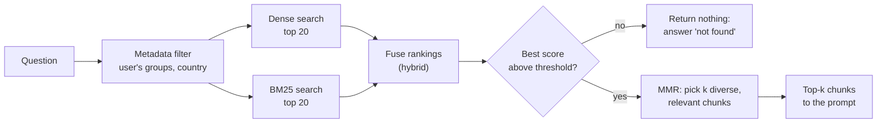

"Find the nearest vectors" is the core of retrieval, but a production retriever makes several more decisions: how many results to return, when a result is too weak to use, whether keyword search should help, and how to avoid returning five copies of the same passage. This lesson covers the mechanisms that make those decisions: **top-k**, **score thresholds**, **BM25** lexical retrieval and how it compares with dense retrieval, **hybrid fusion**, **maximal marginal relevance (MMR)** and **metadata filtering**. Each is small on its own; together they turn a nearest-neighbour lookup into a retriever you can trust.

## The shape of a retriever



Not every system uses every box. HandbookBot will start with dense search, a threshold and top-k, and add the rest as evaluation shows they help.

## Top-k: how many chunks?

The retriever returns the $k$ highest-scoring chunks. The choice of $k$ is a trade-off between **recall** (did we get the chunk we needed?) and **precision** (how much of what we got is useful?).

| | Small k (1 to 3) | Large k (10 or more) |
| --- | --- | --- |
| Chance the needed chunk is included | Lower | Higher |
| Irrelevant text in the prompt | Little | Much: can distract the model |
| Prompt cost and latency | Low | Higher |
| Questions needing several facts | Often miss some | Covered |

A common pattern is to **over-retrieve then narrow**: fetch a larger candidate set (say 20 to 50) cheaply, then use a reranker or MMR to choose the final handful for the prompt. [Reranking models](/learn/advanced-rag/reranking-models) covers the reranker step. Choose $k$ by measuring recall@k on your evaluation set, which [RAG evaluation](/learn/rag-fundamentals/rag-evaluation) shows how to compute.

## Score thresholds

Top-k always returns $k$ results, relevant or not. A **threshold** discards results whose score is too low, so an unanswerable question retrieves nothing and HandbookBot can say so honestly.

The corpus below extends the one from [Semantic search](/learn/rag-fundamentals/semantic-search) with a near-duplicate intranet page and an IT article containing an error code. As before, **TF-IDF vectors stand in for neural embeddings** so the outputs are real and reproducible.

```python
import re
import numpy as np
from collections import Counter
from sklearn.feature_extraction.text import TfidfVectorizer

corpus = {
    "leave-01": "Full-time employees receive 25 days of paid annual leave per year, plus public holidays.",
    "leave-02": "Up to 5 days of unused annual leave can be carried over into the next year.",
    "leave-03": "Carried-over leave must be used by 31 March or it is lost.",
    "parental-01": "Primary carers receive 26 weeks of paid parental leave.",
    "sick-01": "If you are ill, tell your manager before 10am on the first day of absence.",
    "remote-01": "Employees may work remotely up to three days per week with their manager's agreement.",
    "exp-01": "Submit expenses within 30 days of purchase through the expenses portal, with a receipt.",
    "exp-02": "Economy class flights are reimbursed; business class travel needs director approval.",
    "it-01": "Report a lost or stolen laptop to the IT service desk immediately so it can be locked remotely.",
    "it-02": "Passwords must be at least 14 characters, and multi-factor authentication is required.",
    "wiki-leave": "Unused annual leave: up to 5 days can be carried over to the next year.",
    "it-03": "VPN error E-4012 means your certificate has expired; reinstall it from the IT portal.",
}
ids, texts = list(corpus), list(corpus.values())

vectorizer = TfidfVectorizer(stop_words="english")       # stand-in for an embedding model
D = vectorizer.fit_transform(texts).toarray()

def dense_search(query, k=4, threshold=0.0):
    scores = D @ vectorizer.transform([query]).toarray()[0]
    top = np.argsort(-scores)[:k]
    return [(ids[i], round(float(scores[i]), 3)) for i in top if scores[i] >= threshold]

print(dense_search("carry over unused annual leave"))
print(dense_search("carry over unused annual leave", threshold=0.2))
print(dense_search("What is the dress code?", threshold=0.2))
```

```output
[('leave-02', 0.725), ('wiki-leave', 0.725), ('leave-01', 0.243), ('leave-03', 0.135)]
[('leave-02', 0.725), ('wiki-leave', 0.725), ('leave-01', 0.243)]
[]
```

With a threshold of 0.2 the weak tail is cut and the dress-code question returns an empty list. Two cautions:

- The right threshold depends entirely on the embedding model (see [Vector similarity](/learn/rag-fundamentals/vector-similarity)). Set it by looking at scores for labelled relevant and irrelevant pairs, not by intuition.
- A threshold that is too strict makes the bot refuse answerable questions. Track the refusal rate as well as accuracy.

Notice also the first result list: `leave-02` and `wiki-leave` say the same thing and score identically. Two of the four slots are spent on one fact. MMR, below, addresses this.

## BM25: modern lexical search

**BM25** is the standard lexical ranking function, used by search engines such as Elasticsearch and OpenSearch by default. Like TF-IDF it rewards query terms that are rare in the corpus, but it adds two refinements: **term-frequency saturation** (the tenth occurrence of a word adds much less than the first) and **length normalisation** (a match in a short chunk counts more than one in a long chunk). For a query with terms $t$ and a chunk $c$:

$$
\text{BM25}(q, c) = \sum_{t \in q} \text{IDF}(t) \cdot \frac{f(t, c)\,(k_1 + 1)}{f(t, c) + k_1 \left(1 - b + b \frac{|c|}{\text{avgdl}}\right)}
$$

where $f(t, c)$ is how often $t$ occurs in $c$, $|c|$ is the chunk's length in words, $\text{avgdl}$ is the average chunk length, $k_1$ (commonly around 1.2 to 2) controls saturation and $b$ (commonly 0.75) controls length normalisation. The IDF used here is $\ln\!\left(\frac{N - n_t + 0.5}{n_t + 0.5} + 1\right)$, with $N$ chunks of which $n_t$ contain $t$. The `rank_bm25` package implements this; writing it out shows there is no magic:

```python
def tokenize(text):
    return re.findall(r"[a-z0-9]+(?:-[a-z0-9]+)*", text.lower())   # keeps 'e-4012' whole

class BM25:
    def __init__(self, texts, k1=1.5, b=0.75):
        self.docs = [tokenize(t) for t in texts]
        self.k1, self.b = k1, b
        self.avgdl = np.mean([len(d) for d in self.docs])
        n = len(self.docs)
        df = Counter(term for d in self.docs for term in set(d))
        self.idf = {t: np.log((n - m + 0.5) / (m + 0.5) + 1) for t, m in df.items()}
        self.tf = [Counter(d) for d in self.docs]

    def scores(self, query):
        out = np.zeros(len(self.docs))
        for i, (tf, doc) in enumerate(zip(self.tf, self.docs)):
            norm = self.k1 * (1 - self.b + self.b * len(doc) / self.avgdl)
            for t in tokenize(query):
                if t in tf:
                    out[i] += self.idf[t] * tf[t] * (self.k1 + 1) / (tf[t] + norm)
        return out

bm25 = BM25(texts)

def bm25_search(query, k=3):
    s = bm25.scores(query)
    return [(ids[i], round(float(s[i]), 2)) for i in np.argsort(-s)[:k]]

print(bm25_search("VPN error E-4012"))
print(bm25_search("carry over unused annual leave"))
```

```output
[('it-03', 6.43), ('leave-01', 0.0), ('leave-02', 0.0)]
[('wiki-leave', 5.25), ('leave-02', 5.09), ('leave-01', 2.15)]
```

The tokenizer keeps `e-4012` as one token, so the exact error code is a strong, rare match. BM25 scores are unbounded and not comparable with cosine scores; only their order matters.

### BM25 versus dense retrieval

| | BM25 (lexical, sparse) | Dense embeddings |
| --- | --- | --- |
| Matches | Exact words | Meaning, paraphrases |
| "holiday" finds "annual leave" | No | Usually |
| Error codes, names, part numbers | Strong | Often weak |
| New jargon the model never saw | Works if the words match | May be poor |
| Needs a model or GPU | No | Yes, for embedding |
| Explainability | High: you can see which words matched | Low |

Their strengths are complementary, which is why combining them is so common.

## Hybrid retrieval with reciprocal rank fusion

BM25 and dense scores live on different scales, so you cannot simply add them. **Reciprocal rank fusion (RRF)** sidesteps this by using only ranks. Each retriever contributes $1 / (r + \text{rank})$ for each chunk it returns, where $\text{rank}$ starts at 1 and $r$ is a constant, commonly 60, that softens the advantage of the very top ranks:

```python
def rrf(rankings, r=60):
    fused = Counter()
    for ranking in rankings:
        for rank, chunk_id in enumerate(ranking, start=1):
            fused[chunk_id] += 1 / (r + rank)
    return [cid for cid, _ in fused.most_common()]

lexical = ["it-03", "it-01", "it-02"]              # e.g. BM25 for "VPN certificate problem"
semantic = ["it-02", "it-03", "remote-01"]          # an illustrative dense ranking
print(rrf([lexical, semantic]))
```

```output
['it-03', 'it-02', 'it-01', 'remote-01']
```

`it-03` is near the top of both lists, so it wins. Chunks found by only one retriever still appear, lower down. [Hybrid search](/learn/vector-databases/hybrid-search) and [Hybrid retrieval](/learn/advanced-rag/hybrid-retrieval) cover weighting and tuning in depth.

## Maximal marginal relevance (MMR)

Near-duplicate chunks are common: the same policy in the handbook and on the wiki, or overlapping chunks from the same section. Top-k by similarity fills the prompt with repeats. **MMR** picks results one at a time, balancing relevance to the query against similarity to what has already been picked:

$$
\text{MMR} = \arg\max_{c \in C \setminus S} \Big[ \lambda \, \text{sim}(q, c) - (1 - \lambda) \max_{s \in S} \text{sim}(c, s) \Big]
$$

where $C$ is the candidate set, $S$ the chunks selected so far, and $\lambda \in [0, 1]$ trades relevance ($\lambda = 1$ is plain top-k) against diversity. To make the effect easy to see, the example uses small illustrative two-dimensional vectors rather than real embeddings:

```python
q = np.array([1.0, 0.0])
cand = {
    "leave-02":   np.array([0.95, 0.31]),
    "wiki-leave": np.array([0.94, 0.34]),     # near-duplicate of leave-02
    "leave-03":   np.array([0.80, -0.60]),    # related but different fact
    "remote-01":  np.array([0.10, 0.99]),     # unrelated
}
cand = {k: v / np.linalg.norm(v) for k, v in cand.items()}

def mmr(q, cand, k, lam):
    selected, remaining = [], list(cand)
    while remaining and len(selected) < k:
        def score(c):
            redundancy = max((cand[c] @ cand[s] for s in selected), default=0.0)
            return lam * (cand[c] @ q) - (1 - lam) * redundancy
        best = max(remaining, key=score)
        selected.append(best)
        remaining.remove(best)
    return selected

print("lambda=1.0:", mmr(q, cand, k=2, lam=1.0))
print("lambda=0.7:", mmr(q, cand, k=2, lam=0.7))
```

```output
lambda=1.0: ['leave-02', 'wiki-leave']
lambda=0.7: ['leave-02', 'leave-03']
```

With $\lambda = 1$ the two slots go to the same fact twice. With $\lambda = 0.7$ the second slot goes to the carry-over deadline, which is new information. Step through the selection to see why:

```trace
{
  "title": "MMR with lambda = 0.7, k = 2",
  "code": [
    "selected = []",
    "for c in remaining:",
    "    redundancy = max(sim(c, s) for s in selected) or 0",
    "    score[c] = 0.7 * sim(q, c) - 0.3 * redundancy",
    "best = argmax(score); selected.append(best)"
  ],
  "steps": [
    { "line": 1, "vars": { "selected": "[]" }, "note": "Relevance to q: leave-02 0.951, wiki-leave 0.940, leave-03 0.800, remote-01 0.100." },
    { "line": 4, "vars": { "leave-02": "0.665", "wiki-leave": "0.658", "leave-03": "0.560", "remote-01": "0.070" }, "note": "Nothing is selected yet, so redundancy is 0 and the score is just 0.7 x relevance." },
    { "line": 5, "vars": { "selected": "['leave-02']" }, "note": "leave-02 has the highest score and is picked first, exactly as plain top-k would." },
    { "line": 3, "vars": { "sim(wiki-leave, leave-02)": "0.999", "sim(leave-03, leave-02)": "0.574", "sim(remote-01, leave-02)": "0.404" }, "note": "Now each candidate is compared with leave-02. The wiki page is almost identical to it." },
    { "line": 4, "vars": { "wiki-leave": "0.658 - 0.300 = 0.358", "leave-03": "0.560 - 0.172 = 0.388", "remote-01": "0.070 - 0.121 = -0.051" }, "note": "The duplicate's high redundancy costs it 0.3; leave-03 loses much less." },
    { "line": 5, "vars": { "selected": "['leave-02', 'leave-03']" }, "note": "leave-03 wins: relevant and new. The prompt now holds two different facts instead of one fact twice." }
  ]
}
```

> [!TIP]
> Values of $\lambda$ between about 0.5 and 0.8 are typical starting points, but the right value depends on how similar your chunks are under your embedding model. Run MMR over the top 20 to 50 candidates, not the whole corpus: it compares every candidate with every selected chunk.

## Metadata filtering

The cheapest way to improve relevance is often to exclude what cannot be right. Each chunk carries metadata from parsing and ingestion (document, country, access groups, date). Filtering on it **before** ranking enforces permissions (see [Why RAG is needed](/learn/rag-fundamentals/why-rag-is-needed)) and removes whole categories of error, such as a UK employee being told the US leave policy.

```python
meta = {cid: {"groups": {"all-staff"}} for cid in ids}
meta["exp-02"]["groups"] = {"managers"}            # pretend travel approval is managers-only

def allowed(user_groups):
    return np.array([bool(meta[cid]["groups"] & user_groups) for cid in ids])

def filtered_search(query, user_groups, k=3):
    scores = D @ vectorizer.transform([query]).toarray()[0]
    scores[~allowed(user_groups)] = -np.inf         # filtered chunks can never be ranked
    top = [i for i in np.argsort(-scores)[:k] if scores[i] > 0]   # drops filtered and non-matching
    return [ids[i] for i in top]

print(filtered_search("business class flight approval", {"all-staff"}))
print(filtered_search("business class flight approval", {"all-staff", "managers"}))
```

```output
[]
['exp-02']
```

An ordinary employee gets nothing back for the managers-only travel rule, so the model never sees it. Vector databases implement filtering natively and efficiently; see [Metadata filtering](/learn/vector-databases/metadata-filtering).

> [!KEY]
> Retrieval is a pipeline of small decisions: filter, search, fuse, threshold, diversify, cut to k. Change one at a time and measure the effect, or you will not know which change helped.

## Exercises

**1.** Run `mmr(q, cand, k=3, lam=0.7)`. Which chunk is chosen third, and why is it not `remote-01`?

<details>
<summary>Show solution</summary>

```python
print(mmr(q, cand, k=3, lam=0.7))
```

```output
['leave-02', 'leave-03', 'wiki-leave']
```

For the third slot, `wiki-leave` scores $0.658 - 0.3 \times 0.999 = 0.358$, while `remote-01` scores $0.070 - 0.3 \times 0.404 = -0.051$. The duplicate is penalised, but it is still far more relevant than an unrelated chunk. MMR reduces redundancy; it does not promote irrelevant text unless $\lambda$ is set very low.

</details>

**2.** Using `bm25_search` and `dense_search`, fuse the two rankings for `"unused annual leave carried over"` with `rrf`. Print the top 3.

<details>
<summary>Show solution</summary>

```python
query = "unused annual leave carried over"
lex = [cid for cid, _ in bm25_search(query, k=5)]
den = [cid for cid, _ in dense_search(query, k=5)]
print(rrf([lex, den])[:3])
```

```output
['wiki-leave', 'leave-02', 'leave-01']
```

Both retrievers rank the two carry-over chunks at the top, so they lead the fused list. In a real system the second ranking would come from a neural embedding model and the two lists would differ more.

</details>

**3.** A user asks HandbookBot about a policy that is not in the corpus, and the top dense score is 0.41 while the threshold is 0.40. What two things would you check before lowering or raising the threshold?

<details>
<summary>Show solution</summary>

First, look at the chunk that scored 0.41: is it genuinely unrelated, or partially relevant? Second, look at the score distributions on your labelled set: how many answerable questions have their correct chunk scoring between 0.40 and 0.45? Raising the threshold to exclude this case might cause many answerable questions to be refused. Decide on the evidence, and consider letting the prompt's "say you don't know" instruction handle borderline cases.

</details>

```quiz
[
  {
    "q": "What does a score threshold add that top-k alone does not provide?",
    "options": [
      "Faster search",
      "A way to return nothing when no chunk is relevant enough",
      "More diverse results",
      "Exact keyword matching"
    ],
    "answer": 1,
    "why": "Top-k always returns k results. A threshold lets unanswerable questions retrieve nothing, so the system can say it does not know."
  },
  {
    "q": "Which query is BM25 most likely to handle better than dense retrieval?",
    "options": [
      "How much holiday do I get?",
      "Can I work from home sometimes?",
      "What does VPN error E-4012 mean?",
      "I feel unwell, who do I tell?"
    ],
    "answer": 2,
    "why": "Exact identifiers such as error codes are rare tokens that lexical matching handles well. Paraphrased questions favour dense retrieval."
  },
  {
    "q": "Why does reciprocal rank fusion use ranks instead of adding raw scores?",
    "options": [
      "BM25 and cosine scores are on different, incomparable scales",
      "Ranks are faster to compute than scores",
      "Raw scores are always negative",
      "It makes the results alphabetical"
    ],
    "answer": 0,
    "why": "BM25 scores are unbounded while cosine scores lie in [-1, 1], so adding them would let one retriever dominate. Ranks are comparable across retrievers."
  },
  {
    "q": "In MMR, what happens as lambda approaches 1?",
    "options": [
      "Results become maximally diverse",
      "Only chunks from different documents are allowed",
      "The query is ignored",
      "The selection becomes plain top-k by relevance"
    ],
    "answer": 3,
    "why": "With lambda = 1 the redundancy term has zero weight, so chunks are chosen purely by similarity to the query."
  }
]
```
