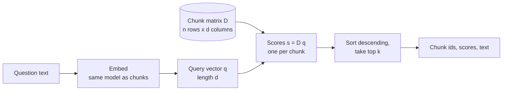

With chunks embedded, HandbookBot can finally answer the question at the heart of RAG: given a user's question, which chunks are most relevant? **Semantic search** answers it by embedding the question into the same vector space as the chunks and returning the chunks whose vectors are nearest. This lesson builds a small but complete working retriever, so you can see search as what it really is: a matrix multiplication followed by a sort.

## Lexical versus semantic search

Traditional search engines are **lexical**: they match the words in the query against the words in the documents, weighting rare words more heavily. They are fast, predictable and excellent when the user types the same words the document uses.

Their weakness is **vocabulary mismatch**. An employee asks "how much holiday do I get?"; the handbook says "25 days of paid annual leave". Not one content word is shared. **Semantic** (or **dense**) search uses neural embeddings in which "holiday" and "annual leave" sit close together, because the model learned from vast amounts of text that they are used in similar contexts.

| Query | Relevant chunk text | Lexical match? | Semantic match? |
| --- | --- | --- | --- |
| "carry over unused leave" | "unused annual leave can be carried over" | Yes, shared words | Yes |
| "how much holiday do I get" | "25 days of paid annual leave" | No shared words | Yes, similar meaning |
| "my laptop was nicked" | "lost or stolen laptop" | Partly ("laptop") | Yes, if the model knows the slang |
| "error code E-4012" | "E-4012: VPN certificate expired" | Yes, exact token | Often weak: codes carry little "meaning" |

The last row is a reminder that semantic search is not strictly better. Exact identifiers, product codes and rare names are where lexical search shines. The next lessons return to this when comparing BM25 with dense retrieval.

## Search as nearest neighbours

Once everything is a vector, search is geometry. With chunk vectors stacked as the rows of a matrix $D$ (one row per chunk, shape $n \times d$) and a query vector $\mathbf{q}$ (length $d$), the relevance score of every chunk is computed at once:

$$
\mathbf{s} = D\,\mathbf{q}
$$

Here $\mathbf{s}$ is a vector of $n$ scores, and $s_i$ is the dot product of chunk $i$'s vector with the query. If all vectors have unit length, each dot product equals the **cosine similarity** between the two vectors, which [Vector similarity](/learn/rag-fundamentals/vector-similarity) examines in detail. The top-k results are the $k$ indices with the largest scores.



Computing every score is called **exact** or **brute-force** search. For thousands or even a few hundred thousand chunks it is fast enough on a laptop. For millions, vector databases use **approximate nearest neighbour** (ANN) indexes that skip most of the comparisons; that is the subject of [Approximate nearest neighbors](/learn/vector-databases/approximate-nearest-neighbors) in Module 29. The interface is the same either way: vector in, top-k ids and scores out.

## A working retriever

To get real, reproducible numbers without downloading a neural model, the retriever below uses **TF-IDF vectors from scikit-learn as a stand-in for neural embeddings**. TF-IDF, from [TF-IDF](/learn/nlp-fundamentals/tf-idf), is a lexical representation, so it will not solve vocabulary mismatch, but everything else is identical to a dense retriever: text becomes a vector, vectors are normalised, and search is a matrix product and a sort. Swapping in a real embedding model changes only the `embed` step.

The corpus is a slice of HandbookBot's chunks:

```python
import numpy as np
from sklearn.feature_extraction.text import TfidfVectorizer

corpus = {
    "leave-01": "Full-time employees receive 25 days of paid annual leave per year, plus public holidays.",
    "leave-02": "Up to 5 days of unused annual leave can be carried over into the next year.",
    "leave-03": "Carried-over leave must be used by 31 March or it is lost.",
    "parental-01": "Primary carers receive 26 weeks of paid parental leave.",
    "sick-01": "If you are ill, tell your manager before 10am on the first day of absence.",
    "remote-01": "Employees may work remotely up to three days per week with their manager's agreement.",
    "exp-01": "Submit expenses within 30 days of purchase through the expenses portal, with a receipt.",
    "exp-02": "Economy class flights are reimbursed; business class travel needs director approval.",
    "it-01": "Report a lost or stolen laptop to the IT service desk immediately so it can be locked remotely.",
    "it-02": "Passwords must be at least 14 characters, and multi-factor authentication is required.",
}

class Retriever:
    def __init__(self, corpus: dict[str, str]):
        self.ids = list(corpus)
        self.texts = list(corpus.values())
        self.vectorizer = TfidfVectorizer(stop_words="english")   # stand-in embedding model
        self.matrix = self.vectorizer.fit_transform(self.texts).toarray()  # rows are unit length

    def embed(self, text: str) -> np.ndarray:
        return self.vectorizer.transform([text]).toarray()[0]

    def search(self, query: str, k: int = 3) -> list[tuple[str, float]]:
        scores = self.matrix @ self.embed(query)       # s = D q
        top = np.argsort(-scores)[:k]                  # indices of the k largest scores
        return [(self.ids[i], round(float(scores[i]), 3)) for i in top]

retriever = Retriever(corpus)
print("matrix shape:", retriever.matrix.shape)
print("row norms:", np.round(np.linalg.norm(retriever.matrix, axis=1)[:3], 3))
```

```output
matrix shape: (10, 62)
row norms: [1. 1. 1.]
```

Ten chunks, each a vector over a vocabulary of 62 terms, and each row already has length 1 because `TfidfVectorizer` L2-normalises by default. A neural model would give you, say, 384 or 1,024 dense dimensions instead of 62 sparse ones, but the matrix would be used in exactly the same way.

Now search:

```python
for q in ["Can I carry over unused leave to next year?",
          "My laptop was stolen",
          "How long is parental leave?",
          "Can I work from home?"]:
    print(f"{q:<45} {retriever.search(q)}")
```

```output
Can I carry over unused leave to next year?   [('leave-02', 0.731), ('leave-01', 0.256), ('leave-03', 0.135)]
My laptop was stolen                          [('it-01', 0.487), ('leave-01', 0.0), ('leave-02', 0.0)]
How long is parental leave?                   [('parental-01', 0.457), ('leave-02', 0.181), ('leave-03', 0.165)]
Can I work from home?                         [('remote-01', 0.422), ('leave-01', 0.0), ('leave-02', 0.0)]
```

The right chunk is first every time, and the scores make sense: the carry-over question shares several words with `leave-02` and scores highly; the others rely on one or two distinctive words. Notice also the zeros: chunks with no shared terms score exactly 0, and the order among them is arbitrary.

## Where the stand-in fails

```python
for q in ["How much holiday do I get?", "What is the dress code?"]:
    print(f"{q:<30} {retriever.search(q)}")
```

```output
How much holiday do I get?     [('leave-01', 0.0), ('leave-02', 0.0), ('leave-03', 0.0)]
What is the dress code?        [('leave-01', 0.0), ('leave-02', 0.0), ('leave-03', 0.0)]
```

Both queries score zero against everything. The first is vocabulary mismatch: the corpus says "holidays" (plural, in a different sense) and "annual leave", and TF-IDF without stemming treats "holiday" as an unrelated token. A neural embedding model would very likely rank `leave-01` first here. The second is a genuinely unanswerable question: the handbook excerpt says nothing about dress codes.

A neural retriever would *not* return all zeros for the dress-code question. Dense vectors are never exactly orthogonal, so every chunk gets some positive score and the top-k list always looks plausible. That is why the next lessons introduce **score thresholds** and why the prompt must tell the model to say "I don't know".

> [!KEY]
> A retriever always returns k results, whether or not any of them is relevant. Ranking tells you which chunks are *most* similar, not whether any is similar *enough*.

## What makes semantic search work well

Most of the quality of semantic search is decided by earlier choices, not by the search code:

- **Good chunks.** A chunk about one topic, with its heading path, embeds sharply (see [Chunking strategies](/learn/rag-fundamentals/chunking-strategies)).
- **The right embedding model** for your language and domain, used with the right query and document prefixes.
- **Questions that resemble the text.** Users ask questions; documents state facts. Models trained for retrieval handle this asymmetry, and techniques like generating a hypothetical answer and embedding that ([Query transformation](/learn/advanced-rag/query-transformation)) can help further.
- **Metadata filters.** Restricting search to the user's country or department before ranking removes whole classes of wrong answers ([Metadata filtering](/learn/vector-databases/metadata-filtering)).

> [!TIP]
> Always print the top results for a few real questions while building a retriever. Reading ranked chunks for ten minutes teaches you more about your system's failure modes than any single metric.

## Exercises

**1.** Add `"Holiday entitlement is 25 days of annual leave for full-time staff."` to the corpus as `leave-04`, rebuild the retriever and search for `"How much holiday do I get?"`. What changes, and what does that tell you about lexical retrieval?

<details>
<summary>Show solution</summary>

```python
corpus2 = dict(corpus, **{"leave-04": "Holiday entitlement is 25 days of annual leave for full-time staff."})
print(Retriever(corpus2).search("How much holiday do I get?"))
```

```output
[('leave-04', 0.417), ('leave-01', 0.0), ('leave-02', 0.0)]
```

The new chunk is found because it contains the exact word "holiday". Lexical retrieval only works when the document happens to use the user's words. Rewriting documents to anticipate every phrasing is not practical, which is the argument for semantic embeddings (or for combining both, as in hybrid search).

</details>

**2.** Extend `Retriever.search` with a `min_score` argument that drops results scoring below it. What does `search("What is the dress code?", min_score=0.1)` return?

<details>
<summary>Show solution</summary>

```python
def search_min(self, query, k=3, min_score=0.0):
    return [(i, s) for i, s in self.search(query, k) if s >= min_score]

Retriever.search_min = search_min
print(retriever.search_min("What is the dress code?", min_score=0.1))
print(retriever.search_min("My laptop was stolen", min_score=0.1))
```

```output
[]
[('it-01', 0.487)]
```

An empty list is the correct answer to an unanswerable question, and it lets the application reply "I couldn't find that in the handbook" without calling the LLM at all.

</details>

**3.** Search for several questions at once by stacking their vectors into a matrix $Q$ (one row per question) and computing $Q D^\top$. What is the shape of the result for 4 questions over this corpus?

<details>
<summary>Show solution</summary>

```python
Q = retriever.vectorizer.transform(["carried over", "laptop", "receipt", "passwords"]).toarray()
S = Q @ retriever.matrix.T
print(S.shape)
print([retriever.ids[j] for j in S.argmax(axis=1)])
```

```output
(4, 10)
['leave-02', 'it-01', 'exp-01', 'it-02']
```

One row of 10 scores per question. Batching queries like this is how retrieval is evaluated efficiently over a whole test set.

</details>

```quiz
[
  {
    "q": "What problem does semantic search solve that lexical search struggles with?",
    "options": [
      "Matching exact product codes",
      "Vocabulary mismatch, where the query and document use different words for the same idea",
      "Searching very large corpora quickly",
      "Removing duplicate chunks"
    ],
    "answer": 1,
    "why": "Dense embeddings place different words with similar meanings near each other, so 'holiday' can match 'annual leave'."
  },
  {
    "q": "If chunk vectors are the rows of matrix `D` and all vectors have unit length, what does `D @ q` give you?",
    "options": [
      "The Euclidean distance from q to every chunk",
      "The embedding of the query",
      "The cosine similarity between q and every chunk",
      "The top-k chunk ids"
    ],
    "answer": 2,
    "why": "Each entry is a dot product, and for unit vectors the dot product equals cosine similarity."
  },
  {
    "q": "A dense retriever is asked a question the corpus cannot answer. What does it typically return?",
    "options": [
      "k chunks with plausible-looking positive scores",
      "An empty list",
      "An error",
      "Exactly zero scores for every chunk"
    ],
    "answer": 0,
    "why": "Dense vectors are rarely orthogonal, so something is always 'most similar'. Thresholds and grounding instructions are needed to handle this."
  },
  {
    "q": "Why does the lesson's retriever use TF-IDF instead of a neural embedding model?",
    "options": [
      "TF-IDF gives better retrieval than neural embeddings",
      "Vector search only works with sparse vectors",
      "Neural embeddings cannot be normalised",
      "So the code runs anywhere with real, reproducible output; the search logic is identical"
    ],
    "answer": 3,
    "why": "It is a lexical stand-in. Swapping in a neural model changes only the embedding step, not the matrix-product-and-sort search."
  }
]
```
