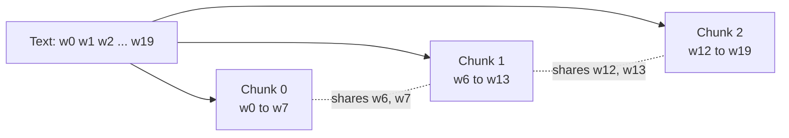

After parsing, the Larkspur handbook is about 30,000 tokens of clean text. You cannot embed it as one vector and you would not want to: a single vector for 60 pages is an average of everything, close to no particular question. **Chunking** splits documents into passages small enough to embed, retrieve and place in a prompt individually. The chunk is the unit your whole system works in: what gets embedded, what gets ranked, what the model reads and what gets cited. This lesson covers why, the simplest method (fixed-size windows with overlap), and how chunk size trades precision against context. The next lesson, [Chunking strategies](/learn/rag-fundamentals/chunking-strategies), covers smarter ways to choose the boundaries.

## Why chunk at all

Four separate pressures push towards splitting documents:

1. **Embedding model limits.** Embedding models accept a maximum input length (often a few hundred to a few thousand tokens). Text beyond the limit is typically truncated, which means silently ignored.
2. **Retrieval precision.** An embedding compresses a passage into one vector. The more topics a passage covers, the more its vector is a blur of all of them, and the less strongly it matches any specific question. A chunk about carrying over leave matches "can I carry over holiday?" far better than a vector for the whole leave chapter.
3. **Context budget.** You will place several retrieved chunks in the prompt. Smaller chunks let you include more distinct sources for the same token cost.
4. **Citation granularity.** "See page 18" is useful; "see the handbook" is not.

Pushing the other way, a chunk must be **large enough to stand alone**. "It must be approved by your manager" is useless without knowing what "it" is. The art of chunking is balancing these.

## Fixed-size chunking with overlap

The simplest method slides a window of fixed size along the text. Each chunk starts `size - overlap` units after the previous one, so consecutive chunks share `overlap` units. Overlap is insurance: if a key sentence straddles a boundary, it appears whole in at least one chunk.



With chunk size $S$, overlap $O$ (where $0 \le O < S$) and a text of $N$ units, the step between chunk starts is $S - O$, and the number of chunks is

$$
n = \left\lceil \frac{\max(N - O,\ 1)}{S - O} \right\rceil
$$

For $N = 20$, $S = 8$, $O = 2$ that gives $\lceil 18 / 6 \rceil = 3$, matching the diagram. Overlap therefore costs extra chunks: roughly a fraction $O / (S - O)$ more storage and embedding work than no overlap.

Here is an implementation that counts in words. Words are a reasonable stand-in for tokens in a demonstration; production code should count with the embedding model's own tokenizer, as discussed in [Tokenization](/learn/generative-ai-fundamentals/tokenization).

```python
def chunk_words(text: str, size: int, overlap: int) -> list[str]:
    if not 0 <= overlap < size:
        raise ValueError("need 0 <= overlap < size")
    words = text.split()
    step = size - overlap
    chunks = []
    for start in range(0, len(words), step):
        chunks.append(" ".join(words[start:start + size]))
        if start + size >= len(words):      # this chunk reached the end
            break
    return chunks

section = (
    "Full-time employees receive 25 days of paid annual leave per year. "
    "Up to 5 days of unused leave can be carried over into the next year. "
    "Carried-over days must be used by 31 March or they are lost. "
    "Requests to carry over more than 5 days need director approval."
)

for i, c in enumerate(chunk_words(section, size=16, overlap=4)):
    print(i, len(c.split()), c)
```

```output
0 16 Full-time employees receive 25 days of paid annual leave per year. Up to 5 days of
1 16 to 5 days of unused leave can be carried over into the next year. Carried-over days
2 16 next year. Carried-over days must be used by 31 March or they are lost. Requests to
3 13 are lost. Requests to carry over more than 5 days need director approval.
```

Notice what overlap did: the words "to 5 days of" end chunk 0 and start chunk 1, and "next year. Carried-over days" is shared between chunks 1 and 2. Notice also what fixed-size chunking did badly: the boundaries ignore sentences entirely. Chunk 0 stops at "Up to 5 days of", chunk 1 begins mid-sentence with "to 5 days", and chunk 3 begins with the fragment "are lost." Each chunk is the right length and the wrong shape. That problem motivates the boundary-aware methods in the next lesson.

The `break` matters. Without it, the loop would produce trailing chunks that lie entirely inside the previous chunk's overlap: pure duplicates. Step through the loop to see the start positions:

```trace
{
  "title": "sliding a window of 16 words with overlap 4",
  "code": [
    "words = text.split()            # 49 words",
    "step = size - overlap           # 16 - 4",
    "for start in range(0, len(words), step):",
    "    chunks.append(words[start:start + size])",
    "    if start + size >= len(words):",
    "        break"
  ],
  "steps": [
    { "line": 2, "vars": { "len(words)": "49", "step": "12" }, "note": "Each new chunk starts 12 words after the previous one, so 4 words are shared." },
    { "line": 4, "vars": { "start": "0", "chunk": "words[0:16]" }, "note": "Chunk 0 covers words 0 to 15." },
    { "line": 4, "vars": { "start": "12", "chunk": "words[12:28]" }, "note": "Chunk 1 starts at 12, so words 12 to 15 appear in both chunks." },
    { "line": 4, "vars": { "start": "24", "chunk": "words[24:40]" }, "note": "Chunk 2 covers words 24 to 39." },
    { "line": 5, "vars": { "start": "24", "start + size": "40" }, "note": "40 is less than 49, so there is text left: keep going." },
    { "line": 4, "vars": { "start": "36", "chunk": "words[36:49]" }, "note": "Chunk 3 is short: only 13 words remain, matching the printed count." },
    { "line": 6, "vars": { "start": "36", "start + size": "52" }, "note": "The window reached the end, so stop. Without this break, range would continue to start 48 and add words[48:49], the single word approval., which is already inside chunk 3." }
  ]
}
```

## Counting in characters instead

Many libraries count characters rather than words or tokens, because it needs no tokenizer. The same logic applies to a string slice. Character windows cut words in half, so they are usually combined with "snap to the nearest space", or replaced by the recursive splitter in the next lesson.

```python
def chunk_chars(text: str, size: int, overlap: int) -> list[str]:
    step = size - overlap
    out = []
    for start in range(0, len(text), step):
        out.append(text[start:start + size])
        if start + size >= len(text):
            break
    return out

for c in chunk_chars("Report a lost laptop to the IT service desk.", size=20, overlap=5):
    print(repr(c))
```

```output
'Report a lost laptop'
'aptop to the IT serv'
' service desk.'
```

The cut through "laptop" and "service" is exactly the problem: a chunk that starts with `'aptop to the IT'` embeds poorly.

## Chunk size trade-offs

There is no universally best chunk size; it depends on your documents, your questions and your embedding model. As a starting point, many teams begin somewhere in the range of a few hundred tokens with an overlap of around 10 to 20 percent, then tune using the evaluation set from [RAG evaluation](/learn/rag-fundamentals/rag-evaluation).

| | Small chunks (for example, one or two sentences) | Large chunks (for example, a page or more) |
| --- | --- | --- |
| Embedding | Sharp, specific meaning | Blurred across several topics |
| Retrieval precision | High for factoid questions | Lower: matches are weaker |
| Self-contained | Often not: missing context ("it", "this policy") | Usually yes |
| Chunks in prompt for a fixed budget | Many, from varied sources | Few |
| Good for | "How many days...?" | "Explain the leave policy" |
| Number of vectors to store | Many | Few |

> [!KEY]
> Chunk size is a tuning parameter, not a constant. Choose a sensible default, build an evaluation set, then measure recall at a few sizes. Intuition about the "right" size is unreliable.

A widely used compromise is to **retrieve small, read large**: embed small chunks for precise matching, but when one is retrieved, give the model its surrounding section. This parent-child pattern is covered in [Parent-child retrieval](/learn/advanced-rag/parent-child-retrieval).

## Each chunk is a record

A chunk is not just a string. Store it with an ID and the metadata captured during parsing, so it can be cited, filtered and replaced:

```python
def make_chunks(doc: dict, size: int = 16, overlap: int = 4) -> list[dict]:
    return [
        {
            "chunk_id": f"{doc['doc_id']}:{i}",
            "doc_id": doc["doc_id"],
            "title": doc["title"],
            "section": doc["section"],
            "page": doc["page"],
            "text": text,
        }
        for i, text in enumerate(chunk_words(doc["text"], size, overlap))
    ]

doc = {"doc_id": "handbook", "title": "Employee Handbook",
       "section": "4.2 Carrying over leave", "page": 18, "text": section}
first = make_chunks(doc)[0]
print({k: v for k, v in first.items() if k != "text"})
```

```output
{'chunk_id': 'handbook:0', 'doc_id': 'handbook', 'title': 'Employee Handbook', 'section': '4.2 Carrying over leave', 'page': 18}
```

> [!TIP]
> Chunk **within** a section, never across section boundaries. If you concatenate the whole handbook and slide a window over it, a chunk can start in the leave policy and end in the expenses policy, and its section metadata will be wrong for half its text.

## Exercises

**1.** Using the formula, how many chunks does a 1,000-token document produce with $S = 200$ and $O = 50$? Check it with `chunk_words` on a text of 1,000 words.

<details>
<summary>Show solution</summary>

$\lceil (1000 - 50) / 150 \rceil = \lceil 6.33 \rceil = 7$.

```python
print(len(chunk_words("w " * 1000, size=200, overlap=50)))
```

```output
7
```

</details>

**2.** Modify `chunk_words` so that a final chunk shorter than `min_words` is merged into the previous chunk instead of standing alone. Test with the `section` text, `size=16`, `overlap=4`, `min_words=15`.

<details>
<summary>Show solution</summary>

```python
def chunk_words_merged(text, size, overlap, min_words):
    chunks = chunk_words(text, size, overlap)
    if len(chunks) > 1 and len(chunks[-1].split()) < min_words:
        tail = chunks.pop().split()[overlap:]      # skip words already in the previous chunk
        chunks[-1] = chunks[-1] + " " + " ".join(tail)
    return chunks

for c in chunk_words_merged(section, 16, 4, 15):
    print(len(c.split()), c)
```

```output
16 Full-time employees receive 25 days of paid annual leave per year. Up to 5 days of
16 to 5 days of unused leave can be carried over into the next year. Carried-over days
25 next year. Carried-over days must be used by 31 March or they are lost. Requests to carry over more than 5 days need director approval.
```

The last chunk is 25 words, over the target size, which is usually better than a 13-word fragment that starts mid-sentence. Note that `tail` skips the first `overlap` words, because those already end the previous chunk.

</details>

**3.** A colleague sets overlap to 50 percent of chunk size "to be safe". What does that cost, and when might it still be justified?

<details>
<summary>Show solution</summary>

With $O = S/2$ the step is $S/2$, so you produce roughly twice as many chunks as without overlap: double the embedding cost and storage, and retrieval often returns several near-duplicate neighbouring chunks that waste prompt space. It can be justified for short, dense documents where answers frequently span boundaries and the corpus is small enough that cost does not matter, but it should be confirmed by measurement.

</details>

```quiz
[
  {
    "q": "Why does a chunk covering many topics tend to retrieve poorly?",
    "options": [
      "Its embedding is a blend of all its topics, so it matches no specific question strongly",
      "Embedding models reject long inputs with an error",
      "Long chunks cannot be cited",
      "Vector databases store only short text"
    ],
    "answer": 0,
    "why": "One vector summarises the whole chunk. Mixing topics dilutes the similarity to any single question."
  },
  {
    "q": "With chunk size 500 and overlap 100, how far apart are the start positions of consecutive chunks?",
    "options": [
      "100",
      "500",
      "600",
      "400"
    ],
    "answer": 3,
    "why": "The step is size minus overlap: 500 - 100 = 400."
  },
  {
    "q": "What is the main purpose of overlap between chunks?",
    "options": [
      "To reduce the number of chunks",
      "To make sure information spanning a boundary appears whole in at least one chunk",
      "To make embeddings more accurate for every chunk",
      "To remove duplicate text"
    ],
    "answer": 1,
    "why": "Without overlap a sentence cut at the boundary appears only in fragments. Overlap costs extra chunks in exchange."
  },
  {
    "q": "Why should you chunk within sections rather than across the concatenated document?",
    "options": [
      "It is faster to embed",
      "Sections are always the same length",
      "A chunk spanning two sections mixes topics and its section metadata becomes wrong",
      "Embedding models require it"
    ],
    "answer": 2,
    "why": "Chunks crossing a section boundary blend unrelated content and cannot be attributed to a single section for citation."
  }
]
```
