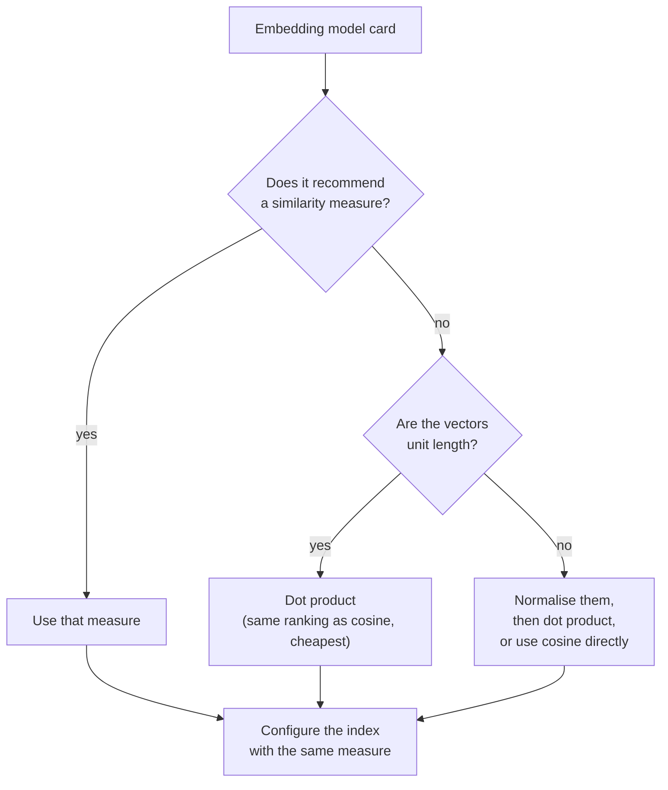

The retriever in [Semantic search](/learn/rag-fundamentals/semantic-search) ranked chunks by a single number: how "similar" each chunk vector is to the query vector. There are three common ways to define that number: **cosine similarity**, the **dot product** and **Euclidean distance**. Vector databases ask you to pick one when you create an index, embedding model cards recommend one, and choosing inconsistently is a classic silent bug. This lesson defines all three, shows with NumPy exactly when they agree and when they disagree, and explains how to choose, along with what similarity scores do and do not mean.

You met dot products and vector norms in [Linear Algebra](/learn/linear-algebra); here they are applied to retrieval.

## The three measures

For a query vector $\mathbf{q}$ and a chunk vector $\mathbf{d}$, both of length $n$:

**Dot product** multiplies matching components and sums them:

$$
\mathbf{q} \cdot \mathbf{d} = \sum_{i=1}^{n} q_i d_i
$$

**Cosine similarity** is the dot product divided by both lengths, which leaves only the angle $\theta$ between the vectors:

$$
\cos\theta = \frac{\mathbf{q} \cdot \mathbf{d}}{\lVert \mathbf{q} \rVert \, \lVert \mathbf{d} \rVert}
$$

where $\lVert \mathbf{v} \rVert = \sqrt{\sum_i v_i^2}$ is the length (L2 norm) of $\mathbf{v}$. It ranges from $-1$ (opposite directions) through $0$ (perpendicular) to $1$ (same direction).

**Euclidean distance** is the straight-line distance between the two points:

$$
\lVert \mathbf{q} - \mathbf{d} \rVert = \sqrt{\sum_{i=1}^{n} (q_i - d_i)^2}
$$

Note the direction: for dot product and cosine, **larger means more similar**; for Euclidean distance, **smaller means more similar**.

| Measure | Range | More similar when | Sensitive to vector length? |
| --- | --- | --- | --- |
| Dot product | Any real number | Larger | Yes |
| Cosine similarity | $-1$ to $1$ | Larger | No |
| Euclidean distance | $0$ upwards | Smaller | Yes |

## When they disagree

The measures differ in how they treat vector **length** (magnitude). Cosine ignores it completely and looks only at direction. The dot product rewards long vectors. Euclidean distance penalises vectors whose length differs from the query's. Here is a query and three chunk vectors, chosen so the difference is visible:

```python
import numpy as np

q = np.array([0.9, 0.4, 0.1])
chunks = {
    "a (same direction, similar length)": np.array([0.8, 0.5, 0.1]),
    "b (different direction, very long)": np.array([3.0, 0.5, 2.0]),
    "c (different topic)":                np.array([0.1, 0.2, 0.9]),
}

def cosine(u, v):
    return u @ v / (np.linalg.norm(u) * np.linalg.norm(v))

print(f"{'chunk':<36}{'dot':>7}{'cosine':>8}{'euclid':>8}")
for name, d in chunks.items():
    print(f"{name:<36}{q @ d:>7.3f}{cosine(q, d):>8.3f}{np.linalg.norm(q - d):>8.3f}")
```

```output
chunk                                   dot  cosine  euclid
a (same direction, similar length)    0.930   0.990   0.141
b (different direction, very long)    3.100   0.860   2.834
c (different topic)                   0.260   0.283   1.149
```

The dot product ranks chunk **b** first, purely because it is long: its direction is noticeably different from the query's (cosine 0.860 versus 0.990 for a). Cosine and Euclidean both prefer **a**. If vector length carries no meaning for your model, the dot product's ranking here is wrong.

## Normalise, and the disagreement disappears

Divide every vector by its length so that each has length 1. This is **L2 normalisation**:

$$
\hat{\mathbf{v}} = \frac{\mathbf{v}}{\lVert \mathbf{v} \rVert}
$$

For unit vectors, $\lVert \hat{\mathbf{q}} \rVert = \lVert \hat{\mathbf{d}} \rVert = 1$, so the cosine formula's denominator is 1 and **cosine similarity equals the dot product**. Euclidean distance becomes a simple function of it too. Expanding the square:

$$
\lVert \hat{\mathbf{q}} - \hat{\mathbf{d}} \rVert^2 = \lVert \hat{\mathbf{q}} \rVert^2 + \lVert \hat{\mathbf{d}} \rVert^2 - 2\,\hat{\mathbf{q}} \cdot \hat{\mathbf{d}} = 2 - 2\cos\theta
$$

Because $2 - 2\cos\theta$ goes down exactly when $\cos\theta$ goes up, the smallest distance always belongs to the largest cosine. All three measures now produce **the same ranking**.

```python
def normalise(v):
    return v / np.linalg.norm(v)

qn = normalise(q)
print(f"{'chunk':<36}{'dot':>7}{'cosine':>8}{'euclid':>8}{'sqrt(2-2cos)':>14}")
for name, d in chunks.items():
    dn = normalise(d)
    print(f"{name:<36}{qn @ dn:>7.3f}{cosine(qn, dn):>8.3f}"
          f"{np.linalg.norm(qn - dn):>8.3f}{np.sqrt(2 - 2 * cosine(qn, dn)):>14.3f}")
```

```output
chunk                                   dot  cosine  euclid  sqrt(2-2cos)
a (same direction, similar length)    0.990   0.990   0.140         0.140
b (different direction, very long)    0.860   0.860   0.529         0.529
c (different topic)                   0.283   0.283   1.197         1.197
```

After normalisation, dot product and cosine columns are identical, and the Euclidean column matches $\sqrt{2 - 2\cos\theta}$ exactly. Every measure ranks a, then b, then c.

> [!KEY]
> If every vector is L2-normalised, cosine, dot product and Euclidean distance give identical rankings. Normalise once at ingestion and at query time, then use the dot product, which is the cheapest to compute.

This is why the TF-IDF retriever in the previous lesson could use a plain matrix product: scikit-learn's `TfidfVectorizer` returns unit-length rows, and normalising the query does not change the ranking for a single query. It is also why `sentence-transformers` offers `normalize_embeddings=True`, and why many hosted embedding APIs return vectors that are already unit length (check the documentation rather than assuming).

## Normalising a whole matrix

In practice you normalise the chunk matrix once, row by row, using broadcasting from [NumPy](/learn/numpy):

```python
rng = np.random.default_rng(0)
D = rng.normal(size=(5, 8))                       # 5 chunk vectors of dimension 8
D_hat = D / np.linalg.norm(D, axis=1, keepdims=True)
print("norms before:", np.round(np.linalg.norm(D, axis=1), 3))
print("norms after: ", np.round(np.linalg.norm(D_hat, axis=1), 3))

query = rng.normal(size=8)
q_hat = query / np.linalg.norm(query)
cos_scores = D_hat @ q_hat
dists = np.linalg.norm(D_hat - q_hat, axis=1)
print("rank by cosine:  ", np.argsort(-cos_scores))
print("rank by distance:", np.argsort(dists))
```

```output
norms before: [1.863 3.167 2.025 1.884 1.944]
norms after:  [1. 1. 1. 1. 1.]
rank by cosine:   [4 0 2 1 3]
rank by distance: [4 0 2 1 3]
```

`keepdims=True` keeps the norms as a column of shape `(5, 1)` so the division broadcasts across each row. The two rankings agree, as the algebra promised.

## Choosing a measure



The rule of thumb: **use the measure the embedding model was trained with.** Most text embedding models for retrieval are trained with cosine similarity, so normalising and using the dot product is correct for them. A few models are trained so that vector length carries information (for example, about how confident or how "content-rich" a passage is) and recommend raw dot product; normalising those throws information away. The model card will say.

> [!WARNING]
> When you create a vector index you choose its metric, often as `cosine`, `dot` (or `ip`, inner product) or `l2` (Euclidean). If you index unnormalised vectors with `dot` while the model expects cosine, long chunks will be systematically over-ranked. Nothing will error; retrieval will simply be worse.

## What a similarity score means

It is tempting to read a cosine of 0.8 as "80 percent relevant". It is not. Similarity scores are **not calibrated probabilities**, and their typical range depends heavily on the model. With some models, unrelated texts score around 0.1; with others, almost everything scores above 0.6, and relevant passages sit only slightly higher.

Practical consequences:

- **Compare scores only within one model.** A threshold tuned for one model is meaningless for another.
- **Set thresholds from data.** Embed a set of known relevant and known irrelevant question-chunk pairs, look at the two score distributions, and choose a cut-off between them. [Retrieval mechanisms](/learn/rag-fundamentals/retrieval-mechanisms) puts this into practice.
- **Rank is more robust than value.** "This chunk is the best match" is more reliable than "this chunk scored 0.72".

Some vector databases report a **distance** rather than a similarity, for example $1 - \cos\theta$ for cosine indexes, in which case smaller is better. Check which one you are receiving before sorting.

## Exercises

**1.** Compute, by hand and then in NumPy, the cosine similarity between $[1, 0]$ and $[1, 1]$, and the Euclidean distance between their normalised versions. Check the relationship $d^2 = 2 - 2\cos\theta$.

<details>
<summary>Show solution</summary>

$\cos\theta = 1 / (1 \cdot \sqrt{2}) \approx 0.707$, so $d^2 = 2 - 1.414 = 0.586$ and $d \approx 0.765$.

```python
u, v = np.array([1.0, 0.0]), np.array([1.0, 1.0])
c = cosine(u, v)
d = np.linalg.norm(normalise(u) - normalise(v))
print(round(c, 3), round(d, 3), round(d**2, 3), round(2 - 2 * c, 3))
```

```output
0.707 0.765 0.586 0.586
```

</details>

**2.** Show that scaling a chunk vector by 10 changes its dot product with the query but not its cosine similarity, using `q` and chunk a from the lesson.

<details>
<summary>Show solution</summary>

```python
a = chunks["a (same direction, similar length)"]
print(round(q @ a, 3), round(q @ (10 * a), 3))
print(round(cosine(q, a), 3), round(cosine(q, 10 * a), 3))
```

```output
0.93 9.3
0.99 0.99
```

The dot product scales by 10; cosine is unchanged because it divides by the vector's length.

</details>

**3.** A colleague sets a relevance threshold of 0.75 cosine, tuned on model A, and keeps it after switching to model B. What could go wrong, and how should the threshold be set?

<details>
<summary>Show solution</summary>

Model B's scores may sit in a different range. If B's scores are generally lower, almost everything is filtered out and HandbookBot says "I don't know" too often; if higher, irrelevant chunks pass. Re-tune the threshold for model B using labelled relevant and irrelevant pairs, choosing a value that separates the two score distributions.

</details>

```quiz
[
  {
    "q": "For L2-normalised vectors, how are cosine similarity and dot product related?",
    "options": [
      "They are equal",
      "Cosine is the square of the dot product",
      "They are unrelated",
      "Dot product is always larger"
    ],
    "answer": 0,
    "why": "Cosine divides the dot product by both lengths. If both lengths are 1, the division changes nothing."
  },
  {
    "q": "Which measure is unaffected by multiplying a vector by a positive constant?",
    "options": [
      "Dot product",
      "Euclidean distance",
      "Sum of components",
      "Cosine similarity"
    ],
    "answer": 3,
    "why": "Cosine depends only on the angle between vectors, not their lengths."
  },
  {
    "q": "For unit vectors with cosine similarity 0.5, what is the squared Euclidean distance between them?",
    "options": [
      "0.5",
      "1.0",
      "1.5",
      "2.0"
    ],
    "answer": 1,
    "why": "Squared distance = 2 - 2 cos = 2 - 1 = 1."
  },
  {
    "q": "A vector index returns a 'distance' of 0.15 for one chunk and 0.40 for another, using cosine distance. Which is more similar to the query?",
    "options": [
      "The one with 0.40",
      "They are equally similar",
      "The one with 0.15",
      "It cannot be determined"
    ],
    "answer": 2,
    "why": "Cosine distance is 1 minus cosine similarity, so smaller distance means higher similarity."
  }
]
```
