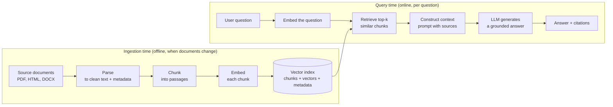
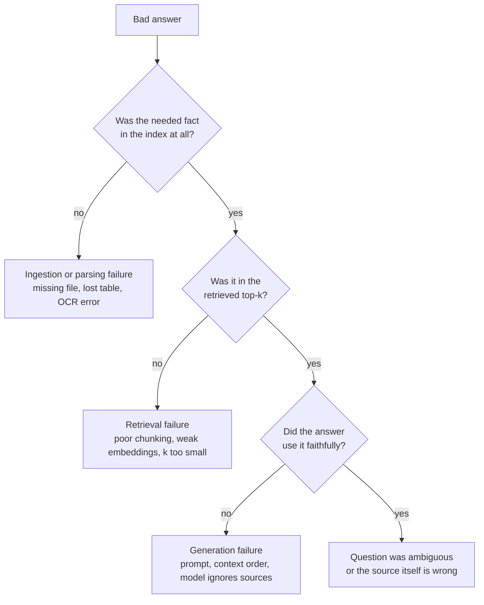

A language model knows only what was in its training data, and it cannot tell you where any particular fact came from. Ask a general-purpose model "How many days of annual leave do I get?" and it will either guess or politely decline, because your company's handbook was never part of its training. **Retrieval-augmented generation (RAG)** fixes this by looking up the relevant passages first and handing them to the model together with the question. The model then answers from text you supplied, and it can point to the passages it used.

RAG is the most widely deployed pattern in applied LLM engineering. Customer-support assistants, internal knowledge bots, legal and medical research tools and code assistants that "know" your repository are almost all RAG systems underneath. This module builds one from the ground up.

## The idea in one paragraph

RAG splits a hard problem (make the model know your documents) into two easier ones. A **retriever** finds the few passages most relevant to a question, out of thousands or millions. A **generator**, the LLM you met in [Working with LLMs](/learn/working-with-llms/openai-api), reads those passages and writes an answer. The model's weights never change. All the knowledge lives in an external store that you can update, delete from and audit at any time.

The name describes exactly that: generation (the LLM writing text), augmented (supplemented) by retrieval (a search step).

## The running example: a handbook assistant

Throughout this module you will build **HandbookBot**, a question-answering assistant for the employees of a fictional company, Larkspur Analytics. Its knowledge comes from:

- the employee handbook, a 60-page PDF;
- HR policy pages on the company intranet (HTML);
- a few Word documents, such as the travel and expenses policy.

Employees ask questions such as "Can I carry over unused holiday?" or "What do I do if my laptop is stolen?". HandbookBot must answer from the official documents, cite the section it used, and say "I don't know" when the documents do not cover the question.

Every lesson in this module adds one stage to HandbookBot, so by the end you will have seen each step of a real pipeline.

## The architecture: two paths

A RAG system has two separate paths that run at different times. The **ingestion path** runs ahead of time (on a schedule, or whenever a document changes) and prepares the documents for search. The **query path** runs every time a user asks a question, and must be fast.



The two paths meet at the **index**. Ingestion writes chunks and their vectors into it; querying reads from it. One crucial constraint links them: the question must be embedded with the **same embedding model** that embedded the chunks, otherwise the vectors live in different spaces and similarity scores are meaningless.

| Stage | Path | Lesson | What it produces |
| --- | --- | --- | --- |
| Ingestion | Ingestion | [Document ingestion](/learn/rag-fundamentals/document-ingestion) | Raw files with source, version and access information |
| Parsing | Ingestion | [Document parsing](/learn/rag-fundamentals/document-parsing) | Clean text plus metadata (title, section, page) |
| Chunking | Ingestion | [Text chunking](/learn/rag-fundamentals/text-chunking), [Chunking strategies](/learn/rag-fundamentals/chunking-strategies) | Passages of a few hundred tokens |
| Embedding | Both | [Embedding generation](/learn/rag-fundamentals/embedding-generation) | One vector per chunk, and one per question |
| Search | Query | [Semantic search](/learn/rag-fundamentals/semantic-search), [Vector similarity](/learn/rag-fundamentals/vector-similarity), [Retrieval mechanisms](/learn/rag-fundamentals/retrieval-mechanisms) | The k most relevant chunks |
| Prompting | Query | [Context construction](/learn/rag-fundamentals/context-construction) | A prompt containing the question and numbered sources |
| Generation | Query | [Answer generation](/learn/rag-fundamentals/answer-generation) | An answer with citations |
| Measurement | Offline | [RAG evaluation](/learn/rag-fundamentals/rag-evaluation) | Scores that tell you whether a change helped |

## A complete pipeline in thirty lines

Before going stage by stage, it helps to see the whole shape at once. The sketch below is deliberately crude: it "embeds" text as a set of lowercase words and scores similarity by word overlap, and it stops just before calling an LLM. Every later lesson replaces one of these crude parts with the real thing, but the structure stays the same.

```python
import re

# Ingestion: a tiny "handbook", already parsed and chunked
chunks = [
    {"id": "leave-01", "text": "Full-time employees receive 25 days of paid annual leave per year."},
    {"id": "leave-02", "text": "Up to 5 days of unused annual leave can be carried over into the next year."},
    {"id": "it-01", "text": "Report a lost or stolen laptop to the IT service desk immediately."},
    {"id": "exp-01", "text": "Submit expenses within 30 days of purchase, with a receipt."},
]

def embed(text):                       # stand-in for a real embedding model
    return set(re.findall(r"[a-z0-9]+", text.lower()))

index = [(c, embed(c["text"])) for c in chunks]

# Query time
def retrieve(question, k=2):
    q = embed(question)
    scored = [(len(q & vec) / len(q | vec), c) for c, vec in index]   # Jaccard overlap
    return sorted(scored, key=lambda pair: pair[0], reverse=True)[:k]

def build_prompt(question, hits):
    sources = "\n".join(f"[{c['id']}] {c['text']}" for _, c in hits)
    return (f"Answer using only the sources below and cite them by id.\n\n"
            f"Sources:\n{sources}\n\nQuestion: {question}")

question = "Can I carry over unused annual leave?"
hits = retrieve(question)
for score, c in hits:
    print(f"{score:.2f}  {c['id']}")
print()
print(build_prompt(question, hits))
```

```output
0.28  leave-02
0.12  leave-01

Answer using only the sources below and cite them by id.

Sources:
[leave-02] Up to 5 days of unused annual leave can be carried over into the next year.
[leave-01] Full-time employees receive 25 days of paid annual leave per year.

Question: Can I carry over unused annual leave?
```

The retriever correctly ranks the carry-over chunk first, and the prompt that would be sent to the LLM contains only two short passages instead of the entire handbook. That prompt is all the model sees, so the quality of the answer depends heavily on the quality of retrieval. A common saying among practitioners is that most RAG failures are retrieval failures.

> [!KEY]
> RAG does not teach the model anything. It gives the model an open-book exam: the right pages are placed in front of it at the moment it answers. Your job as the engineer is mostly to make sure the right pages are found.

## Where things go wrong

Because RAG is a pipeline, an error at any stage flows downstream. It is worth knowing the common failure points from the start, because the rest of the module is organised around preventing them.



This decision tree is also your debugging procedure. When HandbookBot gives a wrong answer, check in order: is the fact in the index, was it retrieved, and was it used. Each question points at a different stage.

## RAG compared with simply asking the model

| Property | Plain LLM | LLM with RAG |
| --- | --- | --- |
| Knows private or recent documents | No | Yes, whatever is indexed |
| Can cite sources | No reliable way | Yes, the retrieved chunks |
| Updating knowledge | Retrain or fine-tune | Re-index the changed document |
| Removing knowledge (for example, a withdrawn policy) | Very hard | Delete its chunks |
| Extra moving parts | None | Parser, chunker, embedder, index, retriever |
| Typical failure | Confident invention | Wrong or missing passage retrieved |

The next lesson, [Why RAG is needed](/learn/rag-fundamentals/why-rag-is-needed), looks at these trade-offs in detail and compares RAG with fine-tuning and with simply pasting documents into a long context window.

> [!NOTE]
> This module stores vectors in plain Python lists and NumPy arrays so you can see every step. Real systems use a vector database; [Module 29: Vector Databases](/learn/vector-databases/vector-embeddings) covers them. Techniques such as reranking, query rewriting and hybrid retrieval are in [Module 30: Advanced RAG](/learn/advanced-rag/advanced-chunking).

## Exercises

**1.** Using the pipeline code above, ask `"What should I do if my laptop is stolen?"`. Which chunk comes first? Then ask `"How much holiday do I get?"` and explain why the word-overlap retriever struggles.

<details>
<summary>Show solution</summary>

The laptop question shares the words "laptop" and "stolen" with `it-01`, so that chunk ranks first. The holiday question shares almost no words with `leave-01` ("holiday" versus "annual leave"), so word overlap scores it near zero. This is the **vocabulary mismatch problem**, and it is exactly why real systems use neural embeddings that place "holiday" and "annual leave" close together. You will see this in [Semantic search](/learn/rag-fundamentals/semantic-search).

```python
for q in ["What should I do if my laptop is stolen?", "How much holiday do I get?"]:
    print(q, [(round(s, 2), c["id"]) for s, c in retrieve(q)])
```

</details>

**2.** For each of these HandbookBot problems, name the pipeline stage most likely responsible: (a) the answer quotes a page footer, "Confidential - do not distribute", as if it were policy; (b) the right passage exists in the index but appears at rank 9 when k is 4; (c) the right passage was retrieved, but the answer contradicts it.

<details>
<summary>Show solution</summary>

(a) Parsing: headers and footers should be stripped before chunking. (b) Retrieval: the embedding, chunking or k needs work. (c) Generation: the prompt or model is not keeping the answer grounded in the sources.

</details>

**3.** Explain in two sentences why the question must be embedded with the same model as the chunks.

<details>
<summary>Show solution</summary>

Each embedding model defines its own vector space, with its own dimensions and geometry, so a vector from one model cannot be meaningfully compared with a vector from another. If you change the embedding model, you must re-embed every chunk as well as the queries.

</details>

```quiz
[
  {
    "q": "In a RAG system, what happens to the LLM's weights when you add a new document?",
    "options": [
      "They are fine-tuned on the new document",
      "Nothing: the document is added to the external index",
      "The embedding layer is retrained",
      "They are reset and pretrained again"
    ],
    "answer": 1,
    "why": "RAG keeps knowledge outside the model. Adding a document means parsing, chunking, embedding and indexing it; the model is unchanged."
  },
  {
    "q": "Which step belongs to the query path rather than the ingestion path?",
    "options": [
      "Parsing PDFs into text",
      "Splitting documents into chunks",
      "Embedding the user's question",
      "Stripping page headers and footers"
    ],
    "answer": 2,
    "why": "The question only exists at query time. The other steps prepare documents ahead of time."
  },
  {
    "q": "HandbookBot gives a wrong answer. The correct passage is in the index but was not in the retrieved top-k. Which stage should you investigate?",
    "options": [
      "Generation",
      "Document ingestion",
      "Answer streaming",
      "Retrieval"
    ],
    "answer": 3,
    "why": "The fact was indexed but not found, so the problem lies in retrieval: chunking, embeddings, similarity or the choice of k."
  }
]
```
