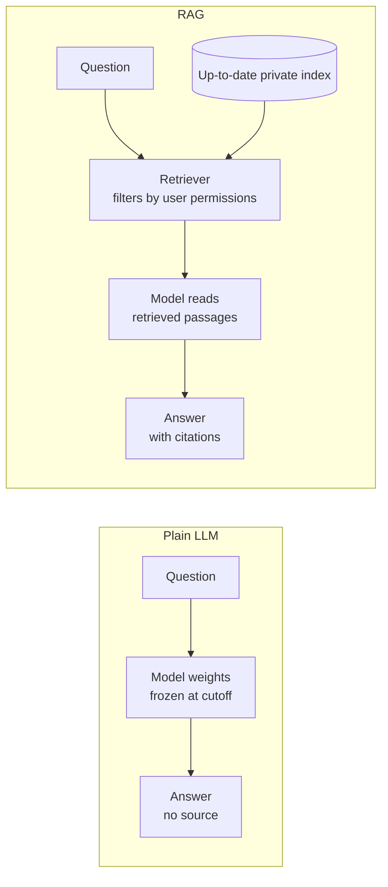
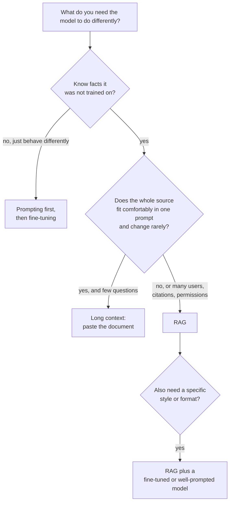

The previous lesson showed what RAG is. This one asks why you would bother: a RAG system has more moving parts than a single API call, and each part can fail. The answer is that a bare LLM has four structural limitations that no amount of prompt engineering removes, and RAG addresses all four at once. Understanding them precisely also tells you when RAG is the wrong tool, and when fine-tuning or a long context window would serve better.

## Limitation 1: the knowledge cutoff

A model is trained on a snapshot of data collected up to some date, its **knowledge cutoff**. As [Pretraining](/learn/generative-ai-fundamentals/pretraining) explained, retraining costs a great deal, so the snapshot is refreshed only occasionally. Anything that happened afterwards is invisible to the model.

For HandbookBot this matters directly. Larkspur Analytics changed its remote-work policy last month from two days a week to three. A model trained before the change, if it knew the old policy at all, would confidently state the wrong number. With RAG, the new policy document replaces the old one in the index the same day, and the very next question is answered from it.

## Limitation 2: private data

Most of the information a business cares about was never on the public internet: handbooks, contracts, support tickets, design documents, customer records. A model cannot have learned what it never saw. This is the commonest reason teams build RAG: not because the model is out of date, but because the relevant knowledge was never public in the first place.

Private data also brings **access control**. A manager may be allowed to read the salary-banding policy while an intern is not. Because RAG retrieves documents at query time, you can filter retrieval by the user's permissions, so the model never sees a passage the user is not allowed to read. Knowledge baked into model weights cannot be filtered per user.

> [!WARNING]
> Access control must be enforced at **retrieval** time, not by asking the model to keep secrets. Anything placed in the prompt can end up in the answer, and prompt injection can coax it out. If a user should not see a chunk, that chunk must never be retrieved for them.

## Limitation 3: hallucination

A model generates fluent text by predicting likely tokens, as [LLM fundamentals](/learn/generative-ai-fundamentals/llm-fundamentals) described. When it lacks a fact, the most likely continuation is often a plausible-sounding invention rather than "I don't know". This is **hallucination**, and it is most dangerous exactly where the model's knowledge is thinnest: niche, specific, numerical facts such as "how many days of parental leave".

RAG reduces hallucination by changing the task. Instead of "recall this fact from your weights", the model is asked to "read these passages and answer from them", which is closer to reading comprehension, a task LLMs do well. It does not eliminate hallucination: a model can still misread a passage or blend in outside knowledge, which is why the prompt includes explicit grounding instructions (see [Context construction](/learn/rag-fundamentals/context-construction)) and why you measure **faithfulness** (see [RAG evaluation](/learn/rag-fundamentals/rag-evaluation)).

## Limitation 4: no provenance

Even when a bare model is right, it cannot show its working. It has no record of which training document taught it a fact. For anything with consequences, such as HR policy, medical guidance, legal advice or financial figures, an answer without a source is hard to trust and impossible to audit.

In RAG, every answer is based on specific retrieved chunks, each with metadata such as document title, section and page. The answer can therefore cite them: "Up to 5 days can be carried over [Employee Handbook, section 4.2, page 18]." Users can click through and check, and when an answer is wrong you can see whether the source or the model was at fault.



## The alternatives: fine-tuning and long context

RAG is not the only way to get knowledge into an answer. Two alternatives come up in every design discussion.

**Fine-tuning** continues training the model on your own data, as described in [Fine-tuning](/learn/generative-ai-fundamentals/fine-tuning) and practised in [Fine-tuning models](/learn/hugging-face-ecosystem/fine-tuning-models). It is excellent at changing **behaviour**: tone, output format, domain jargon, following a house style. It is a poor way to add **facts**: the model absorbs them unreliably, still cannot cite them, and every policy change means another training run.

**Long context** means skipping retrieval and pasting whole documents into the prompt. Modern models accept very long inputs (see [Context windows](/learn/generative-ai-fundamentals/context-windows)), and for a single short document this is often the simplest correct answer. It breaks down as the corpus grows: you pay for every input token on every question, latency grows with prompt length, models tend to use information in the middle of very long prompts less reliably than information near the start or end, and at some size the corpus simply does not fit.

| Criterion | RAG | Fine-tuning | Long context (paste everything) |
| --- | --- | --- | --- |
| Adds new facts | Yes, reliably | Unreliably | Yes |
| Changes style or format | Only via prompt | Yes, strongly | Only via prompt |
| Update when a document changes | Re-index that document | Retrain | Automatic (next prompt) |
| Citations | Natural | Not possible | Possible, but harder to pin down |
| Per-user access control | Filter at retrieval | Not possible | Must build a per-user prompt |
| Cost per question | Low: a few chunks | Low at inference, high to train | High: whole corpus every time |
| Scales to millions of documents | Yes | Not as a fact store | No |
| Engineering effort | Medium: a pipeline | Medium to high: data, training, evaluation | Very low |

These are not mutually exclusive. A mature system might fine-tune a small model to follow the company's answer format and use RAG to supply the facts. A system over a small corpus might retrieve whole documents rather than small chunks and use a long context to hold them.

## A rough cost comparison

The cost argument is easy to make concrete. The numbers below are illustrative assumptions, not measurements: a 60-page handbook at roughly 500 tokens per page, and a RAG prompt with five chunks of about 300 tokens each.

```python
pages, tokens_per_page = 60, 500
corpus_tokens = pages * tokens_per_page

chunks_retrieved, tokens_per_chunk = 5, 300
instructions_and_question = 200
rag_tokens = chunks_retrieved * tokens_per_chunk + instructions_and_question

questions_per_day = 2_000
print(f"Long context: {corpus_tokens:>7,} input tokens per question")
print(f"RAG:          {rag_tokens:>7,} input tokens per question")
print(f"Ratio:        {corpus_tokens / rag_tokens:.0f}x")
print(f"Daily input tokens, long context: {corpus_tokens * questions_per_day:,}")
print(f"Daily input tokens, RAG:          {rag_tokens * questions_per_day:,}")
```

```output
Long context:  30,000 input tokens per question
RAG:            1,700 input tokens per question
Ratio:        18x
Daily input tokens, long context: 60,000,000
Daily input tokens, RAG:          3,400,000
```

At these assumptions the long-context approach sends about 18 times as many tokens per question. Multiply by any per-token price and the difference becomes a budget line. And this is one handbook; the moment HandbookBot also indexes the IT wiki and all the HR policies, the long-context approach stops fitting in a prompt at all.

## Choosing an approach



> [!KEY]
> Fine-tuning changes how a model behaves; RAG changes what it knows at the moment it answers. When the requirement is "answer from these documents, stay current and cite sources", RAG is the default choice.

## What RAG does not fix

Being honest about the limits will save you from overselling it:

- **Garbage in, garbage out.** If the handbook contradicts itself, RAG faithfully retrieves both contradictory passages.
- **Questions that need the whole corpus.** "Summarise every policy change this year" needs aggregation across many documents; top-k retrieval of a handful of chunks will miss most of them.
- **Reasoning the model cannot do.** Retrieval supplies facts, not reasoning ability.
- **Retrieval misses.** If the right chunk is not retrieved, the model either says it does not know (good) or answers from its own weights (bad).

## Exercises

**1.** For each scenario, choose RAG, fine-tuning, long context or a combination, and justify it in one sentence: (a) a bot answering questions about a single 8-page terms-of-service document, used a few times a week; (b) a support assistant over 40,000 help-centre articles that change daily; (c) a model that must always reply in the company's strict JSON ticket format.

<details>
<summary>Show solution</summary>

(a) Long context: the document fits easily, changes rarely and traffic is low, so a pipeline is unnecessary. (b) RAG: the corpus is far too big for a prompt, changes daily and answers should cite articles. (c) Fine-tuning, or simply structured-output prompting first: this is a behaviour and format requirement, not a knowledge one.

</details>

**2.** Re-run the cost calculation for a corpus of 400 pages, keeping everything else the same. What is the ratio now, and does the long-context approach still make sense?

<details>
<summary>Show solution</summary>

```python
corpus_tokens = 400 * 500
print(corpus_tokens, corpus_tokens / rag_tokens)
```

```output
200000 117.6470588235294
```

About 118 times more tokens per question, and a 200,000-token prompt is close to or beyond the limit of many models. RAG's cost does not grow with the corpus, only with k and chunk size.

</details>

**3.** An intern asks HandbookBot about salary bands, which only managers may see. Explain why adding "Do not reveal salary information to interns" to the system prompt is not an adequate control, and what to do instead.

<details>
<summary>Show solution</summary>

Instructions in a prompt are not a security boundary: the model may still include the information, and prompt injection can override the instruction. The salary-band chunks should carry access metadata (for example, `allowed_groups: ["managers"]`), and the retriever should filter on the user's groups so those chunks are never retrieved for an intern.

</details>

```quiz
[
  {
    "q": "Which requirement is fine-tuning best suited to?",
    "options": [
      "Answering from documents that change every day",
      "Citing the exact page an answer came from",
      "Making the model consistently follow a house style and format",
      "Hiding documents from users without permission"
    ],
    "answer": 2,
    "why": "Fine-tuning reliably changes behaviour such as tone and format. It is a poor way to add frequently changing facts and cannot provide citations or per-user filtering."
  },
  {
    "q": "Why does RAG reduce hallucination?",
    "options": [
      "It turns recall from weights into reading comprehension over supplied passages",
      "It lowers the model's temperature automatically",
      "It removes incorrect facts from the model's weights",
      "It guarantees the model cannot use outside knowledge"
    ],
    "answer": 0,
    "why": "The model answers from text placed in the prompt. This reduces but does not eliminate hallucination, which is why grounding instructions and faithfulness evaluation are still needed."
  },
  {
    "q": "Where should access control for private documents be enforced in a RAG system?",
    "options": [
      "In the system prompt",
      "In the retrieval step, by filtering chunks on user permissions",
      "By fine-tuning the model to refuse",
      "In the front end, by hiding answers"
    ],
    "answer": 1,
    "why": "If a chunk is never retrieved for a user, the model cannot leak it. Prompt instructions are not a security boundary."
  },
  {
    "q": "What is the main drawback of pasting an entire large corpus into a long context window for every question?",
    "options": [
      "The model cannot read text in prompts",
      "Citations become impossible",
      "Every question pays for and waits on the entire corpus, and it may not fit",
      "It requires a vector database"
    ],
    "answer": 2,
    "why": "Input cost and latency grow with prompt length on every call, models use information in very long prompts less reliably, and large corpora exceed the window."
  }
]
```
