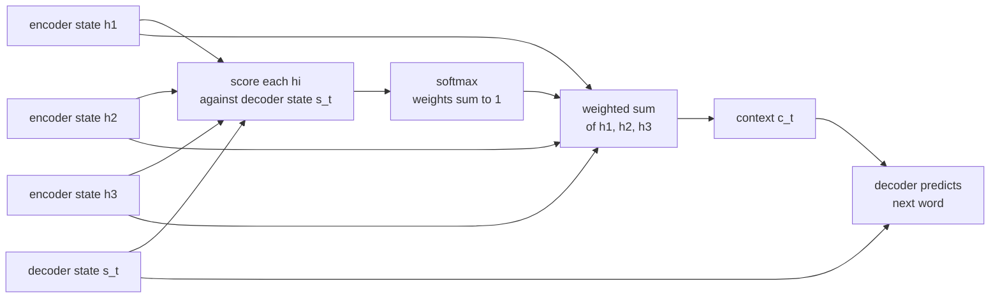

The [seq2seq model](/learn/sequence-models/sequence-modeling) squeezes an entire input sentence into one fixed-size vector before the decoder writes a single word. For short sentences that works; for long ones, quality drops sharply, because a few hundred numbers cannot faithfully hold everything. **Attention** removes the bottleneck: at every output step the decoder looks back at *all* encoder states and takes a weighted average of the ones that matter right now. Introduced for translation in 2014, attention turned out to be more important than the recurrence it was added to. The Transformer, the architecture behind every modern large language model, is built from attention alone.

## The bottleneck problem

In a plain encoder-decoder, the decoder's only view of the input is the encoder's final hidden state $\mathbf{h}_T$. Everything about word 1 of a 50-word sentence must survive 49 recurrent updates and then be read back out at the right moment. Gated cells help, but the capacity is still fixed regardless of input length.

Attention keeps every encoder hidden state $\mathbf{h}_1, \dots, \mathbf{h}_T$ and lets the decoder build a fresh **context vector** at every output step:



When translating "the black cat" into French, the step that produces "chat" can put most of its weight on the encoder state for "cat", regardless of where it sits in the sentence. The attention weights are often interpretable as a soft alignment between source and target words.

## The general recipe

Every attention mechanism follows the same three steps. Given a **query** (what the decoder is looking for), a set of **keys** (one per encoder position, used for matching) and **values** (one per position, what gets returned):

1. **Score** each key against the query: $e_i = \text{score}(\mathbf{q}, \mathbf{k}_i)$.
2. **Normalise** the scores with a softmax: $\alpha_i = \dfrac{\exp(e_i)}{\sum_j \exp(e_j)}$, so the weights are positive and sum to 1.
3. **Combine** the values: $\mathbf{c} = \sum_i \alpha_i \mathbf{v}_i$.

In the original RNN setting the keys and values are both the encoder states $\mathbf{h}_i$, and the query is the decoder state $\mathbf{s}_t$. The mechanisms differ mainly in the score function.

## Additive and dot-product attention

| | Additive (Bahdanau) | Dot-product (Luong) |
| --- | --- | --- |
| Score | $\mathbf{v}^\top \tanh\left(W_1 \mathbf{s}_t + W_2 \mathbf{h}_i\right)$ | $\mathbf{s}_t^\top \mathbf{h}_i$ |
| Learned parameters | $W_1$, $W_2$, $\mathbf{v}$ | None (or one matrix $W$ in the "general" form $\mathbf{s}_t^\top W \mathbf{h}_i$) |
| Query and key sizes | Can differ | Must match (unless $W$ is used) |
| Computation | A small feed-forward network per pair | One matrix multiplication for all pairs |

In the additive form, $W_1$ and $W_2$ project the decoder and encoder states into a shared space and $\mathbf{v}$ turns the result into a scalar score. Dot-product attention is simpler and, because all scores come from one matrix product, much faster on GPUs. That speed is why it won.

## Scaled dot-product attention

Stack all queries into a matrix $Q$ (one row per query), keys into $K$ and values into $V$. Then all scores, weights and outputs come from two matrix multiplications:

$$
\operatorname{Attention}(Q, K, V) = \operatorname{softmax}\left(\frac{QK^\top}{\sqrt{d_k}}\right) V
$$

$Q$ is $m \times d_k$ ($m$ queries), $K$ is $n \times d_k$ ($n$ keys), $V$ is $n \times d_v$, the softmax is applied to each row separately, and the result is $m \times d_v$: one context vector per query.

Why divide by $\sqrt{d_k}$? If the components of a query and a key are independent with mean 0 and variance 1, their dot product is a sum of $d_k$ such products and has variance $d_k$. With large $d_k$ the scores spread widely, the softmax saturates into an almost one-hot vector, and its gradients become tiny. Dividing by $\sqrt{d_k}$ brings the variance back to 1:

```python
import numpy as np

rng = np.random.default_rng(0)
for d in [4, 64, 512]:
    q = rng.normal(size=(10_000, d))
    k = rng.normal(size=(10_000, d))
    dots = (q * k).sum(axis=1)
    print(f"d_k={d:3d}  std of q.k = {dots.std():5.2f}   after scaling = {(dots / np.sqrt(d)).std():.2f}")
```

```output
d_k=  4  std of q.k =  2.00   after scaling = 1.00
d_k= 64  std of q.k =  8.08   after scaling = 1.01
d_k=512  std of q.k = 22.58   after scaling = 1.00
```

## Computing it by hand

One query, three keys with $d_k = 4$, and three 2-dimensional values. The query is identical to the first key, orthogonal to the second and half-aligned with the third.

```trace
{
  "title": "scaled dot-product attention for one query",
  "code": [
    "scores = Q @ K.T / np.sqrt(4)",
    "weights = np.exp(scores) / np.exp(scores).sum()",
    "context = weights @ V",
    "print(context)"
  ],
  "steps": [
    { "line": 1, "vars": { "Q": "[1, 0, 1, 0]", "K rows": "[1,0,1,0] [0,1,0,1] [1,1,0,0]", "scores": "[1.0, 0.0, 0.5]" }, "note": "Raw dot products are 2, 0 and 1. Dividing by sqrt(d_k) = 2 gives 1.0, 0.0 and 0.5." },
    { "line": 2, "vars": { "scores": "[1.0, 0.0, 0.5]", "exp": "[2.7183, 1.0, 1.6487]", "weights": "[0.5065, 0.1863, 0.3072]" }, "note": "exp of each score, divided by their sum 5.3670. The weights are positive and sum to 1. The best-matching key gets about half the attention." },
    { "line": 3, "vars": { "weights": "[0.5065, 0.1863, 0.3072]", "V rows": "[1,2] [3,4] [5,6]", "context": "[2.6014, 3.6014]" }, "note": "First component: 0.5065(1) + 0.1863(3) + 0.3072(5) = 2.6014. The output is a blend of the values, weighted by relevance." },
    { "line": 4, "vars": { "context": "[2.6014, 3.6014]" }, "out": ["[[2.6014 3.6014]]"], "note": "One query produced one context vector of size d_v = 2." }
  ]
}
```

The same computation as a reusable function, with the usual trick of subtracting the row maximum before `exp` for numerical stability (it does not change the softmax):

```python
np.set_printoptions(precision=4, suppress=True)

def softmax(x):
    e = np.exp(x - x.max(axis=-1, keepdims=True))
    return e / e.sum(axis=-1, keepdims=True)

def attention(Q, K, V):
    d_k = Q.shape[-1]
    weights = softmax(Q @ K.T / np.sqrt(d_k))
    return weights @ V, weights

Q = np.array([[1.0, 0.0, 1.0, 0.0]])
K = np.array([[1.0, 0.0, 1.0, 0.0],
              [0.0, 1.0, 0.0, 1.0],
              [1.0, 1.0, 0.0, 0.0]])
V = np.array([[1.0, 2.0],
              [3.0, 4.0],
              [5.0, 6.0]])

context, weights = attention(Q, K, V)
print(weights)
print(context)
```

```output
[[0.5065 0.1863 0.3072]]
[[2.6014 3.6014]]
```

PyTorch provides the same operation as `torch.nn.functional.scaled_dot_product_attention`, which uses fused, memory-efficient kernels where available:

```python
import torch
import torch.nn.functional as F

out = F.scaled_dot_product_attention(torch.tensor(Q), torch.tensor(K), torch.tensor(V))
print(out)
```

```output
tensor([[2.6014, 3.6014]], dtype=torch.float64)
```

## Masking

Sometimes a query must not see certain keys. Two cases matter:

- **Padding mask.** Padded positions in a batch are not real tokens. Set their scores to $-\infty$ before the softmax so their weights become exactly 0.
- **Causal mask.** A language model predicting token $t$ must not attend to tokens after $t$, or training would leak the answer.

```python
scores = Q @ K.T / np.sqrt(4)
scores[:, 2] = -np.inf                   # pretend key 3 is padding
print(softmax(scores))
```

```output
[[0.7311 0.2689 0.    ]]
```

The weight on the masked key is 0 and the remaining weights are renormalised to sum to 1.

> [!TIP]
> Plotting the weight matrix (queries as rows, keys as columns) as a heat map is one of the best debugging tools for attention models. A translation model whose weights are uniform, or all on the first position, has usually not learned to align.

## From attention to the Transformer

Attention was first an add-on to RNNs. The 2017 paper "Attention Is All You Need" asked what happens if you drop the recurrence entirely:

| Idea | What it changes |
| --- | --- |
| **Self-attention** | Queries, keys and values all come from the *same* sequence (via three learned linear projections), so every token can look at every other token directly, in one step |
| **No recurrence** | All positions are computed in parallel, removing the sequential bottleneck that made RNN training slow |
| **Multi-head attention** | Several attention operations run side by side with different projections, each free to focus on a different kind of relationship |
| **Positional encodings** | With no recurrence, order must be injected explicitly into the inputs |

The path between any two tokens is now one attention step instead of up to $T$ recurrent steps, which addresses the long-range gradient problem that motivated the LSTM. The cost is that attention compares every pair of positions, so compute and memory grow with the square of the sequence length.

> [!KEY]
> The scaled dot-product formula in this lesson is, unchanged, the core operation of every Transformer. What Transformers add is where $Q$, $K$ and $V$ come from (learned projections of the same sequence), many heads in parallel, and many stacked layers.

You will build on this in [self-attention](/learn/generative-ai-fundamentals/self-attention) and the full [Transformer architecture](/learn/advanced-nlp/transformer-architecture).

## Exercises

**1.** Using `attention` from this lesson, change the query to `[[0.0, 1.0, 0.0, 1.0]]`. Which value receives the most weight, and why?

<details>
<summary>Show solution</summary>

```python
context, weights = attention(np.array([[0.0, 1.0, 0.0, 1.0]]), K, V)
print(weights, context)
```

```output
[[0.1863 0.5065 0.3072]] [[3.2417 4.2417]]
```

The query now equals the second key, so that key has the highest score (1.0 after scaling) and the context moves towards the second value `[3, 4]`.

</details>

**2.** Multiply the query by 10 and recompute the weights. What happens, and how does this relate to the $\sqrt{d_k}$ scaling?

<details>
<summary>Show solution</summary>

```python
_, w = attention(10 * Q, K, V)
print(w)
```

```output
[[0.9933 0.     0.0067]]
```

The scores are ten times larger, so the softmax becomes almost one-hot on the best key. Large scores saturate the softmax, and the gradients with respect to the other scores become close to zero. Scaling by $\sqrt{d_k}$ prevents scores from growing with the dimension for exactly this reason.

</details>

**3.** Write a causal mask for a sequence of 4 tokens in self-attention: a 4 by 4 boolean array that is `True` where attention is **not** allowed.

<details>
<summary>Show solution</summary>

Token $i$ may attend to tokens $0, \dots, i$, so everything strictly above the diagonal is masked.

```python
mask = np.triu(np.ones((4, 4), dtype=bool), k=1)
print(mask)
```

```output
[[False  True  True  True]
 [False False  True  True]
 [False False False  True]
 [False False False False]]
```

Apply it with `scores[mask] = -np.inf` before the softmax.

</details>

```quiz
[
  {
    "q": "What problem did attention originally solve in seq2seq models?",
    "options": [
      "The decoder had to rely on one fixed-size vector summarising the whole input",
      "RNNs could not process numbers",
      "Embeddings were too large",
      "The softmax was too slow"
    ],
    "answer": 0,
    "why": "Attention lets the decoder build a new context vector from all encoder states at every step, removing the single-vector bottleneck."
  },
  {
    "q": "In scaled dot-product attention, why divide the scores by the square root of `d_k`?",
    "options": [
      "To make the weights sum to 1",
      "To keep the variance of the scores near 1 so the softmax does not saturate",
      "To reduce memory use",
      "To make the attention causal"
    ],
    "answer": 1,
    "why": "Dot products of random d_k-dimensional vectors have variance d_k. Scaling restores unit variance and keeps gradients healthy."
  },
  {
    "q": "`Q` has shape `(5, 64)`, `K` has shape `(9, 64)` and `V` has shape `(9, 32)`. What is the shape of the attention output?",
    "options": [
      "`(9, 32)`",
      "`(5, 9)`",
      "`(5, 32)`",
      "`(5, 64)`"
    ],
    "answer": 2,
    "why": "The weight matrix is (5, 9); multiplying by V (9, 32) gives one 32-dimensional output per query."
  },
  {
    "q": "How does additive attention differ from dot-product attention?",
    "options": [
      "Additive attention does not use a softmax",
      "Dot-product attention has more learned parameters",
      "Additive attention can only be used in Transformers",
      "Additive attention scores each pair with a small learned network, while dot-product attention uses a plain or weighted inner product"
    ],
    "answer": 3,
    "why": "Additive attention computes v^T tanh(W1 s + W2 h); dot-product attention computes s^T h, which is a single fast matrix product for all pairs."
  }
]
```
