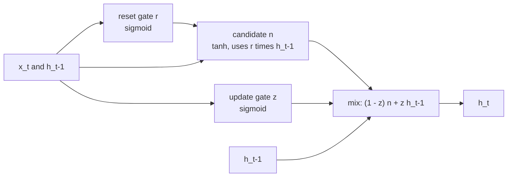

The **gated recurrent unit** (GRU), proposed by Cho and colleagues in 2014, is a streamlined alternative to the [LSTM](/learn/sequence-models/lstm). It keeps the key idea, gates that let the network decide what to remember, but merges the cell state and hidden state into one vector and uses two gates instead of three. The result has about 25% fewer parameters than an LSTM of the same hidden size, runs a little faster, and on many tasks performs comparably. Knowing both lets you read older papers and code, and make a reasoned choice instead of a habitual one.

## From LSTM to GRU

The LSTM carries two vectors, $\mathbf{c}_t$ (memory) and $\mathbf{h}_t$ (what is exposed), and uses separate forget and input gates. The GRU makes two simplifications:

1. **One state vector.** There is only $\mathbf{h}_t$. No separate cell state, and no output gate.
2. **Coupled forget and input.** A single **update gate** $\mathbf{z}_t$ decides how much of the old state to keep; whatever is not kept is replaced by the new candidate. Keeping more automatically means writing less.

A second gate, the **reset gate** $\mathbf{r}_t$, controls how much of the previous state is used when computing the candidate.

## The equations

PyTorch's `nn.GRU` computes, for each step:

$$
\begin{aligned}
\mathbf{r}_t &= \sigma\left(W_{ir}\mathbf{x}_t + \mathbf{b}_{ir} + W_{hr}\mathbf{h}_{t-1} + \mathbf{b}_{hr}\right) \\
\mathbf{z}_t &= \sigma\left(W_{iz}\mathbf{x}_t + \mathbf{b}_{iz} + W_{hz}\mathbf{h}_{t-1} + \mathbf{b}_{hz}\right) \\
\mathbf{n}_t &= \tanh\left(W_{in}\mathbf{x}_t + \mathbf{b}_{in} + \mathbf{r}_t \odot \left(W_{hn}\mathbf{h}_{t-1} + \mathbf{b}_{hn}\right)\right) \\
\mathbf{h}_t &= (1 - \mathbf{z}_t) \odot \mathbf{n}_t + \mathbf{z}_t \odot \mathbf{h}_{t-1}
\end{aligned}
$$

$\mathbf{x}_t$ is the input (size $d$), $\mathbf{h}_{t-1}$ the previous state (size $n$), $\sigma$ the sigmoid, $\odot$ element-wise multiplication, $\mathbf{n}_t$ the candidate state, and each $W_{i\cdot}$ is $n \times d$ and each $W_{h\cdot}$ is $n \times n$.

The last line is the heart of the GRU: the new state is a per-unit **interpolation** between the old state and the candidate. When $\mathbf{z}_t$ is near 1 the unit copies its old value forward, which gives the same kind of gradient highway as the LSTM's cell state: $\partial \mathbf{h}_t / \partial \mathbf{h}_{t-1}$ contains the term $\operatorname{diag}(\mathbf{z}_t)$ with no weight matrix.



> [!NOTE]
> Papers and libraries differ in small ways. Some write the final line as $\mathbf{h}_t = \mathbf{z}_t \odot \mathbf{n}_t + (1 - \mathbf{z}_t) \odot \mathbf{h}_{t-1}$, so the meaning of "z near 1" is flipped. The original paper applies the reset gate to $\mathbf{h}_{t-1}$ *before* the matrix multiplication; PyTorch (following cuDNN) applies it *after*, as above. The behaviour is very similar, but if you port weights between frameworks, check which convention each one uses.

## What each gate does

| Gate | Range | Near 0 means | Near 1 means |
| --- | --- | --- | --- |
| Update $\mathbf{z}_t$ | 0 to 1 | Overwrite the unit with the new candidate | Keep the old value, ignore this input |
| Reset $\mathbf{r}_t$ | 0 to 1 | Compute the candidate as if there were no past (fresh start) | Let the past fully shape the candidate |

A unit with update gate stuck near 1 is a long-term memory slot. A unit whose reset gate often drops to 0 behaves like a detector for short local patterns, for instance word boundaries in character-level text.

## One step by hand, checked against PyTorch

PyTorch stacks the GRU weights in the order **reset, update, new**. Note that the recurrent part of the candidate keeps its own bias inside the reset multiplication, so it has to be computed separately:

```python
import numpy as np
import torch
from torch import nn

torch.manual_seed(0)
gru = nn.GRU(input_size=3, hidden_size=2)
W_ih = gru.weight_ih_l0.detach().numpy()    # (3*2, 3)
W_hh = gru.weight_hh_l0.detach().numpy()    # (3*2, 2)
b_ih = gru.bias_ih_l0.detach().numpy()
b_hh = gru.bias_hh_l0.detach().numpy()

def sigmoid(v):
    return 1 / (1 + np.exp(-v))

def gru_step(x, h):
    gi = W_ih @ x + b_ih                      # input contributions for r, z, n
    gh = W_hh @ h + b_hh                      # recurrent contributions for r, z, n
    i_r, i_z, i_n = np.split(gi, 3)
    h_r, h_z, h_n = np.split(gh, 3)
    r = sigmoid(i_r + h_r)
    z = sigmoid(i_z + h_z)
    n = np.tanh(i_n + r * h_n)
    return (1 - z) * n + z * h

x1, x2 = np.array([1.0, -0.5, 0.2]), np.array([0.3, 0.8, -1.0])
h = gru_step(x2, gru_step(x1, np.zeros(2)))

seq = torch.tensor(np.stack([x1, x2]), dtype=torch.float32).reshape(2, 1, 3)  # (time, batch, features)
_, h_n = gru(seq)
print("numpy:", h.round(4))
print("torch:", h_n.detach().numpy().ravel().round(4))
```

```output
numpy: [-0.5517 -0.513 ]
torch: [-0.5517 -0.513 ]
```

## Parameter count and speed

With three gate pre-activations instead of four, a single GRU layer in PyTorch has

$$
\text{params} = 3\left(n d + n^2 + 2n\right)
$$

```python
for name, cls in [("RNN", nn.RNN), ("GRU", nn.GRU), ("LSTM", nn.LSTM)]:
    count = sum(p.numel() for p in cls(input_size=64, hidden_size=128).parameters())
    print(f"{name:5s} {count:7,d}")
```

```output
RNN    24,832
GRU    74,496
LSTM   99,328
```

The ratio is exactly 1 : 3 : 4. Fewer parameters means slightly less computation per step and somewhat less tendency to overfit on small datasets, but the sequential dependency between steps is the same for all three, so none of them parallelises across time the way attention does.

## LSTM or GRU?

| Aspect | LSTM | GRU |
| --- | --- | --- |
| State | $\mathbf{h}_t$ and $\mathbf{c}_t$ | $\mathbf{h}_t$ only |
| Gates | Input, forget, output (plus candidate) | Update, reset (plus candidate) |
| Parameters per layer | $4(nd + n^2 + 2n)$ | $3(nd + n^2 + 2n)$ |
| Memory control | Separate decisions to forget and to write | Forgetting and writing are coupled |
| Can hide memory from output | Yes, via the output gate | No, the state is the output |
| PyTorch return value | `output, (h_n, c_n)` | `output, h_n` |

Empirical comparisons across many tasks have generally found neither cell consistently better; differences are usually smaller than those from tuning hidden size, learning rate and regularisation. A reasonable default: start with a GRU when data or compute is limited, try an LSTM if you have the budget, and pick on validation results, not reputation.

## nn.GRU shapes, and an unpacking trap

`nn.GRU` takes the same arguments as `nn.LSTM` (`input_size`, `hidden_size`, `num_layers`, `batch_first`, `bidirectional`, `dropout`) and returns `output` with shape `(batch, seq_len, D * hidden_size)` when batch-first, and `h_n` with shape `(D * num_layers, batch, hidden_size)`. There is no `c_n`.

The trap appears when you switch an LSTM model to a GRU and leave the LSTM-style unpacking in place:

```python
torch.manual_seed(0)
x = torch.randn(4, 7, 10)

gru1 = nn.GRU(10, 32, batch_first=True)
try:
    output, (h_n, c_n) = gru1(x)
except ValueError as e:
    print("1 layer:", e)

gru2 = nn.GRU(10, 32, num_layers=2, batch_first=True)
output, (h_n, c_n) = gru2(x)
print("2 layers: no error. h_n:", h_n.shape, " c_n:", c_n.shape)
```

```output
1 layer: not enough values to unpack (expected 2, got 1)
2 layers: no error. h_n: torch.Size([4, 32])  c_n: torch.Size([4, 32])
```

With one layer, Python tries to unpack a tensor of shape `(1, 4, 32)` into two names and fails loudly. With two layers, `h_n` has shape `(2, 4, 32)`, so the unpacking **succeeds**: `h_n` silently becomes layer 1's final state and `c_n` becomes layer 2's. The model trains, just on the wrong features. Write `output, h_n = gru(x)` and take `h_n[-1]` for the top layer.

> [!WARNING]
> Errors that only appear for some hyperparameter values, like this one, survive quick tests. When you change a recurrent cell type or the number of layers, add an `assert` on the shape of the tensor you feed to the next layer.

## Exercises

**1.** Compute the number of parameters in `nn.GRU(input_size=20, hidden_size=50, num_layers=2)`. Remember that layer 2's input is layer 1's output.

<details>
<summary>Show solution</summary>

Layer 1: $3(50 \times 20 + 50^2 + 100) = 3(1000 + 2500 + 100) = 10800$. Layer 2 has input size 50: $3(2500 + 2500 + 100) = 15300$. Total $26100$.

```python
print(sum(p.numel() for p in nn.GRU(20, 50, num_layers=2).parameters()))
```

```output
26100
```

</details>

**2.** Using `gru_step` from this lesson, what is $\mathbf{h}_t$ if the update gate is exactly 1 for every unit? What if it is exactly 0?

<details>
<summary>Show solution</summary>

With $\mathbf{z}_t = 1$: $\mathbf{h}_t = 0 \cdot \mathbf{n}_t + 1 \cdot \mathbf{h}_{t-1} = \mathbf{h}_{t-1}$, the state is copied unchanged and the input is ignored. With $\mathbf{z}_t = 0$: $\mathbf{h}_t = \mathbf{n}_t$, the state is replaced by the candidate, much like a vanilla RNN step (modulated by the reset gate).

</details>

**3.** Rewrite this LSTM classifier's `forward` so that it works with `nn.GRU` for any number of layers.

```python
def forward(self, x):
    _, (h_n, _) = self.rnn(x)
    return self.head(h_n[-1])
```

<details>
<summary>Show solution</summary>

```python
def forward(self, x):
    _, h_n = self.rnn(x)              # GRU returns a single tensor
    return self.head(h_n[-1])         # top layer's final state: (batch, hidden)
```

</details>

```quiz
[
  {
    "q": "Which statement about the GRU is correct?",
    "options": [
      "It has a cell state and a hidden state, like the LSTM",
      "It has one state vector and uses an update gate to interpolate between the old state and a candidate",
      "It has no gates and relies on gradient clipping",
      "It has four gates, one more than the LSTM"
    ],
    "answer": 1,
    "why": "The GRU merges cell and hidden state, and h_t = (1 - z) n + z h_t-1 interpolates per unit."
  },
  {
    "q": "In PyTorch's convention, what does an update gate value near 1 do?",
    "options": [
      "Keeps the previous state for that unit almost unchanged",
      "Erases the unit's memory",
      "Ignores the previous state when computing the candidate",
      "Doubles the learning rate for that unit"
    ],
    "answer": 0,
    "why": "With z near 1, h_t is approximately h_t-1. Ignoring the past when computing the candidate is the reset gate's job (r near 0)."
  },
  {
    "q": "A 2-layer `nn.GRU` is called with `output, (h_n, c_n) = gru(x)`. What happens?",
    "options": [
      "A `ValueError` is raised",
      "PyTorch returns a zero cell state",
      "It runs, but `h_n` and `c_n` are the final states of layer 1 and layer 2",
      "The GRU behaves like an LSTM"
    ],
    "answer": 2,
    "why": "h_n has shape (2, batch, hidden), so Python unpacks it along the first dimension into two layer states. It only fails loudly with one layer."
  },
  {
    "q": "For the same input and hidden size, how does a GRU layer's parameter count compare with an LSTM layer's?",
    "options": [
      "Equal",
      "Half",
      "Three quarters",
      "Twice"
    ],
    "answer": 2,
    "why": "The GRU has three blocks of gate weights against the LSTM's four, so 3/4 of the parameters."
  }
]
```
