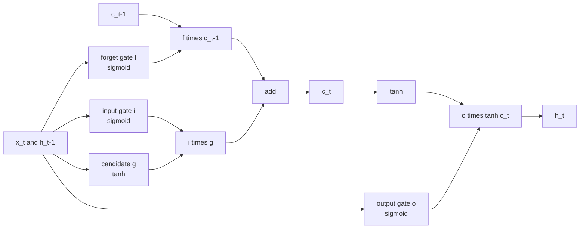

The [vanilla RNN](/learn/sequence-models/recurrent-neural-networks) has a short memory: its gradient shrinks a little at every step, so it struggles to learn anything that depends on inputs far in the past. The **long short-term memory** network (LSTM), introduced by Hochreiter and Schmidhuber in 1997, fixes this with a second state vector, the **cell state**, and a set of learned **gates** that decide what to write to it, what to keep and what to read out. For about two decades the LSTM was the default model for speech, translation, handwriting and time series, and you will still meet it in production systems and in older code you are asked to maintain.

## The core idea: an additive memory

In a vanilla RNN the whole state is rewritten at every step: $\mathbf{h}_t = \tanh(W_{hh}\mathbf{h}_{t-1} + \dots)$. Information from the past survives only if it passes through that matrix multiplication and squashing again and again.

The LSTM adds a cell state $\mathbf{c}_t$ that is updated by **element-wise scaling and addition** instead:

$$
\mathbf{c}_t = \mathbf{f}_t \odot \mathbf{c}_{t-1} + \mathbf{i}_t \odot \mathbf{g}_t
$$

where $\odot$ is element-wise multiplication. If the forget gate $\mathbf{f}_t$ is close to 1 and the input gate $\mathbf{i}_t$ is close to 0, the cell state passes through unchanged, and so does its gradient: $\partial \mathbf{c}_t / \partial \mathbf{c}_{t-1} = \operatorname{diag}(\mathbf{f}_t)$, with no weight matrix in the way. The network can learn to hold a value for hundreds of steps. This uninterrupted path is often called the **constant error carousel**.

> [!KEY]
> The LSTM does not remove the vanishing gradient problem by magic. It gives the network a path where the gradient is multiplied by learned gate values instead of by a fixed weight matrix, so the network can choose to keep the gradient alive where it matters.

## The gate equations

At each step the LSTM reads the input $\mathbf{x}_t$ and the previous hidden state $\mathbf{h}_{t-1}$ and computes four vectors, each of the hidden size $n$:

$$
\begin{aligned}
\mathbf{i}_t &= \sigma\left(W_{ii}\mathbf{x}_t + W_{hi}\mathbf{h}_{t-1} + \mathbf{b}_i\right) \\
\mathbf{f}_t &= \sigma\left(W_{if}\mathbf{x}_t + W_{hf}\mathbf{h}_{t-1} + \mathbf{b}_f\right) \\
\mathbf{g}_t &= \tanh\left(W_{ig}\mathbf{x}_t + W_{hg}\mathbf{h}_{t-1} + \mathbf{b}_g\right) \\
\mathbf{o}_t &= \sigma\left(W_{io}\mathbf{x}_t + W_{ho}\mathbf{h}_{t-1} + \mathbf{b}_o\right) \\
\mathbf{c}_t &= \mathbf{f}_t \odot \mathbf{c}_{t-1} + \mathbf{i}_t \odot \mathbf{g}_t \\
\mathbf{h}_t &= \mathbf{o}_t \odot \tanh(\mathbf{c}_t)
\end{aligned}
$$

$\sigma$ is the sigmoid function, which outputs values in $(0, 1)$, so each gate acts as a soft, per-unit switch. Each $W_{i\cdot}$ is $n \times d$ (input size $d$), each $W_{h\cdot}$ is $n \times n$, and each $\mathbf{b}$ has length $n$.



## What each gate is for

| Gate | Range | Question it answers | Intuition |
| --- | --- | --- | --- |
| Forget $\mathbf{f}_t$ | 0 to 1 | How much of the old memory should I keep? | Reset a "subject is plural" flag when a new sentence starts |
| Input $\mathbf{i}_t$ | 0 to 1 | How much of the new candidate should I write? | Write only when something worth remembering appears |
| Candidate $\mathbf{g}_t$ | -1 to 1 | What new content could I write? | The proposed value, before the input gate filters it |
| Output $\mathbf{o}_t$ | 0 to 1 | Which parts of memory are relevant right now? | Hold a fact in the cell without letting it affect the current output |

A practical detail: initialising the forget-gate bias to a positive value (such as 1) makes the cell remember by default early in training. Some libraries do this automatically; PyTorch does not, but you can set it yourself (see Exercise 2).

## One step by hand, checked against PyTorch

PyTorch stores the four gates' weights stacked in one matrix in the order **input, forget, candidate, output**. Writing one step in NumPy using PyTorch's own weights is a good way to make sure you understand the equations:

```python
import numpy as np
import torch
from torch import nn

torch.manual_seed(0)
lstm = nn.LSTM(input_size=3, hidden_size=2)
W_ih = lstm.weight_ih_l0.detach().numpy()     # (4*2, 3)
W_hh = lstm.weight_hh_l0.detach().numpy()     # (4*2, 2)
b = (lstm.bias_ih_l0 + lstm.bias_hh_l0).detach().numpy()

def sigmoid(z):
    return 1 / (1 + np.exp(-z))

def lstm_step(x, h, c):
    z = W_ih @ x + W_hh @ h + b
    i, f, g, o = np.split(z, 4)               # PyTorch's gate order
    i, f, g, o = sigmoid(i), sigmoid(f), np.tanh(g), sigmoid(o)
    c = f * c + i * g
    h = o * np.tanh(c)
    return h, c

x = np.array([1.0, -0.5, 0.2])
h, c = lstm_step(x, np.zeros(2), np.zeros(2))

out, (h_t, c_t) = lstm(torch.tensor(x, dtype=torch.float32).reshape(1, 1, 3))
print("numpy  h:", h.round(4), " c:", c.round(4))
print("torch  h:", h_t.detach().numpy().ravel().round(4), " c:", c_t.detach().numpy().ravel().round(4))
```

```output
numpy  h: [-0.1436 -0.0638]  c: [-0.2225 -0.0938]
torch  h: [-0.1436 -0.0638]  c: [-0.2225 -0.0938]
```

## Counting parameters

Each of the four gates has its own input weights, recurrent weights and bias. PyTorch uses two bias vectors per gate (`bias_ih` and `bias_hh`), so for one layer:

$$
\text{params} = 4\left(n d + n^2 + 2n\right)
$$

For $d = 10$ and $n = 32$ that is $4(320 + 1024 + 64) = 5632$, exactly four times a vanilla RNN of the same size:

```python
lstm = nn.LSTM(input_size=10, hidden_size=32)
for name, p in lstm.named_parameters():
    print(f"{name:14s} {tuple(p.shape)}")
print("total:", sum(p.numel() for p in lstm.parameters()))
```

```output
weight_ih_l0   (128, 10)
weight_hh_l0   (128, 32)
bias_ih_l0     (128,)
bias_hh_l0     (128,)
total: 5632
```

In a stacked LSTM, layer 2's input size is the hidden size of layer 1 (doubled if bidirectional), so its count differs from layer 1's.

## nn.LSTM shapes

`nn.LSTM` returns `output, (h_n, c_n)`. The shapes are the part people get wrong, so learn them once:

| Tensor | Shape with `batch_first=True` | Contents |
| --- | --- | --- |
| input | `(batch, seq_len, input_size)` | The sequence |
| `output` | `(batch, seq_len, D * hidden_size)` | Top layer's $\mathbf{h}_t$ at every step |
| `h_n` | `(D * num_layers, batch, hidden_size)` | Final $\mathbf{h}$ of every layer and direction |
| `c_n` | `(D * num_layers, batch, hidden_size)` | Final $\mathbf{c}$ of every layer and direction |

$D$ is 2 when `bidirectional=True`, otherwise 1. Note that `h_n` and `c_n` are **never** batch-first.

```python
torch.manual_seed(0)
lstm = nn.LSTM(input_size=10, hidden_size=32, num_layers=2,
               batch_first=True, bidirectional=True)
x = torch.randn(4, 7, 10)            # batch 4, 7 steps, 10 features
output, (h_n, c_n) = lstm(x)
print(output.shape, h_n.shape, c_n.shape)
```

```output
torch.Size([4, 7, 64]) torch.Size([4, 4, 32]) torch.Size([4, 4, 32])
```

Here `h_n` has 4 rows because $D \times \text{num\_layers} = 2 \times 2$; the fact that the batch size is also 4 is a coincidence that makes shape bugs harder to spot. Pick distinct sizes when you test.

## A common shape bug

You want a sequence classifier that uses the final hidden state. A frequent first attempt:

```python
torch.manual_seed(0)
lstm = nn.LSTM(input_size=10, hidden_size=32, batch_first=True)
x = torch.randn(4, 7, 10)
output, (h_n, c_n) = lstm(x)

wrong = output[-1]          # last element along dim 0, which is the batch
right = output[:, -1, :]    # last time step for every sequence
also_right = h_n[-1]        # final state of the top layer
print(wrong.shape, right.shape, also_right.shape)
print(torch.allclose(right, also_right))
```

```output
torch.Size([7, 32]) torch.Size([4, 32]) torch.Size([4, 32])
True
```

`output[-1]` silently picks the **last example in the batch**, with shape `(7, 32)`. If the next layer is `nn.Linear(32, num_classes)`, it happily accepts that shape and produces 7 predictions for one example instead of 4 predictions for the batch. The error, if any, only appears later in the loss function as a batch-size mismatch, far from its real cause. The habit that prevents this: **print shapes after every recurrent layer** while building the model, and use `h_n[-1]` for the top layer's final state.

> [!WARNING]
> With bidirectional LSTMs, `output[:, -1, :]` is not "the final state" for the backward direction: the backward pass ends at position 0. Use `h_n[-2]` (forward, top layer) and `h_n[-1]` (backward, top layer) and concatenate them. With padded batches, `output[:, -1, :]` reads padding; use packed sequences, covered in [sequence modeling](/learn/sequence-models/sequence-modeling).

A clean classifier:

```python
class LSTMClassifier(nn.Module):
    def __init__(self, input_size, hidden_size, num_classes):
        super().__init__()
        self.lstm = nn.LSTM(input_size, hidden_size, batch_first=True)
        self.head = nn.Linear(hidden_size, num_classes)

    def forward(self, x):                  # x: (batch, seq_len, input_size)
        _, (h_n, _) = self.lstm(x)         # h_n: (1, batch, hidden_size)
        return self.head(h_n[-1])          # (batch, num_classes)

model = LSTMClassifier(10, 32, 3)
print(model(torch.randn(4, 7, 10)).shape)
```

```output
torch.Size([4, 3])
```

## Exercises

**1.** How many parameters does a single-layer `nn.LSTM(input_size=50, hidden_size=100)` have? Work it out, then check in code.

<details>
<summary>Show solution</summary>

$4(100 \times 50 + 100^2 + 2 \times 100) = 4(5000 + 10000 + 200) = 60800$.

```python
print(sum(p.numel() for p in nn.LSTM(50, 100).parameters()))
```

```output
60800
```

</details>

**2.** Set the forget-gate bias of a one-layer `nn.LSTM(10, 32)` to 1.0 and leave the other biases unchanged.

<details>
<summary>Show solution</summary>

The bias vectors have length $4n$ in the order input, forget, candidate, output, so the forget gate occupies indices $n$ to $2n$. Since PyTorch adds `bias_ih` and `bias_hh`, set one to 1 and zero the other for that slice.

```python
lstm = nn.LSTM(10, 32)
n = lstm.hidden_size
with torch.no_grad():
    lstm.bias_ih_l0[n:2 * n].fill_(1.0)
    lstm.bias_hh_l0[n:2 * n].zero_()
print((lstm.bias_ih_l0 + lstm.bias_hh_l0)[n:2 * n].detach().unique())
```

```output
tensor([1.])
```

</details>

**3.** In the equations, what happens to the cell state if the forget gate is all zeros and the input gate is all ones for one step?

<details>
<summary>Show solution</summary>

$\mathbf{c}_t = 0 \odot \mathbf{c}_{t-1} + 1 \odot \mathbf{g}_t = \mathbf{g}_t$. The old memory is erased completely and replaced by the candidate. That step behaves like a vanilla RNN update (with a $\tanh$ candidate), and no gradient flows back into $\mathbf{c}_{t-1}$ through the cell path.

</details>

```quiz
[
  {
    "q": "Which equation gives the LSTM its long-range gradient path?",
    "options": [
      "`h_t = o_t * tanh(c_t)`",
      "`i_t = sigmoid(W x + U h + b)`",
      "`c_t = f_t * c_t-1 + i_t * g_t`",
      "`g_t = tanh(W x + U h + b)`"
    ],
    "answer": 2,
    "why": "The cell update is element-wise scaling plus addition, so the gradient from c_t to c_t-1 is just the forget gate, with no weight matrix multiplication."
  },
  {
    "q": "What does the output gate control?",
    "options": [
      "How much of the cell state is exposed as the hidden state at this step",
      "How much of the old cell state is kept",
      "The learning rate of the cell",
      "Whether the sequence ends"
    ],
    "answer": 0,
    "why": "h_t = o_t * tanh(c_t): the cell can hold information that the output gate keeps hidden from the current output."
  },
  {
    "q": "For `nn.LSTM(10, 32, batch_first=True)` and input of shape `(4, 7, 10)`, what is `output[-1].shape`?",
    "options": [
      "`(4, 32)`",
      "`(7, 32)`",
      "`(4, 7)`",
      "`(1, 4, 32)`"
    ],
    "answer": 1,
    "why": "With batch_first, dim 0 is the batch, so output[-1] is every time step of the last example. Use output[:, -1, :] or h_n[-1]."
  },
  {
    "q": "A single-layer LSTM and a vanilla RNN have the same input and hidden sizes. How do their parameter counts compare in PyTorch?",
    "options": [
      "They are equal",
      "The LSTM has twice as many",
      "The LSTM has three times as many",
      "The LSTM has four times as many"
    ],
    "answer": 3,
    "why": "The LSTM computes four gate pre-activations (input, forget, candidate, output), each with the same weight shapes as the RNN's single one."
  }
]
```
