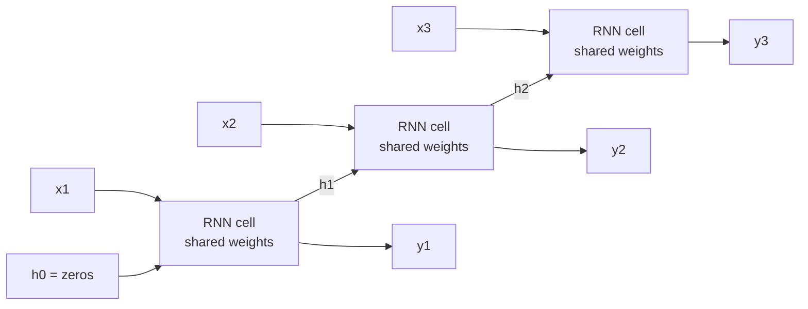

The networks you have built so far take a fixed-size input and produce an output in one pass. A great deal of real data does not look like that. A sentence is a sequence of tokens of any length, a sensor produces a reading every second, and a customer's history is a series of events in order. Order matters in all of them: "dog bites man" is not "man bites dog". A **recurrent neural network** (RNN) handles this by reading a sequence one step at a time and carrying a memory, the **hidden state**, from each step to the next. RNNs have largely been replaced by Transformers for language, but they remain in use for streaming and small-footprint models, and the problems they ran into (vanishing gradients, the memory bottleneck) explain why LSTMs, attention and Transformers look the way they do.

## Why a plain feed-forward network struggles

Suppose you want to classify reviews as positive or negative with the multilayer perceptron from [neural network architecture](/learn/neural-network-fundamentals/neural-network-architecture). Three problems appear at once:

| Problem | Why it hurts |
| --- | --- |
| Variable length | An MLP needs a fixed input size. Reviews have 5 words or 500. |
| No parameter sharing | If position 3 learns "not good" means negative, position 40 has to learn it again with separate weights. |
| Order is ignored or rigid | Averaging word vectors throws order away; concatenating them ties meaning to absolute positions. |

An RNN solves all three with one idea: apply **the same small network at every time step**, feeding it the current input and its own previous output.

## The recurrence

At each step $t$ the RNN combines the input $\mathbf{x}_t$ with the previous hidden state $\mathbf{h}_{t-1}$:

$$
\mathbf{h}_t = \tanh\left(W_{xh}\,\mathbf{x}_t + W_{hh}\,\mathbf{h}_{t-1} + \mathbf{b}_h\right)
$$

$$
\mathbf{y}_t = W_{hy}\,\mathbf{h}_t + \mathbf{b}_y
$$

Here $\mathbf{x}_t \in \mathbb{R}^{d}$ is the input at step $t$ (for example a word embedding), $\mathbf{h}_t \in \mathbb{R}^{n}$ is the hidden state, $W_{xh}$ is an $n \times d$ input-to-hidden matrix, $W_{hh}$ is an $n \times n$ hidden-to-hidden matrix, $\mathbf{b}_h$ is a bias, and $W_{hy}, \mathbf{b}_y$ map the hidden state to an output $\mathbf{y}_t$. The initial state $\mathbf{h}_0$ is usually a vector of zeros. Crucially, $W_{xh}$, $W_{hh}$ and $\mathbf{b}_h$ are **the same at every step**: the number of parameters does not depend on sequence length.

The loop is easier to reason about when you **unroll** it in time. The unrolled picture is one network per time step, all sharing weights:



The hidden state is the network's only memory. Everything it knows about $x_1$ by step 3 has to survive two passes through $W_{hh}$ and $\tanh$. Keep that in mind; it is the source of most of the trouble later.

## A forward pass in NumPy

Here is a tiny RNN with a 1-dimensional input and a 2-dimensional hidden state, reading the sequence $1.0, 0.5, -1.0$. Step through it and watch the hidden state evolve.

```trace
{
  "title": "RNN forward pass over three steps",
  "code": [
    "import numpy as np",
    "W_xh = np.array([[0.5], [-0.3]])",
    "W_hh = np.array([[0.1, 0.4], [-0.2, 0.3]])",
    "b_h = np.array([0.0, 0.1])",
    "h = np.zeros(2)",
    "for x in [1.0, 0.5, -1.0]:",
    "    a = W_xh[:, 0] * x + W_hh @ h + b_h",
    "    h = np.tanh(a)",
    "    print(np.round(h, 4))"
  ],
  "steps": [
    { "line": 5, "vars": { "h": "[0, 0]" }, "note": "The hidden state starts at zero: the network has seen nothing yet." },
    { "line": 7, "vars": { "x": "1.0", "h": "[0, 0]", "a": "[0.5, -0.2]" }, "note": "W_xh x = [0.5, -0.3]. W_hh h is zero because h is zero. Adding b_h gives [0.5, -0.2]." },
    { "line": 9, "vars": { "x": "1.0", "h": "[0.4621, -0.1974]", "a": "[0.5, -0.2]" }, "out": ["[ 0.4621 -0.1974]"], "note": "tanh squashes each pre-activation into (-1, 1). This is h1." },
    { "line": 7, "vars": { "x": "0.5", "h": "[0.4621, -0.1974]", "a": "[0.2173, -0.2016]" }, "out": ["[ 0.4621 -0.1974]"], "note": "Now W_hh h1 contributes: 0.1(0.4621) + 0.4(-0.1974) = -0.0328 for the first unit. Plus 0.25 from the input gives 0.2173." },
    { "line": 9, "vars": { "x": "0.5", "h": "[0.2139, -0.1989]", "a": "[0.2173, -0.2016]" }, "out": ["[ 0.4621 -0.1974]", "[ 0.2139 -0.1989]"], "note": "h2 mixes the new input with a memory of x1." },
    { "line": 7, "vars": { "x": "-1.0", "h": "[0.2139, -0.1989]", "a": "[-0.5582, 0.2975]" }, "out": ["[ 0.4621 -0.1974]", "[ 0.2139 -0.1989]"], "note": "The negative input pushes the first unit down and the second up." },
    { "line": 9, "vars": { "x": "-1.0", "h": "[-0.5066, 0.2891]", "a": "[-0.5582, 0.2975]" }, "out": ["[ 0.4621 -0.1974]", "[ 0.2139 -0.1989]", "[-0.5066  0.2891]"], "note": "h3 is a fixed-size summary of the whole sequence. A classifier would read this vector." }
  ]
}
```

The same code as a runnable block, so you can confirm the numbers:

```python
import numpy as np

W_xh = np.array([[0.5], [-0.3]])
W_hh = np.array([[0.1, 0.4], [-0.2, 0.3]])
b_h = np.array([0.0, 0.1])

h = np.zeros(2)
for x in [1.0, 0.5, -1.0]:
    a = W_xh[:, 0] * x + W_hh @ h + b_h
    h = np.tanh(a)
    print(np.round(h, 4))
```

```output
[ 0.4621 -0.1974]
[ 0.2139 -0.1989]
[-0.5066  0.2891]
```

## The same RNN in PyTorch

PyTorch's `nn.RNN` implements exactly this recurrence, with one small difference: it has two bias vectors (`bias_ih` and `bias_hh`) that are simply added together. If you copy our weights in, you get the same hidden states:

```python
import torch
from torch import nn

rnn = nn.RNN(input_size=1, hidden_size=2, batch_first=True)
with torch.no_grad():
    rnn.weight_ih_l0.copy_(torch.tensor([[0.5], [-0.3]]))
    rnn.weight_hh_l0.copy_(torch.tensor([[0.1, 0.4], [-0.2, 0.3]]))
    rnn.bias_ih_l0.copy_(torch.tensor([0.0, 0.1]))
    rnn.bias_hh_l0.zero_()

x = torch.tensor([[[1.0], [0.5], [-1.0]]])   # (batch=1, time=3, features=1)
output, h_n = rnn(x)
print(output.shape, h_n.shape)
print(output.detach().numpy().round(4))
```

```output
torch.Size([1, 3, 2]) torch.Size([1, 1, 2])
[[[ 0.4621 -0.1974]
  [ 0.2139 -0.1989]
  [-0.5066  0.2891]]]
```

`output` holds the hidden state at **every** step, shape `(batch, time, hidden)`. `h_n` holds only the **final** hidden state, shape `(num_layers, batch, hidden)`. With `batch_first=True` only the input and `output` are batch-first; `h_n` is not. The [LSTM lesson](/learn/sequence-models/lstm) returns to this, because it causes real bugs.

## Backpropagation through time

Training an RNN uses ordinary [backpropagation](/learn/neural-network-fundamentals/backpropagation) on the unrolled graph. This is called **backpropagation through time** (BPTT). Because the weights are shared, the gradient for $W_{hh}$ is the sum of its contributions from every time step.

The interesting part is how a loss at step $T$ reaches an early hidden state $\mathbf{h}_k$. By the [chain rule](/learn/calculus/chain-rule), it passes through every step in between:

$$
\frac{\partial \mathbf{h}_T}{\partial \mathbf{h}_k} = \prod_{t=k+1}^{T} \frac{\partial \mathbf{h}_t}{\partial \mathbf{h}_{t-1}} = \prod_{t=k+1}^{T} \operatorname{diag}\left(1 - \mathbf{h}_t^2\right) W_{hh}
$$

where $1 - \mathbf{h}_t^2$ is the derivative of $\tanh$ applied element-wise. The gradient is multiplied by (roughly) the same matrix $T - k$ times.

For long sequences, full BPTT is expensive in memory, because every hidden state must be stored. **Truncated BPTT** splits a long sequence into chunks of, say, 100 steps, carries the hidden state forward between chunks, but calls `h = h.detach()` so gradients stop at the chunk boundary. The model can still *use* information older than 100 steps; it just cannot be *trained* to keep it.

## Vanishing and exploding gradients

Repeated multiplication by the same matrix either shrinks or grows a vector exponentially, depending on whether the matrix's largest eigenvalue magnitude (its **spectral radius**, see [eigenvalues and eigenvectors](/learn/linear-algebra/eigenvalues-and-eigenvectors)) is below or above 1. Ignoring the $\tanh$ factor, which can only shrink things further:

```python
import numpy as np

rng = np.random.default_rng(0)
W = rng.normal(size=(16, 16))
W /= np.max(np.abs(np.linalg.eigvals(W)))     # spectral radius exactly 1

g = np.ones(16)
for radius in [0.8, 1.2]:
    norms = []
    for steps in [1, 10, 50]:
        v = np.linalg.matrix_power(radius * W, steps) @ g
        norms.append(f"{np.linalg.norm(v):.3g}")
    print(f"radius {radius}: after 1, 10, 50 steps ->", norms)
```

```output
radius 0.8: after 1, 10, 50 steps -> ['3.38', '0.286', '3.81e-05']
radius 1.2: after 1, 10, 50 steps -> ['5.07', '16.5', '2.43e+04']
```

| Problem | Symptom in training | Main remedies |
| --- | --- | --- |
| **Vanishing gradients** | Loss improves, but the model ignores anything more than a few steps back | Gated cells ([LSTM](/learn/sequence-models/lstm), [GRU](/learn/sequence-models/gru)), attention, good initialisation |
| **Exploding gradients** | Loss suddenly jumps or becomes `nan` | Gradient clipping, lower learning rate |

> [!KEY]
> Vanishing gradients do not crash anything, which makes them dangerous. A vanilla RNN trained on long sequences quietly learns to rely on the last few inputs only. This, not speed, is the main reason gated cells replaced the plain RNN.

## Gradient clipping

Exploding gradients have a simple, reliable fix: if the overall gradient norm exceeds a threshold $c$, rescale it to have norm $c$:

$$
\mathbf{g} \leftarrow \mathbf{g} \cdot \min\left(1, \frac{c}{\lVert \mathbf{g} \rVert}\right)
$$

where $\mathbf{g}$ is all parameter gradients concatenated into one vector. The direction is unchanged; only the step size is capped. In PyTorch it is one line between `backward()` and `step()` in the [training loop](/learn/pytorch/training-loops):

```python
loss.backward()
torch.nn.utils.clip_grad_norm_(model.parameters(), max_norm=1.0)
optimizer.step()
optimizer.zero_grad()
```

`clip_grad_norm_` returns the norm *before* clipping. Logging it is a cheap way to see whether clipping is active on most steps (threshold too low) or never (harmless insurance). Values between 0.5 and 5 are common starting points. Clipping does nothing for vanishing gradients; you cannot rescale a signal that has already decayed to almost zero.

> [!WARNING]
> Clip after `loss.backward()` and before `optimizer.step()`. Clipping before `backward()` acts on stale gradients from the previous step, or on nothing at all.

## Exercises

**1.** Using the NumPy RNN from this lesson, feed the sequence `[0.0, 0.0, 0.0]`. What is the hidden state after the first step, and why is it not zero?

<details>
<summary>Show solution</summary>

With $x = 0$ and $\mathbf{h}_0 = 0$, the pre-activation is just the bias $[0.0, 0.1]$, so $\mathbf{h}_1 = \tanh([0, 0.1]) \approx [0, 0.0997]$. The bias alone moves the state, and from then on $W_{hh}$ keeps mixing it, so later states are not zero either.

```python
h = np.zeros(2)
for x in [0.0, 0.0, 0.0]:
    h = np.tanh(W_xh[:, 0] * x + W_hh @ h + b_h)
    print(np.round(h, 4))
```

```output
[0.     0.0997]
[0.0398 0.1292]
[0.0556 0.13  ]
```

</details>

**2.** How many trainable parameters does `nn.RNN(input_size=10, hidden_size=32)` have? Check your answer in code.

<details>
<summary>Show solution</summary>

$W_{ih}$ is $32 \times 10 = 320$, $W_{hh}$ is $32 \times 32 = 1024$, and there are two bias vectors of 32 each, so $320 + 1024 + 64 = 1408$.

```python
print(sum(p.numel() for p in nn.RNN(10, 32).parameters()))
```

```output
1408
```

</details>

**3.** A training run's loss is steady for 2,000 steps, then suddenly becomes `nan`. Name the likely cause and two changes you would make.

<details>
<summary>Show solution</summary>

An exploding gradient produced a huge update that pushed the weights into a region where activations overflow. Add gradient clipping with `clip_grad_norm_` (and log the pre-clip norm to confirm spikes), and lower the learning rate. Also check the data near that step for extreme values.

</details>

```quiz
[
  {
    "q": "Which weights does an RNN share across time steps?",
    "options": [
      "Only the output weights",
      "None: each step has its own weights",
      "The input-to-hidden, hidden-to-hidden and bias parameters",
      "Only the initial hidden state"
    ],
    "answer": 2,
    "why": "The same cell, with the same W_xh, W_hh and b_h, is applied at every step. That is why the parameter count does not depend on sequence length."
  },
  {
    "q": "For `nn.RNN(..., batch_first=True)` with 2 layers, batch 8, 20 steps and hidden size 64, what is the shape of `h_n`?",
    "options": [
      "`(8, 20, 64)`",
      "`(2, 8, 64)`",
      "`(8, 2, 64)`",
      "`(8, 64)`"
    ],
    "answer": 1,
    "why": "`h_n` is always `(num_layers * num_directions, batch, hidden)`. `batch_first` affects only the input and `output`."
  },
  {
    "q": "Why do gradients vanish in a vanilla RNN on long sequences?",
    "options": [
      "The gradient is multiplied by a similar Jacobian at every step, and repeated factors smaller than 1 shrink it exponentially",
      "The learning rate is too large",
      "tanh outputs are always zero",
      "PyTorch truncates gradients after 10 steps by default"
    ],
    "answer": 0,
    "why": "The product of many Jacobians, each involving W_hh and tanh derivatives of at most 1, shrinks exponentially when the spectral radius is below 1."
  },
  {
    "q": "What does gradient clipping by norm change?",
    "options": [
      "The direction of the gradient",
      "The magnitude of the gradient, only when it exceeds the threshold",
      "Which parameters receive gradients",
      "It fixes vanishing gradients"
    ],
    "answer": 1,
    "why": "Clipping rescales the whole gradient vector to the maximum norm when it is too large, keeping its direction. It cannot restore gradients that have vanished."
  }
]
```
