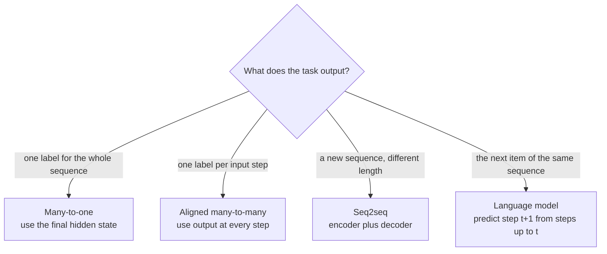
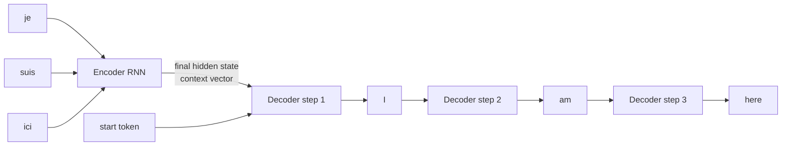

You now have three recurrent cells: the [RNN](/learn/sequence-models/recurrent-neural-networks), the [LSTM](/learn/sequence-models/lstm) and the [GRU](/learn/sequence-models/gru). This lesson is about the problems you build with them. The same cell can classify a review, tag every word in a sentence, translate between languages or generate text; what changes is how inputs and outputs are arranged around it, how a batch of different-length sequences is fed in, and how the model is trained. These patterns (many-to-one, seq2seq, teacher forcing, next-token prediction) outlived RNNs: they are exactly how Transformer-based language models are framed today.

## Input-output patterns

Sequence tasks are usually classified by how many inputs map to how many outputs.

| Pattern | Input | Output | Examples |
| --- | --- | --- | --- |
| One-to-many | One vector | A sequence | Image captioning (image in, words out) |
| Many-to-one | A sequence | One label or value | Sentiment classification, predicting next week's total sales |
| Many-to-many, aligned | A sequence | One output per input step | Part-of-speech tagging, named-entity tagging, frame-level speech labels |
| Many-to-many, seq2seq | A sequence | A sequence of a different length | Translation, summarisation, speech-to-text |



In PyTorch the first two differ only in what you feed to the output layer. With `output, h_n = rnn(x)` and `batch_first=True`:

```python
import torch
from torch import nn

torch.manual_seed(0)
rnn = nn.GRU(input_size=8, hidden_size=16, batch_first=True)
head = nn.Linear(16, 5)
x = torch.randn(3, 6, 8)                 # 3 sequences, 6 steps, 8 features

output, h_n = rnn(x)
print("many-to-one :", head(h_n[-1]).shape)    # one prediction per sequence
print("many-to-many:", head(output).shape)     # one prediction per step
```

```output
many-to-one : torch.Size([3, 5])
many-to-many: torch.Size([3, 6, 5])
```

`nn.Linear` applies to the last dimension, so it works on `(batch, time, hidden)` without any reshaping.

## Seq2seq: encoder and decoder

When input and output lengths differ, a single RNN is not enough. The **sequence-to-sequence** model uses two: an **encoder** reads the whole input and summarises it in its final hidden state; a **decoder** starts from that state and generates the output one token at a time, feeding each generated token back in as its next input. Generation stops when the decoder emits a special end-of-sequence token.



That single context vector has to hold everything about the input sentence, however long. This **bottleneck** limits quality on long inputs and is the problem that [attention](/learn/sequence-models/attention-mechanisms) was invented to solve. Phase 6 builds full seq2seq systems in [sequence-to-sequence models](/learn/advanced-nlp/sequence-to-sequence-models).

## Padding and packing

A batch is a single tensor, so every sequence in it must have the same length. You **pad** shorter sequences with a filler value (usually 0) up to the longest one:

```python
from torch.nn.utils.rnn import pad_sequence, pack_padded_sequence, pad_packed_sequence

seqs = [torch.tensor([3, 7, 2, 9]), torch.tensor([5, 1]), torch.tensor([8, 4, 6])]
lengths = torch.tensor([len(s) for s in seqs])
padded = pad_sequence(seqs, batch_first=True, padding_value=0)
print(padded)
```

```output
tensor([[3, 7, 2, 9],
        [5, 1, 0, 0],
        [8, 4, 6, 0]])
```

Padding creates two problems. The RNN processes the padding steps, which changes the final hidden state of short sequences, and `output[:, -1]` reads a padding position for every sequence shorter than the longest. The fix is to **pack** the batch: `pack_padded_sequence` records each sequence's true length, so the RNN stops updating each sequence at its own end and `h_n` holds the state at the real last token.

```python
torch.manual_seed(0)
emb = nn.Embedding(num_embeddings=10, embedding_dim=4, padding_idx=0)
gru = nn.GRU(input_size=4, hidden_size=3, batch_first=True)

x = emb(padded)                                        # (3, 4, 4)
packed = pack_padded_sequence(x, lengths, batch_first=True, enforce_sorted=False)
packed_out, h_n = gru(packed)
out, out_lengths = pad_packed_sequence(packed_out, batch_first=True)

# The final state of the 2-step sequence equals its output at step 2 (index 1)
print(torch.allclose(h_n[-1][1], out[1, 1]))
# Without packing, the same sequence's state after the padding steps is different
_, h_unpacked = gru(x)
print(torch.allclose(h_n[-1][1], h_unpacked[-1][1]))
print(out[1].detach())                                 # padded positions come back as zeros
```

```output
True
False
tensor([[-0.7289, -0.1905,  0.4211],
        [-0.3012, -0.0148, -0.0726],
        [ 0.0000,  0.0000,  0.0000],
        [ 0.0000,  0.0000,  0.0000]])
```

`enforce_sorted=False` lets you pass sequences in any order; PyTorch sorts and unsorts internally. `padding_idx=0` keeps the embedding of the padding token fixed at zero.

> [!WARNING]
> `pack_padded_sequence` expects `lengths` on the CPU, even when the data is on a GPU. Padding positions must also be excluded from the loss in many-to-many tasks: `nn.CrossEntropyLoss(ignore_index=PAD_ID)` does this when the targets use the padding ID.

## Language-model framing

A **language model** predicts the next item of a sequence from the items before it. You build training data from raw text with no labelling at all: the target is the input shifted one position to the left.

```python
text = "hello world"
vocab = sorted(set(text))
stoi = {ch: i for i, ch in enumerate(vocab)}
ids = [stoi[ch] for ch in text]

inputs, targets = ids[:-1], ids[1:]
for i in range(4):
    print(f"given {text[:i + 1]!r:9} predict {text[i + 1]!r}")
print(inputs)
print(targets)
```

```output
given 'h'       predict 'e'
given 'he'      predict 'l'
given 'hel'     predict 'l'
given 'hell'    predict 'o'
[3, 2, 4, 4, 5, 0, 7, 5, 6, 4]
[2, 4, 4, 5, 0, 7, 5, 6, 4, 1]
```

The model is an aligned many-to-many network: at every step it outputs a probability distribution over the vocabulary, and the loss is the average cross-entropy of the true next token. Mathematically the model factorises the probability of a whole sequence with the chain rule of probability:

$$
P(x_1, \dots, x_T) = \prod_{t=1}^{T} P(x_t \mid x_1, \dots, x_{t-1})
$$

where each factor is one softmax output of the network. Every modern large language model is trained with exactly this objective; only the network computing each factor has changed, from RNNs to Transformers.

```python
class CharLM(nn.Module):
    def __init__(self, vocab_size, emb_dim=32, hidden=64):
        super().__init__()
        self.emb = nn.Embedding(vocab_size, emb_dim)
        self.rnn = nn.LSTM(emb_dim, hidden, batch_first=True)
        self.head = nn.Linear(hidden, vocab_size)

    def forward(self, ids, state=None):            # ids: (batch, time)
        out, state = self.rnn(self.emb(ids), state)
        return self.head(out), state               # logits: (batch, time, vocab)

model = CharLM(len(vocab))
logits, _ = model(torch.tensor([inputs]))
loss = nn.functional.cross_entropy(logits.reshape(-1, len(vocab)), torch.tensor(targets))
print(logits.shape)
```

```output
torch.Size([1, 10, 8])
```

`cross_entropy` expects logits of shape `(N, classes)`, so the batch and time dimensions are flattened together. To generate text, feed a start character, sample from the softmax of the last logits, feed the sample back in with the returned `state`, and repeat.

## Teacher forcing

Training a decoder raises a question: at step $t$, what should it receive as input, its own previous prediction or the true previous token? **Teacher forcing** feeds the true token. It makes training fast and stable, because one bad early prediction cannot derail the rest of the sequence, and it allows the whole target sequence to be processed in one call.

The cost is a mismatch called **exposure bias**: during training the decoder only ever sees correct prefixes, but at inference it sees its own, sometimes wrong, outputs and may never have learned to recover. A common compromise is to use teacher forcing with probability $p$ at each step and decrease $p$ during training (often called scheduled sampling).

```python
import random

def decode_train(decoder, head, emb, h, targets, start_id, teacher_forcing=0.5):
    """targets: (batch, T) token ids. Returns logits (batch, T, vocab)."""
    batch, T = targets.shape
    token = torch.full((batch, 1), start_id)
    all_logits = []
    for t in range(T):
        out, h = decoder(emb(token), h)                 # one step
        logits = head(out)                              # (batch, 1, vocab)
        all_logits.append(logits)
        if random.random() < teacher_forcing:
            token = targets[:, t:t + 1]                 # feed the true token
        else:
            token = logits.argmax(-1)                   # feed the model's own guess
    return torch.cat(all_logits, dim=1)
```

> [!KEY]
> The language-model framing (predict the next token, train with teacher forcing on shifted targets) is the same recipe used for GPT-style models. What Transformers changed is that, with teacher forcing, all positions can be computed in parallel instead of one step at a time.

## Exercises

**1.** For each task, name the pattern and say whether you would read `h_n[-1]` or `output`: (a) flagging fraudulent card transactions one by one as they arrive, (b) predicting a patient's diagnosis from a full hospital stay, (c) converting a sentence to its phonetic transcription.

<details>
<summary>Show solution</summary>

(a) Aligned many-to-many: one decision per transaction, read `output` at every step (and for streaming, carry the state between calls). (b) Many-to-one: read `h_n[-1]`, with packing if stays have different lengths. (c) Seq2seq: input and output lengths differ, so use an encoder-decoder.

</details>

**2.** Build `(inputs, targets)` pairs of length 4 from the token list `[10, 11, 12, 13, 14, 15]` for a language model, using non-overlapping chunks.

<details>
<summary>Show solution</summary>

Each chunk needs 5 tokens: 4 inputs and the shifted targets.

```python
tokens = [10, 11, 12, 13, 14, 15]
L = 4
for start in range(0, len(tokens) - L, L):
    chunk = tokens[start:start + L + 1]
    print(chunk[:-1], chunk[1:])
```

```output
[10, 11, 12, 13] [11, 12, 13, 14]
```

Only one full chunk fits; the remaining token is dropped (or padded in a real pipeline).

</details>

**3.** Why might a seq2seq model trained with 100% teacher forcing produce fluent first words and then degrade into repetition at inference time?

<details>
<summary>Show solution</summary>

Exposure bias. During training every decoder input was a correct token, so the model never learned what to do after its own mistakes. At inference, one slightly wrong token produces a prefix unlike anything seen in training, errors compound, and the model often falls into a high-probability loop. Scheduled sampling, beam search and, in modern systems, much larger training sets reduce the effect.

</details>

```quiz
[
  {
    "q": "Which pattern fits machine translation?",
    "options": [
      "Many-to-one",
      "Aligned many-to-many",
      "One-to-many",
      "Sequence-to-sequence with an encoder and a decoder"
    ],
    "answer": 3,
    "why": "Input and output sentences have different lengths and word orders, so an encoder reads the source and a decoder generates the target."
  },
  {
    "q": "What does `pack_padded_sequence` achieve?",
    "options": [
      "It stops the RNN updating each sequence after its true length, so `h_n` is the state at the real last token",
      "It removes the need for an embedding layer",
      "It sorts the vocabulary",
      "It pads sequences to equal length"
    ],
    "answer": 0,
    "why": "Padding is done by `pad_sequence`. Packing tells the RNN the real lengths so padding steps are skipped."
  },
  {
    "q": "For the text `\"cat\"`, what are the language-model input and target sequences?",
    "options": [
      "Input `c a t`, target `c a t`",
      "Input `c a`, target `a t`",
      "Input `a t`, target `c a`",
      "Input `c`, target `t`"
    ],
    "answer": 1,
    "why": "The target is the input shifted one position left: given c predict a, given ca predict t."
  },
  {
    "q": "What is exposure bias?",
    "options": [
      "Overfitting caused by too many epochs",
      "Bias terms that grow too large",
      "The mismatch between training on true previous tokens and generating from the model's own previous outputs",
      "A bias towards frequent words in the vocabulary"
    ],
    "answer": 2,
    "why": "Teacher forcing shows the decoder only correct prefixes; at inference it must continue from its own, possibly wrong, outputs."
  }
]
```
