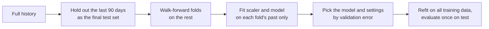

Forecasting means predicting future values of a series from its past: tomorrow's electricity demand, next week's sales per store, the CPU load of a server in an hour. It is one of the most common machine learning tasks in industry, and also one of the easiest to get subtly wrong. Random train/test splits, scalers fitted on the whole dataset and the lack of a simple baseline can make a useless model look excellent. This lesson teaches the workflow that keeps you honest: split by time, window the series, beat the baselines, and only then reach for an LSTM.

## A series to work with

The examples use two years of synthetic daily data with a slow upward trend, a weekly cycle and noise. Because you know how it was generated, you know what a good model should find.

```python
import numpy as np
import pandas as pd

rng = np.random.default_rng(42)
n = 730
t = np.arange(n)
y = 100 + 0.05 * t + 10 * np.sin(2 * np.pi * t / 7) + rng.normal(0, 3, n)
series = pd.Series(y, index=pd.date_range("2023-01-01", periods=n, freq="D"))

test_size = 90
train, test = series[:-test_size], series[-test_size:]
print(train.index[-1].date(), "|", test.index[0].date(), "->", test.index[-1].date())
print(series.head(3).round(2))
```

```output
2024-10-01 | 2024-10-02 -> 2024-12-30
2023-01-01    100.91
2023-01-02    104.75
2023-01-03    112.10
Freq: D, dtype: float64
```

The noise has standard deviation 3, so even a perfect model would have a mean absolute error of about $3\sqrt{2/\pi} \approx 2.4$. Keep that floor in mind when judging results.

## Splitting without leakage

In ordinary supervised learning you shuffle and split. In forecasting that is **leakage**: the model trains on Wednesday and is tested on the Tuesday before it, so it gets to see the future. The test set must come strictly **after** the training set, as above.

For model selection, use **walk-forward** (expanding-window) validation instead of shuffled [cross-validation](/learn/model-evaluation/cross-validation). Each fold trains on everything up to a point and validates on the period right after it:

```python
from sklearn.model_selection import TimeSeriesSplit

for fold, (tr, va) in enumerate(TimeSeriesSplit(n_splits=3, test_size=60).split(train)):
    print(f"fold {fold}: train days 0-{tr[-1]}, validate days {va[0]}-{va[-1]}")
```

```output
fold 0: train days 0-459, validate days 460-519
fold 1: train days 0-519, validate days 520-579
fold 2: train days 0-579, validate days 580-639
```



Leakage also hides in features. A 7-day rolling mean must use only days before the forecast day (`series.shift(1).rolling(7)`), not a centred window. Anything computed from the full dataset, including scalers and imputation values, must be fitted on the training period only.

## Baselines a model must beat

Before training anything, compute what trivial forecasts achieve. For a one-day-ahead forecast of $y_t$:

| Baseline | Forecast $\hat{y}_t$ | Good when |
| --- | --- | --- |
| Naive | $y_{t-1}$ | The series is a random walk (prices, many slowly changing quantities) |
| Seasonal naive | $y_{t-m}$, with season length $m$ | There is a strong cycle, such as weekly demand ($m = 7$) |
| Moving average | $\frac{1}{k}\sum_{i=1}^{k} y_{t-i}$ | The level is stable and noise is high |

Evaluate them with [MAE](/learn/model-evaluation/mae) and MAPE, the mean absolute percentage error:

$$
\text{MAE} = \frac{1}{N}\sum_{t} \lvert y_t - \hat{y}_t \rvert \qquad \text{MAPE} = \frac{100}{N}\sum_{t} \left\lvert \frac{y_t - \hat{y}_t}{y_t} \right\rvert
$$

where $N$ is the number of forecasts, $y_t$ the actual value and $\hat{y}_t$ the forecast. MAE is in the units of the series; MAPE is scale-free, which helps when comparing products of different sizes.

```python
def mae(actual, forecast):
    return np.mean(np.abs(actual - forecast))

def mape(actual, forecast):
    return 100 * np.mean(np.abs((actual - forecast) / actual))

baselines = {
    "naive": series.shift(1),
    "seasonal naive": series.shift(7),
    "moving average 7": series.shift(1).rolling(7).mean(),
}
for name, forecast in baselines.items():
    f = forecast[-test_size:]
    print(f"{name:17s} MAE {mae(test, f):.2f}   MAPE {mape(test, f):.2f}%")
```

```output
naive             MAE 6.04   MAPE 4.54%
seasonal naive    MAE 3.34   MAPE 2.49%
moving average 7  MAE 6.27   MAPE 4.72%
```

The seasonal naive forecast is far better than the other two because it captures the weekly cycle. Any model you build must beat 3.34, not 6.04.

> [!WARNING]
> MAPE is undefined when an actual value is zero and explodes when actuals are near zero, as with intermittent sales. It also penalises over-forecasts and under-forecasts asymmetrically. For such series report MAE, or a scaled error such as MAE divided by the seasonal naive MAE on the same data (the idea behind MASE).

## Windowing and scaling

To train a supervised model, turn the series into fixed-length **windows**: each input is the last $W$ values, each target is the next $H$ values.

```python
def make_windows(values, window, horizon=1):
    X, Y = [], []
    for i in range(len(values) - window - horizon + 1):
        X.append(values[i:i + window])
        Y.append(values[i + window:i + window + horizon])
    return np.array(X), np.array(Y)

X_demo, Y_demo = make_windows(np.arange(8), window=3, horizon=2)
print(X_demo[:2], Y_demo[:2], sep="\n")
```

```output
[[0 1 2]
 [1 2 3]]
[[3 4]
 [4 5]]
```

Neural networks train best on inputs of roughly unit scale, so standardise the series, fitting the scaler on the **training period only**. Then build 14-day windows and split them so that every training target lies in the training period.

```python
from sklearn.linear_model import Ridge
from sklearn.preprocessing import StandardScaler

W = 14
scaler = StandardScaler().fit(train.values.reshape(-1, 1))      # training data only
scaled = scaler.transform(series.values.reshape(-1, 1)).ravel()

X, Y = make_windows(scaled, W)
split = len(train) - W                     # windows whose target is in the training period
X_tr, Y_tr, X_te = X[:split], Y[:split].ravel(), X[split:]

ridge = Ridge(alpha=1.0).fit(X_tr, Y_tr)
pred = scaler.inverse_transform(ridge.predict(X_te).reshape(-1, 1)).ravel()
print(f"ridge on 14 lags  MAE {mae(test.values, pred):.2f}   MAPE {mape(test.values, pred):.2f}%")
```

```output
ridge on 14 lags  MAE 2.88   MAPE 2.15%
```

A linear model on lagged values beats the seasonal naive baseline (2.88 against 3.34) and gets reasonably close to the noise floor. That is the bar an LSTM has to clear.

## Multi-step forecasting

Usually you need more than one step ahead, for example the next 7 days. There are three standard strategies:

| Strategy | How | Trade-off |
| --- | --- | --- |
| Recursive | Train a one-step model; feed each prediction back in as an input for the next step | One model, but errors compound with the horizon |
| Direct | Train a separate model for each horizon $h = 1, \dots, H$ | No compounding, but $H$ models and no shared structure |
| Multi-output (MIMO) | One model outputs all $H$ values at once | One model, no feedback loop; natural for neural networks (final layer of size $H$) |

```python
H = 7
X7, Y7 = make_windows(scaled, W, H)
n_fit = len(train) - W - H + 1            # windows whose whole target is in training
multi = Ridge(alpha=1.0).fit(X7[:n_fit], Y7[:n_fit])

X_or, Y_or = X7[len(train) - W:], Y7[len(train) - W:]   # forecast origins in the test period
def unscale(a):
    return scaler.inverse_transform(a.reshape(-1, 1)).reshape(a.shape)

recursive = []
for x in X_or:
    window = list(x)
    for _ in range(H):
        window.append(ridge.predict(np.array(window[-W:]).reshape(1, -1))[0])
    recursive.append(window[-H:])

actual = unscale(Y_or)
for name, f in [("seasonal naive", unscale(X_or[:, -7:])),
                ("recursive", unscale(np.array(recursive))),
                ("multi-output", unscale(multi.predict(X_or)))]:
    print(f"{name:15s} MAE {mae(actual, f):.2f}   by horizon {np.abs(actual - f).mean(axis=0).round(2)}")
```

```output
seasonal naive  MAE 3.30   by horizon [3.25 3.28 3.31 3.27 3.29 3.33 3.36]
recursive       MAE 2.95   by horizon [2.94 3.02 3.04 2.94 2.9  2.88 2.93]
multi-output    MAE 2.93   by horizon [2.94 3.04 3.01 2.91 2.86 2.85 2.89]
```

Both strategies beat the baseline at every horizon here. On real data with a weaker signal, the recursive strategy's error usually grows faster with the horizon. Always report error **by horizon**, because an average can hide a model that is good tomorrow and useless next week.

## An LSTM forecaster

With windows in hand, an LSTM forecaster is a small many-to-one network with an $H$-unit output layer (the multi-output strategy). The windows need a feature dimension: shape `(batch, W, 1)`.

```python
import torch
from torch import nn

class LSTMForecaster(nn.Module):
    def __init__(self, hidden=32, horizon=7):
        super().__init__()
        self.lstm = nn.LSTM(input_size=1, hidden_size=hidden, batch_first=True)
        self.head = nn.Linear(hidden, horizon)

    def forward(self, x):                     # x: (batch, W, 1)
        _, (h_n, _) = self.lstm(x)
        return self.head(h_n[-1])             # (batch, horizon)

model = LSTMForecaster()
xb = torch.tensor(X7[:n_fit], dtype=torch.float32).unsqueeze(-1)
print(xb.shape, model(xb[:32]).shape)
```

```output
torch.Size([620, 14, 1]) torch.Size([32, 7])
```

Train it with `nn.MSELoss` or `nn.L1Loss` in a standard [training loop](/learn/pytorch/training-loops), select the epoch count with a walk-forward validation fold, inverse-transform the predictions and compare with the table above. Extra inputs such as day of week, holidays or price go in as additional features per time step (`input_size > 1`).

> [!KEY]
> Neural networks are not automatically the best forecasters. In public forecasting competitions and in industry, carefully tuned statistical methods (exponential smoothing, ARIMA) and gradient-boosted trees on lag and calendar features, such as [LightGBM](/learn/machine-learning-libraries/lightgbm), are frequently as accurate or more accurate, and much cheaper to train and explain. Deep models tend to pay off with many related series, rich covariates and large data. Always compare against seasonal naive and a boosted-tree model before committing to an LSTM.

## Exercises

**1.** A colleague standardises the full series, then splits it into train and test. Why is this leakage, and how do you fix it?

<details>
<summary>Show solution</summary>

The mean and standard deviation are computed partly from test-period values, so information about the future (for example that the level rises) reaches the training data. Fit the scaler on the training period only, as in the lesson, and use that fitted scaler to transform validation and test data.

</details>

**2.** Compute the MAE of a "seasonal moving average" baseline: the mean of the same weekday over the previous 4 weeks, $\frac{1}{4}(y_{t-7} + y_{t-14} + y_{t-21} + y_{t-28})$. Does it beat seasonal naive?

<details>
<summary>Show solution</summary>

```python
smav = (series.shift(7) + series.shift(14) + series.shift(21) + series.shift(28)) / 4
print(f"MAE {mae(test, smav[-test_size:]):.2f}")
```

```output
MAE 2.78
```

Yes, and it even beats the 14-lag ridge model (2.88). Averaging four weeks reduces the noise in the baseline, at the cost of lagging slightly behind the trend. This is a useful lesson in humility: a well-chosen baseline is sometimes the model to beat, and occasionally the model to ship.

</details>

**3.** Your model's MAPE is 4% and you are pleased. What should you check before reporting it?

<details>
<summary>Show solution</summary>

That the test set follows the training set in time, that no feature or scaler used future data, what the seasonal naive and naive baselines score on the same test period, the error by horizon, and whether any actual values are close to zero (which distorts MAPE).

</details>

```quiz
[
  {
    "q": "Why should you not use shuffled k-fold cross-validation for a forecasting model?",
    "options": [
      "It is too slow",
      "Training folds would contain observations from after the validation period, leaking the future",
      "scikit-learn does not allow it",
      "It always underestimates error"
    ],
    "answer": 1,
    "why": "Forecasting must only use the past. Walk-forward splits such as `TimeSeriesSplit` keep validation strictly after training."
  },
  {
    "q": "For daily retail sales with a strong weekly pattern, which baseline is usually hardest to beat?",
    "options": [
      "The mean of the whole training set",
      "Naive: yesterday's value",
      "Seasonal naive: the value 7 days earlier",
      "Always predicting zero"
    ],
    "answer": 2,
    "why": "Seasonal naive reproduces the weekly cycle exactly, which the naive forecast misses."
  },
  {
    "q": "Which multi-step strategy feeds each prediction back in as an input?",
    "options": [
      "Recursive",
      "Direct",
      "Multi-output",
      "Seasonal naive"
    ],
    "answer": 0,
    "why": "The recursive strategy rolls a one-step model forward, so errors can compound over the horizon."
  },
  {
    "q": "When is MAPE a poor choice of metric?",
    "options": [
      "When the series has a trend",
      "When comparing series of different scales",
      "When forecasts are made one day ahead",
      "When actual values can be zero or close to zero"
    ],
    "answer": 3,
    "why": "MAPE divides by the actual value, so it is undefined at zero and explodes near it."
  }
]
```
