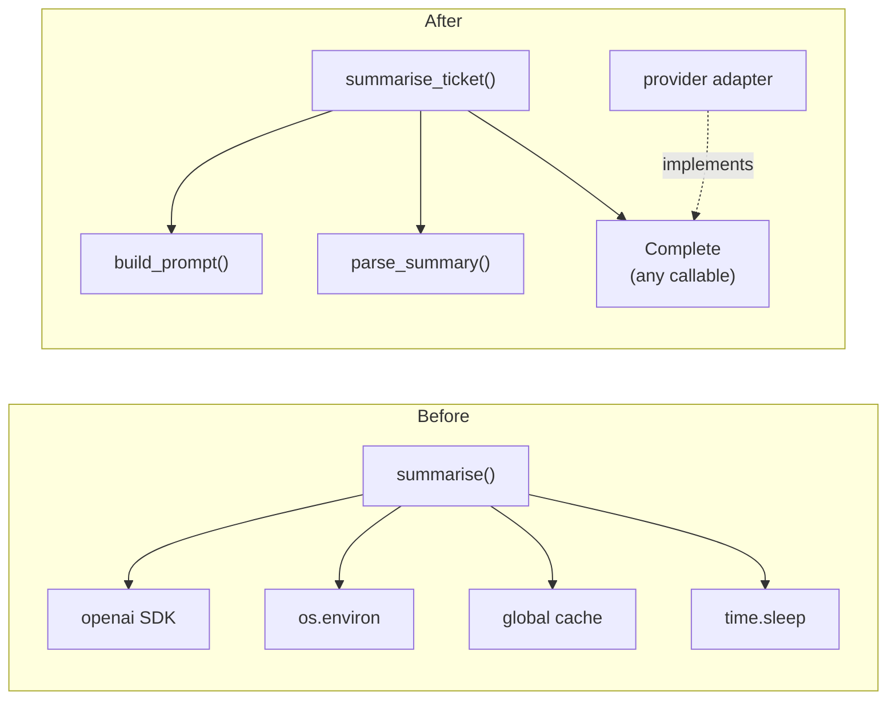

An AI feature usually starts life as a notebook cell or a quick script: call the model, parse the answer, print it. That code is fine for an afternoon. Once it sits behind an API that other people depend on, it has to survive new models, new prompts, new teammates and production incidents at two in the morning. Clean code is code that makes those changes cheap: you can read it quickly, test it in isolation and change one part without breaking another.

[Basic software development practices](/learn/developer-tools/basic-software-development-practices) introduced the foundations: PEP 8, good names, small functions, Ruff and docstrings. This lesson goes a level deeper. You will refactor a realistic messy function from an LLM-backed service step by step, and learn the ideas that explain *why* the result is better: cohesion, coupling and the SOLID principles.

## What makes code hard to change

Messy code is rarely messy because of formatting. Ruff fixes formatting in a second. The expensive problems are structural, and they have recognisable symptoms, often called **code smells**.

| Smell | What it looks like | Why it hurts |
| --- | --- | --- |
| Long function | 60 lines doing validation, I/O, business logic and formatting | You cannot test or reuse any one part |
| Magic numbers | `if len(text) > 12000`, `time.sleep(2)` | Nobody knows what the number means or where else it appears |
| Hidden dependencies | A function creates its own API client or reads `os.environ` | Tests have to hit the real API or patch globals |
| Flag arguments | `process(doc, True, False)` | The caller cannot tell what the booleans do |
| Deep nesting | Four levels of `if` inside a `for` inside a `try` | The happy path is buried |
| Mixed abstraction levels | HTTP status codes next to prompt wording | Every change touches unrelated concerns |

## A messy function from a real service

Here is a function of the kind that appears in many early AI services. It summarises a support ticket with an LLM.

```python
import json, os, time

cache = {}

def summarise(t, short=False, retry=True):
    # summarise ticket
    if t is None or len(t.strip()) == 0:
        return {"ok": False, "err": "empty"}
    if len(t) > 12000:
        t = t[:12000]
    if t in cache:
        return cache[t]
    from openai import OpenAI
    client = OpenAI(api_key=os.environ["OPENAI_API_KEY"])
    p = "Summarise this support ticket"
    if short:
        p += " in one sentence"
    p += ". Reply as JSON with keys summary and priority (1-3).\n\n" + t
    for i in range(3 if retry else 1):
        try:
            r = client.chat.completions.create(model="gpt-4o-mini", messages=[{"role": "user", "content": p}], temperature=0.2)
            d = json.loads(r.choices[0].message.content)
            if d["priority"] not in (1, 2, 3):
                d["priority"] = 2
            cache[t] = {"ok": True, "data": d}
            return cache[t]
        except Exception:
            time.sleep(2 ** i)
    return {"ok": False, "err": "failed"}
```

It works, but count the jobs it does: input validation, truncation, caching, client construction, prompt building, the network call, retries, JSON parsing and output validation. Count the problems too: three magic numbers, two flag arguments, a client built on every call, a bare `except Exception` that also swallows bugs such as `KeyError`, a module-level cache that grows forever, and a return value that is sometimes data and sometimes an error code. You cannot unit test the prompt or the parser without calling OpenAI.

## Refactoring it step by step

**Refactoring** means changing the structure of code without changing its behaviour. Do it in small steps, running the tests after each one. If there are no tests, write a few for the current behaviour first (the [unit testing](/learn/software-engineering/unit-testing) lesson shows how to do that without calling the real API).

### Step 1: name the magic numbers

```python
MAX_TICKET_CHARS = 12_000          # keeps the prompt well inside the context window
VALID_PRIORITIES = (1, 2, 3)
DEFAULT_PRIORITY = 2
MAX_ATTEMPTS = 3
```

A named constant documents intent and gives you one place to change it. The comment explains *why* the value exists, which the name cannot.

### Step 2: extract pure functions

A **pure function** depends only on its arguments and has no side effects. Pure functions are the easiest code to read and test, so pull as much logic as possible into them.

```python
from dataclasses import dataclass

@dataclass(frozen=True)
class TicketSummary:
    summary: str
    priority: int

def build_prompt(ticket: str, one_sentence: bool) -> str:
    length = " in one sentence" if one_sentence else ""
    return (
        f"Summarise this support ticket{length}. "
        "Reply as JSON with keys summary and priority (1-3).\n\n"
        f"{ticket[:MAX_TICKET_CHARS]}"
    )

def parse_summary(raw: str) -> TicketSummary:
    data = json.loads(raw)
    priority = data.get("priority")
    if priority not in VALID_PRIORITIES:
        priority = DEFAULT_PRIORITY
    return TicketSummary(summary=data["summary"], priority=priority)
```

The `TicketSummary` dataclass replaces a loose dictionary, so callers get attribute names and type hints instead of guessing keys.

### Step 3: inject the dependency

Instead of building an OpenAI client inside the function, accept anything that can complete a prompt. The function no longer knows which provider it talks to, and a test can pass in a fake.

```python
from typing import Callable

Complete = Callable[[str], str]   # takes a prompt, returns the model's text

class SummaryError(Exception):
    """Raised when a ticket cannot be summarised."""

def summarise_ticket(ticket: str, complete: Complete, one_sentence: bool = False) -> TicketSummary:
    if not ticket.strip():
        raise SummaryError("ticket is empty")
    raw = complete(build_prompt(ticket, one_sentence))
    try:
        return parse_summary(raw)
    except (json.JSONDecodeError, KeyError) as exc:
        raise SummaryError(f"model returned unusable output: {raw[:80]!r}") from exc
```

Errors are now exceptions with a specific type rather than `{"ok": False}` dictionaries, and only the two exceptions you expect are caught. Retries and caching have gone; they are cross-cutting concerns that belong in a wrapper, which the [design patterns](/learn/software-engineering/design-patterns) lesson builds as a decorator.

### Step 4: check the behaviour

Because the provider is injected, you can exercise the whole function with a stand-in that returns canned text:

```python
def fake_complete(prompt: str) -> str:
    return '{"summary": "Customer cannot reset password.", "priority": 7}'

result = summarise_ticket("I clicked reset but no email arrives.", fake_complete, one_sentence=True)
print(result)

try:
    summarise_ticket("   ", fake_complete)
except SummaryError as exc:
    print("SummaryError:", exc)
```

```output
TicketSummary(summary='Customer cannot reset password.', priority=2)
SummaryError: ticket is empty
```

The invalid priority 7 was replaced by the default, and the empty ticket raised a clear error. Every piece can now be tested in milliseconds.

## Cohesion and coupling

Two words explain most of what the refactoring achieved.

- **Cohesion** is how closely the contents of one unit (function, class, module) belong together. High cohesion is good: `parse_summary` does one thing.
- **Coupling** is how much one unit depends on the internals of another. Low coupling is good: `summarise_ticket` depends on a two-line contract (`str` in, `str` out), not on the OpenAI SDK.



In the "before" picture, changing provider, adding a test or moving the cache all mean editing the same function. In the "after" picture, the provider is plugged in from outside and each box can change alone.

## SOLID, pragmatically

SOLID is a set of five object-oriented design principles. Treat them as questions to ask when code is getting hard to change, not as rules to apply everywhere.

| Principle | The question it asks | AI-service example |
| --- | --- | --- |
| **S**ingle responsibility | Does this unit have one reason to change? | Prompt wording and HTTP retry policy change for different reasons, so they live apart |
| **O**pen/closed | Can I add behaviour without editing working code? | Adding a new model provider means adding an adapter, not editing every caller |
| **L**iskov substitution | Can any implementation stand in for the interface without surprises? | A fake LLM and the real one must both return `str`, never `None` on failure |
| **I**nterface segregation | Do callers depend on methods they never use? | A retriever needs `search()`, not the vector store's whole admin API |
| **D**ependency inversion | Does high-level logic depend on abstractions rather than concrete libraries? | `summarise_ticket` depends on `Complete`, not on `openai.OpenAI` |

> [!KEY]
> In Python the most valuable two are single responsibility and dependency inversion. Passing dependencies in as arguments, rather than creating them inside, is the single change that most improves testability.

Overusing SOLID produces its own smell: five layers of abstract classes around a ten-line script. Introduce an abstraction when you have, or clearly will have, a second implementation (a second provider, a fake for tests). Until then, a plain function is fine.

## Comments versus docstrings

They serve different readers.

| | Docstring | Comment |
| --- | --- | --- |
| Audience | People *calling* the code | People *editing* the code |
| Says | What it does, arguments, return value, exceptions | Why a non-obvious line is written this way |
| Where | First statement of a module, class or function | Next to the line it explains |
| Tooling | Shown by `help()`, IDE hovers, documentation generators | Ignored by tools |

```python
def parse_summary(raw: str) -> TicketSummary:
    """Parse the model's JSON reply into a TicketSummary.

    Raises:
        json.JSONDecodeError: if `raw` is not valid JSON.
        KeyError: if the reply has no "summary" key.
    """
    data = json.loads(raw)
    priority = data.get("priority")
    # The model occasionally invents priorities such as 0 or 4; clamp to the default
    # rather than failing the whole request.
    if priority not in VALID_PRIORITIES:
        priority = DEFAULT_PRIORITY
    return TicketSummary(summary=data["summary"], priority=priority)
```

Avoid comments that restate the code (`# loop over tickets`) or that record history (`# changed by Sam in March`); Git already records history. A comment that has to explain *what* a block does is often a hint to extract a well-named function instead.

> [!TIP]
> Let tools hold the line. Ruff's `C901` rule flags functions whose cyclomatic complexity (roughly, the number of independent paths) exceeds a threshold you set, and its `PLR` rules flag functions with too many arguments or branches. Enable them in `pyproject.toml` and the messy function above would fail the lint before review.

## Exercises

**1.** Find at least four problems in this function from an ML inference API, then list the refactoring steps you would take.

```python
def predict(x):
    import joblib
    m = joblib.load("/models/churn_v3.pkl")
    p = m.predict_proba([x])[0][1]
    if p > 0.62:
        return "churn"
    return "stay"
```

<details>
<summary>Show solution</summary>

Problems: the model is loaded from disk on every request (slow); the path is hard-coded; `0.62` is a magic number; the function mixes loading, inference and decision logic; it cannot be tested without the real model file.

Steps: load the model once at start-up and pass it in; move the path to configuration; name the threshold; split into a pure decision function.

```python
CHURN_THRESHOLD = 0.62   # chosen on the validation set to balance precision and recall

def churn_probability(model, features: list[float]) -> float:
    return model.predict_proba([features])[0][1]

def decide(probability: float, threshold: float = CHURN_THRESHOLD) -> str:
    return "churn" if probability > threshold else "stay"
```

</details>

**2.** Replace the flag arguments in `export(results, True, False)` with a clearer design.

<details>
<summary>Show solution</summary>

Either use keyword-only arguments so the call site names them, `def export(results, *, include_scores: bool, compress: bool)`, called as `export(results, include_scores=True, compress=False)`, or split into separate functions such as `export_with_scores(results)` when the flags select genuinely different behaviour.

</details>

**3.** Write a docstring and one useful comment for this function.

```python
def chunk(text, size=800, overlap=100):
    step = size - overlap
    return [text[i:i + size] for i in range(0, max(len(text) - overlap, 1), step)]
```

<details>
<summary>Show solution</summary>

```python
def chunk(text: str, size: int = 800, overlap: int = 100) -> list[str]:
    """Split text into overlapping character windows for embedding.

    Args:
        text: The document text.
        size: Characters per chunk.
        overlap: Characters shared by consecutive chunks; must be less than size.

    Returns:
        The chunks in document order. Empty text gives one empty chunk.
    """
    step = size - overlap
    # Stop before the final overlap so the last chunk is not a pure duplicate tail.
    return [text[i:i + size] for i in range(0, max(len(text) - overlap, 1), step)]
```

</details>

```quiz
[
  {
    "q": "Which change most improves the testability of a function that calls an LLM?",
    "options": [
      "Adding more comments",
      "Passing the LLM client (or a completion function) in as an argument",
      "Wrapping the body in `try`/`except Exception`",
      "Moving the function into a class"
    ],
    "answer": 1,
    "why": "Injecting the dependency lets a test supply a fake, so the logic can run without network calls. This is dependency inversion in practice."
  },
  {
    "q": "What does high cohesion mean?",
    "options": [
      "A module depends on many other modules",
      "The contents of a unit closely belong together and serve one purpose",
      "Every function is under ten lines",
      "Classes inherit from a common base"
    ],
    "answer": 1,
    "why": "Cohesion measures how related the parts of one unit are. Coupling, the other concept, measures dependence between units."
  },
  {
    "q": "Why was `except Exception` in the original function a problem?",
    "options": [
      "It is slower than a specific exception",
      "Python does not allow it inside a loop",
      "It also catches programming bugs such as `KeyError`, hiding them behind a retry",
      "It prevents the function from returning"
    ],
    "answer": 2,
    "why": "Catching everything turns real bugs into silent retries and vague failures. Catch only the exceptions you expect and can handle."
  },
  {
    "q": "Which belongs in a comment rather than a docstring?",
    "options": [
      "The reason a particular line clamps out-of-range values",
      "The arguments a function accepts",
      "The exceptions a function raises",
      "What the function returns"
    ],
    "answer": 0,
    "why": "Docstrings describe the contract for callers. Comments explain why a specific implementation choice was made, for people editing the code."
  }
]
```
