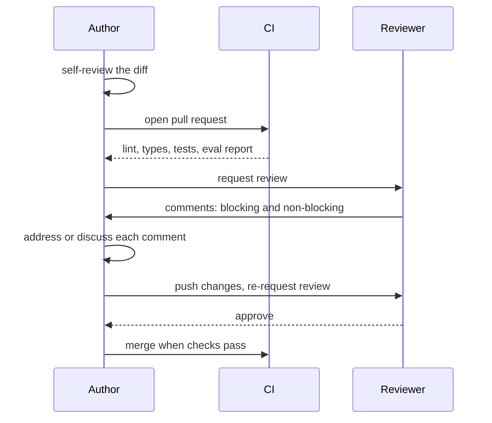

A code review is the moment a second person reads a change before it reaches `main`. It is the cheapest place to catch a bug, the best place to spread knowledge of the codebase, and, in AI teams, often the only place someone asks "did you run the evaluation before changing that prompt?". Done well, reviews make a team faster. Done badly, they become a queue of nitpicks and a source of friction.

[Basic software development practices](/learn/developer-tools/basic-software-development-practices) gave a short table of review etiquette. This lesson covers what to look for and in what order, a checklist specific to AI code, how to keep pull requests reviewable, and how to give and receive feedback well.

## What review is for

| Review is good at | Review is poor at |
| --- | --- |
| Logic errors, missed edge cases, wrong assumptions | Formatting and import order (let Ruff do it) |
| Design: is this the right place and shape for the change? | Finding bugs that only show at runtime (tests and monitoring do) |
| Spreading knowledge: now two people understand this code | Verifying large changes line by line |
| Catching security and privacy risks | Judging model quality by reading a prompt (evaluations do) |

Anything a machine can check should be checked by a machine before a human looks. CI should already have run the formatter, linter, type checker, tests and, for AI changes, the relevant evaluations. The reviewer's attention is the scarcest resource in the process; spend it on what only a human can judge.



## What to look for, in order

Read in order of importance, so the big issues come out first and you do not spend twenty comments on names in a change whose design is wrong.

1. **Purpose.** Does the description explain what and why? Does the change actually do that?
2. **Correctness.** Edge cases (empty input, `None`, very long text, unicode), error paths, concurrency, off-by-one errors, resource cleanup.
3. **Design.** Is the code in the right layer? Does the domain now import an SDK? Is there a simpler approach? (The [modular architecture](/learn/software-engineering/modular-architecture) and [clean code](/learn/software-engineering/clean-code) lessons are the vocabulary here.)
4. **Tests.** Is new behaviour tested? Would the tests fail if the code were wrong? Are LLM calls stubbed in unit tests?
5. **Security and privacy.** Secrets, injection, authorisation, personal data in logs.
6. **Operability.** Logging, metrics, error reporting, configuration, feature flags, rollback.
7. **Readability.** Names, comments, docstrings. Important, but last.

## A review checklist for AI code

AI changes carry risks ordinary code review checklists miss. A prompt edit is a behaviour change with no compiler and no type checker, and its effect only shows on data.

| Area | Questions to ask |
| --- | --- |
| **Prompt changes** | Is the prompt versioned (a new `prompt_version` rather than an in-place edit)? Is there an evaluation comparing old and new on the same dataset? Did any category get worse? |
| **Model and parameter changes** | Why the new model or temperature? What happened to quality, latency and cost per request? Is the model identifier pinned to a specific version where the provider allows it? |
| **Evaluation results** | Is the eval set big enough to trust the difference? Was it run with the exact code in this PR? Are failures inspected, not just the average? |
| **Data leakage** | Do eval or test questions appear in few-shot examples, the retrieval index or fine-tuning data? Are train and test split so the same user, document or time period cannot appear in both? |
| **Secrets** | Any API key, token or connection string in code, notebooks, test fixtures or committed `.env` files? |
| **Personal data** | Are prompts, documents or user messages logged, cached or sent to a new third party? |
| **Untrusted input** | Is user input or retrieved text placed in the prompt with clear delimiters? Can a document's text instruct the model to call tools or reveal data? Is model output validated before use? |
| **Failure handling** | Timeouts, retries with backoff, behaviour on malformed output, fallback model or graceful refusal? |
| **Tests** | Are LLM calls stubbed so tests are deterministic? Are new real-world failure cases added to parser tests? |

> [!KEY]
> Treat a prompt change like a code change with no type checker: require evidence. A pull request that edits a prompt should include an evaluation result, and the reviewer should read the per-category numbers, not only the headline.

### What eval evidence looks like

The headline can hide a regression. Suppose the PR description includes per-question results for the current prompt and the proposed one:

```python
import pandas as pd

results = pd.DataFrame({
    "category": ["billing"] * 4 + ["technical"] * 4 + ["account"] * 4,
    "answer-v3": [1, 1, 0, 1,  1, 0, 1, 0,  1, 1, 1, 1],
    "answer-v4": [1, 1, 1, 1,  1, 1, 1, 1,  1, 0, 0, 1],
})

summary = results.groupby("category")[["answer-v3", "answer-v4"]].mean()
summary.loc["overall"] = results[["answer-v3", "answer-v4"]].mean()
summary["change"] = summary["answer-v4"] - summary["answer-v3"]
print(summary.round(2))
```

```output
           answer-v3  answer-v4  change
category                               
account         1.00       0.50   -0.50
billing         0.75       1.00    0.25
technical       0.50       1.00    0.50
overall         0.75       0.83    0.08
```

Overall accuracy improved, which is what a hurried reviewer would see. But `account` questions dropped from 1.00 to 0.50. With four questions per category this could be noise, which is itself a review comment: the eval set is too small to support the conclusion. A good review asks for the failing `account` examples and more data before approving.

## Keep pull requests small

Reviewers' attention fades quickly on long diffs: a 50-line change gets careful comments, while a 2,000-line change tends to get a skim and an approval. Small pull requests are reviewed faster, more thoroughly and are easier to revert.

Practical habits:

- **One purpose per PR.** A refactor and a behaviour change in the same PR hide each other. Ship the refactor first (no behaviour change, tests unchanged), then the feature.
- **Separate mechanical changes.** Renames, formatting and generated files go in their own PR, labelled as such.
- **Stack dependent changes.** Large features become a sequence of small PRs, each reviewable and safe to merge, with unfinished paths hidden behind a [feature flag](/learn/software-engineering/git-branching).
- **Review your own diff first.** Most authors find something to fix when they read the diff as a reviewer would.

A description template that gives the reviewer what they need:

```text
## What and why
Adds a cross-encoder reranker after vector search. Users reported irrelevant
top answers for long questions (see issue 214).

## How
New Reranker port and adapter; AnswerService reranks top 20 to top 5.
Behind the `reranker` flag, default off.

## Evidence
Golden-set recall@5: 0.78 -> 0.86 (120 questions). p95 latency +140 ms.
Eval report attached; failures reviewed, 3 remaining misses are vocabulary gaps.

## Risks and rollout
Extra model call per request. Roll out to 10% via flag, watch latency SLO.
```

## Giving feedback

The goal is a better change and a team that wants to keep working together. Comment on the code, not the person, and make the weight of each comment clear. Many teams use **Conventional Comments** style labels:

| Label | Meaning | Example |
| --- | --- | --- |
| `issue (blocking):` | Must be fixed before merge | "issue (blocking): the user's raw message is logged at INFO here; that sends personal data to the log platform." |
| `suggestion:` | A proposed improvement; author decides | "suggestion: `tenacity` would replace this hand-written retry loop." |
| `question:` | You need to understand before judging | "question: why is temperature raised to 0.9 for extraction?" |
| `nit:` | Trivial, non-blocking | "nit: `chnk` could be `chunk`." |
| `praise:` | Something done well | "praise: these parser tests built from real bad replies are excellent." |

Good comments explain the **why** and, where possible, offer a concrete alternative. Compare "This is wrong" with "issue (blocking): if `search` returns an empty list, `chunks[0]` raises `IndexError`. Could we return the refusal answer in that case, and add a test?". The second can be acted on immediately.

> [!TIP]
> Review promptly. A pull request waiting a day for review blocks its author and invites bigger, riskier batches. Many teams aim to give a first response within a few working hours, even if that response is "I'll review this properly after lunch".

## Receiving feedback

- **Assume good intent.** The reviewer is spending their time to improve your change.
- **Respond to every comment**: fix it, or explain why not. "Done" or a link to the commit is enough for simple fixes.
- **Disagree with reasons, and move long debates to a call.** Ten rounds of comments on one design point are slower than a ten-minute conversation; record the outcome in the PR.
- **Do not take it personally.** A comment on your code is not a comment on you, and catching problems in review is the process working.

Automated AI reviewers are now common and can be a useful first pass for obvious bugs and missing tests. They do not replace a human reviewer who understands the product, owns the decision and is accountable for what is merged.

## Exercises

**1.** Review this diff from a RAG service and write three comments with labels.

```python
def answer(question, user):
    log.info(f"question from {user.email}: {question}")
    docs = retriever.search(question, k=5)
    prompt = SYSTEM + "\n" + "\n".join(d.text for d in docs) + "\n" + question
    return client.chat.completions.create(model="gpt-4o", messages=[{"role": "user", "content": prompt}])
```

<details>
<summary>Show solution</summary>

- `issue (blocking):` the log line writes the user's email and full question at INFO. Log a pseudonymous user ID and `chars` instead.
- `issue (blocking):` retrieved text and the question are concatenated into one string with no delimiters, and the system prompt is sent as user content. A document could inject instructions. Use a system message and wrap context and question in clearly delimited sections.
- `suggestion:` the provider SDK is called directly from domain code and the raw response object is returned. Put it behind the `LLM` port so this can be unit tested and the model can be changed through configuration.
- `question:` was the switch to this model evaluated? Please add the eval comparison to the description.

</details>

**2.** A 1,400-line PR renames a module, reformats twelve files, changes the chunking strategy and updates the prompt. How would you ask the author to restructure it?

<details>
<summary>Show solution</summary>

Ask for at least three PRs: (1) the rename and reformat, mechanical with no behaviour change, quick to approve; (2) the chunking change with a retrieval golden-set comparison; (3) the prompt change with its own evaluation. Changing chunking and prompt together also makes it impossible to tell which one caused any quality change, so splitting them is an evaluation requirement as well as a review one.

</details>

**3.** Using the eval table from this lesson, write the review comment you would leave.

<details>
<summary>Show solution</summary>

"question: overall accuracy rises from 0.75 to 0.83, but `account` drops from 1.00 to 0.50. Could you share the two failing account examples? With four questions per category these differences may be noise. Could we run on the full 200-question set before merging? Happy to approve once that's in."

</details>

```quiz
[
  {
    "q": "What should a reviewer focus on first in a pull request?",
    "options": [
      "Variable naming and formatting",
      "Whether the change does what it claims and is correct",
      "Import order",
      "Comment spelling"
    ],
    "answer": 1,
    "why": "Purpose and correctness come first. Formatting should be automated, and naming matters less than a wrong design or a bug."
  },
  {
    "q": "A PR edits the system prompt of a production assistant. What evidence should the reviewer expect?",
    "options": [
      "None: prompt text is not code",
      "A screenshot of one good answer",
      "An evaluation comparing old and new prompt versions on the same dataset, broken down by category",
      "Confirmation that the prompt is shorter"
    ],
    "answer": 2,
    "why": "Prompt changes alter behaviour and can regress specific cases, so they need evaluation evidence, not a single example."
  },
  {
    "q": "Which is an example of data leakage a reviewer should flag?",
    "options": [
      "Using a feature flag for a new prompt",
      "Evaluation questions copied into the few-shot examples of the prompt being evaluated",
      "Logging token counts",
      "Stubbing the LLM in unit tests"
    ],
    "answer": 1,
    "why": "If test questions appear in the prompt, the evaluation measures memorised answers and overstates real quality."
  },
  {
    "q": "Why separate a refactor and a behaviour change into different pull requests?",
    "options": [
      "Git cannot merge them together",
      "Each becomes smaller and easier to verify, and a mechanical refactor no longer hides the real behaviour change",
      "Refactors do not need review",
      "It increases the number of commits"
    ],
    "answer": 1,
    "why": "Mixing them makes the diff large and hides the meaningful change among mechanical edits."
  }
]
```
