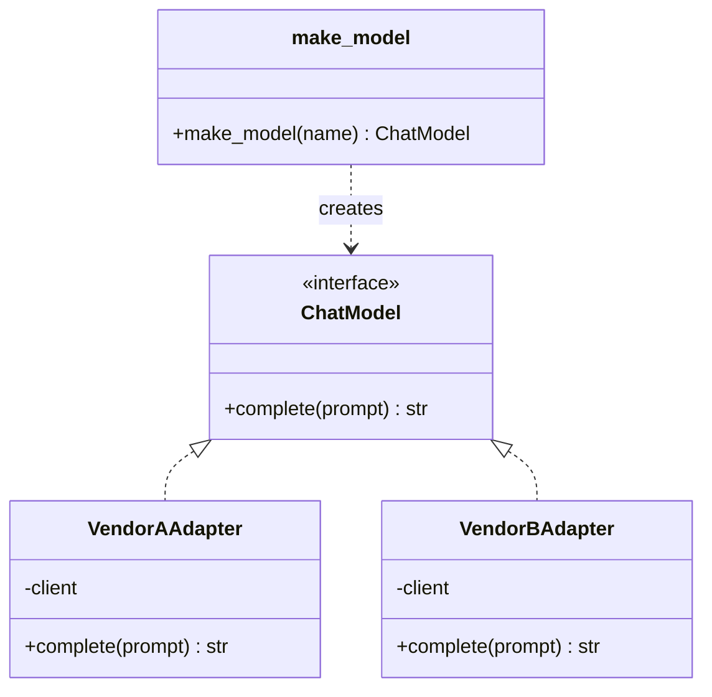
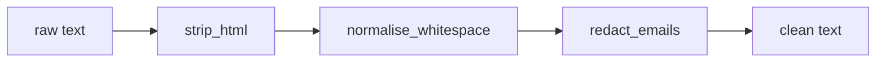

A **design pattern** is a named, reusable shape of solution to a problem that keeps recurring. Patterns are not libraries you install; they are vocabulary. When a reviewer says "make the provider an adapter" or "put the retry in a decorator", everyone on the team knows what the code will look like. AI systems are full of recurring problems: swapping models, wrapping vendor SDKs, retrying flaky calls, caching expensive embeddings, chaining processing steps. This lesson covers the seven patterns you will meet most often, each with a short runnable example.

The classic catalogue (the "Gang of Four" book) was written for languages like C++ and Java. Python's first-class functions, duck typing and `Protocol` make many patterns much lighter: often a function or a dictionary replaces a class hierarchy. The examples use the lightest form that still makes the idea clear.

| Pattern | Problem it solves | Typical AI use |
| --- | --- | --- |
| Strategy | Choose one of several interchangeable algorithms at runtime | Swap models, chunkers or rerankers |
| Factory | Centralise how objects are created from configuration | Build the right LLM client from settings |
| Adapter | Make an incompatible interface fit the one you expect | Wrap each provider SDK behind one method |
| Repository | Hide storage details behind a collection-like interface | Store documents, conversations, eval results |
| Decorator | Add behaviour around a function without changing it | Retries, caching, timing |
| Observer / callbacks | Let many listeners react to events without coupling | Token streaming, logging, cost tracking |
| Pipeline / chain | Compose small steps into a sequence | Ingestion and RAG pipelines |

## Strategy: interchangeable algorithms

The strategy pattern defines a family of algorithms with a common interface and lets the caller choose one. In Python a strategy is often just a function.

```python
from typing import Callable

Chunker = Callable[[str], list[str]]

def by_sentence(text: str) -> list[str]:
    return [s.strip() + "." for s in text.split(".") if s.strip()]

def by_words(text: str, size: int = 6) -> list[str]:
    words = text.split()
    return [" ".join(words[i:i + size]) for i in range(0, len(words), size)]

def ingest(text: str, chunker: Chunker) -> list[str]:
    return chunker(text)

doc = "Refunds take five days. Orders ship in two days. Support is open weekdays."
print(ingest(doc, by_sentence))
print(ingest(doc, by_words))
```

```output
['Refunds take five days.', 'Orders ship in two days.', 'Support is open weekdays.']
['Refunds take five days. Orders ship', 'in two days. Support is open', 'weekdays.']
```

`ingest` never changes when you add a new chunking strategy. The same shape lets you compare models in an evaluation loop: pass each candidate model as the strategy and score the results.

## Adapter and factory: one interface, many providers

Provider SDKs all do roughly the same thing with different method names and response shapes. An **adapter** wraps each one so it matches your interface. A **factory** is a function that builds the right adapter from configuration, so callers never mention concrete classes.



The fake SDK classes below stand in for real vendor libraries, so the example runs without keys.

```python
from typing import Protocol

class ChatModel(Protocol):
    def complete(self, prompt: str) -> str: ...

# Two "vendor SDKs" with incompatible interfaces
class VendorAClient:
    def generate(self, inputs: dict) -> dict:
        return {"outputs": [{"text": f"A says: {inputs['prompt']}"}]}

class VendorBClient:
    def chat(self, messages: list[dict]) -> list[str]:
        return [f"B says: {messages[-1]['content']}"]

class VendorAAdapter:
    def __init__(self, client: VendorAClient):
        self.client = client
    def complete(self, prompt: str) -> str:
        return self.client.generate({"prompt": prompt})["outputs"][0]["text"]

class VendorBAdapter:
    def __init__(self, client: VendorBClient):
        self.client = client
    def complete(self, prompt: str) -> str:
        return self.client.chat([{"role": "user", "content": prompt}])[0]

_REGISTRY = {
    "vendor-a": lambda: VendorAAdapter(VendorAClient()),
    "vendor-b": lambda: VendorBAdapter(VendorBClient()),
}

def make_model(name: str) -> ChatModel:
    try:
        return _REGISTRY[name]()
    except KeyError:
        raise ValueError(f"unknown model {name!r}; choose from {sorted(_REGISTRY)}") from None

for name in ["vendor-a", "vendor-b"]:
    print(make_model(name).complete("hello"))
```

```output
A says: hello
B says: hello
```

The registry dictionary is the Pythonic factory: adding a provider is one new adapter class and one new entry. The [modular architecture](/learn/software-engineering/modular-architecture) lesson shows where these pieces live in a real service.

## Repository: storage behind a collection

A **repository** gives the rest of the code a simple, collection-like interface (`add`, `get`, `list`) and hides whether data lives in memory, SQLite, Postgres or a vector store. Business logic and tests then use an in-memory version.

```python
from dataclasses import dataclass, field

@dataclass
class Conversation:
    id: str
    messages: list[dict] = field(default_factory=list)

class InMemoryConversationRepo:
    def __init__(self):
        self._items: dict[str, Conversation] = {}
    def get(self, conv_id: str) -> Conversation:
        return self._items.setdefault(conv_id, Conversation(conv_id))
    def save(self, conv: Conversation) -> None:
        self._items[conv.id] = conv

repo = InMemoryConversationRepo()
conv = repo.get("c-42")
conv.messages.append({"role": "user", "content": "Hi"})
repo.save(conv)
print(len(repo.get("c-42").messages))
```

```output
1
```

A `SqlConversationRepo` with the same two methods can replace it in production, and the chat logic will not notice.

## Decorator: retries and caching without touching the function

A **decorator** wraps a function to add behaviour before or after it runs. Python has dedicated syntax for this (introduced in [decorators and generators](/learn/python-programming/decorators-and-generators)). It is the natural home for cross-cutting concerns such as retries, caching, timing and rate limiting, which you do not want mixed into business logic.

```python
import functools
import random
import time

class TransientError(Exception):
    """A failure worth retrying, such as a timeout or a rate limit."""

def retry(attempts: int = 3, base_delay: float = 0.01):
    def decorator(func):
        @functools.wraps(func)
        def wrapper(*args, **kwargs):
            for attempt in range(1, attempts + 1):
                try:
                    return func(*args, **kwargs)
                except TransientError as exc:
                    if attempt == attempts:
                        raise
                    delay = base_delay * 2 ** (attempt - 1) * (1 + random.random())
                    print(f"attempt {attempt} failed ({exc}); retrying")
                    time.sleep(delay)
        return wrapper
    return decorator

calls = {"n": 0}

@retry(attempts=3)
def call_llm(prompt: str) -> str:
    calls["n"] += 1
    if calls["n"] < 3:
        raise TransientError("429 rate limited")
    return "OK: " + prompt

print(call_llm("summarise"))
```

```output
attempt 1 failed (429 rate limited); retrying
attempt 2 failed (429 rate limited); retrying
OK: summarise
```

The delay doubles each attempt (**exponential backoff**) and is multiplied by a random factor (**jitter**) so that many clients do not all retry at the same instant. Only `TransientError` is retried: a bug such as a `TypeError` should fail immediately. In production you would usually reach for the `tenacity` library, which implements the same idea with more options.

Step through the wrapper to see the control flow:

```trace
{
  "title": "the retry decorator",
  "code": [
    "for attempt in range(1, attempts + 1):",
    "    try:",
    "        return func(*args, **kwargs)",
    "    except TransientError as exc:",
    "        if attempt == attempts:",
    "            raise",
    "        print(f\"attempt {attempt} failed\")",
    "        time.sleep(delay)"
  ],
  "steps": [
    { "line": 3, "vars": { "attempts": "3", "attempt": "1", "calls": "1" }, "note": "First call. The fake LLM raises TransientError because calls < 3." },
    { "line": 5, "vars": { "attempts": "3", "attempt": "1", "calls": "1" }, "note": "Caught. attempt is not the last one, so we do not re-raise." },
    { "line": 7, "vars": { "attempts": "3", "attempt": "1", "calls": "1" }, "out": ["attempt 1 failed"], "note": "Report it, then sleep with backoff and jitter." },
    { "line": 3, "vars": { "attempts": "3", "attempt": "2", "calls": "2" }, "note": "Second call fails the same way." },
    { "line": 7, "vars": { "attempts": "3", "attempt": "2", "calls": "2" }, "out": ["attempt 1 failed", "attempt 2 failed"], "note": "The delay is now roughly twice as long." },
    { "line": 3, "vars": { "attempts": "3", "attempt": "3", "calls": "3" }, "out": ["attempt 1 failed", "attempt 2 failed"], "note": "Third call succeeds, so return exits the loop with the result. Had it failed, line 6 would re-raise the last error." }
  ]
}
```

Caching is a decorator too. The standard library's `functools.lru_cache` memoises results by argument, which suits deterministic, expensive calls such as embedding a fixed string:

```python
@functools.lru_cache(maxsize=10_000)
def embed(text: str) -> tuple[float, ...]:
    print(f"computing embedding for {text!r}")
    return tuple(float(ord(c)) for c in text[:3])   # stand-in for a real model

embed("refund"); embed("refund"); embed("ship")
print(embed.cache_info())
```

```output
computing embedding for 'refund'
computing embedding for 'ship'
CacheInfo(hits=1, misses=2, maxsize=10000, currsize=2)
```

> [!WARNING]
> Only cache what is safe to reuse. An embedding of a fixed string is; a chat completion at temperature 0.8 is a deliberate sample, and a cached answer may be stale or belong to another user's context. Return immutable values (a tuple, not a list) from cached functions, or a caller can mutate the cached copy.

## Observer and callbacks: reacting to events

The **observer** pattern lets an object announce events to any number of listeners without knowing who they are. Streaming LLM responses, agent frameworks and training loops all use it, usually under the name **callbacks** or **hooks**.

```python
class StreamingLLM:
    def __init__(self):
        self._listeners = []
    def subscribe(self, listener):
        self._listeners.append(listener)
    def generate(self, tokens: list[str]) -> str:
        for tok in tokens:
            for listener in self._listeners:
                listener("token", tok)
        for listener in self._listeners:
            listener("done", len(tokens))
        return "".join(tokens)

class TokenCounter:
    def __init__(self):
        self.count = 0
    def __call__(self, event, payload):
        if event == "done":
            self.count += payload

llm = StreamingLLM()
counter = TokenCounter()
llm.subscribe(lambda e, p: print(p, end="") if e == "token" else print())
llm.subscribe(counter)
llm.generate(["Hel", "lo", " there"])
print("tokens used:", counter.count)
```

```output
Hello there
tokens used: 3
```

The display code and the cost tracker know nothing about each other, and adding a third listener (say, a logger) needs no changes to `StreamingLLM`.

## Pipeline: composing steps

A **pipeline** (or chain) passes data through a sequence of small, single-purpose steps. Each step has the same shape, so steps can be reordered, tested alone and reused.



```python
import re
from functools import reduce

def strip_html(t): return re.sub(r"<[^>]+>", " ", t)
def normalise_whitespace(t): return " ".join(t.split())
def redact_emails(t): return re.sub(r"\S+@\S+", "[EMAIL]", t)

def pipeline(*steps):
    return lambda value: reduce(lambda acc, step: step(acc), steps, value)

clean = pipeline(strip_html, normalise_whitespace, redact_emails)
print(clean("<p>Contact   ana@example.com</p>\n<p>for refunds</p>"))
```

```output
Contact [EMAIL] for refunds
```

LangChain's expression language and scikit-learn's `Pipeline` are both this pattern with more machinery.

## Using patterns well

> [!KEY]
> A pattern is justified by a concrete force: a second provider, a flaky dependency, a need to test without the network. Start with plain functions and introduce a pattern when the code starts asking for it.

Common mistakes are wrapping a single implementation in a factory, adapter and abstract base class "for flexibility", decorators that silently swallow exceptions, and caches with no size limit or no invalidation rule. If a reader needs a diagram to follow a 50-line feature, the patterns are working against you.

## Exercises

**1.** Write a `timed` decorator that prints how long the wrapped function took in milliseconds, and preserves the function's name with `functools.wraps`.

<details>
<summary>Show solution</summary>

```python
import functools, time

def timed(func):
    @functools.wraps(func)
    def wrapper(*args, **kwargs):
        start = time.perf_counter()
        try:
            return func(*args, **kwargs)
        finally:
            ms = (time.perf_counter() - start) * 1000
            print(f"{func.__name__} took {ms:.1f} ms")
    return wrapper
```

The `finally` block reports the time even when the function raises.

</details>

**2.** Add a `"vendor-c"` provider to the factory example whose SDK method is `ask(question: str) -> str`. Which existing code did you have to change?

<details>
<summary>Show solution</summary>

```python
class VendorCClient:
    def ask(self, question: str) -> str:
        return f"C says: {question}"

class VendorCAdapter:
    def __init__(self, client): self.client = client
    def complete(self, prompt: str) -> str: return self.client.ask(prompt)

_REGISTRY["vendor-c"] = lambda: VendorCAdapter(VendorCClient())
```

Only the registry gained an entry. No caller of `make_model` or `complete` changed: the open/closed principle in action.

</details>

**3.** Which pattern fits each need? (a) Log every LLM call's latency without editing each call site. (b) Let users pick between BM25 and dense retrieval per request. (c) Store evaluation runs in SQLite now and Postgres later.

<details>
<summary>Show solution</summary>

(a) Decorator (or an observer hook if the client emits events). (b) Strategy. (c) Repository.

</details>

```quiz
[
  {
    "q": "Your code calls three LLM vendors whose SDKs have different method names and response shapes. Which pattern gives them one common interface?",
    "options": ["Observer", "Adapter", "Repository", "Pipeline"],
    "answer": 1,
    "why": "An adapter translates one interface into another, so each SDK is wrapped to expose the same `complete` method."
  },
  {
    "q": "Why does the retry decorator catch only `TransientError` rather than `Exception`?",
    "options": [
      "Catching `Exception` is a syntax error in a decorator",
      "Retrying programming errors such as `TypeError` wastes time and hides bugs that will never succeed on retry",
      "`Exception` cannot be re-raised",
      "It makes the backoff shorter"
    ],
    "answer": 1,
    "why": "Only failures that might succeed on a later attempt, such as timeouts and rate limits, should be retried."
  },
  {
    "q": "What does jitter add to exponential backoff?",
    "options": [
      "A maximum number of attempts",
      "A random factor so many clients do not retry in lockstep",
      "Caching of failed responses",
      "A circuit breaker"
    ],
    "answer": 1,
    "why": "Without jitter, clients that failed together retry together and can overload the service again."
  },
  {
    "q": "Which call is the poorest candidate for `functools.lru_cache`?",
    "options": [
      "Embedding a fixed string with a fixed model",
      "Tokenising a string",
      "A chat completion at temperature 0.8 that includes the user's account data",
      "Loading a static prompt template from disk"
    ],
    "answer": 2,
    "why": "Sampled completions are meant to vary and can contain user-specific data, so reusing a cached result may be wrong or leak information."
  }
]
```
