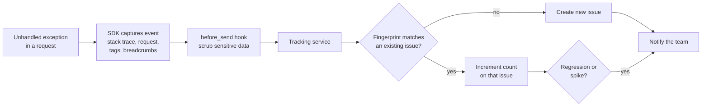
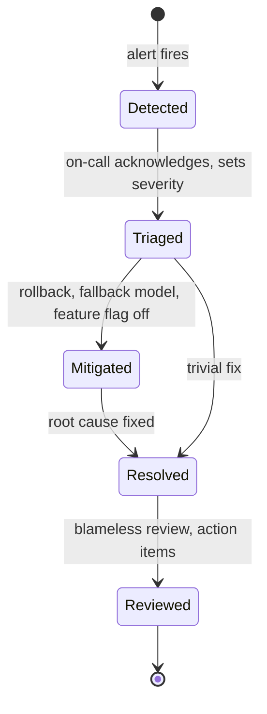

Logs record what happened, but only if someone goes and looks. In production nobody reads logs all day, so failures can sit unnoticed for hours: a provider changes its response format, a deploy breaks the embedding job, a new prompt makes the model refuse a third of requests. **Error monitoring** closes that gap. It collects failures automatically, groups them, measures how healthy the service is against targets you set, and wakes a human only when something genuinely needs attention.

This lesson builds on [logging](/learn/software-engineering/logging) and on [error handling](/learn/backend-development/error-handling) in APIs. It covers what counts as an error, how error-tracking tools such as Sentry work, how to define service level objectives (SLOs) and alerts, and the basics of being on call for an AI service.

## Exceptions, errors and expected failures

Three ideas are often blurred together.

- An **exception** is a Python mechanism: something raised and possibly caught. Many exceptions are normal control flow (`KeyError` on a cache miss, `ValidationError` on bad input).
- An **error**, in the monitoring sense, is a failure of an operation your service promised to perform: the user asked a question and did not get an answer.
- An **expected failure** is a predictable outcome you handle by design: invalid input, a user over quota, a question with no relevant documents.

The distinction matters because monitoring is only useful if errors are rare and meaningful. If every 422 validation response is reported as an error, the real ones drown.

| Event in a RAG service | Category | What to do |
| --- | --- | --- |
| Request body fails validation (422) | Expected failure | Log at `INFO`; count it as a metric |
| Retrieval finds no relevant chunk; service replies "I don't know" | Expected outcome | Count it; alert only if the rate jumps |
| Provider rate limit (429), retried successfully | Handled transient failure | `WARNING` log; track retry rate |
| Provider timeout after all retries; user gets 503 | Error | Report to error tracker; counts against SLO |
| Model returns unparseable JSON after a repair attempt | Error | Report with prompt version and model tags |
| `TypeError` in the reranker after a deploy | Bug (unhandled exception) | Report; this is exactly what error trackers are for |

> [!KEY]
> Monitor what the user experiences. A request either succeeded from the user's point of view or it did not; internal retries that worked are a health signal, not an error.

## How error-tracking tools work

Tools such as Sentry, Rollbar, Bugsnag and the error features of observability platforms (Datadog, Honeycomb, Grafana and others) all follow the same model. An SDK inside your application hooks into the runtime and the web framework, catches unhandled exceptions, and sends an **event** to a central service.



What an event typically contains:

| Field | Why it helps |
| --- | --- |
| Stack trace, often with local variable values | Find the failing line without reproducing it |
| **Breadcrumbs**: recent log lines, HTTP calls, queries before the error | See the sequence that led to the failure |
| **Release** (a version or Git commit) | Tell which deploy introduced a bug |
| **Environment** (`production`, `staging`) | Keep test noise out of production views |
| **Tags** you add (`model`, `prompt_version`, `tenant`) | Filter: "is this only on the new prompt?" |

The most valuable feature is **grouping**. Ten thousand occurrences of the same `KeyError` become one **issue** with a count, a first-seen and a last-seen time, so you fix it once rather than reading ten thousand log lines.

## Minimal setup

With Sentry's Python SDK, initialisation is a few lines at start-up, in the composition root before the web app is created. Its framework integrations (FastAPI, Starlette, Flask, Django, Celery and others) activate automatically when those packages are installed.

```python
import os
import sentry_sdk

sentry_sdk.init(
    dsn=os.environ["SENTRY_DSN"],          # where to send events; not a secret key, but keep it in config
    environment=os.environ.get("APP_ENV", "development"),
    release=os.environ.get("GIT_SHA"),     # ties every error to a deploy
    send_default_pii=False,                # do not attach user IPs, cookies and similar by default
    traces_sample_rate=0.1,                # also sample 10% of requests for performance tracing
)
```

Unhandled exceptions are now reported automatically. For an error you handle (for example, returning a friendly 503 after the provider timed out) but still want to see, report it explicitly and add context:

```python
try:
    answer = llm.complete(prompt)
except ProviderTimeout as exc:
    sentry_sdk.set_tag("model", settings.llm_model)
    sentry_sdk.set_tag("prompt_version", "answer-v3")
    sentry_sdk.capture_exception(exc)
    raise ServiceUnavailable("The assistant is busy, please retry.") from exc
```

> [!WARNING]
> Error events capture request data and local variables, which in an AI service often include prompts, retrieved documents and user messages. Keep `send_default_pii=False`, scrub fields in a `before_send` hook, and check the tool's data-scrubbing settings before sending production traffic. The same rules as for logs apply.

## SLIs, SLOs and error budgets

Counting errors is not enough; you need to know whether the count is acceptable. Site reliability engineering uses three terms.

- A **service level indicator (SLI)** is a measured ratio of good events to all events. Example: the fraction of `/ask` requests that return a non-5xx response within 10 seconds.
- A **service level objective (SLO)** is the target for that ratio over a window. Example: 99.5% over 30 days.
- The **error budget** is what the SLO allows to go wrong: $1 - \text{SLO}$.

$$
\text{SLI} = \frac{\text{good events}}{\text{valid events}}, \qquad \text{error budget} = 1 - \text{SLO}
$$

The budget is a planning tool. While budget remains, the team can ship changes freely; when it is nearly spent, reliability work takes priority over new features.

```python
def error_budget(slo: float, window_days: int = 30, requests: int | None = None) -> None:
    budget_fraction = 1 - slo
    minutes = window_days * 24 * 60 * budget_fraction
    print(f"SLO {slo:.2%}: budget {budget_fraction:.2%} = {minutes:.1f} minutes per {window_days} days", end="")
    if requests:
        print(f", or {requests * budget_fraction:,.0f} failed requests out of {requests:,}")
    else:
        print()

for slo in (0.99, 0.995, 0.999):
    error_budget(slo, requests=2_000_000)
```

```output
SLO 99.00%: budget 1.00% = 432.0 minutes per 30 days, or 20,000 failed requests out of 2,000,000
SLO 99.50%: budget 0.50% = 216.0 minutes per 30 days, or 10,000 failed requests out of 2,000,000
SLO 99.90%: budget 0.10% = 43.2 minutes per 30 days, or 2,000 failed requests out of 2,000,000
```

Each extra "nine" cuts the budget by a factor of ten. Choose SLOs from what users need and what your dependencies can deliver: if your LLM provider's own availability target is lower than yours, your SLO must account for that through fallbacks, or be lowered.

### SLIs for AI services

Classic SLIs (availability, latency) still apply, but LLM features need a few more:

| SLI | Good event |
| --- | --- |
| Availability | Response is not a 5xx |
| Latency | Time to first token under 2 s for streamed answers; total under 15 s |
| Structured output validity | Model output parses and validates on the first or repair attempt |
| Grounded answer rate | Answer cites at least one retrieved source (where the product requires it) |
| Cost per request | Tokens per request below a budget; tracked as a metric rather than an SLO in most teams |

The thresholds above are illustrative; set your own from user research and measured baselines.

## Alerting that people trust

An alert should mean "a human needs to act now". Every alert that fires without needing action teaches the team to ignore alerts. Principles:

- **Alert on symptoms, not causes.** Page on "error rate for users is high", not "CPU is at 80%". High CPU that hurts nobody is not an emergency.
- **Separate pages from tickets.** Urgent, user-facing problems page the on-call engineer. Slow-burning issues (a gradual rise in refusals) open a ticket for working hours.
- **Alert on budget burn rate.** The **burn rate** is how fast you are using the error budget relative to plan: a burn rate of 1 spends exactly the budget over the window; a burn rate of 10 spends a 30-day budget in three days.

```python
def burn_rate(errors: int, total: int, slo: float) -> float:
    """How fast the budget is being spent: 1.0 means exactly on budget."""
    return (errors / total) / (1 - slo)

print(f"last 1 hour:  {burn_rate(errors=180, total=12_000, slo=0.995):.1f}")
print(f"last 6 hours: {burn_rate(errors=420, total=70_000, slo=0.995):.1f}")
```

```output
last 1 hour:  3.0
last 6 hours: 1.2
```

A common pattern pages when the burn rate is high over both a short and a longer window (so a brief blip does not page, but a sustained problem does) and opens a ticket for lower, longer burns. Most monitoring platforms can express this directly.

## On-call basics

Someone has to respond when an alert fires. A healthy on-call practice has a few ingredients.

1. **A rotation**: engineers take turns, with a clear primary and a backup, and handovers that summarise open issues.
2. **Runbooks**: for each alert, a short page saying what it means, how to check it, and the first mitigations to try.
3. **Fast mitigation before root cause**: restore service first. For AI services the quickest levers are often rolling back a deploy, reverting a prompt version, switching to a fallback model, or turning off a feature flag.
4. **Severity levels** so everyone agrees how urgent an incident is and who must be told.
5. **Blameless post-incident reviews**: what happened, why the system allowed it, and what will change. Blaming individuals makes people hide mistakes; fixing systems prevents repeats.



> [!TIP]
> Make mitigation cheap before you need it. If switching models requires a code change and a deploy, an outage lasts as long as your release pipeline. A configuration flag that selects the provider, tested regularly, turns a long incident into a short one.

## Exercises

**1.** Classify each as an expected failure, a handled transient failure or an error that should be reported: (a) the user uploads a 300-page PDF over the size limit; (b) the embedding API returns 503 twice and succeeds on the third try; (c) the vector database is unreachable and the API returns 503 to users for five minutes.

<details>
<summary>Show solution</summary>

(a) Expected failure: return a clear 413 or 422, log at `INFO`, count it. (b) Handled transient failure: `WARNING` log and a retry metric; no error report. (c) An error affecting users: it counts against the availability SLO and should alert.

</details>

**2.** Your SLO is 99.9% availability over 30 days and you serve 5 million requests. How many failed requests does the error budget allow? If 3,000 requests have already failed by day 10, what should the team do?

<details>
<summary>Show solution</summary>

Budget: $5{,}000{,}000 \times 0.001 = 5{,}000$ failed requests. By day 10 the team has spent 60% of the budget in a third of the window, a burn rate of roughly 1.8. They should slow risky changes and prioritise the reliability problems causing the failures, so the remaining budget lasts the window.

</details>

**3.** Write a runbook outline (headings and one line each) for the alert "LLM structured-output failure rate above 5% for 15 minutes".

<details>
<summary>Show solution</summary>

- **Meaning**: more than 1 in 20 model replies fail JSON validation; users see errors or fallback answers.
- **Check**: error tracker issues tagged by `model` and `prompt_version`; recent deploys and prompt changes; provider status page.
- **Mitigate**: if a new prompt version correlates, revert it; if one model is affected, switch to the fallback model via config; if the provider is degraded, enable the degraded-mode response.
- **Escalate**: if not mitigated in 30 minutes, page the backup and the owning team lead.
- **Follow-up**: add the failing replies to the parser's test cases; review whether schema-constrained output is available for this model.

</details>

```quiz
[
  {
    "q": "Which event should normally be reported to an error tracker as an error?",
    "options": [
      "A request rejected with 422 because a required field is missing",
      "A provider 429 that succeeded on retry",
      "An unhandled `TypeError` in the reranker after a deploy",
      "A question for which retrieval found no relevant documents"
    ],
    "answer": 2,
    "why": "Unhandled exceptions are bugs that need fixing. The others are expected or handled outcomes better tracked as metrics."
  },
  {
    "q": "What does an error-tracking tool's grouping feature do?",
    "options": [
      "Sends each exception as a separate email",
      "Combines occurrences of the same failure into one issue with a count and first and last seen times",
      "Deletes duplicate log lines",
      "Groups users by region"
    ],
    "answer": 1,
    "why": "Grouping by fingerprint turns thousands of identical events into a single issue to triage and fix."
  },
  {
    "q": "With a 99.5% SLO over 30 days, how much downtime does the error budget allow?",
    "options": ["43.2 minutes", "216 minutes", "432 minutes", "7.2 minutes"],
    "answer": 1,
    "why": "0.5% of 43,200 minutes is 216 minutes."
  },
  {
    "q": "During an incident caused by a new prompt version, what should on-call do first?",
    "options": [
      "Find the exact root cause before changing anything",
      "Write the post-incident review",
      "Mitigate, for example by reverting to the previous prompt version, then investigate",
      "Wait for the next scheduled release"
    ],
    "answer": 2,
    "why": "Restoring service comes first. Root-cause analysis and the review follow once users are no longer affected."
  }
]
```
