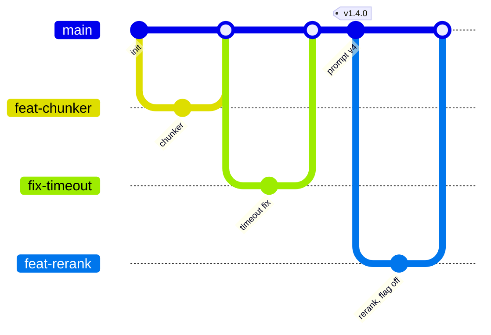
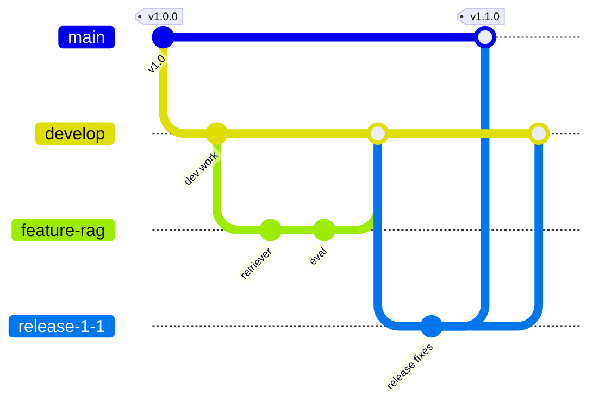
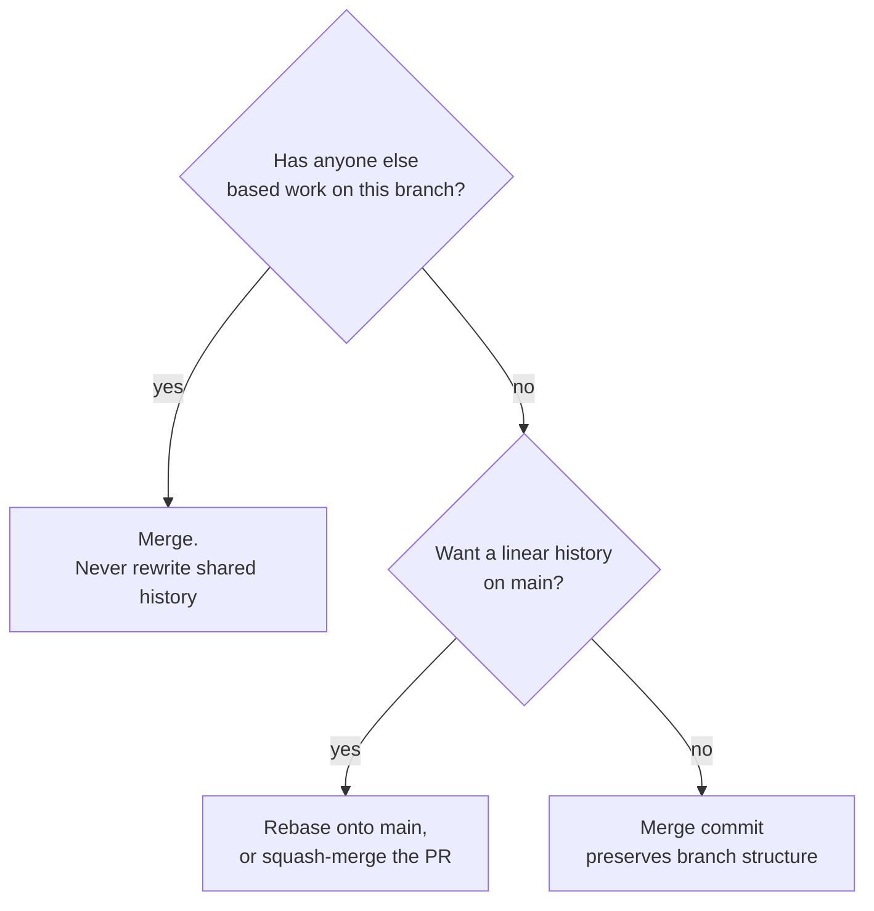

On your own, Git branches are a convenience. On a team of five shipping an AI service every day, the way you branch decides how often you hit painful merges, how quickly a fix reaches production, and whether you can tell which code, prompt and model configuration produced last Tuesday's answers. A **branching strategy** is the team's agreement about which branches exist, how long they live and how changes flow into a release.

[Git and GitHub](/learn/developer-tools/git-and-github) covered commits, branches, merging, conflicts and pull requests. This lesson goes up a level: the two main branching strategies, feature flags that make short-lived branches practical, merge versus rebase, conventional commit messages, and tagging releases.

## Trunk-based development

In **trunk-based development** everyone integrates into one main branch (the "trunk", usually `main`) at least daily. Work happens on short-lived feature branches that last hours or a day or two, each merged through a small pull request once CI passes. `main` is always releasable, and releases are cut from it, often automatically.



The short lifetime is the point. A branch that lives for a day diverges little from `main`, so merges are small and conflicts rare. Unfinished features are merged too, hidden behind **feature flags** (below), rather than kept on a branch for weeks.

## GitFlow

**GitFlow** is an older, more structured model with several long-lived branches.

| Branch | Lifetime | Purpose |
| --- | --- | --- |
| `main` | Permanent | Only released code; every commit is a release, tagged |
| `develop` | Permanent | Integration branch for the next release |
| `feature/*` | Days to weeks | One feature, branched from and merged into `develop` |
| `release/*` | Days | Stabilise a release: fixes only, then merge to `main` and `develop` |
| `hotfix/*` | Hours | Urgent fix branched from `main`, merged to `main` and `develop` |



### Choosing between them

| | Trunk-based | GitFlow |
| --- | --- | --- |
| Branch lifetime | Hours to a couple of days | Days to weeks |
| Integration | Continuous; conflicts small | Batched; conflicts can be large |
| Release cadence | Many times a day or week | Scheduled releases |
| Requires | Good automated tests, CI, feature flags | Release management discipline |
| Fits | Web services and APIs you deploy yourself | Versioned products with several supported releases (libraries, installed software, on-device models) |

> [!KEY]
> For most AI services and APIs, trunk-based development with feature flags is the better default: small changes, fast feedback and quick rollback. GitFlow earns its overhead when you must maintain several released versions in parallel.

## Feature flags

A **feature flag** is a runtime switch that decides whether a code path runs. It separates **deploying** code from **releasing** a feature: the new reranker can be merged and deployed on Monday, switched on for internal users on Tuesday, for 10% of traffic on Wednesday, and for everyone once the metrics look good. If something goes wrong, you turn the flag off without a deploy.

Flags are especially useful in AI work, where you often want to compare a new prompt or model against the current one on real traffic. A minimal percentage rollout, made deterministic by hashing the user ID so each user consistently sees the same variant:

```python
import hashlib

FLAGS = {
    "reranker": {"enabled": True, "rollout_percent": 10, "allow": {"staff-1"}},
    "prompt_v4": {"enabled": False, "rollout_percent": 0, "allow": set()},
}

def bucket(user_id: str, flag: str) -> int:
    digest = hashlib.sha256(f"{flag}:{user_id}".encode()).hexdigest()
    return int(digest, 16) % 100          # stable number from 0 to 99

def is_enabled(flag: str, user_id: str) -> bool:
    cfg = FLAGS[flag]
    if not cfg["enabled"]:
        return False
    return user_id in cfg["allow"] or bucket(user_id, flag) < cfg["rollout_percent"]

users = [f"user-{i}" for i in range(1000)]
print("reranker on for", sum(is_enabled("reranker", u) for u in users), "of 1000 users")
print("staff-1:", is_enabled("reranker", "staff-1"))
print("prompt_v4 on for", sum(is_enabled("prompt_v4", u) for u in users), "users")
```

```output
reranker on for 109 of 1000 users
staff-1: True
prompt_v4 on for 0 users
```

Roughly 10% of users fall in the rollout, the allow-listed staff account always gets the feature, and a disabled flag is off for everyone. In production the flag values live in configuration or a flag service (LaunchDarkly, Unleash, Flagsmith and others, or a simple database table) so they can change without a deploy.

> [!WARNING]
> Flags are temporary debt. Each one doubles the paths through a piece of code. Give every flag an owner and a removal date, and delete it (with the losing code path) once the rollout is complete.

## Merge versus rebase

When `main` has moved on since you branched, there are two ways to bring the work together. Here is a real repository where `main` gained a fix while a reranker feature was developed on a branch.

**Merging** creates a merge commit with two parents, preserving exactly what happened:

```bash
git switch main
git merge --no-ff feat/reranker
git log --graph --format='%h %s'
```

```output
*   0a9b8ba Merge branch 'feat/reranker'
|\  
| * 3fc5144 test(retrieval): golden-set recall for reranker
| * 07cb82f feat(retrieval): add cross-encoder reranker
* | ea57b07 fix(api): return 503 on provider timeout
|/  
* 3fb95c5 test: cover empty question
* fb68e00 feat: add /ask endpoint
```

**Rebasing** replays your branch's commits on top of the current `main`, as if you had started from there. `main` can then fast-forward, giving a straight line:

```bash
git switch feat/reranker
git rebase main
git switch main
git merge --ff-only feat/reranker
git log --graph --format='%h %s'
```

```output
* 43a2f8a test(retrieval): golden-set recall for reranker
* 2781642 feat(retrieval): add cross-encoder reranker
* ea57b07 fix(api): return 503 on provider timeout
* 3fb95c5 test: cover empty question
* fb68e00 feat: add /ask endpoint
```

Look at the hashes: the reranker commits were `07cb82f` and `3fc5144` before the rebase and `2781642` and `43a2f8a` after. Rebasing creates **new commits**, because a commit's identity includes its parent. That is harmless on your own unpublished branch and harmful on a branch others have pulled, because their copies still contain the old commits.



| | Merge | Rebase |
| --- | --- | --- |
| History | True record, with merge commits | Linear, easier to read and bisect |
| Rewrites commits | No | Yes (new hashes) |
| Safe on shared branches | Yes | No |
| Conflicts | Resolved once, in the merge commit | Possibly once per replayed commit |

Many teams settle this in the hosting platform's settings: pull requests are **squash-merged** (all the branch's commits become one commit on `main`) or rebase-merged, and developers may rebase their own branches freely before review. `git rebase -i main` lets you tidy your own commits (reorder, squash, reword) before opening a pull request.

## Conventional commits

[Git and GitHub](/learn/developer-tools/git-and-github) recommended short imperative commit messages. **Conventional Commits** is a widely used specification that adds a machine-readable prefix:

```text
<type>(<optional scope>): <description>

[optional body]

[optional footer(s)]
```

| Type | Use for |
| --- | --- |
| `feat` | A new feature for users |
| `fix` | A bug fix |
| `docs` | Documentation only |
| `refactor` | Code change that neither fixes a bug nor adds a feature |
| `test` | Adding or correcting tests |
| `perf` | Performance improvement |
| `build`, `ci`, `chore` | Build system, CI configuration, maintenance |

A breaking change is marked with `!` after the type or a `BREAKING CHANGE:` footer:

```text
feat(api)!: return citations as objects instead of strings

BREAKING CHANGE: `sources` is now a list of {doc_id, title, url}.
Clients must update their parsing.
```

The payoff is automation. Tools can read the history and work out the next **semantic version** (`MAJOR.MINOR.PATCH`): a `fix` bumps the patch number, a `feat` the minor number, and a breaking change the major number. They can also generate changelogs grouped by type. For AI services a scope such as `prompt`, `retrieval` or `eval` makes it easy to find every prompt change in the log with `git log --grep "(prompt)"`.

## Release tags

A **tag** is a permanent name for a specific commit. Annotated tags (`-a`) also store a message, author and date, and are the right choice for releases.

```bash
git tag -a v1.3.0 -m "Reranker and timeout handling"
git push origin v1.3.0
git tag -n
```

```output
v1.3.0          Reranker and timeout handling
```

Tags make releases reproducible: `git switch --detach v1.3.0` gives you exactly the code that shipped. In an AI system, tag everything that determines behaviour. If prompts, model identifiers and retrieval settings live in the repository, the tag captures them too; if a model artefact lives in a registry, record the tag in the registry entry (and vice versa) so you can always answer "what produced this answer?". Deployment pipelines commonly trigger on new tags, which [CI/CD](/learn/ci-cd/deployment-pipelines) covers later.

> [!TIP]
> Protect `main` in your hosting platform: require pull requests, passing CI and at least one approval, and block force-pushes. These settings enforce the strategy so nobody has to remember it.

## Exercises

**1.** A teammate rebased the shared `develop` branch and force-pushed it. Two colleagues now see confusing duplicate commits. Explain what happened and the safer alternative.

<details>
<summary>Show solution</summary>

Rebasing rewrote the commits on `develop` with new hashes. The colleagues' local copies still had the old commits, so when they pulled, Git saw two different histories containing equivalent changes and merged them, producing duplicates. Shared branches should be updated with merges (or by rebasing only private branches before they are shared). Branch protection that blocks force-pushes prevents this.

</details>

**2.** Write conventional commit messages for: (a) a new prompt template that adds citations; (b) fixing a crash when retrieval returns no chunks; (c) renaming a field in the API response that clients rely on.

<details>
<summary>Show solution</summary>

(a) `feat(prompt): add inline citations to answer template`
(b) `fix(retrieval): handle empty result set without crashing`
(c) `feat(api)!: rename answer_text to answer` with a `BREAKING CHANGE:` footer explaining what clients must change. Version bumps: (a) minor, (b) patch, (c) major.

</details>

**3.** Extend `is_enabled` so a flag can be forced off for specific users with a `deny` set, which takes priority over everything else.

<details>
<summary>Show solution</summary>

```python
def is_enabled(flag: str, user_id: str) -> bool:
    cfg = FLAGS[flag]
    if not cfg["enabled"] or user_id in cfg.get("deny", set()):
        return False
    return user_id in cfg["allow"] or bucket(user_id, flag) < cfg["rollout_percent"]
```

A deny list is useful when one customer reports a problem with a new model: you exclude them while investigating, without stopping the rollout for everyone else.

</details>

```quiz
[
  {
    "q": "What is the defining feature of trunk-based development?",
    "options": [
      "A separate `develop` branch for integration",
      "Everyone integrates small changes into the main branch at least daily, using short-lived branches",
      "Every developer has a permanent personal branch",
      "Releases are only made from `release/*` branches"
    ],
    "answer": 1,
    "why": "Short-lived branches and frequent integration keep divergence and merge conflicts small."
  },
  {
    "q": "After `git rebase main`, the commits on your feature branch have different hashes. Why?",
    "options": [
      "Rebase compresses the commits",
      "A commit's identity includes its parent, and rebase gives the commits new parents",
      "Git randomises hashes on every operation",
      "The commit messages were changed"
    ],
    "answer": 1,
    "why": "Rebase replays your changes as new commits on top of the new base, so their hashes change."
  },
  {
    "q": "Which conventional commit would trigger a major version bump under semantic versioning?",
    "options": [
      "`fix(api): handle timeout`",
      "`feat(retrieval): add reranker`",
      "`feat(api)!: change the response schema`",
      "`docs: update README`"
    ],
    "answer": 2,
    "why": "The `!` (or a `BREAKING CHANGE:` footer) marks a breaking change, which bumps the major version."
  },
  {
    "q": "What does a feature flag let you do that a long-lived feature branch does not?",
    "options": [
      "Avoid writing tests",
      "Merge and deploy unfinished code safely, then release it gradually and turn it off without a deploy",
      "Skip code review",
      "Store model weights in Git"
    ],
    "answer": 1,
    "why": "Flags separate deployment from release, enabling trunk-based development, gradual rollouts and instant rollback."
  }
]
```
