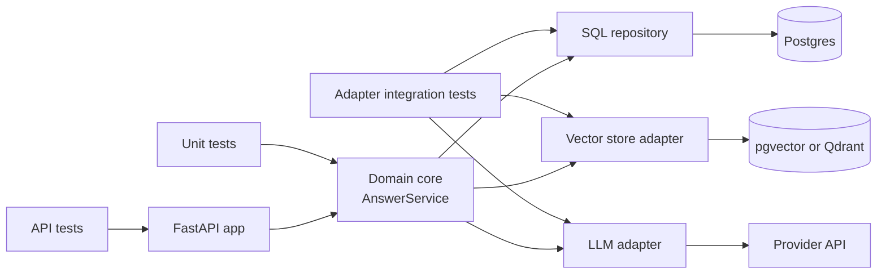

Unit tests replace every dependency with a double, which is exactly why they are fast and exactly why they can all pass while the service is broken. Your SQL can have a typo that no fake notices. The provider can rename a field in its response. Your retriever can return the wrong documents for half your users' questions. **Integration tests** check that your code works with the real things it talks to: databases, vector stores, HTTP APIs, message queues and model providers.

This lesson covers where the boundaries are, how to get real dependencies into a test cheaply, how contract tests catch API drift, and why retrieval quality in a RAG system is best treated as an integration concern. It assumes the [unit testing](/learn/software-engineering/unit-testing) lesson.

## Where integration tests sit

The [modular architecture](/learn/software-engineering/modular-architecture) lesson split a service into a domain core and adapters. That split tells you what each kind of test covers: unit tests exercise the core with fakes; integration tests exercise each **adapter** against the real technology behind it, plus a few tests that run the whole service through its API.



| Test kind | Real dependencies | Speed | Typical count |
| --- | --- | --- | --- |
| Unit | None | Milliseconds | Hundreds |
| Adapter integration | One (the thing behind the adapter) | Tens of ms to seconds | Dozens |
| API / service | Several, sometimes all but the LLM | Seconds | A handful per endpoint |
| End-to-end | Everything, deployed | Seconds to minutes | A few critical journeys |

Because integration tests are slower and need infrastructure, keep each one focused on the boundary: "does this SQL do what the repository promises?", not "does the whole product work?".

## Testing against a real database

The most common integration test checks a repository against a real database engine. SQLite ships with Python and runs in memory, which makes it ideal for showing the idea:

```python
import sqlite3

class SqlDocumentRepo:
    def __init__(self, conn: sqlite3.Connection):
        self.conn = conn
        conn.execute(
            "CREATE TABLE IF NOT EXISTS documents ("
            " id TEXT PRIMARY KEY, title TEXT NOT NULL, body TEXT NOT NULL,"
            " updated_at TEXT NOT NULL)"
        )

    def upsert(self, doc_id: str, title: str, body: str, updated_at: str) -> None:
        self.conn.execute(
            "INSERT INTO documents (id, title, body, updated_at) VALUES (?, ?, ?, ?) "
            "ON CONFLICT(id) DO UPDATE SET title = excluded.title, "
            "body = excluded.body, updated_at = excluded.updated_at",
            (doc_id, title, body, updated_at),
        )

    def changed_since(self, timestamp: str) -> list[str]:
        rows = self.conn.execute(
            "SELECT id FROM documents WHERE updated_at > ? ORDER BY id", (timestamp,)
        )
        return [r[0] for r in rows]

def test_upsert_then_query_changed_documents():
    repo = SqlDocumentRepo(sqlite3.connect(":memory:"))
    repo.upsert("refunds", "Refunds", "Refunds take 5 days.", "2025-01-01")
    repo.upsert("shipping", "Shipping", "Ships in 2 days.", "2025-01-01")
    repo.upsert("refunds", "Refunds", "Refunds take 3 days.", "2025-02-01")  # update
    assert repo.changed_since("2025-01-15") == ["refunds"]
    count = repo.conn.execute("SELECT COUNT(*) FROM documents").fetchone()[0]
    assert count == 2  # the upsert did not create a duplicate

test_upsert_then_query_changed_documents()
print("integration test passed")
```

```output
integration test passed
```

This test would catch a misspelt column, a broken `ON CONFLICT` clause or a wrong comparison, none of which an in-memory fake would notice. It is the kind of incremental-ingestion logic a RAG pipeline depends on: re-embed only documents that changed.

### Use the same engine as production

SQLite is a fine stand-in for SQLite. It is not a faithful stand-in for Postgres: types, `ON CONFLICT` details, JSON operators and extensions such as pgvector differ. For adapters that use engine-specific features, test against the real engine. The `testcontainers` library starts a throwaway Docker container for the test session and removes it afterwards:

```python
import pytest
from testcontainers.postgres import PostgresContainer

@pytest.fixture(scope="session")
def postgres_url():
    with PostgresContainer("pgvector/pgvector:pg16") as pg:
        yield pg.get_connection_url()
```

Each test then connects to that URL, usually inside a transaction that is rolled back at the end so tests do not see each other's data. The alternative is a `docker compose` file that CI starts before the test job. Either way, the tests run against the same database software, and ideally the same major version, as production.

> [!TIP]
> Integration tests need isolation as much as unit tests. Give each test its own data (unique IDs, a fresh schema, or a rolled-back transaction), never rely on rows left by a previous test, and never point tests at a shared or production database.

## Contract tests: catching API drift

Your LLM adapter parses a provider's JSON response. If the provider changes that shape, your unit tests (which use canned responses you wrote) keep passing. A **contract test** pins down the assumptions one side makes about the other and checks them against reality.

For a third-party API the practical version has two halves:

1. Record a real response once and store it as a fixture file. Unit-test your adapter's parsing against that recording.
2. Write a check of the fields your adapter relies on, and run the same check against a **live** response on a schedule (nightly, or before a release), with a small, cheap request.

```python
RECORDED = {   # saved from a real call; trimmed to what the adapter reads
    "id": "resp_123",
    "model": "small-chat-model",
    "choices": [{"index": 0, "message": {"role": "assistant", "content": "Hi"}, "finish_reason": "stop"}],
    "usage": {"prompt_tokens": 9, "completion_tokens": 1, "total_tokens": 10},
}

CONTRACT = {  # path -> type the adapter depends on
    ("choices", 0, "message", "content"): str,
    ("choices", 0, "finish_reason"): str,
    ("usage", "prompt_tokens"): int,
    ("usage", "completion_tokens"): int,
}

def contract_violations(response: dict) -> list[str]:
    problems = []
    for path, expected_type in CONTRACT.items():
        value = response
        try:
            for key in path:
                value = value[key]
        except (KeyError, IndexError, TypeError):
            problems.append(f"missing {'.'.join(map(str, path))}")
            continue
        if not isinstance(value, expected_type):
            problems.append(f"{'.'.join(map(str, path))} is {type(value).__name__}")
    return problems

print(contract_violations(RECORDED))
drifted = {**RECORDED, "usage": {"input_tokens": 9, "output_tokens": 1}}
print(contract_violations(drifted))
```

```output
[]
['missing usage.prompt_tokens', 'missing usage.completion_tokens']
```

When the nightly run reports a violation, you learn about the change from a test rather than from users. Between your own services, **consumer-driven contract testing** (tools such as Pact) formalises the same idea: the consumer publishes the requests and responses it depends on, and the provider's CI verifies it still honours them.

## Testing the API layer

For HTTP services, an API test sends real requests through the framework's routing, validation, middleware and serialisation. FastAPI's `TestClient` does this in-process without starting a server, and dependency overrides let you swap the LLM for a stub while keeping everything else real. The [FastAPI API testing](/learn/fastapi/api-testing) lesson covers it in detail. A good split is: real database and vector store, stubbed LLM, assertions on status codes and response schemas.

## Retrieval quality as an integration concern

In a RAG system, the retriever can be perfectly correct code and still return the wrong documents. Whether "Is my laptop covered if it breaks?" finds the warranty page depends on the embedding model, the chunking, the index and the data together. No unit test with a fake index can tell you that. It is a property of the real components working together, so treat it as an integration test with a quality threshold.

The recipe:

1. Build a small **golden set**: realistic questions paired with the document (or chunk) a correct answer needs. Start with 20-50; grow it from real user questions and bug reports.
2. Run the **real** retriever over a fixed, versioned test corpus.
3. Compute a retrieval metric such as **recall@k**: the fraction of questions whose expected document appears in the top $k$ results.
4. Fail the test if the metric drops below a threshold you have agreed on.

$$
\text{recall@}k = \frac{1}{|Q|} \sum_{q \in Q} \mathbb{1}\left[d_q \in \text{top}_k(q)\right]
$$

Here $Q$ is the set of golden questions, $d_q$ is the expected document for question $q$, $\text{top}_k(q)$ is the retriever's first $k$ results, and $\mathbb{1}[\cdot]$ is 1 when the condition holds and 0 otherwise. ([RAG evaluation](/learn/rag-fundamentals/rag-evaluation) covers more metrics.)

A runnable example with a TF-IDF retriever from scikit-learn standing in for a vector store:

```python
from sklearn.feature_extraction.text import TfidfVectorizer
from sklearn.metrics.pairwise import cosine_similarity

CORPUS = {
    "refunds.md": "Refunds are issued to the original card within five working days.",
    "returns.md": "You can return unused items within 30 days for a full refund.",
    "shipping.md": "Standard shipping takes two to four days. Express arrives next day.",
    "warranty.md": "All electronics carry a two year warranty against manufacturing faults.",
    "password.md": "To reset your password, click Forgot password on the sign-in page.",
    "invoices.md": "Invoices can be downloaded as PDF from the Billing section of your account.",
}

class TfidfRetriever:
    def __init__(self, corpus: dict[str, str], **vectorizer_args):
        self.ids = list(corpus)
        self.vectorizer = TfidfVectorizer(**vectorizer_args)
        self.matrix = self.vectorizer.fit_transform(corpus.values())

    def search(self, query: str, k: int) -> list[str]:
        scores = cosine_similarity(self.vectorizer.transform([query]), self.matrix)[0]
        ranked = sorted(zip(self.ids, scores), key=lambda p: p[1], reverse=True)
        return [doc_id for doc_id, score in ranked[:k] if score > 0]

GOLDEN = [  # question -> the document a correct answer needs
    ("When will I get my refund?", "refunds.md"),
    ("How long does shipping take?", "shipping.md"),
    ("I forgot my password", "password.md"),
    ("Where can I download invoices?", "invoices.md"),
    ("Is my laptop covered if it breaks?", "warranty.md"),
    ("Can I send back something I bought?", "returns.md"),
]

def recall_at_k(retriever, golden, k: int) -> float:
    hits = 0
    for question, expected in golden:
        found = retriever.search(question, k)
        if expected in found:
            hits += 1
        else:
            print(f"  miss: {question!r} -> {found}")
    return hits / len(golden)

print("word TF-IDF")
print(f"recall@3 = {recall_at_k(TfidfRetriever(CORPUS, stop_words='english'), GOLDEN, 3):.2f}")
print("character n-gram TF-IDF")
char_retriever = TfidfRetriever(CORPUS, analyzer="char_wb", ngram_range=(3, 5))
print(f"recall@3 = {recall_at_k(char_retriever, GOLDEN, 3):.2f}")
```

```output
word TF-IDF
  miss: 'When will I get my refund?' -> ['returns.md']
  miss: 'Is my laptop covered if it breaks?' -> []
  miss: 'Can I send back something I bought?' -> []
recall@3 = 0.50
character n-gram TF-IDF
  miss: 'Is my laptop covered if it breaks?' -> ['returns.md', 'refunds.md', 'invoices.md']
recall@3 = 0.83
```

The test does two jobs. It **measures**: the word-level retriever misses "refund" versus "Refunds" because it does not stem, and switching to character n-grams fixes that, raising recall. And it **diagnoses**: the remaining miss is a pure vocabulary gap ("laptop" never appears; "electronics" does) that only a semantic embedding model would bridge. Without the golden set, both changes would be guesswork.

As a pytest test it becomes a guard against regressions when someone changes the chunker, the embedding model or the index settings:

```python
import pytest

@pytest.mark.integration
def test_retrieval_recall_does_not_regress():
    assert recall_at_k(char_retriever, GOLDEN, k=3) >= 0.80
```

> [!WARNING]
> Keep the golden set and its corpus out of anything the system learns from (prompt examples, fine-tuning data, few-shot banks). If the test questions leak into the system, the metric goes up while real quality does not.

## Running integration tests sensibly

- **Mark them** (`@pytest.mark.integration`) so developers can run only fast unit tests locally with `pytest -m "not integration"`, while CI runs everything. The [pytest](/learn/software-engineering/pytest) lesson shows how to register markers.
- **Do not call paid model APIs on every push.** Stub the LLM in API tests; run live provider contract checks and quality evaluations on a schedule or before releases.
- **Make failures readable.** Print which questions missed, which fields drifted, which rows differed. A bare `assert 0.67 >= 0.8` tells you nothing.
- **Pin your test data.** A golden set that silently changes makes the metric meaningless. Version it with the code.

## Exercises

**1.** Add a test for `SqlDocumentRepo.changed_since` that checks the boundary: a document updated exactly at the timestamp is *not* returned.

<details>
<summary>Show solution</summary>

```python
def test_changed_since_excludes_exact_timestamp():
    repo = SqlDocumentRepo(sqlite3.connect(":memory:"))
    repo.upsert("a", "A", "body", "2025-03-01")
    assert repo.changed_since("2025-03-01") == []
```

The query uses `>`, so equal timestamps are excluded. If your ingestion job stores "last run" as the time of the last processed document, this behaviour avoids reprocessing it.

</details>

**2.** Extend `contract_violations` so it also reports when `finish_reason` is `"length"`, which means the output was truncated. Should that be a contract violation or something else?

<details>
<summary>Show solution</summary>

It is not a contract violation: the shape is valid. It is a runtime condition the adapter should handle (log a warning, maybe raise a domain error). Keep the contract test about structure, and add a unit test that the adapter reacts correctly to a recorded response with `"finish_reason": "length"`.

</details>

**3.** Add `("Can I get my money back?", "refunds.md")` and `("My login isn't working", "password.md")` to `GOLDEN`. Predict whether the character n-gram retriever finds each in its top 3, then run it. Why is recall@3 on this six-document corpus an optimistic number?

<details>
<summary>Show solution</summary>

Running `char_retriever.search(question, 3)` gives `['returns.md', 'invoices.md', 'password.md']` for the money question, a miss: nothing in "money back" resembles the wording of the refunds page. The login question returns `['refunds.md', 'password.md', 'shipping.md']`, a hit at rank 2, but only just.

The number is optimistic because top 3 of 6 documents is half the corpus: even a random retriever would score about 0.5. A meaningful retrieval test needs a corpus of realistic size and similar-looking distractor documents, and questions phrased in users' own words, which is why golden sets should be grown from real user questions.

</details>

```quiz
[
  {
    "q": "Which bug would an integration test against a real database catch that a unit test with an in-memory fake would not?",
    "options": [
      "A wrong confidence threshold in the domain logic",
      "A misspelt column name in an `INSERT` statement",
      "A prompt missing its delimiters",
      "A retry loop that never stops"
    ],
    "answer": 1,
    "why": "The fake never executes your SQL, so only running it against a real engine reveals SQL errors."
  },
  {
    "q": "Why test a Postgres adapter against Postgres (for example via testcontainers) rather than SQLite?",
    "options": [
      "SQLite cannot run inside tests",
      "Postgres tests are always faster",
      "Engines differ in types, SQL features and extensions such as pgvector, so SQLite can pass where Postgres fails",
      "testcontainers requires Postgres"
    ],
    "answer": 2,
    "why": "An integration test is only as good as its fidelity to production; use the same engine and ideally the same major version."
  },
  {
    "q": "Your golden set has 20 questions and the expected document appears in the top 5 results for 17 of them. What is recall@5?",
    "options": ["0.17", "0.85", "0.25", "5"],
    "answer": 1,
    "why": "Recall@k is the fraction of questions whose expected document is in the top k: 17 / 20 = 0.85."
  },
  {
    "q": "What is the main purpose of running a contract check against the live provider API on a schedule?",
    "options": [
      "To measure answer quality",
      "To detect changes in the response shape that recorded fixtures would hide",
      "To warm up the provider's cache",
      "To replace all unit tests"
    ],
    "answer": 1,
    "why": "Recorded fixtures freeze the past. A periodic live check notices when the real API drifts from what your adapter assumes."
  }
]
```
