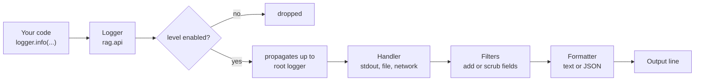
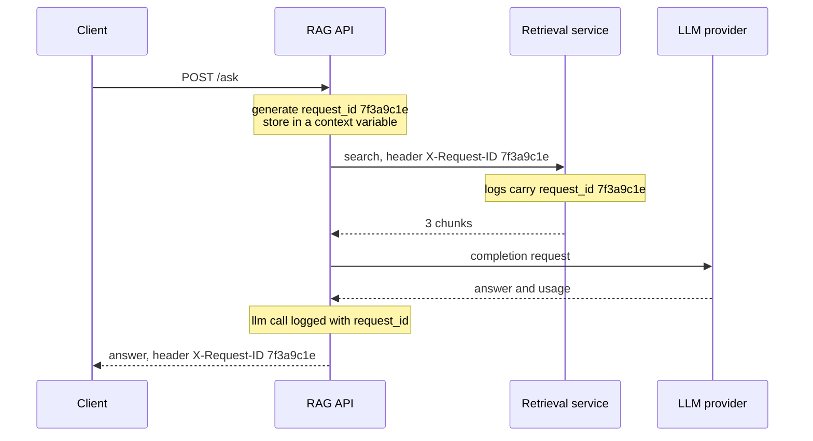

When a user reports that your RAG assistant "gave a weird answer at about three o'clock", logs are usually the only evidence you have. Which documents were retrieved? Which prompt version and model were used? How long did the LLM take, and how many tokens did it consume? A debugger cannot answer those questions after the fact; good logs can. In AI services logging does double duty: it is your debugging record and also the raw material for cost tracking, latency monitoring and quality investigations.

[Basic software development practices](/learn/developer-tools/basic-software-development-practices) introduced the `logging` module, levels and `basicConfig`. This lesson turns that into production practice: structured JSON logs, correlation IDs that tie one request's lines together, keeping secrets and personal data out, and a standard way to log every LLM call.

## How the logging module fits together

Python's `logging` has four moving parts. Knowing them lets you configure it properly instead of fighting it.



| Part | Job | You configure it |
| --- | --- | --- |
| **Logger** | Named entry point, one per module via `logging.getLogger(__name__)` | Rarely; just create and use |
| **Handler** | Sends records somewhere | Once, at start-up, on the root logger |
| **Filter** | Inspects or modifies records before output | Once, attached to a handler |
| **Formatter** | Turns a record into a string | Once, attached to a handler |

The golden rule: **libraries and modules only create loggers and call them; the application configures handlers once**, in the composition root. That way a module never decides where logs go.

## Structured logging: logs as data

A line such as `INFO Retrieved 3 chunks for user 812 in 240ms` is easy for a human to read and annoying for a machine: to chart latency you must write a regular expression for every message format. **Structured logging** emits each event as a set of key-value fields, usually one JSON object per line. Log platforms (Elasticsearch, Loki, Datadog, Cloud Logging and others) index the fields, so you can query `latency_ms > 2000 AND model = "..."` directly.

The standard library is enough. A formatter that turns each record into JSON, and copies any fields passed with `extra=`:

```python
import json
import logging
import sys
from datetime import datetime, timezone

_STANDARD_ATTRS = set(vars(logging.makeLogRecord({}))) | {"message"}

class JsonFormatter(logging.Formatter):
    def format(self, record: logging.LogRecord) -> str:
        entry = {
            "ts": datetime.fromtimestamp(record.created, timezone.utc).isoformat(timespec="milliseconds"),
            "level": record.levelname,
            "logger": record.name,
            "msg": record.getMessage(),
        }
        # Anything passed with extra={...} becomes a top-level field
        entry.update({k: v for k, v in vars(record).items() if k not in _STANDARD_ATTRS})
        if record.exc_info:
            entry["exc"] = self.formatException(record.exc_info)
        return json.dumps(entry, default=str)

def configure_logging(level: str = "INFO") -> None:
    handler = logging.StreamHandler(sys.stdout)
    handler.setFormatter(JsonFormatter())
    root = logging.getLogger()
    root.handlers = [handler]
    root.setLevel(level)

configure_logging()
logger = logging.getLogger("rag.ingest")
logger.info("document indexed", extra={"doc_id": "refunds.md", "chunks": 14})
logger.debug("this is filtered out at INFO")
try:
    1 / 0
except ZeroDivisionError:
    logger.exception("scoring failed", extra={"doc_id": "faq.md"})
```

```output
{"ts": "2026-11-12T07:39:38.902+00:00", "level": "INFO", "logger": "rag.ingest", "msg": "document indexed", "doc_id": "refunds.md", "chunks": 14}
{"ts": "2026-11-12T07:39:38.902+00:00", "level": "ERROR", "logger": "rag.ingest", "msg": "scoring failed", "doc_id": "faq.md", "exc": "Traceback (most recent call last):\n  File \"app/logging_setup.py\", line 34, in <module>\nZeroDivisionError: division by zero"}
```

Your timestamps will differ. Three details matter:

- The **message stays constant** (`"document indexed"`) and the variable parts go in fields. That lets you count and group events by message.
- `logger.exception(...)` logs at `ERROR` and attaches the traceback. Call it only inside an `except` block.
- The handler writes to **stdout**. In containers and most cloud platforms the runtime collects stdout, so the application should not manage log files itself.

> [!TIP]
> Libraries such as `structlog` and `python-json-logger` provide the same structured output with less code and extra conveniences. The concepts in this lesson carry over directly; the hand-written formatter above simply shows that there is no magic.

## Choosing levels in a service

Levels are a contract with whoever reads the logs and whoever sets up alerts.

| Level | Use in an AI service | Example |
| --- | --- | --- |
| `DEBUG` | Detail useful only while diagnosing; off in production | Retrieved chunk IDs and scores |
| `INFO` | Normal, noteworthy events, roughly one or a few per request | "llm call" with tokens and latency |
| `WARNING` | Something unexpected that was handled; worth a look if it grows | Retry after rate limit, fallback model used, empty retrieval |
| `ERROR` | One operation failed and the user saw a failure | LLM call failed after all retries |
| `CRITICAL` | The service cannot function | Vector store unreachable at start-up |

A useful test for `ERROR`: should someone eventually look at every one of these? If the answer is no (a user sent an empty question), it is not an error, it is `INFO` or `WARNING`. Noisy error logs train people to ignore them.

## Correlation IDs: following one request

A busy service interleaves lines from hundreds of concurrent requests. A **correlation ID** (or request ID) is a unique value generated at the start of a request and attached to every log line that request produces, including in other services it calls.



Searching the logs for `request_id = "7f3a9c1e"` now shows the whole story. Returning the ID in the response lets a user or support agent quote it in a bug report.

In Python the right place to keep the ID is a `contextvars.ContextVar`, which is safe with threads and with `asyncio`: each request's task sees its own value. A filter copies it onto every record:

```python
import contextvars
import uuid

request_id: contextvars.ContextVar[str] = contextvars.ContextVar("request_id", default="-")

class RequestIdFilter(logging.Filter):
    def filter(self, record: logging.LogRecord) -> bool:
        record.request_id = request_id.get()
        return True   # never drops the record, only enriches it

logging.getLogger().handlers[0].addFilter(RequestIdFilter())

def handle_request(question: str) -> None:
    request_id.set(uuid.uuid4().hex[:8])
    log = logging.getLogger("rag.api")
    log.info("question received", extra={"chars": len(question)})
    log.info("retrieval finished", extra={"hits": 3})

handle_request("How long do refunds take?")
handle_request("Where is my order?")
```

```output
{"ts": "2026-11-12T07:39:38.903+00:00", "level": "INFO", "logger": "rag.api", "msg": "question received", "chars": 25, "request_id": "21788471"}
{"ts": "2026-11-12T07:39:38.903+00:00", "level": "INFO", "logger": "rag.api", "msg": "retrieval finished", "hits": 3, "request_id": "21788471"}
{"ts": "2026-11-12T07:39:38.903+00:00", "level": "INFO", "logger": "rag.api", "msg": "question received", "chars": 18, "request_id": "c175c3ee"}
{"ts": "2026-11-12T07:39:38.903+00:00", "level": "INFO", "logger": "rag.api", "msg": "retrieval finished", "hits": 3, "request_id": "c175c3ee"}
```

The IDs are random, so yours will differ. In a FastAPI app you would set the context variable in a [middleware](/learn/backend-development/middleware), reusing an incoming `X-Request-ID` header if a gateway already assigned one. Tracing systems such as OpenTelemetry generalise this idea with trace and span IDs.

## Keeping secrets and personal data out of logs

Logs are copied to many places, kept for a long time and read by many people. Anything that reaches them should be treated as widely visible.

> [!WARNING]
> Never log API keys, passwords, session tokens, full request headers, or raw user prompts and documents by default. Prompts often contain names, emails, health or financial details that users did not agree to have stored in a log system. A key that appears in a log must be treated as leaked and rotated.

Defence comes in layers. First, do not pass sensitive values to the logger at all: log `prompt_chars` or a hash rather than the prompt. Second, add a redacting filter as a safety net for mistakes:

```python
import re

SECRET_PATTERNS = [
    (re.compile(r"sk-[A-Za-z0-9_-]{8,}"), "[REDACTED_KEY]"),
    (re.compile(r"[\w.+-]+@[\w-]+\.[\w.]+"), "[EMAIL]"),
]

def scrub(value):
    if isinstance(value, str):
        for pattern, replacement in SECRET_PATTERNS:
            value = pattern.sub(replacement, value)
    return value

class RedactingFilter(logging.Filter):
    def filter(self, record: logging.LogRecord) -> bool:
        record.msg = scrub(record.getMessage())
        record.args = None
        for key, value in vars(record).items():
            if key not in _STANDARD_ATTRS:
                setattr(record, key, scrub(value))
        return True

logging.getLogger().handlers[0].addFilter(RedactingFilter())
log = logging.getLogger("rag.api")
log.warning("auth failed for %s", "ana@example.com", extra={"header": "Bearer sk-live_abcdefgh12345"})
```

```output
{"ts": "2026-11-12T07:39:38.904+00:00", "level": "WARNING", "logger": "rag.api", "msg": "auth failed for [EMAIL]", "header": "Bearer [REDACTED_KEY]", "request_id": "c175c3ee"}
```

Pattern-based redaction is a net, not a guarantee: it cannot recognise a name or a street address. When you genuinely need prompts and responses for debugging or evaluation, store them in a separate, access-controlled system with a retention period, not in general application logs.

## Logging LLM calls

Every call to a model should produce one structured event with the same fields. That single habit gives you cost reports, latency dashboards and the ability to compare prompt versions, all from queries over your logs.

| Field | Why |
| --- | --- |
| `model` | Costs and behaviour differ per model; needed to explain changes |
| `prompt_version` | Ties quality changes to prompt changes |
| `input_tokens`, `output_tokens` | Cost and context-window usage (see [token usage](/learn/working-with-llms/token-usage-and-cost-optimization)) |
| `latency_ms` | User experience; time-to-first-token as well if streaming |
| `status` or error type | Rate of failures, timeouts and refusals |
| `request_id` | Join with the rest of the request's story |

Wrap the provider call once, so no call site can forget:

```python
import time
from dataclasses import dataclass

@dataclass
class Usage:
    input_tokens: int
    output_tokens: int

def fake_llm(prompt: str) -> tuple[str, Usage]:
    time.sleep(0.12)
    return "Refunds take 5 working days.", Usage(input_tokens=412, output_tokens=9)

llm_log = logging.getLogger("rag.llm")

def logged_completion(prompt: str, *, model: str, prompt_version: str) -> str:
    start = time.perf_counter()
    try:
        text, usage = fake_llm(prompt)
    except Exception:
        llm_log.exception("llm call failed", extra={
            "model": model, "prompt_version": prompt_version,
            "latency_ms": round((time.perf_counter() - start) * 1000),
        })
        raise
    llm_log.info("llm call", extra={
        "model": model,
        "prompt_version": prompt_version,
        "input_tokens": usage.input_tokens,
        "output_tokens": usage.output_tokens,
        "latency_ms": round((time.perf_counter() - start) * 1000),
        "prompt_chars": len(prompt),
    })
    return text

request_id.set("7f3a9c1e")
logged_completion("Context: ... Question: How long do refunds take?", model="small-chat-model", prompt_version="answer-v3")
```

```output
{"ts": "2026-11-12T07:39:39.036+00:00", "level": "INFO", "logger": "rag.llm", "msg": "llm call", "model": "small-chat-model", "prompt_version": "answer-v3", "input_tokens": 412, "output_tokens": 9, "latency_ms": 130, "prompt_chars": 48, "request_id": "7f3a9c1e"}
```

Real provider responses report token usage in a `usage` object; the field names vary by SDK, so the adapter translates them into your own names. The failure branch logs and **re-raises**: logging an exception is not handling it, and swallowing it here would hide the failure from callers and from [error monitoring](/learn/software-engineering/error-monitoring).

## Common mistakes

- **Logging and re-raising at every layer.** One failure produces five identical stack traces. Log where you handle the error, or at the top-level boundary, not everywhere.
- **Building messages with f-strings everywhere.** `logger.debug(f"chunks {big_list}")` formats the string even when DEBUG is off. Prefer `logger.debug("chunks %s", big_list)` or fields in `extra`.
- **Using `extra` keys that clash with record attributes** such as `name`, `msg` or `args`. Python raises `KeyError: "Attempt to overwrite 'msg' in LogRecord"`. Prefix or rename them.
- **Calling `basicConfig` in library modules.** Only the application configures logging.

## Exercises

**1.** Rewrite `logger.info(f"User {user_id} asked a {len(q)} char question using {model}")` as a structured log call.

<details>
<summary>Show solution</summary>

```python
logger.info("question received", extra={"user_id": user_id, "chars": len(q), "model": model})
```

The message is now constant, so you can count questions per model with a simple query. Consider whether `user_id` is needed at all, or whether a pseudonymous ID would do.

</details>

**2.** Extend `logged_completion` so that it logs `WARNING` with `"llm output truncated"` when `output_tokens` equals a `max_tokens` argument.

<details>
<summary>Show solution</summary>

```python
def logged_completion(prompt, *, model, prompt_version, max_tokens=512):
    start = time.perf_counter()
    text, usage = fake_llm(prompt)
    fields = {"model": model, "prompt_version": prompt_version,
              "output_tokens": usage.output_tokens,
              "latency_ms": round((time.perf_counter() - start) * 1000)}
    if usage.output_tokens >= max_tokens:
        llm_log.warning("llm output truncated", extra=fields)
    else:
        llm_log.info("llm call", extra=fields)
    return text
```

Hitting the limit usually means the answer was cut off, which is a quality problem worth tracking.

</details>

**3.** A teammate proposes logging every full prompt at `INFO` "to help debugging". List two risks and a safer alternative.

<details>
<summary>Show solution</summary>

Risks: prompts contain user data and retrieved documents, so personal or confidential data spreads to every system that stores logs; log volume and cost grow sharply; prompts may contain secrets pasted by users. Safer: log `prompt_version`, sizes and a hash at `INFO`, and capture full prompts only for a sampled subset into an access-controlled store with a retention limit, or only in development at `DEBUG`.

</details>

```quiz
[
  {
    "q": "Where should logging handlers and formatters be configured?",
    "options": [
      "In every module that logs",
      "Once, at application start-up",
      "Inside each function before it logs",
      "In the library code the app imports"
    ],
    "answer": 1,
    "why": "Modules only create loggers and call them. Configuring once at the top keeps output consistent and lets the application decide where logs go."
  },
  {
    "q": "Why is a `contextvars.ContextVar` a good place to store the current request ID?",
    "options": [
      "It is faster than a global variable",
      "Each thread or asyncio task sees its own value, so concurrent requests do not overwrite each other",
      "It is automatically sent to the client",
      "It writes the ID into the log file"
    ],
    "answer": 1,
    "why": "Context variables are isolated per task and thread, which is exactly the scope of a request in a concurrent server."
  },
  {
    "q": "Which is the best structured log call for an LLM request?",
    "options": [
      "`logger.info(f\"called {model} in {ms}ms\")`",
      "`print(model, ms)`",
      "`logger.info(\"llm call\", extra={\"model\": model, \"latency_ms\": ms})`",
      "`logger.error(\"llm call\", extra={\"model\": model})`"
    ],
    "answer": 2,
    "why": "A constant message with variable data in fields can be indexed and queried. A successful call is INFO, not ERROR."
  },
  {
    "q": "A user submits an empty question and the API returns 422. At which level should this be logged?",
    "options": ["CRITICAL", "ERROR", "INFO or WARNING", "It must not be logged"],
    "answer": 2,
    "why": "Nothing in the service failed. Reserving ERROR for real failures keeps error logs meaningful and alerts trustworthy."
  }
]
```
