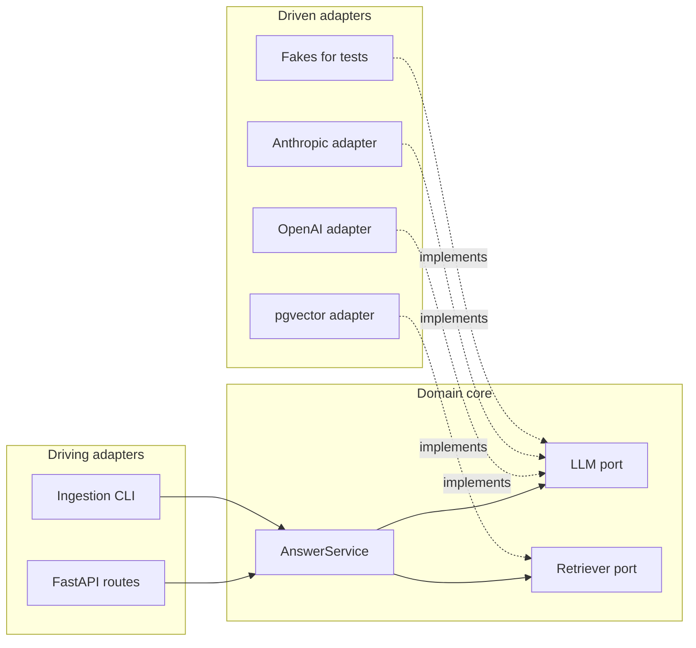

A single `main.py` is a perfectly good home for a first RAG prototype. Six months later the same service has an HTTP API, two LLM providers, a vector database, a background ingestion job and an evaluation script, and every one of them imports every other. Changing the embedding model breaks the API tests; swapping providers means editing twenty files. **Architecture** is the set of decisions about how code is divided into parts and which parts may depend on which. Get it roughly right and the service stays easy to change as it grows.

This lesson builds on [clean code](/learn/software-engineering/clean-code), which worked at the level of one function, and scales the same ideas (cohesion, low coupling, injected dependencies) up to a whole service.

## Layers: separating what changes for different reasons

The most common starting point is a **layered architecture**. Each layer has one kind of responsibility.

| Layer | Responsibility | In a RAG service |
| --- | --- | --- |
| Interface (API) | Translate the outside world into calls to the core: HTTP, CLI, queue messages | FastAPI routes, request and response models |
| Application / domain | The rules of your product, independent of any technology | "Retrieve five chunks, refuse if none score above the threshold, build the prompt, answer with citations" |
| Infrastructure | Talk to concrete technology | OpenAI or Anthropic SDK, pgvector, S3, Redis |

The domain layer is the valuable part: it encodes what your product does. Frameworks and providers are details that will change. A useful test is to ask whether a piece of code would survive switching from FastAPI to a CLI, or from one LLM provider to another. If it would, it belongs in the domain.

## Dependency direction: the rule that makes it work

Layers alone do not help if the domain imports the OpenAI SDK directly. The key rule is about **dependency direction**: source-code dependencies point *inwards*, towards the domain. The domain defines the interfaces it needs (called **ports**), and the infrastructure provides implementations of them (called **adapters**). This is the **ports and adapters** (or hexagonal) architecture.



Read the arrows as "imports" or "knows about". Nothing points out of the core. The API knows about the service, adapters know about the ports, and the service knows only about its own ports. That is **dependency inversion** applied to a whole system: the high-level policy does not depend on low-level details; both depend on the port.

> [!KEY]
> A quick check for dependency direction: your domain package should import nothing from `fastapi`, `openai`, `anthropic`, `sqlalchemy` or any other framework or SDK. If it does, a detail has leaked into the core.

## Isolating LLM providers behind a port

In Python, a port is most naturally a `typing.Protocol`: a description of the methods an object must have, checked by type checkers without any inheritance. Here is a minimal but complete core for a question-answering service.

```python
from dataclasses import dataclass
from typing import Protocol

@dataclass(frozen=True)
class Chunk:
    doc_id: str
    text: str
    score: float

@dataclass(frozen=True)
class Answer:
    text: str
    sources: list[str]

class LLM(Protocol):
    def complete(self, system: str, user: str) -> str: ...

class Retriever(Protocol):
    def search(self, query: str, k: int) -> list[Chunk]: ...

class AnswerService:
    """Answers questions from retrieved context. Knows nothing about providers."""

    def __init__(self, llm: LLM, retriever: Retriever, k: int = 3, min_score: float = 0.3):
        self.llm, self.retriever, self.k, self.min_score = llm, retriever, k, min_score

    def answer(self, question: str) -> Answer:
        chunks = [c for c in self.retriever.search(question, self.k) if c.score >= self.min_score]
        if not chunks:
            return Answer("I could not find that in the documentation.", [])
        context = "\n\n".join(f"[{c.doc_id}] {c.text}" for c in chunks)
        reply = self.llm.complete(
            system="Answer only from the context. Cite sources in brackets.",
            user=f"Context:\n{context}\n\nQuestion: {question}",
        )
        return Answer(reply, [c.doc_id for c in chunks])
```

Adapters live in the infrastructure layer and translate between the port and a specific SDK. Two sketches (not run here, because they need API keys) show how different SDKs hide behind the same method:

```python
# infrastructure/llm_openai.py
from openai import OpenAI

class OpenAIChat:
    def __init__(self, model: str, client: OpenAI | None = None):
        self.model, self.client = model, client or OpenAI()

    def complete(self, system: str, user: str) -> str:
        resp = self.client.chat.completions.create(
            model=self.model,
            messages=[{"role": "system", "content": system}, {"role": "user", "content": user}],
        )
        return resp.choices[0].message.content or ""

# infrastructure/llm_anthropic.py
import anthropic

class AnthropicChat:
    def __init__(self, model: str, max_tokens: int = 1024):
        self.model, self.max_tokens, self.client = model, max_tokens, anthropic.Anthropic()

    def complete(self, system: str, user: str) -> str:
        msg = self.client.messages.create(
            model=self.model, max_tokens=self.max_tokens, system=system,
            messages=[{"role": "user", "content": user}],
        )
        return "".join(block.text for block in msg.content if block.type == "text")
```

Notice that the provider differences (the system prompt is a message in one SDK and a parameter in the other; the response shapes differ) are contained entirely in the adapters. The service never sees them. For tests and local development you write in-memory adapters:

```python
class EchoLLM:
    def complete(self, system: str, user: str) -> str:
        return "Refunds take 5 working days [refunds.md]"

class KeywordRetriever:
    def __init__(self, docs: dict[str, str]):
        self.docs = docs

    def search(self, query: str, k: int) -> list[Chunk]:
        words = set(query.lower().split())
        scored = [
            Chunk(doc_id, text, len(words & set(text.lower().split())) / len(words))
            for doc_id, text in self.docs.items()
        ]
        return sorted(scored, key=lambda c: c.score, reverse=True)[:k]

docs = {
    "refunds.md": "refunds take up to 5 working days",
    "shipping.md": "orders ship from our warehouse in two days",
}
service = AnswerService(EchoLLM(), KeywordRetriever(docs))
print(service.answer("how long do refunds take"))
print(service.answer("what is your office address"))
```

```output
Answer(text='Refunds take 5 working days [refunds.md]', sources=['refunds.md'])
Answer(text='I could not find that in the documentation.', sources=[])
```

The refusal path, the score threshold and the citation logic were all exercised without a network call, an API key or a vector database.

## Wiring it together: the composition root

Something has to decide which adapters to use. That place is the **composition root**: a single module, run at start-up, that reads configuration, builds the concrete objects and hands them to the core. It is the only module allowed to import everything.

```python
# app/main.py: the composition root
def build_service(settings) -> AnswerService:
    if settings.llm_provider == "openai":
        llm = OpenAIChat(settings.llm_model)
    elif settings.llm_provider == "anthropic":
        llm = AnthropicChat(settings.llm_model)
    else:
        raise ValueError(f"unknown provider {settings.llm_provider!r}")
    retriever = PgVectorRetriever(settings.database_url)
    return AnswerService(llm, retriever, k=settings.top_k)
```

In a FastAPI app the route receives the service through [dependency injection](/learn/fastapi/dependency-injection), so routes never construct adapters themselves.

## A package layout that enforces the rule

```text
rag-service/
├── pyproject.toml
├── src/rag_service/
│   ├── domain/              no framework or SDK imports allowed here
│   │   ├── models.py        Chunk, Answer
│   │   ├── ports.py         LLM, Retriever, DocumentStore protocols
│   │   └── answering.py     AnswerService
│   ├── adapters/
│   │   ├── llm_openai.py
│   │   ├── llm_anthropic.py
│   │   └── retriever_pgvector.py
│   ├── api/
│   │   ├── routes.py        FastAPI routes, request/response schemas
│   │   └── deps.py          dependency providers
│   ├── config.py            settings loaded from the environment
│   └── main.py              composition root
└── tests/
    ├── unit/                domain tests with fakes
    └── integration/         adapter tests against real services
```

The folder structure makes the rule visible. Tools such as `import-linter` can enforce it in CI by failing the build if `domain` imports from `adapters`.

## Configuration

Configuration is everything that varies between environments: provider names, model identifiers, URLs, thresholds, secrets. Three rules keep it manageable.

1. **Load it once, at the edge.** Read environment variables in `config.py`, validate them at start-up, and pass values down. Domain code should never call `os.environ`.
2. **Fail fast.** A missing API key should stop the service at start-up with a clear message, not cause a `KeyError` on the first user request.
3. **Type it.** A typo such as `TOP_K=five` should be rejected, not discovered later.

The `pydantic-settings` package does all three. Each field is read from an environment variable of the same name (case-insensitive), with an optional prefix:

```python
from pydantic import SecretStr
from pydantic_settings import BaseSettings, SettingsConfigDict

class Settings(BaseSettings):
    model_config = SettingsConfigDict(env_prefix="RAG_", env_file=".env")

    llm_provider: str = "openai"
    llm_model: str
    database_url: str
    top_k: int = 5
    openai_api_key: SecretStr | None = None
```

`Settings()` reads `RAG_LLM_MODEL`, `RAG_TOP_K` and so on, converts types, and raises a validation error listing every missing or malformed value. `SecretStr` hides the key when the settings object is printed or logged.

> [!WARNING]
> Prompts are configuration-like but are usually better kept in version-controlled files or code than in environment variables. A prompt change alters behaviour as much as a code change does, so it should go through review and evaluation in the same way.

## Pitfalls

| Pitfall | Symptom | Remedy |
| --- | --- | --- |
| Leaky port | The `LLM` protocol returns an OpenAI response object | Ports use your own types (`str`, `Answer`), never SDK types |
| Abstraction for its own sake | Interfaces with exactly one implementation and no fake | Add a port when you need a second implementation, including a test fake |
| The `utils.py` dumping ground | One module imported by everything, with no theme | Move each helper to the module that uses it, or to a cohesive named module |
| Circular imports | `ImportError: cannot import name ...` at start-up | Usually a dependency pointing outwards; move the shared type into `domain` |
| Configuration everywhere | `os.environ.get` scattered across files | One settings object, created in the composition root |

## Exercises

**1.** A colleague's `domain/answering.py` contains `from fastapi import HTTPException` and raises it when retrieval finds nothing. What is wrong, and how would you fix it?

<details>
<summary>Show solution</summary>

The domain now depends on the web framework, so it cannot be reused from a CLI or tested without FastAPI, and HTTP status codes leak into business logic. Define a domain exception such as `class NoRelevantContext(Exception)` in the domain, raise that, and translate it into an `HTTPException(status_code=404)` in the API layer (for example with a FastAPI exception handler).

</details>

**2.** Add an `embed(texts: list[str]) -> list[list[float]]` port called `Embedder`, and write a fake implementation suitable for tests that returns vectors of a fixed length.

<details>
<summary>Show solution</summary>

```python
from typing import Protocol

class Embedder(Protocol):
    def embed(self, texts: list[str]) -> list[list[float]]: ...

class FakeEmbedder:
    def __init__(self, dim: int = 8):
        self.dim = dim

    def embed(self, texts: list[str]) -> list[list[float]]:
        # Deterministic: same text always gives the same vector.
        return [[(hash(t) >> i) % 7 / 7 for i in range(self.dim)] for t in texts]
```

Note that Python randomises `hash()` for strings between processes, so this fake is deterministic within one test run only. For vectors that are identical across runs, derive them from `hashlib.sha256(t.encode()).digest()` instead.

</details>

**3.** Sort these into domain, adapter, API or composition root: (a) the rule "refuse to answer if no chunk scores above 0.3"; (b) converting an Anthropic response into a string; (c) choosing which LLM adapter to use from settings; (d) returning HTTP 429 when a user exceeds their quota.

<details>
<summary>Show solution</summary>

(a) Domain: it is product behaviour. (b) Adapter: SDK-specific translation. (c) Composition root. (d) API layer: HTTP status codes are an interface concern, although the quota rule itself may live in the domain.

</details>

```quiz
[
  {
    "q": "In a ports and adapters architecture, which way should source-code dependencies point?",
    "options": [
      "From the domain outwards to the SDKs it uses",
      "Inwards, towards the domain core",
      "From the database to the API",
      "There is no rule; it depends on the team"
    ],
    "answer": 1,
    "why": "Adapters and the API depend on the domain and its ports. The domain depends on nothing external, which keeps it stable and testable."
  },
  {
    "q": "What is the composition root?",
    "options": [
      "The base class every adapter inherits from",
      "The top folder of the repository",
      "The single place at start-up that builds concrete adapters and injects them into the core",
      "The first route in a FastAPI app"
    ],
    "answer": 2,
    "why": "It is the one module allowed to know about every concrete implementation, so the rest of the code can depend on abstractions."
  },
  {
    "q": "Why should a port such as `LLM.complete` return `str` rather than the provider's response object?",
    "options": [
      "Strings use less memory",
      "Returning SDK types would leak the provider into the domain and couple it to one vendor",
      "Protocols cannot return objects",
      "Response objects cannot be logged"
    ],
    "answer": 1,
    "why": "Ports should speak in the domain's own types so any adapter, including a test fake, can implement them."
  },
  {
    "q": "A missing API key is discovered only when the first user request fails. Which configuration rule was broken?",
    "options": ["Type it", "Fail fast at start-up", "Keep prompts in files", "Use a `utils.py` module"],
    "answer": 1,
    "why": "Validating settings when the service starts turns a confusing runtime error into a clear start-up failure."
  }
]
```
