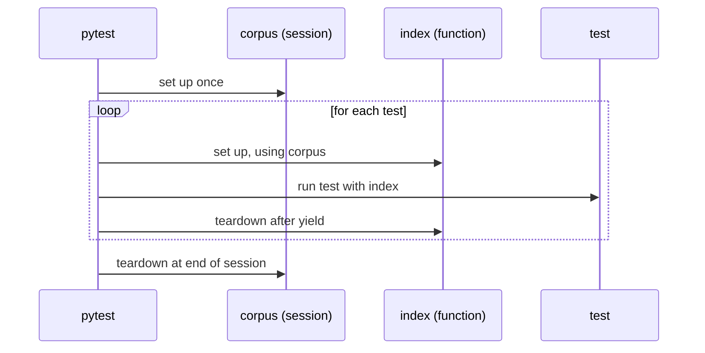

pytest is the testing tool almost every Python AI project uses, from small RAG services to libraries such as scikit-learn and Hugging Face Transformers. You have already written plain `test_` functions with `assert`. This lesson covers the features that make a large test suite pleasant to live with: fixtures and their scopes, `conftest.py`, parametrisation, markers, the built-in `tmp_path` and `monkeypatch` fixtures, configuration and coverage. Every session shown is real output from the small project below.

## The example project

A tiny RAG utility package, laid out the way [basic software development practices](/learn/developer-tools/basic-software-development-practices) recommended:

```text
ragkit/
├── pyproject.toml
├── src/ragkit/
│   ├── __init__.py
│   ├── chunking.py      chunk_text(text, size, overlap)
│   ├── config.py        load_top_k() reads RAG_TOP_K
│   └── store.py         save_jsonl / load_jsonl
└── tests/
    ├── conftest.py      shared fixtures
    ├── test_chunking.py
    ├── test_index.py
    └── test_config_and_store.py
```

pytest's settings live in `pyproject.toml`:

```toml
[tool.pytest.ini_options]
testpaths = ["tests"]
pythonpath = ["src"]
addopts = "-ra --strict-markers"
markers = [
    "slow: tests that take more than a second",
    "integration: tests that need real external services",
]
```

`testpaths` tells pytest where to look, `pythonpath` lets tests import `ragkit` without installing it, `-ra` prints a summary line for every test that did not simply pass, and `--strict-markers` turns a misspelt marker into an error instead of a silently ignored test.

The function under test:

```python
def chunk_text(text: str, size: int, overlap: int = 0) -> list[str]:
    """Split text into windows of `size` words, sharing `overlap` words."""
    if size <= 0:
        raise ValueError("size must be positive")
    if not 0 <= overlap < size:
        raise ValueError("overlap must be in [0, size)")
    words = text.split()
    if not words:
        return []
    step = size - overlap
    return [" ".join(words[i:i + size]) for i in range(0, max(len(words) - overlap, 1), step)]
```

## Discovery and assertion rewriting

pytest **discovers** tests by convention: files named `test_*.py` (or `*_test.py`), functions named `test_*`, and methods named `test_*` inside classes named `Test*`. You never register tests by hand.

Its other trick is **assertion rewriting**. A plain `assert` in a test file is rewritten at import time so that, on failure, pytest shows the values involved. Suppose you wrongly expect the chunker to emit a trailing chunk:

```python
def test_overlap_keeps_last_word():
    chunks = chunk_text("refunds take five working days", size=3, overlap=1)
    assert chunks == ["refunds take five", "five working days", "days"]
```

```bash
pytest -q tests/test_fail.py
```

```output
F                                                                        [100%]
=================================== FAILURES ===================================
_________________________ test_overlap_keeps_last_word _________________________

    def test_overlap_keeps_last_word():
        chunks = chunk_text("refunds take five working days", size=3, overlap=1)
>       assert chunks == ["refunds take five", "five working days", "days"]
E       AssertionError: assert ['refunds tak...working days'] == ['refunds tak...days', 'days']
E         
E         Right contains one more item: 'days'
E         Use -v to get more diff

tests/test_fail.py:6: AssertionError
=========================== short test summary info ============================
FAILED tests/test_fail.py::test_overlap_keeps_last_word - AssertionError: ass...
1 failed in 0.02s
```

You did not write any message, yet pytest tells you the right-hand list has one extra item. Here the test was wrong, not the code: a final chunk containing only the overlap word would be redundant.

## Fixtures: reusable setup

A **fixture** is a function that prepares something a test needs. A test asks for it simply by naming it as a parameter; pytest calls the fixture and passes in the result. Fixtures can depend on other fixtures, and code after a `yield` runs as **teardown**.

```python
import pytest

class FakeIndex:
    """In-memory stand-in for a vector index."""

    def __init__(self):
        self.docs: dict[str, str] = {}

    def add(self, doc_id: str, text: str) -> None:
        self.docs[doc_id] = text

    def search(self, word: str) -> list[str]:
        return sorted(d for d, t in self.docs.items() if word in t.split())

@pytest.fixture(scope="session")
def corpus():
    # Expensive to build in real life (parsing files), so share it across the session.
    return {
        "refunds": "refunds take five working days",
        "shipping": "orders ship in two days",
    }

@pytest.fixture
def index(corpus):
    idx = FakeIndex()
    for doc_id, text in corpus.items():
        idx.add(doc_id, text)
    yield idx
    idx.docs.clear()  # teardown runs after each test
```

Tests that use it:

```python
def test_search_finds_word(index):
    assert index.search("days") == ["refunds", "shipping"]

def test_add_document(index):
    index.add("warranty", "two year warranty")
    assert index.search("warranty") == ["warranty"]

def test_fixture_is_fresh(index):
    assert "warranty" not in index.docs  # the previous test's change is gone
```

### Scopes

The `scope` argument controls how often a fixture is created and therefore how widely its value is shared.

| Scope | Created once per | Use for |
| --- | --- | --- |
| `function` (default) | Test | Anything a test might modify: indexes, repositories, mocks |
| `class` | Test class | Shared setup for a group of related tests |
| `module` | Test file | Moderately expensive read-only data |
| `package` | Test package directory | Rarely needed |
| `session` | Whole run | Expensive, read-only resources: a loaded tokenizer, a database container, a small embedding model |

The `--setup-show` flag prints when each fixture is set up and torn down. `S` marks session scope and `F` function scope:

```bash
pytest -q --setup-show tests/test_index.py -m "not slow"
```

```output
SETUP    S corpus
        SETUP    F index (fixtures used: corpus)
        tests/test_index.py::test_search_finds_word (fixtures used: corpus, index) .
        TEARDOWN F index
        SETUP    F index (fixtures used: corpus)
        tests/test_index.py::test_add_document (fixtures used: corpus, index) .
        TEARDOWN F index
        SETUP    F index (fixtures used: corpus)
        tests/test_index.py::test_fixture_is_fresh (fixtures used: corpus, index) .
        TEARDOWN F index
TEARDOWN S corpus
3 passed, 1 deselected in 0.00s
```



> [!WARNING]
> A wider scope is faster but shares state. If a session-scoped fixture returns a mutable object and one test modifies it, later tests see the change, and failures start depending on test order. Make shared fixtures read-only, or build a fresh function-scoped object from them, as `index` does from `corpus`.

### conftest.py

Fixtures defined in a file called `conftest.py` are available to every test in that directory and below, with no import. A project usually has one at `tests/conftest.py` for shared fixtures, and sometimes more specific ones in subfolders such as `tests/integration/conftest.py` for database fixtures. That is where `corpus` and `index` above live.

## Parametrize: one test, many cases

`@pytest.mark.parametrize` runs the same test body over a table of inputs. Each row becomes a separate test with its own pass or fail, and `ids` gives them readable names.

```python
import pytest

@pytest.mark.parametrize(
    ("text", "size", "overlap", "expected"),
    [
        ("a b c d", 2, 0, ["a b", "c d"]),
        ("a b c d", 3, 1, ["a b c", "c d"]),
        ("a b", 5, 0, ["a b"]),
        ("", 3, 0, []),
    ],
    ids=["no-overlap", "overlap", "short-text", "empty"],
)
def test_chunk_text(text, size, overlap, expected):
    assert chunk_text(text, size, overlap) == expected

@pytest.mark.parametrize("size, overlap", [(0, 0), (3, 3), (3, -1)])
def test_rejects_bad_arguments(size, overlap):
    with pytest.raises(ValueError):
        chunk_text("a b c", size, overlap)
```

```bash
pytest -v tests/test_chunking.py
```

```output
============================= test session starts ==============================
collecting ... collected 7 items

tests/test_chunking.py::test_chunk_text[no-overlap] PASSED               [ 14%]
tests/test_chunking.py::test_chunk_text[overlap] PASSED                  [ 28%]
tests/test_chunking.py::test_chunk_text[short-text] PASSED               [ 42%]
tests/test_chunking.py::test_chunk_text[empty] PASSED                    [ 57%]
tests/test_chunking.py::test_rejects_bad_arguments[0-0] PASSED           [ 71%]
tests/test_chunking.py::test_rejects_bad_arguments[3-3] PASSED           [ 85%]
tests/test_chunking.py::test_rejects_bad_arguments[3--1] PASSED          [100%]

============================== 7 passed in 0.00s ===============================
```

(The platform header pytest prints first is omitted here and below.) Parametrisation is ideal for parsers of model output: one row per real reply you have seen, good and bad.

## Markers: selecting and skipping tests

Markers attach labels to tests. Some are built in; others you register yourself, as in `pyproject.toml` above.

| Marker | Effect |
| --- | --- |
| `@pytest.mark.skip(reason=...)` | Never run; reported as skipped |
| `@pytest.mark.skipif(condition, reason=...)` | Skip when the condition is true, for example no GPU or no API key |
| `@pytest.mark.xfail(reason=...)` | Expected to fail (a known bug); reported as `xfail`, and as `XPASS` if it unexpectedly passes |
| `@pytest.mark.slow` (custom) | A label you can select or exclude with `-m` |

```python
import os, time

@pytest.mark.slow
def test_reindex_large_corpus(index):
    time.sleep(1.2)
    assert len(index.docs) == 2

@pytest.mark.skipif("OPENAI_API_KEY" not in os.environ, reason="needs a real API key")
def test_live_provider_contract():
    ...
```

Select with `-m` (markers) or `-k` (substring of test names):

```bash
pytest -q -m "not slow"
pytest -q -k "top_k"
```

```output
.............                                                            [100%]
13 passed, 1 deselected in 0.01s
..                                                                       [100%]
2 passed, 12 deselected in 0.00s
```

A common arrangement: developers run `pytest -m "not slow and not integration"` on every save, and CI runs everything.

## Built-in fixtures: tmp_path and monkeypatch

pytest ships with fixtures for the most common awkward dependencies.

`tmp_path` gives each test its own fresh temporary directory as a `pathlib.Path`, so tests that write files never collide or leave litter:

```python
from ragkit.store import load_jsonl, save_jsonl

def test_jsonl_round_trip(tmp_path):
    path = tmp_path / "chunks.jsonl"
    rows = [{"id": "c1", "text": "refunds"}, {"id": "c2", "text": "shipping"}]
    assert save_jsonl(path, rows) == 2
    assert load_jsonl(path) == rows
```

`monkeypatch` temporarily changes environment variables, attributes or dictionary entries, and undoes every change after the test:

```python
from ragkit.config import load_top_k

def test_top_k_default(monkeypatch):
    monkeypatch.delenv("RAG_TOP_K", raising=False)
    assert load_top_k() == 5

def test_top_k_from_env(monkeypatch):
    monkeypatch.setenv("RAG_TOP_K", "8")
    assert load_top_k() == 8
```

| Fixture | Gives you |
| --- | --- |
| `tmp_path` | A unique temporary directory per test |
| `monkeypatch` | `setenv`, `delenv`, `setattr`, `setitem`, all undone automatically |
| `capsys` | Captured `stdout` and `stderr` via `capsys.readouterr()` |
| `caplog` | Captured log records, to assert that a warning was logged |

> [!TIP]
> `monkeypatch.setattr` can replace a function such as `time.sleep` or your own `call_llm` for one test. Prefer passing dependencies in where you can, as the [unit testing](/learn/software-engineering/unit-testing) lesson recommends; patching is the tool for code you cannot easily change.

## Coverage

**Coverage** measures which lines of your code ran during the tests. The `pytest-cov` plugin (`pip install pytest-cov`) adds it to pytest:

```bash
pytest -q --cov=ragkit --cov-report=term-missing -m "not slow"
```

```output
.............                                                            [100%]
================================ tests coverage ================================
______________ coverage: platform darwin, python 3.12.16-final-0 _______________

Name                     Stmts   Miss  Cover   Missing
------------------------------------------------------
src/ragkit/__init__.py       0      0   100%
src/ragkit/chunking.py      10      0   100%
src/ragkit/config.py         9      1    89%   9
src/ragkit/store.py         10      0   100%
------------------------------------------------------
TOTAL                       29      1    97%
13 passed, 1 deselected in 0.03s
```

`Missing` lists line numbers never executed. Line 9 of `config.py` is `raise ValueError("RAG_TOP_K must be at least 1")`: no test checks the invalid case. Coverage points you at untested branches like this.

> [!KEY]
> Coverage tells you what was *not* tested, not that what ran was tested well. A test with no assertions can execute every line. Use it to find gaps, and set a CI floor (`--cov-fail-under=80`) to stop coverage quietly eroding, rather than chasing 100%.

## Everyday flags

| Command | Does |
| --- | --- |
| `pytest -x` | Stop at the first failure |
| `pytest --lf` | Re-run only the tests that failed last time |
| `pytest -k "chunk and not empty"` | Run tests whose names match the expression |
| `pytest tests/test_index.py::test_add_document` | Run a single test |
| `pytest -vv` | Very verbose, with full diffs on failure |
| `pytest --pdb` | Open the debugger at the point of failure |
| `pytest --durations=5` | Show the five slowest tests |

## Exercises

**1.** Write a test that covers the missing line in `config.py`: setting `RAG_TOP_K` to `"0"` should raise `ValueError`.

<details>
<summary>Show solution</summary>

```python
def test_top_k_rejects_zero(monkeypatch):
    monkeypatch.setenv("RAG_TOP_K", "0")
    with pytest.raises(ValueError, match="at least 1"):
        load_top_k()
```

Re-running with `--cov-report=term-missing` now shows `config.py` at 100%.

</details>

**2.** A test suite loads a 400 MB tokenizer in a function-scoped fixture used by 60 tests. What would you change, and what must you be careful about?

<details>
<summary>Show solution</summary>

Make the fixture `scope="session"` so the tokenizer loads once. The care point is shared state: the tokenizer must be treated as read-only. If any test changes its settings (for example adding special tokens), either give that test its own instance or restore the change in teardown.

</details>

**3.** Parametrise a test for a function `is_refusal(reply: str) -> bool` with at least four cases, two refusals and two normal answers, using readable `ids`.

<details>
<summary>Show solution</summary>

```python
@pytest.mark.parametrize(
    ("reply", "expected"),
    [
        ("I'm sorry, but I can't help with that.", True),
        ("I cannot answer that question.", True),
        ("Refunds take five working days.", False),
        ("Sorry for the delay: your order ships today.", False),
    ],
    ids=["sorry-cant", "cannot", "normal", "apology-not-refusal"],
)
def test_is_refusal(reply, expected):
    assert is_refusal(reply) is expected
```

The last case guards against a naive implementation that treats any "sorry" as a refusal.

</details>

```quiz
[
  {
    "q": "A fixture is declared with `@pytest.fixture(scope=\"module\")`. How often is it created?",
    "options": ["Once per test", "Once per test file", "Once per test run", "Once per class"],
    "answer": 1,
    "why": "Module scope means one instance per test module (file), shared by every test in it."
  },
  {
    "q": "Where do fixtures need to be defined to be usable by every test in `tests/` without importing them?",
    "options": ["`tests/__init__.py`", "`tests/fixtures.py`", "`tests/conftest.py`", "`pyproject.toml`"],
    "answer": 2,
    "why": "pytest automatically loads `conftest.py` files and makes their fixtures available to tests in that directory and below."
  },
  {
    "q": "Which built-in fixture should you use to set an environment variable for one test only?",
    "options": ["`tmp_path`", "`capsys`", "`monkeypatch`", "`caplog`"],
    "answer": 2,
    "why": "`monkeypatch.setenv` changes the variable and automatically restores the original after the test."
  },
  {
    "q": "Coverage reports 100% for a module. What can you conclude?",
    "options": [
      "The module has no bugs",
      "Every line ran during the tests, but not necessarily that results were checked",
      "Every test passed",
      "All edge cases are tested"
    ],
    "answer": 1,
    "why": "Coverage measures execution, not verification. A test without assertions still counts as covering lines."
  }
]
```
