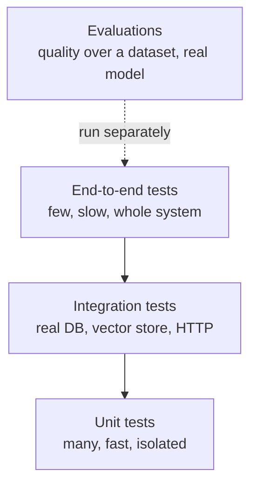

Every time you tweak a prompt, swap a model or refactor a parser, you risk breaking something that used to work. Unit tests are the cheapest insurance against that: small, fast, automatic checks that one piece of code does what you intended. In AI services they have an extra difficulty: the most interesting dependency, the LLM, is slow, costs money and gives different answers on different days. This lesson shows what to unit test, how to replace dependencies with **test doubles**, and how to test LLM-calling code so the results are the same on every run.

You wrote your first pytest functions in [basic software development practices](/learn/developer-tools/basic-software-development-practices). Here the focus is on design: what to test and how to isolate it. The [pytest](/learn/software-engineering/pytest) lesson later in this module covers the tool's features in depth.

## What a unit test is

A **unit test** checks one small piece of behaviour (a function, a class) in isolation from slow or unpredictable things: networks, databases, file systems, clocks, randomness and, above all, model APIs. Good unit tests share a few properties, sometimes summarised as FIRST:

| Property | Meaning |
| --- | --- |
| **F**ast | Milliseconds each, so you can run hundreds on every save |
| **I**ndependent | No test depends on another having run first |
| **R**epeatable | Same result on every machine, every time |
| **S**elf-validating | Pass or fail, with no human reading output |
| **T**imely | Written alongside the code, not months later |

Unit tests sit at the base of the **testing pyramid**: many fast unit tests, fewer [integration tests](/learn/software-engineering/integration-testing) that exercise real dependencies, and a handful of slow end-to-end tests. AI systems add a fourth kind, **evaluations**, which measure output quality over a dataset rather than checking pass or fail ([RAG evaluation](/learn/rag-fundamentals/rag-evaluation) and [model evaluation](/learn/working-with-llms/model-evaluation) cover those).



### What to unit test in an AI service

| Unit test it | Leave it to other tests |
| --- | --- |
| Prompt construction: the right context, delimiters, instructions | Whether the model *understands* the prompt (evaluation) |
| Parsing and validating model output, including garbage | Whether the vector database returns results (integration) |
| Business rules: thresholds, fallbacks, refusals, routing | Model accuracy on a test set (evaluation) |
| Retry, timeout and error-handling logic | Network behaviour of the real provider (integration) |
| Chunking, cleaning, tokenisation helpers | |

The pattern is clear: unit tests check **your code's logic around the model**, not the model itself.

## The code under test

The examples test a small ticket classifier. It builds a prompt, calls an injected `llm` object, retries transient failures, parses JSON and applies a confidence threshold.

```python
import json

LABELS = {"billing", "technical", "other"}

class ClassificationError(Exception):
    pass

class TransientError(Exception):
    pass

def build_prompt(ticket: str) -> str:
    return (
        "Classify the support ticket as billing, technical or other.\n"
        'Reply with JSON: {"label": ..., "confidence": 0-1}.\n\n'
        f"<ticket>\n{ticket}\n</ticket>"
    )

def parse_label(raw: str) -> tuple[str, float]:
    try:
        data = json.loads(raw)
        label, confidence = data["label"].lower(), float(data["confidence"])
    except (json.JSONDecodeError, KeyError, TypeError, ValueError) as exc:
        raise ClassificationError(f"unparseable reply: {raw!r}") from exc
    if label not in LABELS:
        raise ClassificationError(f"unknown label {label!r}")
    return label, confidence

class TicketClassifier:
    def __init__(self, llm, max_attempts: int = 3, min_confidence: float = 0.5):
        self.llm, self.max_attempts, self.min_confidence = llm, max_attempts, min_confidence

    def classify(self, ticket: str) -> str:
        for attempt in range(1, self.max_attempts + 1):
            try:
                raw = self.llm.complete(build_prompt(ticket))
                break
            except TransientError:
                if attempt == self.max_attempts:
                    raise
        label, confidence = parse_label(raw)
        return label if confidence >= self.min_confidence else "other"
```

The `llm` is passed in rather than created inside, as [clean code](/learn/software-engineering/clean-code) recommended. That single decision is what makes everything below possible.

## Arrange, act, assert

Most tests follow the same three-part shape: set up inputs and doubles (**arrange**), call the code (**act**), check the outcome (**assert**). Pure functions need no setup at all:

```python
import pytest

def test_prompt_wraps_ticket_in_delimiters():
    prompt = build_prompt("Card charged twice")
    assert "<ticket>\nCard charged twice\n</ticket>" in prompt

def test_parse_label_normalises_case():
    assert parse_label('{"label": "Billing", "confidence": 0.9}') == ("billing", 0.9)

def test_parse_label_rejects_unknown_label():
    with pytest.raises(ClassificationError, match="unknown label"):
        parse_label('{"label": "sales", "confidence": 0.9}')

def test_parse_label_rejects_prose():
    with pytest.raises(ClassificationError):
        parse_label("Sure! This looks like a billing issue.")
```

The second test encodes a lesson every LLM engineer learns: models sometimes answer in chatty prose despite instructions. Collect real bad outputs you see in production and turn each one into a test case for your parser.

> [!TIP]
> Name tests after the behaviour, not the function: `test_low_confidence_falls_back_to_other` tells you what broke when it fails; `test_classify_2` does not.

## Test doubles

A **test double** is any object that stands in for a real dependency during a test. The vocabulary is worth knowing because each kind answers a different question.

| Double | What it does | Use it when |
| --- | --- | --- |
| **Dummy** | Fills a parameter; never used | A constructor requires an argument the test does not touch |
| **Stub** | Returns canned answers | You care about the result your code produces from a given reply |
| **Fake** | A working, simplified implementation | You need realistic behaviour: an in-memory repository or vector index |
| **Mock** | Records calls so you can assert on them | You care *how* the dependency was called: arguments, count |
| **Spy** | A real object wrapped to record calls | You want real behaviour plus a record of interactions |

### A hand-written stub

For an object with one method, a small class is often clearer than any library:

```python
class StubLLM:
    def __init__(self, reply: str):
        self.reply = reply

    def complete(self, prompt: str) -> str:
        return self.reply

def test_low_confidence_falls_back_to_other():
    clf = TicketClassifier(StubLLM('{"label": "technical", "confidence": 0.3}'))
    assert clf.classify("App is slow") == "other"
```

### Mocks with unittest.mock

The standard library's `unittest.mock` creates doubles on the fly. A `Mock` accepts any call, returns another `Mock` by default, and records everything. Two attributes control behaviour:

- `return_value`: what the call returns.
- `side_effect`: an exception to raise, a function to call, or an iterable whose items are returned (or raised, if they are exceptions) on successive calls.

That makes retry logic easy to test deterministically:

```python
from unittest.mock import Mock, create_autospec

class LLM:  # the interface the classifier depends on
    def complete(self, prompt: str) -> str: ...

def test_retries_transient_errors_then_succeeds():
    llm = Mock()
    llm.complete.side_effect = [
        TransientError("429"),
        TransientError("timeout"),
        '{"label": "technical", "confidence": 0.8}',
    ]
    assert TicketClassifier(llm).classify("Login fails") == "technical"
    assert llm.complete.call_count == 3

def test_gives_up_after_max_attempts():
    llm = Mock()
    llm.complete.side_effect = TransientError("503")
    with pytest.raises(TransientError):
        TicketClassifier(llm, max_attempts=2).classify("Hello")
    assert llm.complete.call_count == 2

def test_sends_built_prompt_once():
    llm = create_autospec(LLM, instance=True)
    llm.complete.return_value = '{"label": "billing", "confidence": 0.95}'

    assert TicketClassifier(llm).classify("Refund please") == "billing"
    llm.complete.assert_called_once_with(build_prompt("Refund please"))
```

Simulating a rate limit followed by a timeout followed by success would be nearly impossible against a real API. With `side_effect` it is three lines.

### Why autospec matters

A plain `Mock` happily accepts methods that do not exist, so a test can pass while the real code would crash. `create_autospec` builds a mock that has only the methods of the real class, with the same signatures:

```python
loose = Mock()
result = loose.compelte("typo")         # no error: Mock invents the method
print("loose mock returned a", type(result).__name__)

strict = create_autospec(LLM, instance=True)
try:
    strict.compelte("typo")
except AttributeError as exc:
    print("AttributeError:", exc)
```

```output
loose mock returned a Mock
AttributeError: Mock object has no attribute 'compelte'
```

> [!WARNING]
> Mock at the boundary you own, not deep inside libraries. Mocking `openai.OpenAI().chat.completions.create` couples your tests to the SDK's internal shape; mocking your own `LLM.complete` port does not. If you must use `unittest.mock.patch`, patch the name **where it is looked up** (`patch("myapp.service.call_llm")`), not where it was defined.

## Testing LLM code deterministically

The model is the one dependency you can never make deterministic in a unit test, so do not try. Instead:

1. **Inject the model** behind your own interface and replace it with stubs, mocks or fakes.
2. **Record real outputs once**, save them as fixture files, and test your parser against them. Include the awkward ones: prose, truncated JSON, wrong labels, empty strings.
3. **Assert on properties, not prose.** If a test must touch generated text, check structure ("valid JSON with a known label") rather than exact wording.
4. **Test the prompt as data.** Check that the user input is inside its delimiters, that retrieved context appears, that the prompt stays under a size budget.
5. **Keep real-model checks in a separate suite** of evaluations or integration tests, run on demand or nightly, not on every save.

Running all eight tests from this lesson (saved in `tests/test_classifier.py`, with the classifier in `classifier.py`):

```bash
pytest -v
```

```output
============================= test session starts ==============================
collecting ... collected 8 items

tests/test_classifier.py::test_prompt_wraps_ticket_in_delimiters PASSED  [ 12%]
tests/test_classifier.py::test_parse_label_normalises_case PASSED        [ 25%]
tests/test_classifier.py::test_parse_label_rejects_unknown_label PASSED  [ 37%]
tests/test_classifier.py::test_parse_label_rejects_prose PASSED          [ 50%]
tests/test_classifier.py::test_low_confidence_falls_back_to_other PASSED [ 62%]
tests/test_classifier.py::test_sends_built_prompt_once PASSED            [ 75%]
tests/test_classifier.py::test_retries_transient_errors_then_succeeds PASSED [ 87%]
tests/test_classifier.py::test_gives_up_after_max_attempts PASSED        [100%]

============================== 8 passed in 0.01s ===============================
```

Eight tests covering prompts, parsing, thresholds and retry logic in a hundredth of a second, with no API key. (The full run also prints a platform header, omitted here.)

> [!KEY]
> If code is hard to unit test, the code is usually telling you something: it creates its own dependencies, mixes I/O with logic, or does too much. Fix the design and the test becomes easy.

## Exercises

**1.** Write a test that `parse_label` raises `ClassificationError` when the reply is valid JSON but `confidence` is the string `"high"`.

<details>
<summary>Show solution</summary>

```python
def test_parse_label_rejects_non_numeric_confidence():
    with pytest.raises(ClassificationError, match="unparseable"):
        parse_label('{"label": "billing", "confidence": "high"}')
```

`float("high")` raises `ValueError`, which `parse_label` converts into a `ClassificationError`.

</details>

**2.** Write a test that checks `classify` does **not** retry when the model returns unparseable output (a `ClassificationError` should propagate after exactly one call).

<details>
<summary>Show solution</summary>

```python
def test_does_not_retry_on_bad_output():
    llm = Mock()
    llm.complete.return_value = "I think it's billing"
    with pytest.raises(ClassificationError):
        TicketClassifier(llm).classify("Charged twice")
    assert llm.complete.call_count == 1
```

Retrying a parse failure might sometimes help, but it should be a deliberate decision with its own test, not an accident.

</details>

**3.** Classify each double: (a) an in-memory dictionary implementing your `DocumentStore` port; (b) `Mock()` with `assert_called_once_with`; (c) an object that always returns the same embedding vector; (d) `None` passed as a logger the test never triggers.

<details>
<summary>Show solution</summary>

(a) Fake. (b) Mock. (c) Stub. (d) Dummy.

</details>

```quiz
[
  {
    "q": "Which of these belongs in a unit test of an LLM-backed feature?",
    "options": [
      "Checking that the real model answers correctly 90% of the time",
      "Checking that the parser rejects a prose reply that is not JSON",
      "Checking that the vector database container starts",
      "Measuring the provider's average latency"
    ],
    "answer": 1,
    "why": "Unit tests check your own logic deterministically. Model quality is an evaluation, and real services are integration concerns."
  },
  {
    "q": "How do you make a `Mock` raise an error on the first call and return a value on the second?",
    "options": [
      "Set `return_value` to a list",
      "Set `side_effect` to a list containing the exception and then the value",
      "Call `mock.reset_mock()` between calls",
      "Use `assert_called_once_with`"
    ],
    "answer": 1,
    "why": "When `side_effect` is an iterable, each call takes the next item; exception instances in it are raised."
  },
  {
    "q": "What problem does `create_autospec` solve?",
    "options": [
      "It makes mocks run faster",
      "It records real network traffic",
      "It stops a mock accepting methods or signatures the real object does not have",
      "It automatically writes assertions"
    ],
    "answer": 2,
    "why": "A plain `Mock` invents any attribute, so typos and API drift go unnoticed. An autospecced mock fails like the real object would."
  },
  {
    "q": "You need an in-memory object that genuinely stores and returns documents so a service can be tested end to end without Postgres. What kind of double is it?",
    "options": ["Dummy", "Stub", "Fake", "Spy"],
    "answer": 2,
    "why": "A fake is a working, simplified implementation, as opposed to a stub that returns fixed answers."
  }
]
```
