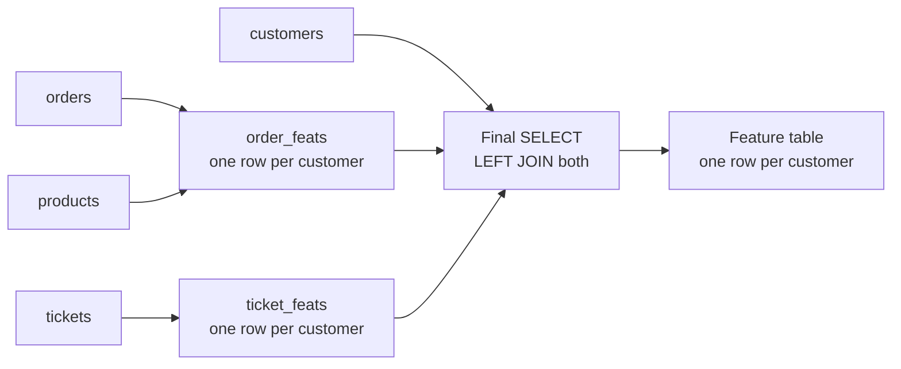
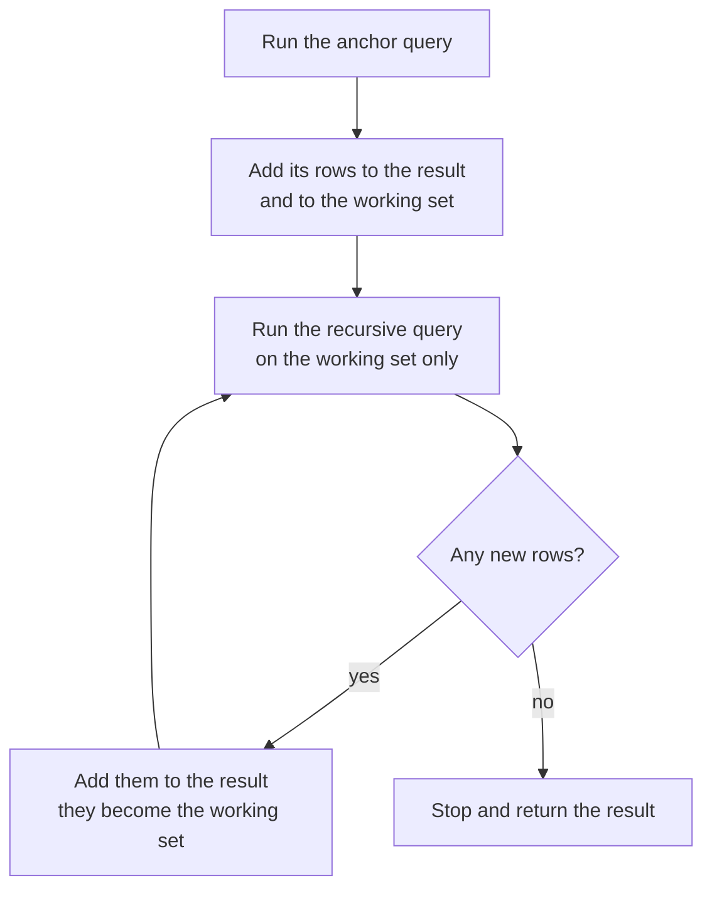

The subqueries of the previous lesson work, but nest three of them and the query reads inside out, with the most important logic buried in the middle. A **common table expression** (CTE) fixes this. It gives a subquery a name with `WITH name AS (...)`, placed before the main query, so a long query reads top to bottom as a sequence of named steps. Feature-extraction queries for machine learning are often dozens of lines long, and CTEs are what keep them readable, reviewable and debuggable. CTEs can also be **recursive**, which lets SQL generate sequences and walk hierarchies.

SQLite has supported CTEs since version 3.8.3, and PostgreSQL, MySQL 8, SQL Server and the major warehouses all support them.

## The WITH clause

A CTE is a named query that exists only for the duration of one statement:

```sql
WITH shipped AS (
    SELECT o.customer_id, o.quantity * p.price AS amount
    FROM orders AS o
    JOIN products AS p ON p.product_id = o.product_id
    WHERE o.status = 'shipped'
)
SELECT customer_id, SUM(amount) AS revenue
FROM shipped
GROUP BY customer_id
ORDER BY revenue DESC;
```

```output
 customer_id | revenue
-------------+---------
           2 |   777.0
           1 |   339.0
           3 |   250.0
           4 |   199.0
           5 |   128.0
(5 rows)
```

Inside the main query, `shipped` behaves like a table. Nothing is stored permanently: after the statement finishes, the name is gone. If you need the same intermediate result in several separate statements, use a view or a temporary table instead.

## Chaining several CTEs

Separate CTEs with commas. Each one can refer to any CTE defined before it, so you build a pipeline. Each customer's share of shipped revenue:

```sql
WITH revenue AS (
    SELECT o.customer_id, SUM(o.quantity * p.price) AS revenue
    FROM orders AS o
    JOIN products AS p ON p.product_id = o.product_id
    WHERE o.status = 'shipped'
    GROUP BY o.customer_id
),
total AS (
    SELECT SUM(revenue) AS grand_total FROM revenue
)
SELECT c.name, r.revenue, ROUND(100.0 * r.revenue / t.grand_total, 1) AS pct
FROM revenue AS r
JOIN customers AS c ON c.customer_id = r.customer_id
CROSS JOIN total AS t
ORDER BY r.revenue DESC;
```

```output
 name        | revenue |  pct
-------------+---------+------
 Ben Carter  |   777.0 | 45.9
 Amina Khan  |   339.0 | 20.0
 Chen Wei    |   250.0 | 14.8
 Diego Lopez |   199.0 | 11.8
 Ewa Nowak   |   128.0 |  7.6
(5 rows)
```

`total` reads from `revenue`, and the main query reads from both. `total` has exactly one row, so the `CROSS JOIN` simply attaches the grand total to every row. Note the `100.0`: dividing two integers in SQLite and PostgreSQL performs integer division (`SELECT 7 / 2` gives 3), so percentages computed from integer columns would truncate. Multiplying by a decimal literal first forces decimal arithmetic.

## A feature table in named steps

The real payoff comes with longer queries. Here is a customer feature table of the kind you would feed to a churn or lifetime-value model, built as a pipeline:



```sql
WITH order_feats AS (
    SELECT o.customer_id,
           COUNT(*) AS n_orders,
           SUM(CASE WHEN o.status = 'refunded' THEN 1 ELSE 0 END) AS n_refunds,
           SUM(o.quantity * p.price) AS total_spend
    FROM orders AS o
    JOIN products AS p ON p.product_id = o.product_id
    GROUP BY o.customer_id
),
ticket_feats AS (
    SELECT customer_id,
           COUNT(*) AS n_tickets,
           MAX(created_at) AS last_ticket
    FROM tickets
    GROUP BY customer_id
)
SELECT c.customer_id,
       c.country,
       COALESCE(o.n_orders, 0)      AS n_orders,
       COALESCE(o.n_refunds, 0)     AS n_refunds,
       COALESCE(o.total_spend, 0.0) AS total_spend,
       COALESCE(t.n_tickets, 0)     AS n_tickets,
       t.last_ticket
FROM customers AS c
LEFT JOIN order_feats  AS o ON o.customer_id = c.customer_id
LEFT JOIN ticket_feats AS t ON t.customer_id = c.customer_id
ORDER BY c.customer_id;
```

```output
 customer_id | country | n_orders | n_refunds | total_spend | n_tickets | last_ticket
-------------+---------+----------+-----------+-------------+-----------+-------------
           1 | UK      |        3 |         0 |       384.0 |         2 | 2024-06-11
           2 | US      |        3 |         0 |       777.0 |         2 | 2024-06-23
           3 | SG      |        2 |         1 |       449.0 |         2 | 2024-06-19
           4 | ES      |        2 |         0 |       334.0 |         2 | 2024-06-27
           5 | PL      |        2 |         0 |       128.0 |         2 | 2024-06-29
           6 | UK      |        0 |         0 |         0.0 |         1 | 2024-06-24
(6 rows)
```

Each CTE aggregates one child table to one row per customer, so the final joins cannot fan out. In Python, `pd.read_sql(query, conn)` turns this result straight into a DataFrame ready for scikit-learn.

> [!TIP]
> To debug a CTE pipeline, temporarily replace the final `SELECT` with `SELECT * FROM order_feats` (or whichever step you suspect) and inspect it. Because every step has a name, you can test them one at a time, which is far harder with nested subqueries.

> [!WARNING]
> Features must only use information available at prediction time. If you are predicting churn as of 1 June, every CTE needs a `WHERE` condition such as `order_date < '2024-06-01'`, or the features will leak the future into training.

## CTEs versus subqueries: performance

For a non-recursive CTE, the result is usually identical to writing the same query as a derived table. Whether the database computes the CTE once and stores it (**materialises** it) or folds it into the main query like a subquery varies:

- PostgreSQL 12 and later inline a CTE that is referenced once and has no side effects, so it costs the same as a subquery. A CTE referenced more than once is materialised by default. You can override this with `AS MATERIALIZED` or `AS NOT MATERIALIZED`.
- Before version 12, PostgreSQL always materialised CTEs, which acted as an "optimisation fence". Older advice warning that CTEs are slow refers to this.

Write CTEs for clarity first; check the plan with `EXPLAIN` only if a query is slow.

## Recursive CTEs

`WITH RECURSIVE` lets a CTE refer to itself. It has two parts joined by `UNION ALL`: an **anchor** query that produces the starting rows, and a **recursive** query that produces new rows from the previous ones. The database repeats the recursive step until it produces no new rows.



The simplest example counts from 1 to 5:

```sql
WITH RECURSIVE counter(n) AS (
    SELECT 1                                   -- anchor
    UNION ALL
    SELECT n + 1 FROM counter WHERE n < 5      -- recursive step
)
SELECT n FROM counter;
```

```output
 n
---
 1
 2
 3
 4
 5
(5 rows)
```

The `WHERE n < 5` is the stopping condition. Leave it out and the query never ends.

### Filling gaps in a time series

A practical use: a daily count of tickets. Grouping `tickets` by `created_at` gives only days that *have* tickets, but a monitoring chart or a time-series model needs every day, with zeros. Generate the calendar recursively, then left join:

```sql
WITH RECURSIVE days(day) AS (
    SELECT '2024-06-20'
    UNION ALL
    SELECT date(day, '+1 day') FROM days WHERE day < '2024-06-29'
)
SELECT d.day, COUNT(t.ticket_id) AS n_tickets
FROM days AS d
LEFT JOIN tickets AS t ON t.created_at = d.day
GROUP BY d.day
ORDER BY d.day;
```

```output
 day        | n_tickets
------------+-----------
 2024-06-20 |         0
 2024-06-21 |         0
 2024-06-22 |         0
 2024-06-23 |         1
 2024-06-24 |         1
 2024-06-25 |         0
 2024-06-26 |         0
 2024-06-27 |         1
 2024-06-28 |         0
 2024-06-29 |         1
(10 rows)
```

`date(day, '+1 day')` is SQLite's date arithmetic. In PostgreSQL you would write `day + 1` on a `DATE` column, or skip the recursion entirely with the built-in `generate_series('2024-06-20'::date, '2024-06-29'::date, interval '1 day')`.

Recursive CTEs also walk hierarchies stored as parent pointers: a category tree, an organisation chart, or a chain of agent tool calls where each step records the step that triggered it. The anchor selects the root, and the recursive step joins the table to the rows found so far on `child.parent_id = found.id`.

## Exercises

**1.** Using a CTE, list the categories with more than one product, with the number of products and the average price rounded to 2 decimal places.

<details>
<summary>Show solution</summary>

```sql
WITH cat AS (
    SELECT category, COUNT(*) AS n_products, AVG(price) AS avg_price
    FROM products
    GROUP BY category
)
SELECT category, n_products, ROUND(avg_price, 2) AS avg_price
FROM cat
WHERE n_products > 1;
```

```output
 category    | n_products | avg_price
-------------+------------+-----------
 accessories |          3 |     57.67
 services    |          2 |     185.0
(2 rows)
```

</details>

**2.** Compute the classifier's per-class [recall](/learn/model-evaluation/recall) on reviewed tickets: for each true label, the fraction of tickets the model labelled correctly. Use one CTE for the reviewed tickets and one for the per-class counts.

<details>
<summary>Show solution</summary>

```sql
WITH reviewed AS (
    SELECT * FROM tickets WHERE true_label IS NOT NULL
),
per_class AS (
    SELECT true_label AS label,
           SUM(CASE WHEN predicted_label = true_label THEN 1 ELSE 0 END) AS tp,
           COUNT(*) AS support
    FROM reviewed
    GROUP BY true_label
)
SELECT label, tp, support, ROUND(1.0 * tp / support, 2) AS recall
FROM per_class
ORDER BY label;
```

```output
 label    | tp | support | recall
----------+----+---------+--------
 account  |  2 |       2 |    1.0
 billing  |  3 |       4 |   0.75
 product  |  1 |       3 |   0.33
 shipping |  1 |       1 |    1.0
(4 rows)
```

Grouping by the *true* label gives recall; grouping by the *predicted* label, as in the GROUP BY lesson, gives precision. The model misses most product issues.

</details>

**3.** Write a recursive CTE that lists the start date of each week in June 2024, beginning on `'2024-06-01'` and stepping 7 days, stopping once the date passes `'2024-06-22'`.

<details>
<summary>Show solution</summary>

```sql
WITH RECURSIVE weeks(day) AS (
    SELECT '2024-06-01'
    UNION ALL
    SELECT date(day, '+7 day') FROM weeks WHERE day < '2024-06-22'
)
SELECT day FROM weeks;
```

```output
 day
------------
 2024-06-01
 2024-06-08
 2024-06-15
 2024-06-22
(4 rows)
```

The condition is checked on the previous row, so `2024-06-22` is produced (from `2024-06-15`) and the recursion stops after it.

</details>

```quiz
[
  {
    "q": "Within one `WITH` clause, which CTEs can the second CTE refer to?",
    "options": [
      "None; CTEs cannot refer to each other",
      "The first CTE",
      "Only CTEs defined after it",
      "Only tables, not CTEs"
    ],
    "answer": 1,
    "why": "Each CTE may reference CTEs defined earlier in the same WITH clause, forming a pipeline."
  },
  {
    "q": "What are the two parts of a recursive CTE?",
    "options": [
      "A SELECT and a GROUP BY",
      "An anchor query and a recursive query combined with UNION ALL",
      "A CREATE TABLE and an INSERT",
      "Two CTEs joined with a CROSS JOIN"
    ],
    "answer": 1,
    "why": "The anchor produces the starting rows; the recursive member repeatedly produces new rows from the previous ones until none remain."
  },
  {
    "q": "In PostgreSQL 12 and later, how is a non-recursive CTE that is referenced once usually executed?",
    "options": [
      "It is always written to disk first",
      "It is executed once per row",
      "It is inlined into the main query, like a subquery",
      "It is cached across sessions"
    ],
    "answer": 2,
    "why": "Since version 12, such CTEs are inlined unless you write `AS MATERIALIZED`."
  },
  {
    "q": "Why does the daily ticket count query generate a calendar with a recursive CTE before joining?",
    "options": [
      "So that days with no tickets appear with a count of 0",
      "Because GROUP BY cannot group dates",
      "To make the query faster",
      "Because tickets has no date column"
    ],
    "answer": 0,
    "why": "Grouping tickets alone only yields days that have tickets. Left joining tickets to a full calendar keeps empty days."
  }
]
```
