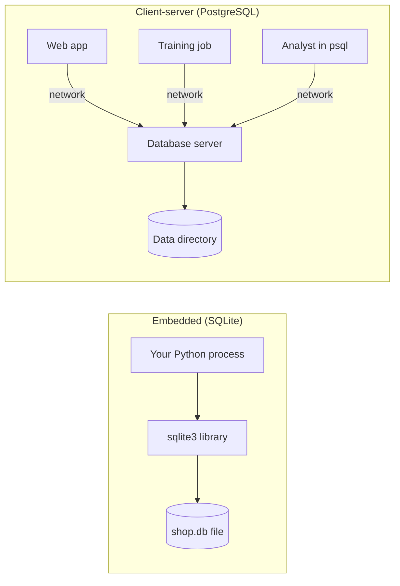

Almost every AI system you build will sit next to a database. User accounts, orders, support tickets, model predictions, evaluation results, feature tables, chat histories: in production they live in a database, not in CSV files on someone's laptop. Training data is usually extracted from one with a SQL query, and the predictions your model makes are often written straight back into one. This module teaches you to design tables, query them fluently with SQL, and keep those queries fast. This first lesson explains what a database is, why it beats a folder of files, and how to talk to one from Python.

## Why not just use files?

In the [pandas module](/learn/pandas/series-and-dataframes) you loaded CSV files into DataFrames and analysed them in memory. That works well for one person exploring one dataset. It breaks down as soon as a real application depends on the data.

| Problem | With CSV files | With a database |
| --- | --- | --- |
| Two programs write at the same time | One overwrites the other | Concurrent writes are coordinated safely |
| A crash halfway through a save | Half-written, corrupt file | The change is applied completely or not at all |
| Bad data (negative price, missing email) | Nothing stops it | Constraints reject it at write time |
| Find one customer among ten million | Read the whole file | An index finds it almost instantly |
| Data bigger than memory | You must load it all | The database reads only what the query needs |
| Who may read or change what | File permissions only | Users, roles and per-table privileges |

A **database** is an organised, persistent collection of data. The software that manages it, answers queries and enforces the rules is the **database management system** (DBMS). In everyday speech people say "the database" for both.

## The relational model

The most widely used kind of database is the **relational database**. It stores data in **tables**, much like DataFrames:

- A **table** (formally a *relation*) holds one kind of thing: customers, or orders, or products.
- A **row** is one record: one customer.
- A **column** is one attribute with a fixed type: every customer's email.
- A **primary key** is a column whose value uniquely identifies each row, such as `customer_id`.
- A **foreign key** is a column that refers to a primary key in another table, such as `orders.customer_id`. Foreign keys are how tables relate to each other.

Here is the `customers` table you will use throughout this module:

```output
 customer_id | name        | email             | country | signup_date
-------------+-------------+-------------------+---------+-------------
           1 | Amina Khan  | amina@example.com | UK      | 2024-01-15
           2 | Ben Carter  | ben@example.com   | US      | 2024-02-03
           3 | Chen Wei    | chen@example.com  | SG      | 2024-02-20
           4 | Diego Lopez | diego@example.com | ES      | 2024-03-11
           5 | Ewa Nowak   | ewa@example.com   | PL      | 2024-04-02
           6 | Farah Ali   | farah@example.com | UK      | 2024-05-19
(6 rows)
```

Alongside it sit `products`, `orders` (who bought what, when) and `tickets` (customer support tickets, each with a label predicted by a classification model and, once a human has reviewed it, the true label). The [next lesson](/learn/sql-and-databases/tables-and-relationships) builds all four tables and explains how they connect.

## SQL: saying what, not how

You talk to a relational database in **SQL** (Structured Query Language, pronounced "ess-cue-ell" or "sequel"). SQL is **declarative**: you describe the result you want, and the database works out how to produce it.

```sql
SELECT name, country
FROM customers
WHERE country = 'UK';
```

```output
 name       | country
------------+---------
 Amina Khan | UK
 Farah Ali  | UK
(2 rows)
```

Compare that with Python, where you would write the loop, the comparison and the list yourself. In SQL you never say "loop over the rows" or "use the index". A component called the **query planner** chooses the strategy, which is why the same query can get faster after someone adds an index, without the query changing.

SQL statements fall into a few families:

| Family | Purpose | Main statements |
| --- | --- | --- |
| Data definition (DDL) | Create and change structure | `CREATE TABLE`, `ALTER TABLE`, `DROP TABLE` |
| Data manipulation (DML) | Read and change rows | `SELECT`, `INSERT`, `UPDATE`, `DELETE` |
| Data control (DCL) | Permissions | `GRANT`, `REVOKE` |
| Transaction control | Group changes | `BEGIN`, `COMMIT`, `ROLLBACK` |

SQL is a standard, but every database adds its own dialect on top. The core you learn here works almost everywhere; where SQLite and PostgreSQL differ, the lessons say so.

## Embedded and client-server databases

Databases come in two architectures, and you will use both.



**SQLite** is a library that reads and writes a single file. There is no server to install, and Python ships with it in the `sqlite3` module. It is ideal for learning, tests, local tools, mobile apps and small sites. **PostgreSQL** (and MySQL, SQL Server and others) runs as a separate server process that many clients connect to over the network. It handles many concurrent writers, users with different permissions, and very large datasets. The [PostgreSQL lesson](/learn/sql-and-databases/postgresql) covers it in depth.

> [!NOTE]
> All runnable examples in this module use SQLite through Python's built-in `sqlite3`, so you need nothing extra installed. The SQL you learn transfers almost unchanged to PostgreSQL, the database you are most likely to meet in production AI systems.

You will also hear about **NoSQL** databases: document stores such as MongoDB, key-value stores such as Redis, and the vector databases covered in Phase 8. They trade some relational guarantees for flexibility or speed on a particular access pattern. Relational databases remain the default for structured business data, and PostgreSQL can itself store documents (JSONB) and vectors (pgvector).

## Talking to a database from Python

The `sqlite3` module follows Python's standard database interface (DB-API, PEP 249), so the same shape of code works with PostgreSQL drivers too: connect, execute statements, fetch results, commit, close.

```python
import sqlite3

conn = sqlite3.connect("shop.db")          # creates the file if it does not exist
conn.execute("""
    CREATE TABLE IF NOT EXISTS customers (
        customer_id INTEGER PRIMARY KEY,
        name        TEXT NOT NULL,
        country     TEXT NOT NULL
    )
""")
conn.execute("INSERT INTO customers (name, country) VALUES (?, ?)", ("Amina Khan", "UK"))
conn.execute("INSERT INTO customers (name, country) VALUES (?, ?)", ("Ben Carter", "US"))
conn.commit()                                # make the changes permanent

for row in conn.execute("SELECT customer_id, name, country FROM customers"):
    print(row)
conn.close()
```

```output
(1, 'Amina Khan', 'UK')
(2, 'Ben Carter', 'US')
```

Three details matter from day one:

- **`?` placeholders.** Values are passed separately from the SQL text, never pasted in with an f-string. The driver handles quoting, and this is what prevents SQL injection, covered in [database optimisation](/learn/sql-and-databases/database-optimization).
- **`commit()`.** Changes are invisible to other connections, and are lost when you close, until you commit.
- **Rows come back as tuples.** Each row is a tuple in the order of the columns you selected.

Pass `":memory:"` instead of a filename to get a throwaway database that lives only in RAM, which is perfect for experiments and tests.

## Transactions and ACID

A **transaction** groups several statements into one unit of work. Relational databases guarantee four properties for transactions, known as **ACID**:

| Property | Meaning |
| --- | --- |
| **Atomicity** | All statements succeed, or none of their effects remain |
| **Consistency** | Every committed state satisfies the declared constraints |
| **Isolation** | Concurrent transactions do not see each other's half-finished work |
| **Durability** | Once committed, data survives a crash or power loss |

Atomicity is easiest to see. Below, moving credits between two accounts is two `UPDATE` statements. Used as a context manager, a `sqlite3` connection commits when the block succeeds and rolls back if it raises.

```python
import sqlite3

conn = sqlite3.connect(":memory:")
conn.execute("CREATE TABLE accounts (name TEXT PRIMARY KEY, credits INTEGER NOT NULL CHECK (credits >= 0))")
conn.executemany("INSERT INTO accounts VALUES (?, ?)", [("amina", 100), ("ben", 20)])
conn.commit()

def transfer(sender, receiver, amount):
    try:
        with conn:   # one transaction: commit on success, roll back on error
            conn.execute("UPDATE accounts SET credits = credits + ? WHERE name = ?", (amount, receiver))
            conn.execute("UPDATE accounts SET credits = credits - ? WHERE name = ?", (amount, sender))
    except sqlite3.IntegrityError as e:
        print("Transfer failed:", e)

transfer("amina", "ben", 30)
transfer("ben", "amina", 500)     # would make ben's balance negative
print(conn.execute("SELECT * FROM accounts").fetchall())
```

```output
Transfer failed: CHECK constraint failed: credits >= 0
[('amina', 70), ('ben', 50)]
```

In the failed transfer, the first `UPDATE` had already added 500 credits to Amina. When the second one violated the `CHECK` constraint, the whole transaction rolled back, so Amina did not keep credits that were never taken from Ben.

> [!KEY]
> A transaction turns several statements into one all-or-nothing change. Whenever two writes must stay in step (an order and its stock update, a prediction and its audit log), put them in one transaction.

## Two kinds of workload

Databases are tuned for one of two patterns, and knowing which you are facing explains many design choices later in the course.

| | OLTP (transactional) | OLAP (analytical) |
| --- | --- | --- |
| Typical query | Fetch or update one order | Revenue by country for the last year |
| Rows touched per query | A few | Millions |
| Users | The application, many at once | Analysts, dashboards, training jobs |
| Examples | PostgreSQL, MySQL, SQLite | Warehouses such as BigQuery, Snowflake, DuckDB |

An AI engineer often reads training data from an analytical warehouse and serves predictions from a transactional database. The SQL is the same language in both.

## Exercises

**1.** Create an in-memory SQLite database with a table `notes (note_id INTEGER PRIMARY KEY, text TEXT NOT NULL)`. Insert three notes using `?` placeholders, commit, then print how many rows the table has.

<details>
<summary>Show solution</summary>

```python
import sqlite3

conn = sqlite3.connect(":memory:")
conn.execute("CREATE TABLE notes (note_id INTEGER PRIMARY KEY, text TEXT NOT NULL)")
for text in ["buy GPUs", "label data", "ship model"]:
    conn.execute("INSERT INTO notes (text) VALUES (?)", (text,))
conn.commit()
print(conn.execute("SELECT COUNT(*) FROM notes").fetchone()[0])   # 3
```

Note the trailing comma in `(text,)`: parameters must be a sequence, and `(text)` is just a string in brackets.

</details>

**2.** In the transfer example, what would the final balances be if the two `UPDATE` statements ran without the `with conn:` block and with autocommit after each statement?

<details>
<summary>Show solution</summary>

The first statement would add 500 credits to Amina and be committed immediately. The second would fail. Amina would end with 570 credits and Ben with 50: 500 credits created from nothing. That is exactly the inconsistency atomicity exists to prevent.

</details>

**3.** For each scenario, say whether SQLite or a PostgreSQL server is the better fit: (a) a command-line tool that caches API responses locally; (b) a web app with 200 concurrent users writing chat messages; (c) unit tests for your data-access code.

<details>
<summary>Show solution</summary>

(a) SQLite: one process, a local file, no server to run. (b) PostgreSQL: many concurrent writers and network clients. (c) SQLite in memory is common for fast tests, though if production uses PostgreSQL-specific features you should also test against a real PostgreSQL instance.

</details>

```quiz
[
  {
    "q": "What does a foreign key do?",
    "options": [
      "Refers to the primary key of a row in another table",
      "Uniquely identifies each row in its own table",
      "Encrypts a column",
      "Speeds up every query automatically"
    ],
    "answer": 0,
    "why": "A foreign key column holds values that must match a primary key in another table, which is how tables relate."
  },
  {
    "q": "Why is SQL called declarative?",
    "options": [
      "You must declare every variable before use",
      "It runs statements in the order you declare them",
      "It can only declare tables, not query them",
      "You describe the result you want and the database chooses how to compute it"
    ],
    "answer": 3,
    "why": "The query planner decides on the execution strategy; your query only states what result is wanted."
  },
  {
    "q": "A transaction runs two `UPDATE` statements and the second fails. With atomicity, what happens to the first update?",
    "options": [
      "It stays applied",
      "It is applied twice",
      "It is rolled back",
      "It is applied only after a restart"
    ],
    "answer": 2,
    "why": "Atomicity means all or nothing: a failure anywhere in the transaction undoes its earlier changes."
  },
  {
    "q": "Which statement about SQLite is true?",
    "options": [
      "It stores a whole database in a single file and is built into Python",
      "It needs a separate server process",
      "It does not support SQL",
      "It is designed for thousands of concurrent network clients"
    ],
    "answer": 0,
    "why": "SQLite is an embedded library; Python's `sqlite3` module talks to a single database file with no server."
  }
]
```
