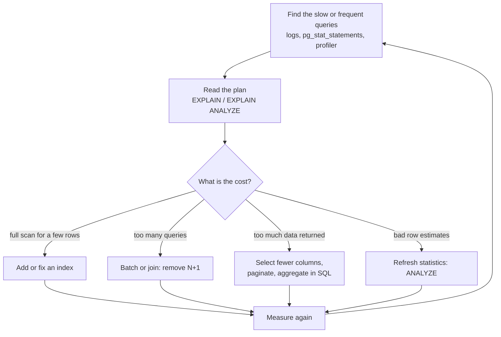
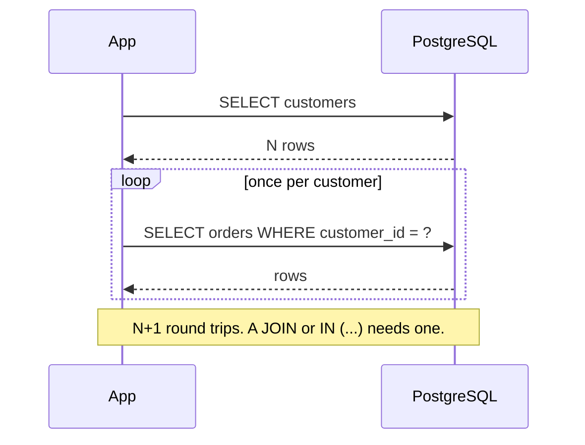

A database that was fast in development is often slow in production, for reasons that have little to do with the database itself: a page that sends 500 queries where one would do, a batch job that commits after every row, a query that fetches a million rows to display twenty. This lesson is about finding and fixing those problems systematically. It also covers the one "optimisation" that is really a security requirement: parameterised queries, which prevent SQL injection. For AI systems, where an inference service may hit the database on every request and an LLM may be generating SQL, both speed and safety matter.

## Measure before you change anything

Guessing at performance problems wastes time. Follow a loop:



In PostgreSQL, the `pg_stat_statements` extension records every distinct query with its call count and total time, which tells you where time actually goes. Often the culprit is not the slowest single query but a fast one run a hundred thousand times.

## Reading plans with EXPLAIN

You met SQLite's `EXPLAIN QUERY PLAN` in the [indexing lesson](/learn/sql-and-databases/indexing). PostgreSQL has two variants:

- `EXPLAIN query` shows the plan the planner chose, with its **estimated** costs and row counts, without running the query.
- `EXPLAIN ANALYZE query` **runs** the query and adds the actual time and actual row counts for each step.

```sql
EXPLAIN ANALYZE
SELECT order_id, order_date FROM orders WHERE customer_id = 4242;
```

The output below is illustrative, from a hypothetical `orders` table of one million rows; the exact numbers depend on your data and hardware.

```text
Seq Scan on orders  (cost=0.00..18334.00 rows=48 width=12) (actual time=0.015..95.002 rows=51 loops=1)
  Filter: (customer_id = 4242)
  Rows Removed by Filter: 999949
Planning Time: 0.080 ms
Execution Time: 95.030 ms
```

After `CREATE INDEX idx_orders_customer ON orders (customer_id)`, the same command shows something like:

```text
Index Scan using idx_orders_customer on orders  (cost=0.42..8.95 rows=48 width=12) (actual time=0.020..0.071 rows=51 loops=1)
  Index Cond: (customer_id = 4242)
Planning Time: 0.110 ms
Execution Time: 0.090 ms
```

| Plan element | Meaning |
| --- | --- |
| `Seq Scan` | Full table scan (SQLite calls it `SCAN`) |
| `Index Scan`, `Index Only Scan`, `Bitmap Heap Scan` | Index-based access; index-only is the covering case |
| `cost=start..total` | The planner's estimate, in arbitrary units |
| `rows=` (first brackets) | Estimated rows; (second brackets) actual rows |
| `Rows Removed by Filter` | Rows read and thrown away: a large number suggests a missing index |
| `Nested Loop`, `Hash Join`, `Merge Join` | The join algorithm chosen |

Compare estimated and actual rows. If the planner expected 48 rows and got 500,000, its statistics are stale or misleading, and it may have picked a poor plan; running `ANALYZE orders` refreshes them.

> [!WARNING]
> `EXPLAIN ANALYZE` really executes the statement. On an `UPDATE` or `DELETE`, wrap it in a transaction you roll back: `BEGIN; EXPLAIN ANALYZE DELETE ...; ROLLBACK;`.

## The N+1 query problem

The most common performance bug in application code is not a slow query but too many fast ones. It looks innocent:

```python
from shop import connect

conn = connect()
queries = []
conn.set_trace_callback(queries.append)    # record every statement sent to SQLite

# N+1: one query for the customers, then one more per customer
report = {}
for customer_id, name in conn.execute("SELECT customer_id, name FROM customers").fetchall():
    n = conn.execute(
        "SELECT COUNT(*) FROM orders WHERE customer_id = ?", (customer_id,)
    ).fetchone()[0]
    report[name] = n
print(len(queries), "queries:", report)

queries.clear()
rows = conn.execute("""
    SELECT c.name, COUNT(o.order_id)
    FROM customers AS c
    LEFT JOIN orders AS o ON o.customer_id = c.customer_id
    GROUP BY c.customer_id, c.name
""").fetchall()
print(len(queries), "query: ", dict(rows))
```

```output
7 queries: {'Amina Khan': 3, 'Ben Carter': 3, 'Chen Wei': 2, 'Diego Lopez': 2, 'Ewa Nowak': 2, 'Farah Ali': 0}
1 query:  {'Amina Khan': 3, 'Ben Carter': 3, 'Chen Wei': 2, 'Diego Lopez': 2, 'Ewa Nowak': 2, 'Farah Ali': 0}
```

Same answer: 1 + N queries in the loop, one in the join. With SQLite in memory the difference is invisible. Against a PostgreSQL server over a network, each query pays a round trip, often around a millisecond, before doing any work:



With 10,000 customers that is 10,001 round trips, roughly ten seconds of pure waiting, for a report the join produces in milliseconds. The fixes are a join, an aggregate, or one query with `WHERE customer_id IN (...)` for the whole batch. ORMs make N+1 easy to write by accident, because accessing `customer.orders` silently runs a query; SQLAlchemy, for example, offers eager-loading options such as `selectinload` to fetch related rows in one extra query instead of N.

## Batch your writes

The same principle applies to writes. Every commit forces the database to make the change durable on disk, which is slow. Committing once per row multiplies that cost:

```python
import os
import sqlite3
import time

rows = [(i, f"user{i}", i % 7) for i in range(5_000)]

def fresh(path):
    if os.path.exists(path):
        os.remove(path)
    conn = sqlite3.connect(path)
    conn.execute("CREATE TABLE scores (id INTEGER PRIMARY KEY, name TEXT, score INTEGER)")
    conn.commit()
    return conn

conn = fresh("slow.db")
start = time.perf_counter()
for row in rows:
    conn.execute("INSERT INTO scores VALUES (?, ?, ?)", row)
    conn.commit()                       # one transaction per row
print(f"commit per row: {time.perf_counter() - start:.3f} s")

conn = fresh("fast.db")
start = time.perf_counter()
with conn:                              # one transaction for the batch
    conn.executemany("INSERT INTO scores VALUES (?, ?, ?)", rows)
print(f"one batch:      {time.perf_counter() - start:.3f} s")
```

```output
commit per row: 1.071 s
one batch:      0.002 s
```

Your timings will differ, especially with disk type, but a difference of two or three orders of magnitude is typical. When a batch scoring job writes predictions, write them in chunks of a few thousand rows per transaction. For very large loads, PostgreSQL's `COPY` command (exposed in psycopg as `cursor.copy`) is faster still.

## Fetch only what you need

- **Name the columns.** `SELECT *` on a table with a large text or `JSONB` column drags all of it over the network even if you use one field. Naming columns can also enable index-only scans.
- **Aggregate in the database.** Fetching every order to sum them in Python moves all the data; `SUM` in SQL moves one number.
- **Paginate with keys, not offsets.** `LIMIT 20 OFFSET 100000` still reads and discards 100,000 rows. **Keyset pagination** remembers the last key seen and asks for the next ones, which an index answers directly however deep the page:

```sql
SELECT ticket_id, subject
FROM tickets
WHERE ticket_id > 4          -- the last ticket_id on the previous page
ORDER BY ticket_id
LIMIT 3;
```

```output
 ticket_id | subject
-----------+----------------------------
         5 | Hub not detected by laptop
         6 | Refund still not received
         7 | Package stuck in transit
(3 rows)
```

Beyond individual queries, a few structural tools are worth knowing:

| Tool | What it does |
| --- | --- |
| Connection pooling | Reuses open connections instead of opening one per request; opening a PostgreSQL connection is expensive. Use `psycopg_pool` in the app or PgBouncer in front of the server |
| Materialised view (PostgreSQL) | Stores a query's result as a table, refreshed with `REFRESH MATERIALIZED VIEW`; good for dashboards over expensive aggregates |
| Denormalised summary table | A deliberately duplicated, precomputed table, such as daily revenue per customer, maintained by a scheduled job |
| `VACUUM` and `ANALYZE` | PostgreSQL maintenance: reclaim space from deleted row versions and refresh planner statistics (autovacuum normally handles this) |
| Caching | Keep hot, rarely-changing results in application memory or Redis; the hard part is invalidation |

## SQL injection and parameterised queries

Building SQL by pasting user input into a string lets the input change the statement's meaning. This is **SQL injection**, one of the oldest and most damaging classes of security vulnerability.

```python
from shop import connect

conn = connect()

def find_customer_unsafe(email):
    sql = f"SELECT customer_id, name FROM customers WHERE email = '{email}'"
    return conn.execute(sql).fetchall()

def find_customer_safe(email):
    sql = "SELECT customer_id, name FROM customers WHERE email = ?"
    return conn.execute(sql, (email,)).fetchall()

attack = "nobody@example.com' OR '1'='1"
print(find_customer_unsafe("ben@example.com"))
print(len(find_customer_unsafe(attack)), "rows leaked")
print(find_customer_safe(attack))
```

```output
[(2, 'Ben Carter')]
6 rows leaked
[]
```

The attacker's quote closed the string literal early, so the f-string produced `WHERE email = 'nobody@example.com' OR '1'='1'`, which is true for every row. With a placeholder, the driver sends the SQL and the value separately; the whole input is treated as one email address, which matches nothing. No escaping function you write yourself is as reliable.

> [!KEY]
> Never build SQL with f-strings, `+`, `%` or `.format()` on values that come from outside your code: users, files, APIs, or an LLM. Pass them as parameters (`?` in `sqlite3`, `%s` in psycopg). For identifiers such as a sort column, choose from a fixed allow-list.

Python's `sqlite3` refuses to run two statements in one `execute` call (`You can only execute one statement at a time.`), which blocks the classic `'; DROP TABLE customers; --` payload there, but many drivers and APIs do not, and the `OR '1'='1'` attack above needs only one statement. For LLM-generated SQL, where parameterisation is impossible because the model writes the whole query, the defences are layered: a read-only database role with access to only the needed tables (see [PostgreSQL roles](/learn/sql-and-databases/postgresql)), statement timeouts, row limits, and validating the generated SQL before running it.

## Exercises

**1.** This function is called for each of 2,000 ticket IDs on a dashboard page. Rewrite the access pattern so the page needs one query.

```python
def subject_for(ticket_id):
    return conn.execute("SELECT subject FROM tickets WHERE ticket_id = ?", (ticket_id,)).fetchone()[0]
```

<details>
<summary>Show solution</summary>

Fetch all the subjects at once and look them up in a dictionary. Build one placeholder per ID, so the values are still parameterised:

```python
def subjects_for(ticket_ids):
    placeholders = ", ".join("?" for _ in ticket_ids)
    sql = f"SELECT ticket_id, subject FROM tickets WHERE ticket_id IN ({placeholders})"
    return dict(conn.execute(sql, list(ticket_ids)).fetchall())

print(subjects_for([2, 7]))
# {2: 'Charged twice for order', 7: 'Package stuck in transit'}
```

The f-string here only inserts question marks that your code generated, never user data, so it is safe. For very long lists, split into chunks, since databases limit the number of parameters per statement.

</details>

**2.** An API sorts results by a column the client names: `?sort=price`. Why can't you use a placeholder for it, and how do you make it safe?

<details>
<summary>Show solution</summary>

Placeholders stand for values, not identifiers: `ORDER BY ?` would sort by a constant string. Map the input through an allow-list:

```python
SORTABLE = {"price": "price", "name": "name", "newest": "product_id DESC"}

def list_products(sort):
    order = SORTABLE.get(sort, "product_id")
    return conn.execute(f"SELECT name, price FROM products ORDER BY {order}").fetchall()
```

Only strings written in your own code can reach the SQL text.

</details>

**3.** `EXPLAIN ANALYZE` on a slow PostgreSQL query shows `Seq Scan on tickets ... (rows=12) (actual ... rows=480000)` and `Rows Removed by Filter: 20`. What do you conclude, and what do you try first?

<details>
<summary>Show solution</summary>

The planner expected 12 rows but got 480,000, so its statistics are badly off, and few rows were filtered, so the query genuinely returns most of the table. An index would not help a query that returns nearly everything. First run `ANALYZE tickets` so the estimates are right, then ask whether the application really needs 480,000 rows: usually it should aggregate in SQL or paginate.

</details>

```quiz
[
  {
    "q": "What is the main difference between `EXPLAIN` and `EXPLAIN ANALYZE` in PostgreSQL?",
    "options": [
      "`EXPLAIN ANALYZE` actually runs the query and reports real times and row counts",
      "`EXPLAIN ANALYZE` also refreshes table statistics",
      "`EXPLAIN` only works on SELECT",
      "There is no difference"
    ],
    "answer": 0,
    "why": "EXPLAIN shows estimates only; EXPLAIN ANALYZE executes the statement, so wrap writes in a rolled-back transaction."
  },
  {
    "q": "A page loads 50 customers, then runs one query per customer to fetch their orders. What is this called?",
    "options": [
      "A fan-out join",
      "Keyset pagination",
      "A covering index",
      "The N+1 query problem"
    ],
    "answer": 3,
    "why": "One query for the list plus N follow-up queries; a join or a single IN query removes the extra round trips."
  },
  {
    "q": "With `sql = f\"... WHERE email = '{email}'\"`, which input returns every customer?",
    "options": [
      "`ben@example.com`",
      "`x' OR '1'='1`",
      "An empty string",
      "`%`"
    ],
    "answer": 1,
    "why": "The quote ends the string literal and `OR '1'='1'` makes the condition true for all rows."
  },
  {
    "q": "Why is `LIMIT 20 OFFSET 100000` slow for deep pages?",
    "options": [
      "OFFSET disables all indexes",
      "The database still reads and discards the first 100,000 rows",
      "LIMIT forces a full sort of every table",
      "It runs the query 20 times"
    ],
    "answer": 1,
    "why": "OFFSET skips rows by producing them first. Keyset pagination (`WHERE id > last_seen`) jumps straight to the next page."
  }
]
```
