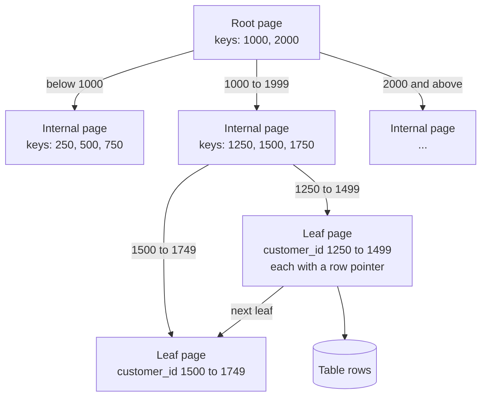

With six customers every query is instant. With fifty million, `SELECT * FROM orders WHERE customer_id = 2` has to read every row to find the handful that match, and an API endpoint that runs it on each request becomes unusable. An **index** is a separate, sorted data structure that lets the database jump straight to the matching rows, the way a book's index takes you to a page without reading the whole book. Indexes are the single biggest lever on database performance, and understanding them is what separates a query that takes 20 milliseconds from one that takes 20 microseconds. They also have costs, so this lesson covers when to add one, which columns to put in it, and how to confirm the database actually uses it.

## Scans and searches

Without an index, the only way to answer a `WHERE` clause is a **full table scan**: read every row and test the condition. The cost grows linearly with the table. With an index on the filtered column, the database performs a **search**: it finds the first matching entry in the index, then follows pointers to the rows.

SQLite shows its choice with `EXPLAIN QUERY PLAN`:

```python
from shop import connect

conn = connect()

def plan(sql):
    for row in conn.execute("EXPLAIN QUERY PLAN " + sql):
        print(row[-1])          # the last column holds the description

plan("SELECT * FROM orders WHERE customer_id = 2")
conn.execute("CREATE INDEX idx_orders_customer ON orders (customer_id)")
plan("SELECT * FROM orders WHERE customer_id = 2")
```

```output
SCAN orders
SEARCH orders USING INDEX idx_orders_customer (customer_id=?)
```

`SCAN` means every row is read; `SEARCH ... USING INDEX` means the index narrowed it down. The query text did not change. That is SQL's declarative design at work: the planner noticed the new index and switched strategy.

To see the difference in time, here is a table of one million events, queried for one user's rows 200 times before and after indexing:

```python
import random
import sqlite3
import time

random.seed(0)
conn = sqlite3.connect(":memory:")
conn.execute("""CREATE TABLE events (
    event_id INTEGER PRIMARY KEY, user_id INTEGER, kind TEXT, ts TEXT)""")
rows = ((i, random.randrange(100_000), random.choice(["view", "click", "buy"]),
         f"2024-06-{random.randrange(1, 31):02d}") for i in range(1_000_000))
conn.executemany("INSERT INTO events VALUES (?, ?, ?, ?)", rows)

def timed(label):
    start = time.perf_counter()
    for user in range(200):
        conn.execute("SELECT kind, ts FROM events WHERE user_id = ?", (user,)).fetchall()
    ms = (time.perf_counter() - start) * 1000 / 200
    print(f"{label}: {ms:.4f} ms per query")

timed("no index  ")
conn.execute("CREATE INDEX idx_events_user ON events (user_id)")
timed("with index")
```

```output
no index  : 16.1991 ms per query
with index: 0.0070 ms per query
```

Your timings will differ with hardware, but the ratio will be similar: thousands of times faster, and the gap widens as the table grows.

## How a B-tree index works

The default index type in SQLite, PostgreSQL, MySQL and most other databases is the **B-tree** (strictly, a B+ tree). It keeps the indexed values sorted in a shallow, wide tree of fixed-size pages:



To find `customer_id = 1302`, the database reads the root, follows the branch for 1000 to 1999, then the branch for 1250 to 1499, and arrives at a leaf holding the entry and a pointer to the row. Each step reads one page. Because each page holds hundreds of keys (the **fan-out** $b$), the tree's height for $n$ entries is about

$$
h \approx \log_b n
$$

With $b = 200$, a billion entries need $\log_{200} 10^9 \approx 3.9$, so about four page reads instead of a billion row checks. That logarithmic growth is why an index lookup stays fast as the table grows.

Leaves are also linked in order, so a B-tree serves more than equality:

| Query shape | Uses a B-tree on the column? |
| --- | --- |
| `col = value` | Yes |
| `col > a`, `col BETWEEN a AND b` | Yes: find the start, walk the leaves |
| `ORDER BY col` (with `LIMIT`) | Yes: read leaves in order, no sort needed |
| `col LIKE 'abc%'` (fixed prefix) | Often, depending on the database and collation |
| `col LIKE '%abc%'` | No: the sort order does not help with a middle match |
| `lower(col) = 'x'` | No, unless there is an index on `lower(col)` |

## Composite indexes and column order

An index can cover several columns. `CREATE INDEX ... ON orders (customer_id, order_date)` sorts entries by customer first, then by date within each customer, like a phone book sorted by surname, then first name.

```python
conn = connect()
conn.execute("CREATE INDEX idx_orders_cust_date ON orders (customer_id, order_date)")

plan("SELECT * FROM orders WHERE customer_id = 2 AND order_date >= '2024-06-10'")
plan("SELECT * FROM orders WHERE customer_id = 2 ORDER BY order_date")
plan("SELECT * FROM orders WHERE order_date >= '2024-06-10'")
plan("SELECT order_date FROM orders WHERE customer_id = 2")
```

```output
SEARCH orders USING INDEX idx_orders_cust_date (customer_id=? AND order_date>?)
SEARCH orders USING INDEX idx_orders_cust_date (customer_id=?)
SCAN orders
SEARCH orders USING COVERING INDEX idx_orders_cust_date (customer_id=?)
```

Line by line:

1. Both columns used: equality on the first, a range on the second.
2. The index gives customer 2's orders already sorted by date, so no separate sort step appears.
3. A filter on `order_date` alone cannot use the index, just as a phone book sorted by surname cannot find everyone called "Ben". This is the **leftmost prefix rule**: a composite index helps queries that constrain its leading columns.
4. **Covering index**: everything the query needs (`order_date`, and the row ID) is in the index itself, so the table is never touched.

> [!TIP]
> In a composite index, put columns tested with equality first and the column used for a range or sort last. `(customer_id, order_date)` serves "this customer's recent orders"; `(order_date, customer_id)` would not.

## When an index is not used

Having an index does not guarantee it is used. The usual reasons:

```python
conn = connect()
plan("SELECT * FROM customers WHERE email = 'ben@example.com'")
plan("SELECT * FROM customers WHERE lower(email) = 'ben@example.com'")
plan("SELECT * FROM tickets WHERE subject LIKE '%order%'")
```

```output
SEARCH customers USING INDEX sqlite_autoindex_customers_1 (email=?)
SCAN customers
SCAN tickets
```

The `UNIQUE` constraint on `email` created an index automatically (`sqlite_autoindex_customers_1`), and the plain equality uses it. Wrapping the column in `lower()` hides it from that index: the index stores emails, not lowercased emails. Both SQLite and PostgreSQL support **expression indexes** to fix this: `CREATE INDEX idx_customers_email_lower ON customers (lower(email))`, after which the second query becomes a `SEARCH`. A leading `%` wildcard defeats a B-tree entirely; PostgreSQL offers trigram (`pg_trgm`) and full-text indexes for that need.

The planner may also deliberately skip an index when a condition matches a large fraction of the table, such as `status = 'shipped'` matching 75 per cent of rows. Jumping between index and table for most rows is slower than one sequential scan. Indexes pay off for **selective** conditions, ones that match a small fraction of rows.

> [!WARNING]
> Neither SQLite nor PostgreSQL indexes foreign key columns automatically. A `REFERENCES` clause adds a constraint, not an index. Joins and lookups on `orders.customer_id` or `tickets.customer_id` will scan until you create one.

## The cost of indexes

Indexes are not free:

- **Slower writes.** Every `INSERT`, `DELETE`, and `UPDATE` of an indexed column must also update each index. A table with ten indexes does roughly ten extra pieces of work per insert.
- **Storage.** An index is a copy of its columns plus pointers. Several indexes on a wide table can take more space than the table.
- **Maintenance.** The planner relies on statistics about data distribution, refreshed by `ANALYZE` in both SQLite and PostgreSQL.

So index for the queries you actually run. A bulk load of millions of rows is often faster if you drop the indexes, load, and recreate them. A **partial index** indexes only the rows matching a condition, which keeps it small: `CREATE INDEX idx_tickets_unreviewed ON tickets (created_at) WHERE true_label IS NULL` serves a review queue without indexing every reviewed ticket.

## Index types beyond the B-tree

PostgreSQL offers several index types, chosen with `USING`. These are PostgreSQL features; SQLite has only B-trees (plus full-text and R-tree extensions).

| Type | Good for |
| --- | --- |
| B-tree (default) | Equality, ranges, sorting on ordinary columns |
| Hash | Equality only |
| GIN | Values containing many items: `JSONB`, arrays, full-text search |
| GiST | Geometric data, ranges, nearest-neighbour searches |
| BRIN | Very large tables whose physical order follows a column, such as append-only event timestamps |
| HNSW, IVFFlat (pgvector extension) | Approximate nearest-neighbour search over embedding vectors |

The last row connects this lesson to vector search: a vector index answers "which rows are closest to this embedding?" rather than "which rows equal this value?". The [PostgreSQL lesson](/learn/sql-and-databases/postgresql) previews pgvector, and Phase 8 covers [vector indexing](/learn/vector-databases/vector-indexing) in depth.

## Exercises

**1.** The support dashboard repeatedly runs `SELECT ticket_id FROM tickets WHERE true_label IS NULL ORDER BY created_at`. Create a partial index for it and check the plan.

<details>
<summary>Show solution</summary>

```python
conn = connect()
conn.execute("""CREATE INDEX idx_tickets_unreviewed
                ON tickets (created_at) WHERE true_label IS NULL""")
plan("SELECT ticket_id FROM tickets WHERE true_label IS NULL ORDER BY created_at")
```

```output
SCAN tickets USING INDEX idx_tickets_unreviewed
```

It is a scan, but of the partial index, which holds only unreviewed tickets, already in date order. The index stays tiny however many reviewed tickets accumulate.

</details>

**2.** Given an index on `tickets (predicted_label, confidence)`, which of these can use it to search: (a) `WHERE predicted_label = 'billing' AND confidence < 0.8`; (b) `WHERE confidence < 0.8`; (c) `WHERE predicted_label = 'billing'`?

<details>
<summary>Show solution</summary>

(a) and (c) can, because they constrain the leading column. (b) cannot search, because it skips the first column. SQLite reports (a) as `SEARCH tickets USING COVERING INDEX idx_tickets_label_conf (predicted_label=? AND confidence<?)` and (b) as `SCAN tickets USING COVERING INDEX idx_tickets_label_conf`: it reads the whole index because it is smaller than the table, but it still examines every entry.

</details>

**3.** A colleague adds an index on every column of a table that receives 5,000 inserts per second and is queried by `user_id` only. What is wrong with this?

<details>
<summary>Show solution</summary>

Every insert now updates one index per column, multiplying write work and storage for indexes no query uses. Keep the index on `user_id` (and the primary key), drop the rest, and add others only when a real, frequent query needs them.

</details>

```quiz
[
  {
    "q": "Roughly how does the number of page reads for a B-tree lookup grow with the number of rows n?",
    "options": [
      "Linearly in n",
      "Logarithmically in n",
      "Quadratically in n",
      "It is always exactly one"
    ],
    "answer": 1,
    "why": "The tree height is about log base b of n, where b is the fan-out, so lookups grow very slowly."
  },
  {
    "q": "An index exists on `orders (customer_id, order_date)`. Which query cannot search it?",
    "options": [
      "`WHERE customer_id = 2`",
      "`WHERE customer_id = 2 AND order_date > '2024-06-10'`",
      "`WHERE order_date > '2024-06-10'`",
      "`WHERE customer_id = 2 ORDER BY order_date`"
    ],
    "answer": 2,
    "why": "By the leftmost prefix rule, a composite index helps only queries that constrain its leading column."
  },
  {
    "q": "Why might `WHERE lower(email) = 'ben@example.com'` scan the table even though `email` is indexed?",
    "options": [
      "The index stores email values, not lower(email); an expression index is needed",
      "Indexes do not work on text",
      "lower() is not valid SQL",
      "UNIQUE indexes cannot be searched"
    ],
    "answer": 0,
    "why": "Applying a function to the column hides it from the plain index. Index the expression itself."
  },
  {
    "q": "Which is a real cost of adding an index?",
    "options": [
      "SELECT queries always become slower",
      "Foreign keys stop being enforced",
      "The table can no longer have a primary key",
      "Inserts and updates must also maintain the index"
    ],
    "answer": 3,
    "why": "Each write must update every index on the affected columns, and indexes take storage."
  }
]
```
