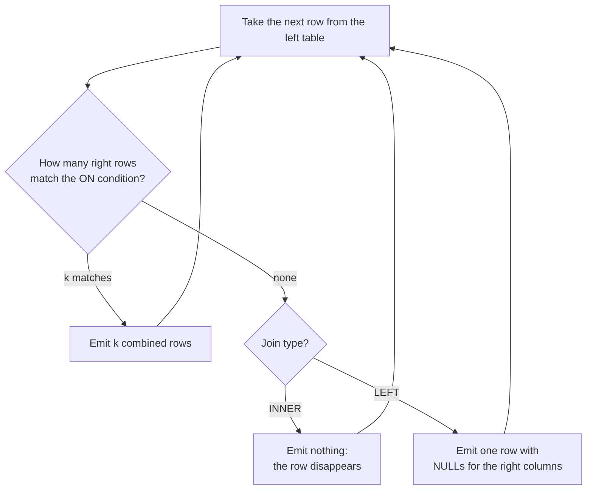

Normalised data is spread across tables on purpose: the order knows only a `customer_id`, not the customer's name. A **join** puts the pieces back together for a query, matching rows from two tables on a condition, usually a foreign key equal to a primary key. Building a training set almost always means joining: ticket text from one table, customer attributes from another, order history from a third. Joins are also where the subtlest SQL bugs live, because a wrong join rarely errors; it just returns the wrong number of rows. This lesson covers the join types, and the two classic mistakes: losing rows you needed and multiplying rows you did not want.

You met the same idea as `pd.merge` in [Merging and joining](/learn/pandas/merging-and-joining). The concepts carry over directly.

## INNER JOIN

An inner join returns one output row for every pair of rows that satisfy the `ON` condition. Rows with no partner are dropped. To show each order with the customer's and product's names:

```sql
SELECT o.order_id, c.name AS customer, p.name AS product,
       o.quantity * p.price AS total
FROM orders AS o
JOIN customers AS c ON c.customer_id = o.customer_id
JOIN products  AS p ON p.product_id  = o.product_id
WHERE o.status = 'shipped'
ORDER BY o.order_id
LIMIT 5;
```

```output
 order_id | customer   | product             | total
----------+------------+---------------------+-------
        1 | Amina Khan | GPU Cloud Credits   | 250.0
        2 | Amina Khan | Mechanical Keyboard |  89.0
        3 | Ben Carter | Laptop Stand        |  78.0
        5 | Ben Carter | GPU Cloud Credits   | 500.0
        7 | Ewa Nowak  | Mechanical Keyboard |  89.0
(5 rows)
```

`JOIN` on its own means `INNER JOIN`. The short **aliases** (`o`, `c`, `p`) keep the query readable and are required to say which table a column comes from when both have one with that name, such as `name` here.

Joins combine with everything from the previous lesson. Revenue per customer from shipped orders:

```sql
SELECT c.name, SUM(o.quantity * p.price) AS revenue
FROM orders AS o
JOIN customers AS c ON c.customer_id = o.customer_id
JOIN products  AS p ON p.product_id  = o.product_id
WHERE o.status = 'shipped'
GROUP BY c.customer_id, c.name
ORDER BY revenue DESC;
```

```output
 name        | revenue
-------------+---------
 Ben Carter  |   777.0
 Amina Khan  |   339.0
 Chen Wei    |   250.0
 Diego Lopez |   199.0
 Ewa Nowak   |   128.0
(5 rows)
```

Farah Ali is missing. She has no orders, so the inner join had nothing to pair her with.

## How a join produces rows

Conceptually, the database considers each row of the left table, finds its matching rows on the right, and emits one combined row per match. What happens when there is no match is the only difference between inner and left joins.



The simplest physical strategy is literally two nested loops, which you can step through below. Real databases also use hash joins and merge joins, and indexes, to avoid comparing every pair; the planner picks one, as you will see in [indexing](/learn/sql-and-databases/indexing).

```trace
{
  "title": "A nested-loop inner join of customers and orders",
  "code": [
    "customers = [(1, 'Amina'), (2, 'Ben'), (6, 'Farah')]",
    "orders = [(1, 1), (2, 1), (3, 2)]   # (order_id, customer_id)",
    "for cid, name in customers:",
    "    for oid, o_cid in orders:",
    "        if o_cid == cid:",
    "            print(name, oid)"
  ],
  "steps": [
    { "line": 3, "vars": { "cid": "1", "name": "'Amina'" }, "note": "Outer loop: take the first customer." },
    { "line": 5, "vars": { "cid": "1", "name": "'Amina'", "oid": "1", "o_cid": "1" }, "note": "Order 1 belongs to customer 1: a match." },
    { "line": 6, "vars": { "cid": "1", "name": "'Amina'", "oid": "1", "o_cid": "1" }, "out": ["Amina 1"], "note": "Emit one combined row." },
    { "line": 6, "vars": { "cid": "1", "name": "'Amina'", "oid": "2", "o_cid": "1" }, "out": ["Amina 1", "Amina 2"], "note": "Order 2 also matches, so Amina appears a second time. Joins repeat the left row once per match." },
    { "line": 5, "vars": { "cid": "1", "name": "'Amina'", "oid": "3", "o_cid": "2" }, "out": ["Amina 1", "Amina 2"], "note": "Order 3 belongs to customer 2: no match, nothing emitted." },
    { "line": 6, "vars": { "cid": "2", "name": "'Ben'", "oid": "3", "o_cid": "2" }, "out": ["Amina 1", "Amina 2", "Ben 3"], "note": "Next customer. Orders 1 and 2 do not match Ben; order 3 does." },
    { "line": 5, "vars": { "cid": "6", "name": "'Farah'", "oid": "3", "o_cid": "2" }, "out": ["Amina 1", "Amina 2", "Ben 3"], "note": "Farah matches no order. An inner join emits nothing for her; a LEFT JOIN would emit 'Farah None'." }
  ]
}
```

This loop compares every customer with every order: $n \times m$ comparisons for tables of $n$ and $m$ rows. Fine for six customers, hopeless for millions, which is why join columns are usually indexed.

## LEFT JOIN: keep every row on the left

A `LEFT JOIN` (or `LEFT OUTER JOIN`) keeps every row of the left table. When there is no match, the right side's columns are `NULL`:

```sql
SELECT c.name, o.order_id
FROM customers AS c
LEFT JOIN orders AS o ON o.customer_id = c.customer_id
WHERE c.country = 'UK'
ORDER BY c.name, o.order_id;
```

```output
 name       | order_id
------------+----------
 Amina Khan |        1
 Amina Khan |        2
 Amina Khan |        9
 Farah Ali  |     NULL
(4 rows)
```

When counting after a left join, count a column from the right table, not `*`. `COUNT(*)` counts Farah's `NULL` row as one order; `COUNT(o.order_id)` skips `NULL`s and correctly gives 0.

### The anti-join: rows with no match

A left join followed by `WHERE right.key IS NULL` finds rows that have **no** partner. Which products have never been ordered?

```sql
SELECT p.name
FROM products AS p
LEFT JOIN orders AS o ON o.product_id = p.product_id
WHERE o.order_id IS NULL;
```

```output
 name
---------------------
 Data Labelling Pack
(1 row)
```

### Conditions in ON versus WHERE

With an inner join it does not matter whether a condition goes in `ON` or `WHERE`. With a left join it matters a great deal. To list every customer with their pending orders, if any:

```sql
SELECT c.name, o.order_id, o.status
FROM customers AS c
LEFT JOIN orders AS o
       ON o.customer_id = c.customer_id AND o.status = 'pending'
ORDER BY c.customer_id;
```

```output
 name        | order_id | status
-------------+----------+---------
 Amina Khan  |        9 | pending
 Ben Carter  |     NULL | NULL
 Chen Wei    |     NULL | NULL
 Diego Lopez |        6 | pending
 Ewa Nowak   |     NULL | NULL
 Farah Ali   |     NULL | NULL
(6 rows)
```

Move `o.status = 'pending'` into a `WHERE` clause instead and only two rows come back: Amina and Diego. `WHERE` runs after the join, and `NULL = 'pending'` is not true, so it throws away exactly the unmatched rows the left join was meant to keep.

> [!WARNING]
> A `WHERE` condition on the right-hand table of a `LEFT JOIN` silently turns it into an inner join. Put conditions that describe *which right rows count as a match* in `ON`.

## The other join types

| Join | Keeps | Example use |
| --- | --- | --- |
| `INNER JOIN` | Only matched pairs | Orders with their customers |
| `LEFT JOIN` | All left rows, matched or not | Every customer, with orders if any |
| `RIGHT JOIN` | All right rows | Rarely used; swap the tables and use `LEFT` |
| `FULL OUTER JOIN` | All rows from both sides | Reconciling two lists, such as predictions and labels from different systems |
| `CROSS JOIN` | Every pair, no condition | Building a grid: every customer with every product (6 × 6 = 36 rows) |

`RIGHT` and `FULL` joins work in PostgreSQL and in SQLite from version 3.39; older SQLite versions reject them.

A **self join** joins a table to itself under two aliases. Pairs of customers in the same country:

```sql
SELECT a.name AS customer_a, b.name AS customer_b, a.country
FROM customers AS a
JOIN customers AS b
  ON a.country = b.country AND a.customer_id < b.customer_id;
```

```output
 customer_a | customer_b | country
------------+------------+---------
 Amina Khan | Farah Ali  | UK
(1 row)
```

The `<` stops each pair appearing twice and stops a customer pairing with herself.

## Fan-out: when joins multiply rows

Suppose you want each customer's number of orders and number of tickets, and you join both tables at once:

```sql
SELECT c.name, COUNT(o.order_id) AS n_orders, COUNT(t.ticket_id) AS n_tickets
FROM customers AS c
LEFT JOIN orders  AS o ON o.customer_id = c.customer_id
LEFT JOIN tickets AS t ON t.customer_id = c.customer_id
GROUP BY c.customer_id, c.name
ORDER BY c.customer_id;
```

```output
 name        | n_orders | n_tickets
-------------+----------+-----------
 Amina Khan  |        6 |         6
 Ben Carter  |        6 |         6
 Chen Wei    |        4 |         4
 Diego Lopez |        4 |         4
 Ewa Nowak   |        4 |         4
 Farah Ali   |        0 |         1
(6 rows)
```

Amina has 3 orders and 2 tickets, not 6 of each. Each of her 3 order rows was paired with each of her 2 ticket rows, producing 3 × 2 = 6 rows before counting. Joining two independent one-to-many relationships from the same parent always does this, and a `SUM` of order values would be inflated the same way.

> [!KEY]
> Before aggregating, ask how many rows the join produces per entity. If you join a parent to two unrelated child tables, aggregate each child separately first (with subqueries or CTEs, covered next), then join the summaries.

`COUNT(DISTINCT o.order_id)` happens to rescue the counts here, but there is no `DISTINCT` fix for sums: two orders of the same value would collapse into one. Aggregating first is the reliable cure.

## Exercises

**1.** List the misclassified tickets (where both labels are known and differ) with the customer's name and country.

<details>
<summary>Show solution</summary>

```sql
SELECT t.ticket_id, t.predicted_label, t.true_label, c.name, c.country
FROM tickets AS t
JOIN customers AS c ON c.customer_id = t.customer_id
WHERE t.predicted_label <> t.true_label;
```

```output
 ticket_id | predicted_label | true_label | name        | country
-----------+-----------------+------------+-------------+---------
         3 | shipping        | product    | Chen Wei    | SG
         9 | shipping        | product    | Farah Ali   | UK
        10 | account         | billing    | Diego Lopez | ES
(3 rows)
```

</details>

**2.** Find customers who have raised a ticket but have never placed an order.

<details>
<summary>Show solution</summary>

```sql
SELECT DISTINCT c.name
FROM customers AS c
JOIN tickets AS t ON t.customer_id = c.customer_id
LEFT JOIN orders AS o ON o.customer_id = c.customer_id
WHERE o.order_id IS NULL;
```

```output
 name
-----------
 Farah Ali
(1 row)
```

An inner join to tickets keeps only customers with tickets; the anti-join on orders keeps those without orders.

</details>

**3.** For every product category, show the number of units sold in shipped orders, including categories with no sales (they should show 0).

<details>
<summary>Show solution</summary>

```sql
SELECT p.category, COALESCE(SUM(o.quantity), 0) AS units
FROM products AS p
LEFT JOIN orders AS o
       ON o.product_id = p.product_id AND o.status = 'shipped'
GROUP BY p.category
ORDER BY units DESC;
```

```output
 category    | units
-------------+-------
 accessories |     5
 services    |     4
 audio       |     2
(3 rows)
```

The status filter is in `ON` so unsold products survive the left join. `COALESCE` replaces the `NULL` sum of a group with no matches by 0. Here every category happens to have sales: the Data Labelling Pack sold nothing, but GPU credits share its `services` category.

</details>

```quiz
[
  {
    "q": "Customer A has 3 orders and 2 tickets. How many rows does `customers LEFT JOIN orders LEFT JOIN tickets` (both on customer_id) produce for A?",
    "options": [
      "2",
      "3",
      "5",
      "6"
    ],
    "answer": 3,
    "why": "Each of the 3 order rows pairs with each of the 2 ticket rows: 3 × 2 = 6. This is fan-out."
  },
  {
    "q": "Which query pattern finds products that have never been ordered?",
    "options": [
      "`products INNER JOIN orders` with `WHERE o.order_id IS NULL`",
      "`products CROSS JOIN orders`",
      "`products LEFT JOIN orders` with `WHERE o.order_id IS NULL`",
      "`orders LEFT JOIN products` with `WHERE p.product_id IS NULL`"
    ],
    "answer": 2,
    "why": "The left join keeps every product, giving NULLs where there is no order; filtering on NULL keeps exactly the unmatched ones."
  },
  {
    "q": "After `customers c LEFT JOIN orders o ON ...`, why is `COUNT(o.order_id)` preferred to `COUNT(*)` for counting orders?",
    "options": [
      "`COUNT(*)` counts the NULL row of a customer with no orders as 1",
      "It is faster",
      "`COUNT(*)` is not allowed with joins",
      "`COUNT(o.order_id)` also counts NULLs"
    ],
    "answer": 0,
    "why": "`COUNT(column)` ignores NULLs, so customers without orders correctly get 0."
  },
  {
    "q": "What happens when you put `WHERE o.status = 'pending'` after `customers c LEFT JOIN orders o`?",
    "options": [
      "Customers without pending orders are kept with NULLs",
      "The query errors",
      "Only refunded orders are returned",
      "Customers without a pending order are removed, as with an inner join"
    ],
    "answer": 3,
    "why": "WHERE runs after the join; unmatched rows have NULL status, which fails the test, so they are dropped."
  }
]
```
