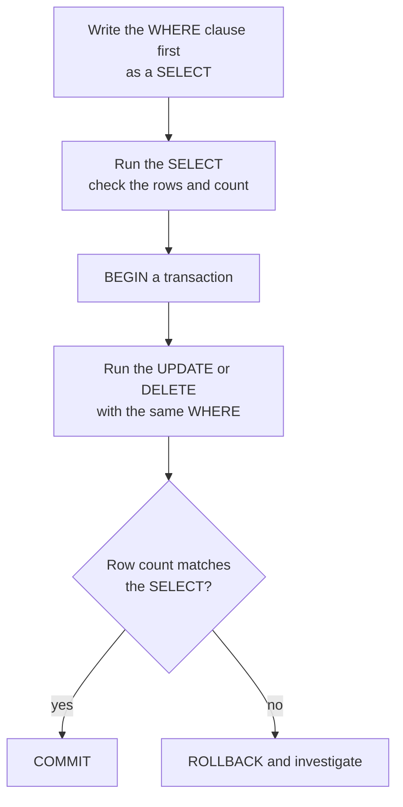

Four statements do almost all the day-to-day work in a database: `SELECT` reads rows, `INSERT` adds them, `UPDATE` changes them and `DELETE` removes them. Together they are often called CRUD (create, read, update, delete). An AI service uses all four constantly: it reads features, inserts predictions, updates a ticket when a human corrects the label, and deletes expired cache entries. This lesson covers each statement, how to run it safely from Python, and the mistakes that destroy data.

All examples use the shop schema from [Tables and relationships](/learn/sql-and-databases/tables-and-relationships). Each block of SQL runs against a fresh copy unless the text says otherwise.

## SELECT: reading rows

The simplest query names the columns you want and the table they come from:

```sql
SELECT name, price
FROM products;
```

```output
 name                | price
---------------------+-------
 Laptop Stand        |  39.0
 Mechanical Keyboard |  89.0
 GPU Cloud Credits   | 250.0
 ANC Headphones      | 199.0
 USB-C Hub           |  45.0
 Data Labelling Pack | 120.0
(6 rows)
```

`SELECT *` returns every column. It is handy when exploring but avoid it in application code: it fetches data you do not need, and the result silently changes shape when someone adds a column.

### Expressions and aliases

A column list can contain expressions. `AS` gives the result column a name:

```sql
SELECT name, price, price * 1.2 AS price_with_vat
FROM products
WHERE category = 'accessories';
```

```output
 name                | price | price_with_vat
---------------------+-------+----------------
 Laptop Stand        |  39.0 |           46.8
 Mechanical Keyboard |  89.0 |          106.8
 USB-C Hub           |  45.0 |           54.0
(3 rows)
```

The `WHERE` clause filters rows; the [next lesson](/learn/sql-and-databases/where-group-by-order-by) covers it in depth.

### DISTINCT and LIMIT

`DISTINCT` removes duplicate result rows, and `LIMIT` caps how many rows come back:

```sql
SELECT DISTINCT category FROM products;
```

```output
 category
-------------
 accessories
 services
 audio
(3 rows)
```

```sql
SELECT order_id, customer_id, status
FROM orders
LIMIT 3;
```

```output
 order_id | customer_id | status
----------+-------------+---------
        1 |           1 | shipped
        2 |           1 | shipped
        3 |           2 | shipped
(3 rows)
```

> [!WARNING]
> Without `ORDER BY`, a relational database promises **no** row order. These rows happen to come back in key order, but on another database, or after the table changes, `LIMIT 3` may return different rows. If the order matters, say so with `ORDER BY`.

## INSERT: adding rows

Always list the columns you are filling. The statement then keeps working if columns are added or reordered later, and omitted columns take their default (or `NULL`).

```sql
INSERT INTO products (name, category, price)
VALUES ('Webcam', 'accessories', 59.0);

SELECT * FROM products WHERE name = 'Webcam';
```

```output
 product_id | name   | category    | price
------------+--------+-------------+-------
          7 | Webcam | accessories |  59.0
(1 row)
```

`product_id` was omitted, so the database generated the next key. In SQLite an `INTEGER PRIMARY KEY` does this automatically; in PostgreSQL you declare the column `GENERATED ALWAYS AS IDENTITY` (or the older `SERIAL`). One `INSERT` can add many rows by listing several bracketed tuples after `VALUES`, separated by commas, as the setup script does.

## UPDATE: changing rows

`UPDATE` sets new values on every row matching the `WHERE` clause. When a support agent reviews ticket 11, which had no true label yet:

```sql
UPDATE tickets
SET true_label = 'shipping'
WHERE ticket_id = 11;

SELECT ticket_id, predicted_label, true_label FROM tickets WHERE ticket_id = 11;
```

```output
 ticket_id | predicted_label | true_label
-----------+-----------------+------------
        11 | shipping        | shipping
(1 row)
```

The new value can be computed from the old one. A 10 per cent discount on accessories:

```sql
UPDATE products
SET price = ROUND(price * 0.9, 2)
WHERE category = 'accessories'
RETURNING product_id, name, price;
```

```output
 product_id | name                | price
------------+---------------------+-------
          1 | Laptop Stand        |  35.1
          2 | Mechanical Keyboard |  80.1
          5 | USB-C Hub           |  40.5
(3 rows)
```

`RETURNING` makes a write statement hand back the rows it changed, which saves a separate `SELECT`. SQLite (since 3.35) and PostgreSQL support it; MySQL does not. The `ROUND` is there because `89 * 0.9` in floating point is `80.10000000000001`, one more reason PostgreSQL code stores money as `NUMERIC`.

## DELETE: removing rows

`DELETE` removes every row matching the `WHERE` clause:

```sql
DELETE FROM orders
WHERE status = 'pending'
RETURNING order_id, customer_id;
```

```output
 order_id | customer_id
----------+-------------
        6 |           4
        9 |           1
(2 rows)
```

Ten orders remain. Many production systems avoid physical deletes for business records and instead set a column such as `deleted_at` (a **soft delete**), so history and audit trails survive.

## The missing WHERE clause

`UPDATE products SET price = 0;` is valid SQL. It sets **every** price to zero. `DELETE FROM orders;` empties the table. Neither asks for confirmation. This is the most common way people destroy data, and the defence is a routine:



In PostgreSQL's `psql` you can type `BEGIN;`, run the statement, look at the reported row count, and then `COMMIT;` or `ROLLBACK;`. In Python, the connection's transaction plays the same role.

## Upserts: insert or update

Pipelines often receive a record that may or may not already exist: a product feed, a re-run of a batch scoring job. An **upsert** inserts the row, or updates it if the key already exists. SQLite (3.24 and later) and PostgreSQL share the syntax:

```sql
INSERT INTO products (product_id, name, category, price)
VALUES (6, 'Data Labelling Pack', 'services', 99.0)
ON CONFLICT (product_id) DO UPDATE SET price = excluded.price;

SELECT * FROM products WHERE product_id = 6;
```

```output
 product_id | name                | category | price
------------+---------------------+----------+-------
          6 | Data Labelling Pack | services |  99.0
(1 row)
```

`excluded` refers to the row you tried to insert. Upserts make a job **idempotent**: running it twice leaves the same result as running it once, which is exactly what you want when a scheduled job retries after a failure. `ON CONFLICT DO NOTHING` skips duplicates instead.

## CRUD from Python

A batch scoring job writes its predictions with `executemany`, which runs one statement for each tuple of parameters, all inside one transaction:

```python
from shop import connect

conn = connect()

new_tickets = [
    (12, 3, "2024-07-01", "GPU credits not applied", "billing", 0.86),
    (13, 6, "2024-07-01", "Reset my password",       "account", 0.97),
]
with conn:
    conn.executemany(
        """INSERT INTO tickets (ticket_id, customer_id, created_at, subject,
                                predicted_label, confidence)
           VALUES (?, ?, ?, ?, ?, ?)""",
        new_tickets,
    )
    cur = conn.execute(
        "UPDATE tickets SET true_label = ? WHERE ticket_id = ?", ("billing", 12)
    )
    print("rows updated:", cur.rowcount)

rows = conn.execute(
    "SELECT ticket_id, predicted_label, true_label FROM tickets WHERE ticket_id >= ?", (12,)
).fetchall()
print(rows)
```

```output
rows updated: 1
[(12, 'billing', 'billing'), (13, 'account', None)]
```

SQL `NULL` arrives in Python as `None`. `cur.rowcount` tells you how many rows a write touched, the programmatic version of checking the count before committing.

> [!KEY]
> Every value from outside your code goes through a placeholder (`?` in `sqlite3`, `%s` in PostgreSQL's psycopg), never through string formatting. The placeholder style differs by driver; the rule does not.

Placeholders stand for **values** only. You cannot use one for a table or column name; if those must vary, choose them from a fixed allow-list in your code.

## Exercises

**1.** Write a query that lists each product's name and its price in pence (an integer), naming the column `price_pence`. Use `CAST(... AS INTEGER)`.

<details>
<summary>Show solution</summary>

```sql
SELECT name, CAST(ROUND(price * 100) AS INTEGER) AS price_pence
FROM products;
```

`ROUND` first guards against a float such as `44.99999` being truncated to 4499 by the cast.

</details>

**2.** A model was retrained and you have new confidence scores for tickets 1 and 2: 0.97 and 0.91. Write Python that applies both updates in one transaction with `executemany`.

<details>
<summary>Show solution</summary>

```python
from shop import connect

conn = connect()
updates = [(0.97, 1), (0.91, 2)]
with conn:
    conn.executemany("UPDATE tickets SET confidence = ? WHERE ticket_id = ?", updates)
print(conn.execute("SELECT ticket_id, confidence FROM tickets WHERE ticket_id <= 2").fetchall())
# [(1, 0.97), (2, 0.91)]
```

Note the tuple order matches the order of the placeholders: confidence first, then ID.

</details>

**3.** Write an upsert that records a customer's latest country: insert customer 7 (`'Gil Ortega'`, `'gil@example.com'`, `'US'`, `'2024-07-01'`) or, if a customer with that email exists, update only their country.

<details>
<summary>Show solution</summary>

```sql
INSERT INTO customers (customer_id, name, email, country, signup_date)
VALUES (7, 'Gil Ortega', 'gil@example.com', 'US', '2024-07-01')
ON CONFLICT (email) DO UPDATE SET country = excluded.country;
```

The conflict target can be any column with a `UNIQUE` constraint, not only the primary key.

</details>

```quiz
[
  {
    "q": "What does `UPDATE products SET price = 0;` do?",
    "options": [
      "Raises an error because WHERE is missing",
      "Updates only the first row",
      "Sets the price of every product to 0",
      "Does nothing until you add LIMIT"
    ],
    "answer": 2,
    "why": "With no WHERE clause, UPDATE applies to every row in the table."
  },
  {
    "q": "Why should application code list columns in `INSERT INTO t (a, b) VALUES (...)`?",
    "options": [
      "It keeps working if columns are added or reordered, and lets omitted columns take defaults",
      "It is required by SQL",
      "It makes inserts faster",
      "It disables constraints"
    ],
    "answer": 0,
    "why": "Naming the columns ties values to columns explicitly instead of depending on the table's column order."
  },
  {
    "q": "What does `ON CONFLICT (product_id) DO UPDATE SET price = excluded.price` refer to with `excluded`?",
    "options": [
      "The row already in the table",
      "Rows deleted earlier",
      "A system table of errors",
      "The row you attempted to insert"
    ],
    "answer": 3,
    "why": "`excluded` is the proposed row that conflicted, so `excluded.price` is the new price."
  },
  {
    "q": "In Python's `sqlite3`, which call safely inserts a user-supplied name?",
    "options": [
      "`conn.execute(f\"INSERT INTO t (name) VALUES ('{name}')\")`",
      "`conn.execute(\"INSERT INTO t (name) VALUES (\" + name + \")\")`",
      "`conn.execute(\"INSERT INTO t (name) VALUES (?)\", (name,))`",
      "`conn.execute(\"INSERT INTO t (name) VALUES (%s)\" % name)`"
    ],
    "answer": 2,
    "why": "Only the placeholder version passes the value separately from the SQL text, so it cannot change the statement's meaning."
  }
]
```
