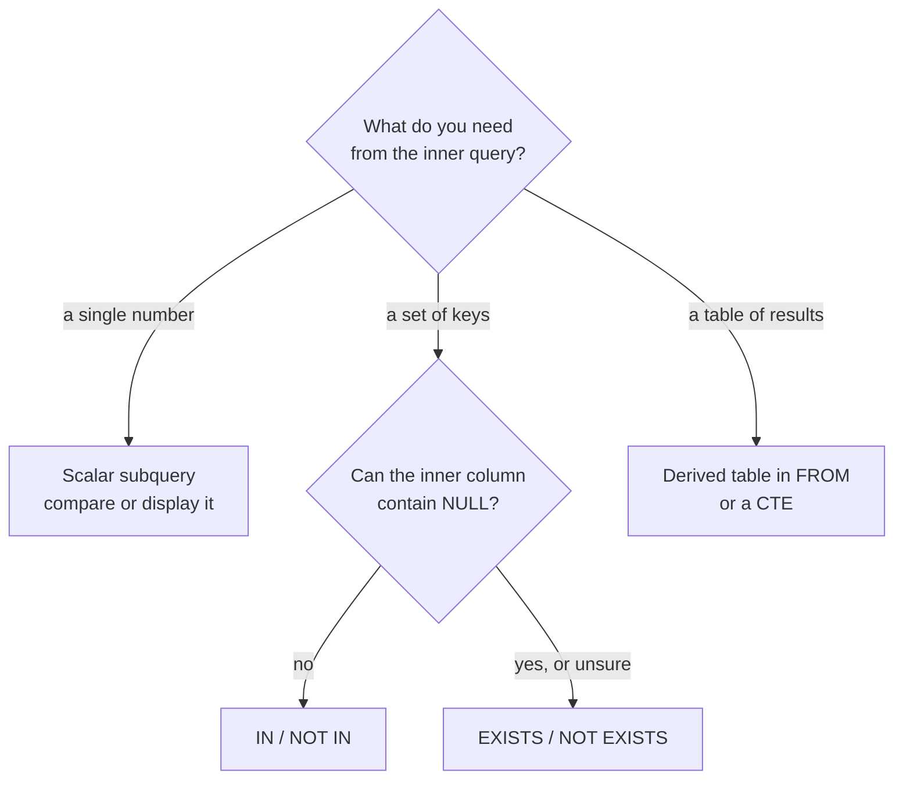

Some questions need the answer to another question first. "Which products cost more than average?" needs the average. "Which customers have never ordered?" needs the set of customers who have. A **subquery** is a complete `SELECT` nested inside another statement, in brackets, whose result the outer query uses. Subqueries let you build a complex query out of small pieces you can test one at a time, which is how experienced engineers write SQL for feature extraction and evaluation reports.

## Where a subquery can go

What a subquery returns decides where you can put it.

| Returns | Called | Used in | Example |
| --- | --- | --- | --- |
| One value (one row, one column) | Scalar subquery | Anywhere a value fits: `SELECT`, `WHERE`, `HAVING` | `price > (SELECT AVG(price) FROM products)` |
| One column, many rows | List subquery | `IN`, `NOT IN` | `customer_id IN (SELECT customer_id FROM orders)` |
| Any rows, only existence matters | Existence test | `EXISTS`, `NOT EXISTS` | `EXISTS (SELECT 1 FROM orders WHERE ...)` |
| A whole table | Derived table | `FROM` or `JOIN`, with an alias | `FROM (SELECT ... GROUP BY ...) AS t` |



## Scalar subqueries

The average product price is one value, so it can sit on the right of a comparison:

```sql
SELECT name, price
FROM products
WHERE price > (SELECT AVG(price) FROM products);
```

```output
 name              | price
-------------------+-------
 GPU Cloud Credits | 250.0
 ANC Headphones    | 199.0
(2 rows)
```

The inner query runs once and returns 123.67 (742 / 6), then the outer query compares each price with it. You could not write `WHERE price > AVG(price)`: as the [previous lesson on clause order](/learn/sql-and-databases/where-group-by-order-by) showed, aggregates are not available in `WHERE`.

A scalar subquery must return at most one row. If it returns several, PostgreSQL raises an error (`more than one row returned by a subquery used as an expression`). SQLite silently uses the first row, which hides the bug, so do not rely on it.

## IN with a list subquery

Which customers have bought anything in the `services` category? Subqueries can nest:

```sql
SELECT name, country
FROM customers
WHERE customer_id IN (
    SELECT customer_id FROM orders
    WHERE product_id IN (
        SELECT product_id FROM products WHERE category = 'services'
    )
);
```

```output
 name       | country
------------+---------
 Amina Khan | UK
 Ben Carter | US
 Chen Wei   | SG
(3 rows)
```

Read it inside out: services products, then orders of those products, then the customers who placed them. A join would also answer this, but would repeat Ben for each of his matching orders unless you added `DISTINCT`. `IN` only asks whether a customer is in the set, so each customer appears once.

## Correlated subqueries

The subqueries so far were independent: you could run them on their own. A **correlated** subquery refers to a column of the outer query, so conceptually it runs once per outer row with that row's values plugged in.

Each customer's most recent order:

```sql
SELECT o.customer_id, o.order_id, o.order_date
FROM orders AS o
WHERE o.order_date = (
    SELECT MAX(o2.order_date)
    FROM orders AS o2
    WHERE o2.customer_id = o.customer_id
)
ORDER BY o.customer_id;
```

```output
 customer_id | order_id | order_date
-------------+----------+------------
           1 |        9 | 2024-06-20
           2 |       12 | 2024-06-28
           3 |        8 | 2024-06-18
           4 |       10 | 2024-06-22
           5 |       11 | 2024-06-25
(5 rows)
```

`o2.customer_id = o.customer_id` is the correlation: for order 9, the inner query computes Amina's latest date. The two aliases for `orders` are essential, otherwise both references would mean the same row.

Here is an evaluation use: tickets where the model was less confident than it usually is for that predicted class. Such tickets are good candidates for human review.

```sql
SELECT ticket_id, predicted_label, confidence
FROM tickets AS t
WHERE confidence < (
    SELECT AVG(confidence) FROM tickets AS t2
    WHERE t2.predicted_label = t.predicted_label
)
ORDER BY predicted_label, ticket_id;
```

```output
 ticket_id | predicted_label | confidence
-----------+-----------------+------------
         8 | account         |       0.55
        10 | account         |       0.49
         4 | billing         |       0.72
         3 | shipping        |       0.61
         9 | shipping        |       0.58
(5 rows)
```

Three of these five were misclassified, and none of the other reviewed tickets was. Low relative confidence is a useful review signal.

> [!NOTE]
> "Runs once per outer row" is the logical meaning, not necessarily what happens. Planners often rewrite correlated subqueries into joins. When they cannot, a correlated subquery over a large table can be slow; the [window functions](/learn/sql-and-databases/window-functions) lesson shows a faster way to compute per-group values.

## EXISTS and NOT EXISTS

`EXISTS (subquery)` is true if the subquery returns at least one row. What it selects does not matter, so by convention it selects `1`. Customers with no orders:

```sql
SELECT c.name
FROM customers AS c
WHERE NOT EXISTS (
    SELECT 1 FROM orders AS o WHERE o.customer_id = c.customer_id
);
```

```output
 name
-----------
 Farah Ali
(1 row)
```

This is the same anti-join you wrote with `LEFT JOIN ... IS NULL` in the [joins lesson](/learn/sql-and-databases/joins), and often reads more clearly. The database can stop scanning as soon as it finds one matching row.

## The NOT IN and NULL trap

The support organisation has five teams. Which team has never been the true destination of a ticket?

```sql
CREATE TABLE teams (team TEXT PRIMARY KEY);
INSERT INTO teams VALUES ('account'), ('billing'), ('product'), ('returns'), ('shipping');

SELECT team FROM teams
WHERE team NOT IN (SELECT true_label FROM tickets);
```

```output
 team
------
(0 rows)
```

No rows, yet the answer is obviously `returns`. The subquery's results include the `NULL` from unreviewed ticket 11. `'returns' NOT IN ('account', ..., NULL)` means `'returns' <> 'account' AND ... AND 'returns' <> NULL`, and the last comparison is unknown, so the whole condition is unknown and the row is dropped. One `NULL` in the list makes `NOT IN` return nothing at all.

`NOT EXISTS` does not have this problem, because it tests for matching rows rather than comparing against a list:

```sql
SELECT team FROM teams
WHERE NOT EXISTS (
    SELECT 1 FROM tickets WHERE tickets.true_label = teams.team
);
```

```output
 team
---------
 returns
(1 row)
```

> [!WARNING]
> Never use `NOT IN (subquery)` on a column that can contain `NULL`. Use `NOT EXISTS`, or add `WHERE column IS NOT NULL` inside the subquery. This bug produces silently empty results, not errors.

## Derived tables: subqueries in FROM

A subquery in `FROM` acts as a temporary table for the rest of the query and must be given an alias. This is the cure for the fan-out problem from the joins lesson: aggregate each child table separately, then join the small summaries.

```sql
SELECT c.name,
       COALESCE(o.n_orders, 0)  AS n_orders,
       COALESCE(t.n_tickets, 0) AS n_tickets
FROM customers AS c
LEFT JOIN (SELECT customer_id, COUNT(*) AS n_orders
           FROM orders GROUP BY customer_id) AS o
       ON o.customer_id = c.customer_id
LEFT JOIN (SELECT customer_id, COUNT(*) AS n_tickets
           FROM tickets GROUP BY customer_id) AS t
       ON t.customer_id = c.customer_id
ORDER BY c.customer_id;
```

```output
 name        | n_orders | n_tickets
-------------+----------+-----------
 Amina Khan  |        3 |         2
 Ben Carter  |        3 |         2
 Chen Wei    |        2 |         2
 Diego Lopez |        2 |         2
 Ewa Nowak   |        2 |         2
 Farah Ali   |        0 |         1
(6 rows)
```

Each derived table has at most one row per customer, so the joins cannot multiply anything. This is exactly the shape of a feature table for a churn model: one row per customer, one column per feature. Once queries grow to several derived tables, nesting gets hard to read, and the next lesson's [CTEs](/learn/sql-and-databases/ctes) express the same thing as named steps.

## Exercises

**1.** List the products whose price is above the average price **of their own category**, using a correlated subquery.

<details>
<summary>Show solution</summary>

```sql
SELECT name, category, price
FROM products AS p
WHERE price > (
    SELECT AVG(price) FROM products AS p2 WHERE p2.category = p.category
);
```

```output
 name                | category    | price
---------------------+-------------+-------
 Mechanical Keyboard | accessories |  89.0
 GPU Cloud Credits   | services    | 250.0
(2 rows)
```

Audio has one product, which cannot exceed its own average.

</details>

**2.** Using `EXISTS`, list customers who have at least one ticket the model misclassified (both labels known and different).

<details>
<summary>Show solution</summary>

```sql
SELECT c.name
FROM customers AS c
WHERE EXISTS (
    SELECT 1 FROM tickets AS t
    WHERE t.customer_id = c.customer_id
      AND t.predicted_label <> t.true_label
);
```

```output
 name
-------------
 Chen Wei
 Diego Lopez
 Farah Ali
(3 rows)
```

</details>

**3.** Using a derived table, find the categories whose average product price is above 100.

<details>
<summary>Show solution</summary>

```sql
SELECT category, avg_price
FROM (SELECT category, AVG(price) AS avg_price
      FROM products GROUP BY category) AS cat
WHERE avg_price > 100;
```

```output
 category | avg_price
----------+-----------
 audio    |     199.0
 services |     185.0
(2 rows)
```

`HAVING AVG(price) > 100` gives the same result in one level; the derived-table form becomes useful when you need to join or further transform the summary.

</details>

```quiz
[
  {
    "q": "A subquery returns the values `'a'`, `'b'` and `NULL`. What does `WHERE x NOT IN (subquery)` return for `x = 'c'`?",
    "options": [
      "True, so the row is kept",
      "False",
      "Unknown, so the row is dropped",
      "An error"
    ],
    "answer": 2,
    "why": "`'c' <> NULL` is unknown, which makes the whole AND chain unknown. WHERE drops unknown rows."
  },
  {
    "q": "What makes a subquery correlated?",
    "options": [
      "It refers to a column of the outer query",
      "It appears in the FROM clause",
      "It returns exactly one value",
      "It uses an aggregate function"
    ],
    "answer": 0,
    "why": "A correlated subquery depends on the current outer row, so logically it is evaluated once per outer row."
  },
  {
    "q": "Why is a derived table (aggregate, then join) a cure for join fan-out?",
    "options": [
      "Derived tables are always faster",
      "It forces an inner join",
      "Derived tables ignore NULLs",
      "Each derived table has at most one row per join key, so joining cannot multiply rows"
    ],
    "answer": 3,
    "why": "Aggregating each child table to one row per customer before joining removes the many-to-many pairing that caused duplication."
  },
  {
    "q": "In PostgreSQL, what happens if a scalar subquery in `WHERE price = (SELECT ...)` returns three rows?",
    "options": [
      "It uses the first row",
      "It raises an error",
      "It uses the average",
      "It compares against all three"
    ],
    "answer": 1,
    "why": "PostgreSQL errors with 'more than one row returned by a subquery used as an expression'. SQLite silently takes the first row."
  }
]
```
