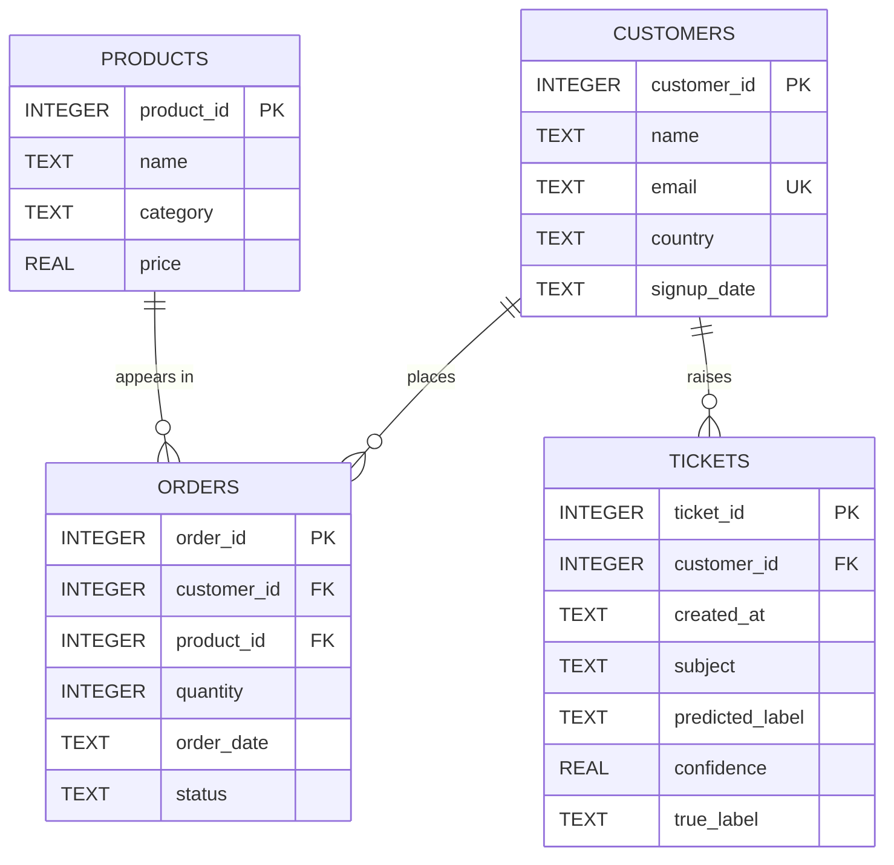
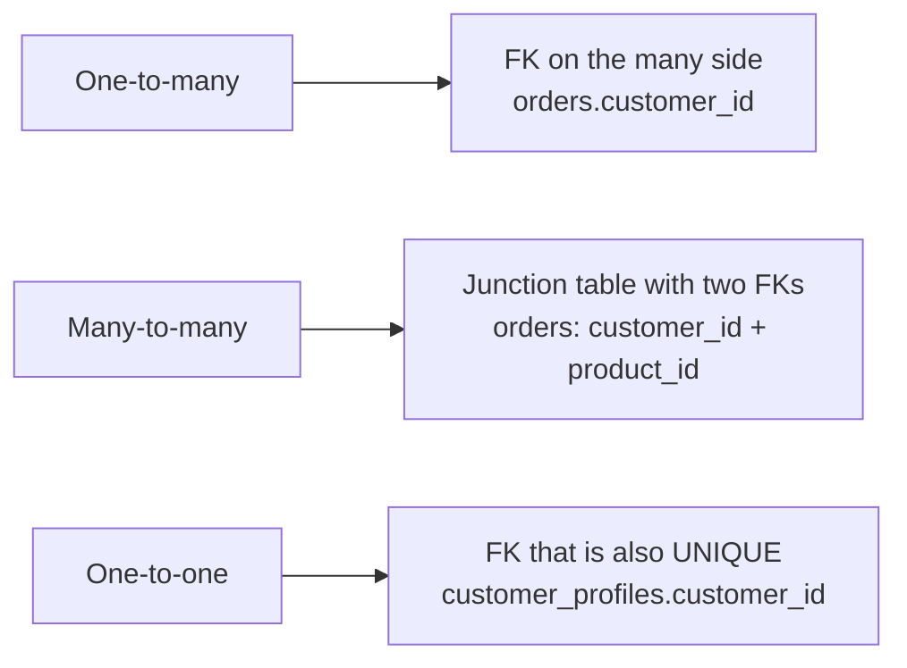

A database is only as good as its design. Get the tables and relationships right and queries are simple, data stays consistent, and new features slot in easily. Get them wrong and you fight duplicated values, contradictory records and awkward queries for the life of the system. This lesson shows how to define tables with types and constraints, how tables relate to one another, and builds the four-table example schema used throughout the module.

## The example schema

You will work with a small online shop that sells hardware and AI services, and that uses a model to route support tickets to the right team.



Read the crow's-foot notation on each line: `||--o{` means "exactly one on the left, zero or more on the right". One customer places zero or more orders; every order belongs to exactly one customer. The `tickets` table holds the model's `predicted_label` and `confidence` next to the `true_label` a support agent assigned after review. That pairing is how you will measure the model's accuracy with SQL in later lessons.

## Defining a table

`CREATE TABLE` names the table, then lists each column with a type and optional constraints:

```sql
CREATE TABLE orders (
    order_id    INTEGER PRIMARY KEY,
    customer_id INTEGER NOT NULL REFERENCES customers(customer_id),
    product_id  INTEGER NOT NULL REFERENCES products(product_id),
    quantity    INTEGER NOT NULL CHECK (quantity > 0),
    order_date  TEXT NOT NULL,
    status      TEXT NOT NULL
);
```

The full script, which every later lesson assumes you have run, is below. Save it as `shop.py`.

<details>
<summary>Show the full setup script (shop.py)</summary>

```python
import sqlite3

SCHEMA = """
CREATE TABLE customers (
    customer_id INTEGER PRIMARY KEY,
    name        TEXT NOT NULL,
    email       TEXT NOT NULL UNIQUE,
    country     TEXT NOT NULL,
    signup_date TEXT NOT NULL
);
CREATE TABLE products (
    product_id INTEGER PRIMARY KEY,
    name       TEXT NOT NULL,
    category   TEXT NOT NULL,
    price      REAL NOT NULL CHECK (price >= 0)
);
CREATE TABLE orders (
    order_id    INTEGER PRIMARY KEY,
    customer_id INTEGER NOT NULL REFERENCES customers(customer_id),
    product_id  INTEGER NOT NULL REFERENCES products(product_id),
    quantity    INTEGER NOT NULL CHECK (quantity > 0),
    order_date  TEXT NOT NULL,
    status      TEXT NOT NULL
);
CREATE TABLE tickets (
    ticket_id       INTEGER PRIMARY KEY,
    customer_id     INTEGER NOT NULL REFERENCES customers(customer_id),
    created_at      TEXT NOT NULL,
    subject         TEXT NOT NULL,
    predicted_label TEXT NOT NULL,
    confidence      REAL NOT NULL,
    true_label      TEXT
);
"""

DATA = """
INSERT INTO customers VALUES
    (1, 'Amina Khan',  'amina@example.com', 'UK', '2024-01-15'),
    (2, 'Ben Carter',  'ben@example.com',   'US', '2024-02-03'),
    (3, 'Chen Wei',    'chen@example.com',  'SG', '2024-02-20'),
    (4, 'Diego Lopez', 'diego@example.com', 'ES', '2024-03-11'),
    (5, 'Ewa Nowak',   'ewa@example.com',   'PL', '2024-04-02'),
    (6, 'Farah Ali',   'farah@example.com', 'UK', '2024-05-19');
INSERT INTO products VALUES
    (1, 'Laptop Stand',        'accessories',  39.00),
    (2, 'Mechanical Keyboard', 'accessories',  89.00),
    (3, 'GPU Cloud Credits',   'services',    250.00),
    (4, 'ANC Headphones',      'audio',       199.00),
    (5, 'USB-C Hub',           'accessories',  45.00),
    (6, 'Data Labelling Pack', 'services',    120.00);
INSERT INTO orders VALUES
    (1,  1, 3, 1, '2024-06-01', 'shipped'),
    (2,  1, 2, 1, '2024-06-03', 'shipped'),
    (3,  2, 1, 2, '2024-06-05', 'shipped'),
    (4,  3, 4, 1, '2024-06-07', 'refunded'),
    (5,  2, 3, 2, '2024-06-10', 'shipped'),
    (6,  4, 5, 3, '2024-06-12', 'pending'),
    (7,  5, 2, 1, '2024-06-15', 'shipped'),
    (8,  3, 3, 1, '2024-06-18', 'shipped'),
    (9,  1, 5, 1, '2024-06-20', 'pending'),
    (10, 4, 4, 1, '2024-06-22', 'shipped'),
    (11, 5, 1, 1, '2024-06-25', 'shipped'),
    (12, 2, 4, 1, '2024-06-28', 'shipped');
INSERT INTO tickets VALUES
    (1,  1, '2024-06-02', 'Cannot log in after reset',  'account',  0.94, 'account'),
    (2,  2, '2024-06-06', 'Charged twice for order',    'billing',  0.88, 'billing'),
    (3,  3, '2024-06-08', 'Headphones arrived broken',  'shipping', 0.61, 'product'),
    (4,  1, '2024-06-11', 'How do I export invoices?',  'billing',  0.72, 'billing'),
    (5,  4, '2024-06-13', 'Hub not detected by laptop', 'product',  0.83, 'product'),
    (6,  5, '2024-06-16', 'Refund still not received',  'billing',  0.91, 'billing'),
    (7,  3, '2024-06-19', 'Package stuck in transit',   'shipping', 0.97, 'shipping'),
    (8,  2, '2024-06-23', 'Change account email',       'account',  0.55, 'account'),
    (9,  6, '2024-06-24', 'Keyboard missing keycaps',   'shipping', 0.58, 'product'),
    (10, 4, '2024-06-27', 'Invoice shows wrong VAT',    'account',  0.49, 'billing'),
    (11, 5, '2024-06-29', 'Where is my order?',         'shipping', 0.89, NULL);
"""

def connect():
    conn = sqlite3.connect(":memory:")
    conn.execute("PRAGMA foreign_keys = ON")
    conn.executescript(SCHEMA + DATA)
    return conn
```

Then `from shop import connect` and `conn = connect()` gives you a fresh copy of the data. The lessons show query results as text tables for readability; in Python, `conn.execute(sql).fetchall()` returns the same rows as a list of tuples.

</details>

## Data types

Every column has a type. Types document intent, let the database reject nonsense, and decide how values sort and compare.

| Kind of data | SQLite | PostgreSQL |
| --- | --- | --- |
| Whole numbers | `INTEGER` | `INTEGER`, `BIGINT` |
| Exact decimals (money) | no exact type; store integer cents or `TEXT` | `NUMERIC(10, 2)` |
| Floating point | `REAL` | `REAL`, `DOUBLE PRECISION` |
| Text | `TEXT` | `TEXT`, `VARCHAR(n)` |
| True/false | `INTEGER` 0 or 1 | `BOOLEAN` |
| Dates and times | `TEXT` in ISO 8601 (`'2024-06-01'`) | `DATE`, `TIMESTAMPTZ` |
| JSON documents | `TEXT` plus JSON functions | `JSONB` |
| Auto-incrementing key | `INTEGER PRIMARY KEY` | `GENERATED ALWAYS AS IDENTITY` (older code: `SERIAL`) |

SQLite is unusually relaxed about types. A column's declared type is only an *affinity*, a preference, unless you declare the table `STRICT` (available since SQLite 3.37):

```python
import sqlite3

conn = sqlite3.connect(":memory:")
conn.execute("CREATE TABLE loose (n INTEGER)")
conn.execute("CREATE TABLE strict_t (n INTEGER) STRICT")

conn.execute("INSERT INTO loose VALUES ('42'), ('hello')")
print(conn.execute("SELECT n, typeof(n) FROM loose").fetchall())

try:
    conn.execute("INSERT INTO strict_t VALUES ('hello')")
except sqlite3.IntegrityError as e:
    print(e)
```

```output
[(42, 'integer'), ('hello', 'text')]
cannot store TEXT value in INTEGER column strict_t.n
```

The loose table converted `'42'` to an integer but happily stored `'hello'` in an integer column. PostgreSQL behaves like the strict table: inserting `'hello'` into an `INTEGER` column is always an error. Storing dates as ISO 8601 text in SQLite works because that format sorts correctly as a string.

## Constraints: rules the database enforces

Constraints are rules declared once in the schema and checked on every write, by every program that touches the data. That is far more reliable than hoping each script validates its input.

| Constraint | Guarantees |
| --- | --- |
| `PRIMARY KEY` | Each row has a unique, non-missing identifier |
| `NOT NULL` | The column always has a value |
| `UNIQUE` | No two rows share the value (for example, emails) |
| `CHECK (expr)` | Every row satisfies a condition, such as `price >= 0` |
| `REFERENCES t(col)` | A foreign key: the value must exist in the other table |
| `DEFAULT value` | Value used when an insert omits the column |

Here each constraint in the schema catches a bad row:

```python
import sqlite3
from shop import SCHEMA, DATA

conn = sqlite3.connect(":memory:")
conn.execute("PRAGMA foreign_keys = ON")    # SQLite leaves this off by default
conn.executescript(SCHEMA + DATA)

bad_rows = [
    ("INSERT INTO orders VALUES (13, 99, 1, 1, '2024-07-01', 'pending')", "unknown customer"),
    ("INSERT INTO customers VALUES (7, 'Gil', 'ben@example.com', 'US', '2024-07-01')", "duplicate email"),
    ("INSERT INTO products VALUES (7, 'Mouse', 'accessories', -5)", "negative price"),
    ("INSERT INTO customers (customer_id, name, country, signup_date) VALUES (8, 'Hana', 'JP', '2024-07-02')", "missing email"),
]
for sql, why in bad_rows:
    try:
        conn.execute(sql)
    except sqlite3.IntegrityError as e:
        print(f"{why:17} -> {e}")
```

```output
unknown customer  -> FOREIGN KEY constraint failed
duplicate email   -> UNIQUE constraint failed: customers.email
negative price    -> CHECK constraint failed: price >= 0
missing email     -> NOT NULL constraint failed: customers.email
```

> [!WARNING]
> SQLite does **not** enforce foreign keys unless you run `PRAGMA foreign_keys = ON` on each new connection. Without it, the order for customer 99 above would be inserted silently. PostgreSQL always enforces them.

## Kinds of relationship

Relationships are built from foreign keys. There are three shapes.

**One-to-many** is by far the most common. The foreign key goes on the "many" side: `orders.customer_id` points at `customers`. One customer, many orders.

**Many-to-many** needs a third table, a **junction table**, holding a pair of foreign keys. A customer buys many products and a product is bought by many customers; in this schema `orders` plays the junction role, since each row links one customer to one product (with extra facts: quantity, date, status).

**One-to-one** puts a `UNIQUE` foreign key on one side, for example a `customer_profiles` table whose `customer_id` is both a foreign key and unique. It is used to split rarely-read or sensitive columns away from a busy table.



Foreign keys can also say what happens when the referenced row is deleted: `ON DELETE CASCADE` deletes the dependent rows too, `ON DELETE SET NULL` clears the reference, and the default refuses the delete while dependants exist.

## Normalisation: one fact in one place

Why not keep one wide table with the customer's name and email repeated on every order? Because duplicated facts drift apart. If Amina changes her email and only some of her order rows are updated, the database now contradicts itself. **Normalisation** is the discipline of storing each fact exactly once and linking to it with keys. The classic normal forms boil down to three rules of thumb:

1. Each column holds one atomic value: no comma-separated lists of product IDs in a cell (first normal form).
2. Every non-key column depends on the whole key. In an `order_items` table keyed by `(order_id, product_id)`, the product's name depends only on `product_id`, so it belongs in `products` (second normal form).
3. Non-key columns do not depend on other non-key columns. Storing `country_name` next to `country_code` repeats a fact that belongs in a `countries` table (third normal form).

> [!KEY]
> Normalise first for correctness. Duplicate data deliberately (denormalise) only later, for a measured performance reason, and know which copy is the source of truth.

Our schema takes one shortcut worth noticing: revenue is computed as `quantity * products.price`, so changing a product's price would rewrite history. Real shops copy the price paid onto the order line at purchase time, which is not duplication but a different fact: the price *at that moment*.

## Exercises

**1.** Real orders contain several products. Redesign `orders` into two tables, `orders` and `order_items`, and write the `CREATE TABLE` statements with keys and constraints.

<details>
<summary>Show solution</summary>

```sql
CREATE TABLE orders (
    order_id    INTEGER PRIMARY KEY,
    customer_id INTEGER NOT NULL REFERENCES customers(customer_id),
    order_date  TEXT NOT NULL,
    status      TEXT NOT NULL CHECK (status IN ('pending', 'shipped', 'refunded'))
);

CREATE TABLE order_items (
    order_id   INTEGER NOT NULL REFERENCES orders(order_id) ON DELETE CASCADE,
    product_id INTEGER NOT NULL REFERENCES products(product_id),
    quantity   INTEGER NOT NULL CHECK (quantity > 0),
    unit_price REAL NOT NULL CHECK (unit_price >= 0),
    PRIMARY KEY (order_id, product_id)
);
```

The composite primary key stops the same product appearing twice in one order, and `unit_price` records the price actually paid.

</details>

**2.** A colleague proposes adding a `tags TEXT` column to `products` holding values like `'gpu,cloud,ml'`. What problem does this cause, and what design would you use instead?

<details>
<summary>Show solution</summary>

It breaks first normal form: finding every product tagged `ml` needs fragile string matching, and nothing stops misspelt tags. Use a `tags (tag_id, name UNIQUE)` table and a junction table `product_tags (product_id, tag_id)` with a composite primary key. (PostgreSQL also offers array and `JSONB` columns, which are acceptable when you rarely query by tag.)

</details>

**3.** Using the setup script, try inserting a ticket for customer 42 on a connection where you did **not** run `PRAGMA foreign_keys = ON`. What happens, and why does it matter?

<details>
<summary>Show solution</summary>

```python
import sqlite3
from shop import SCHEMA, DATA

conn = sqlite3.connect(":memory:")       # no PRAGMA this time
conn.executescript(SCHEMA + DATA)
conn.execute("INSERT INTO tickets VALUES (12, 42, '2024-07-01', 'Hello', 'account', 0.5, NULL)")
print(conn.execute("SELECT COUNT(*) FROM tickets WHERE customer_id = 42").fetchone())   # (1,)
```

The insert succeeds, leaving an orphan ticket that no join to `customers` will find. Any report joining tickets to customers silently undercounts.

</details>

```quiz
[
  {
    "q": "In the relationship between `customers` and `orders`, where does the foreign key live?",
    "options": [
      "`customers.order_id`",
      "`orders.customer_id`",
      "In a separate junction table",
      "Both tables need one"
    ],
    "answer": 1,
    "why": "In a one-to-many relationship the foreign key sits on the many side: each order records its customer."
  },
  {
    "q": "How do you model a many-to-many relationship between products and tags?",
    "options": [
      "A comma-separated tags column on products",
      "A junction table holding `product_id` and `tag_id`",
      "A foreign key from products to tags",
      "Two foreign keys pointing at each other"
    ],
    "answer": 1,
    "why": "A junction table with one row per (product, tag) pair is the standard relational model of many-to-many."
  },
  {
    "q": "What happens in SQLite, by default, if you insert an order whose `customer_id` does not exist?",
    "options": [
      "The insert fails with a foreign key error",
      "SQLite creates the missing customer",
      "The insert succeeds, because foreign keys are off unless `PRAGMA foreign_keys = ON` is set",
      "The value is replaced with NULL"
    ],
    "answer": 2,
    "why": "SQLite parses `REFERENCES` clauses but only enforces them when the foreign_keys pragma is on for that connection."
  },
  {
    "q": "Which PostgreSQL type should you use for prices to avoid floating-point rounding errors?",
    "options": [
      "`NUMERIC(10, 2)`",
      "`DOUBLE PRECISION`",
      "`REAL`",
      "`TEXT`"
    ],
    "answer": 0,
    "why": "`NUMERIC` stores exact decimals. Floating-point types cannot represent many decimal fractions exactly."
  }
]
```
