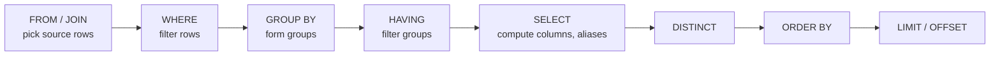

Reading whole tables is rarely what you want. You want the low-confidence predictions from last week, the number of orders per status, the ten most recent tickets. Three clauses do that work: `WHERE` filters rows, `GROUP BY` collapses rows into summaries, and `ORDER BY` sorts the result. Together they cover most of what you did with boolean masks, `groupby` and `sort_values` in the [pandas module](/learn/pandas/grouping-and-aggregation), but executed inside the database, next to the data.

This lesson also explains the order in which a database evaluates a query's clauses. That order is not the order you write them in, and it explains a whole family of confusing errors.

## Filtering with WHERE

`WHERE` keeps only the rows for which a condition is true. Conditions use comparison operators (`=`, `<>` or `!=`, `<`, `<=`, `>`, `>=`) combined with `AND`, `OR` and `NOT`.

```sql
SELECT order_id, customer_id, order_date
FROM orders
WHERE order_date BETWEEN '2024-06-10' AND '2024-06-20'
  AND status IN ('shipped', 'pending');
```

```output
 order_id | customer_id | order_date
----------+-------------+------------
        5 |           2 | 2024-06-10
        6 |           4 | 2024-06-12
        7 |           5 | 2024-06-15
        8 |           3 | 2024-06-18
        9 |           1 | 2024-06-20
(5 rows)
```

| Operator | Meaning | Example |
| --- | --- | --- |
| `BETWEEN a AND b` | Inclusive range | `price BETWEEN 40 AND 100` |
| `IN (...)` | Equals any value in a list | `status IN ('shipped', 'pending')` |
| `LIKE` | Pattern: `%` any run of characters, `_` exactly one | `subject LIKE '%order%'` |
| `IS NULL` / `IS NOT NULL` | Missing or present | `true_label IS NULL` |

`BETWEEN` on the date strings works because ISO 8601 dates sort correctly as text.

### AND binds tighter than OR

This query was meant to find accessories or audio products costing more than 100:

```sql
SELECT name, category, price
FROM products
WHERE category = 'accessories' OR category = 'audio' AND price > 100;
```

```output
 name                | category    | price
---------------------+-------------+-------
 Laptop Stand        | accessories |  39.0
 Mechanical Keyboard | accessories |  89.0
 ANC Headphones      | audio       | 199.0
 USB-C Hub           | accessories |  45.0
(4 rows)
```

`AND` is evaluated first, so the condition reads "accessories, or (audio and over 100)". Brackets fix it:

```sql
SELECT name, category, price
FROM products
WHERE (category = 'accessories' OR category = 'audio') AND price > 100;
```

```output
 name           | category | price
----------------+----------+-------
 ANC Headphones | audio    | 199.0
(1 row)
```

Whenever you mix `AND` and `OR`, add brackets even if you think you know the precedence.

### Pattern matching and case

```sql
SELECT ticket_id, subject FROM tickets WHERE subject LIKE '%order%';
```

```output
 ticket_id | subject
-----------+-------------------------
         2 | Charged twice for order
        11 | Where is my order?
(2 rows)
```

Here the dialects differ. In SQLite, `LIKE` ignores case for ASCII letters, so `'%ORDER%'` would match too. In PostgreSQL, `LIKE` is case-sensitive, and the case-insensitive version is the PostgreSQL-only operator `ILIKE`. The portable approach is `LOWER(subject) LIKE '%order%'`.

## NULL and three-valued logic

`NULL` means "unknown". Ticket 11 has not been reviewed, so its `true_label` is `NULL`. Any comparison with an unknown value is itself unknown, not true or false, and `WHERE` only keeps rows where the condition is true:

```sql
SELECT COUNT(*) FROM tickets WHERE true_label = NULL;
```

```output
 COUNT(*)
----------
        0
(1 row)
```

Zero rows, because `true_label = NULL` is never true, not even when `true_label` is `NULL`. Use `IS NULL`:

```sql
SELECT ticket_id, subject, predicted_label FROM tickets WHERE true_label IS NULL;
```

```output
 ticket_id | subject            | predicted_label
-----------+--------------------+-----------------
        11 | Where is my order? | shipping
(1 row)
```

The same logic quietly shapes metrics. `WHERE predicted_label <> true_label` counts 3 wrong predictions, and it silently skips ticket 11: unknown is neither right nor wrong.

> [!WARNING]
> `NULL` is not equal to anything, including another `NULL`. Test for it with `IS NULL`, and remember that `<>`, `NOT IN` and most functions drop or propagate `NULL`s. When a count looks too low, look for `NULL`s first.

## Sorting with ORDER BY and LIMIT

`ORDER BY` sorts by one or more expressions, each ascending (`ASC`, the default) or descending (`DESC`). Combined with `LIMIT`, it answers "top N" questions:

```sql
SELECT ticket_id, predicted_label, confidence
FROM tickets
ORDER BY confidence DESC
LIMIT 3;
```

```output
 ticket_id | predicted_label | confidence
-----------+-----------------+------------
         7 | shipping        |       0.97
         1 | account         |       0.94
         6 | billing         |       0.91
(3 rows)
```

With ties, add a second key so the order is deterministic: `ORDER BY true_label, ticket_id`. `NULL`s also need a decision. SQLite puts them first in ascending order; PostgreSQL puts them last. Both accept an explicit `NULLS FIRST` or `NULLS LAST`:

```sql
SELECT ticket_id, true_label
FROM tickets
ORDER BY true_label NULLS LAST, ticket_id
LIMIT 4;
```

```output
 ticket_id | true_label
-----------+------------
         1 | account
         8 | account
         2 | billing
         4 | billing
(4 rows)
```

`LIMIT n OFFSET m` skips `m` rows first, which gives simple pagination. It gets slow for deep pages; [database optimisation](/learn/sql-and-databases/database-optimization) shows a better way.

## Summarising with GROUP BY

Aggregate functions reduce many rows to one value: `COUNT`, `SUM`, `AVG`, `MIN`, `MAX`. On their own they summarise the whole table. `COUNT(*)` counts rows, `COUNT(col)` counts non-`NULL` values, and `COUNT(DISTINCT col)` counts unique values:

```sql
SELECT COUNT(*), COUNT(true_label), COUNT(DISTINCT predicted_label) FROM tickets;
```

```output
 COUNT(*) | COUNT(true_label) | COUNT(DISTINCT predicted_label)
----------+-------------------+---------------------------------
       11 |                10 |                               4
(1 row)
```

`GROUP BY` splits rows into groups that share a value and computes the aggregates per group:

```sql
SELECT status, COUNT(*) AS n_orders, SUM(quantity) AS units
FROM orders
GROUP BY status;
```

```output
 status   | n_orders | units
----------+----------+-------
 pending  |        2 |     4
 refunded |        1 |     1
 shipped  |        9 |    11
(3 rows)
```

Here is a genuinely useful one: per-class accuracy of the ticket classifier. For the $n$ reviewed tickets in a class, accuracy is

$$
\text{accuracy} = \frac{1}{n}\sum_{i=1}^{n} \mathbb{1}[\hat{y}_i = y_i]
$$

where $\hat{y}_i$ is the predicted label, $y_i$ the true label, and $\mathbb{1}[\cdot]$ is 1 when the condition holds and 0 otherwise. In SQL, a `CASE` expression is the indicator and `AVG` does the rest:

```sql
SELECT predicted_label,
       COUNT(*) AS n,
       ROUND(AVG(confidence), 3) AS avg_conf,
       ROUND(AVG(CASE WHEN predicted_label = true_label THEN 1.0 ELSE 0.0 END), 2) AS accuracy
FROM tickets
WHERE true_label IS NOT NULL
GROUP BY predicted_label
ORDER BY accuracy DESC, predicted_label;
```

```output
 predicted_label | n | avg_conf | accuracy
-----------------+---+----------+----------
 billing         | 3 |    0.837 |      1.0
 product         | 1 |     0.83 |      1.0
 account         | 3 |     0.66 |     0.67
 shipping        | 3 |     0.72 |     0.33
(4 rows)
```

When the model says "shipping" it is right only a third of the time: two broken-product tickets were misrouted to shipping. That is the kind of finding you can get without exporting anything.

### HAVING filters groups

`WHERE` filters rows before grouping; `HAVING` filters groups after aggregation. Customers with at least two non-refunded orders:

```sql
SELECT customer_id, COUNT(*) AS n_orders, MIN(order_date) AS first_order
FROM orders
WHERE status <> 'refunded'
GROUP BY customer_id
HAVING COUNT(*) >= 2
ORDER BY n_orders DESC, customer_id;
```

```output
 customer_id | n_orders | first_order
-------------+----------+-------------
           1 |        3 | 2024-06-01
           2 |        3 | 2024-06-05
           4 |        2 | 2024-06-12
           5 |        2 | 2024-06-15
(4 rows)
```

## The logical order of a query

You write `SELECT` first, but the database evaluates it nearly last:



This is a *logical* order, the meaning of the query; the planner may physically do things differently as long as the result is the same. It explains three rules:

- You cannot use an aggregate in `WHERE` (`WHERE COUNT(*) > 1`), because groups do not exist yet. Use `HAVING`.
- A column alias defined in `SELECT` cannot be used in `WHERE` in standard SQL, because `WHERE` runs first. It *can* be used in `ORDER BY`, which runs after.
- Every column in `SELECT` must either be in `GROUP BY` or inside an aggregate. Otherwise "the name of the category's product" is ambiguous: which product?

> [!NOTE]
> SQLite is lenient on the last two rules: it accepts an alias in `WHERE`, and `SELECT category, name FROM products GROUP BY category` runs and returns an arbitrary product name per category. PostgreSQL rejects both with an error. Write the standard form so your SQL ports cleanly.

## Exercises

**1.** List the tickets the model was unsure about (confidence below 0.6) that have been reviewed, showing ID, subject, predicted and true labels, least confident first.

<details>
<summary>Show solution</summary>

```sql
SELECT ticket_id, subject, predicted_label, true_label
FROM tickets
WHERE confidence < 0.6 AND true_label IS NOT NULL
ORDER BY confidence;
```

```output
 ticket_id | subject                  | predicted_label | true_label
-----------+--------------------------+-----------------+------------
        10 | Invoice shows wrong VAT  | account         | billing
         8 | Change account email     | account         | account
         9 | Keyboard missing keycaps | shipping        | product
(3 rows)
```

</details>

**2.** For each product, show the total units sold across shipped orders, keeping only products with at least 2 units. Use only the `orders` table (report `product_id`).

<details>
<summary>Show solution</summary>

```sql
SELECT product_id, SUM(quantity) AS units
FROM orders
WHERE status = 'shipped'
GROUP BY product_id
HAVING SUM(quantity) >= 2
ORDER BY units DESC, product_id;
```

```output
 product_id | units
------------+-------
          3 |     4
          1 |     3
          2 |     2
          4 |     2
(4 rows)
```

The quantity filter on individual rows would be wrong here: product 1 reaches 3 units only by adding two orders together, so the condition must go in `HAVING`, on the sum.

</details>

**3.** Why does `SELECT COUNT(*) FROM tickets WHERE NOT (predicted_label = true_label)` return 3, not 4, even though 4 tickets are not known to be correct?

<details>
<summary>Show solution</summary>

For ticket 11, `predicted_label = true_label` is unknown because `true_label` is `NULL`, and `NOT unknown` is still unknown. `WHERE` keeps only true rows, so ticket 11 is excluded. To count "not confirmed correct" you need `WHERE true_label IS NULL OR predicted_label <> true_label`.

</details>

```quiz
[
  {
    "q": "Which clause filters groups after aggregation?",
    "options": [
      "`HAVING`",
      "`WHERE`",
      "`ORDER BY`",
      "`LIMIT`"
    ],
    "answer": 0,
    "why": "`WHERE` runs before grouping and sees individual rows; `HAVING` runs after and can test aggregates."
  },
  {
    "q": "What does `WHERE true_label = NULL` return?",
    "options": [
      "Rows where true_label is missing",
      "Every row",
      "An error in every database",
      "No rows, because comparing with NULL is never true"
    ],
    "answer": 3,
    "why": "Comparisons with NULL yield unknown, which WHERE treats as not true. Use `IS NULL`."
  },
  {
    "q": "In PostgreSQL, which matches `'Where is my ORDER?'` case-insensitively?",
    "options": [
      "`subject LIKE '%order%'`",
      "`subject = 'order'`",
      "`subject ILIKE '%order%'`",
      "`subject IN ('order')`"
    ],
    "answer": 2,
    "why": "PostgreSQL's LIKE is case-sensitive; ILIKE is its case-insensitive variant. SQLite's LIKE is already case-insensitive for ASCII."
  },
  {
    "q": "In the logical order of evaluation, which comes first?",
    "options": [
      "`WHERE`",
      "`ORDER BY`",
      "`SELECT`",
      "`HAVING`"
    ],
    "answer": 0,
    "why": "The order is FROM, WHERE, GROUP BY, HAVING, SELECT, DISTINCT, ORDER BY, LIMIT."
  }
]
```
