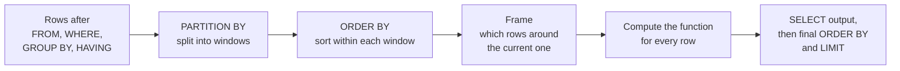

`GROUP BY` answers "what is the total per customer?" but throws away the individual rows to do it. Many questions need both: each order *and* its customer's total; each ticket *and* the running average confidence up to that point; each purchase *and* the number of days since the previous one. **Window functions** compute a value over a set of related rows, the *window*, while keeping every row in the result. They are the SQL tool for rankings, running totals, moving averages and lag features, which makes them central to feature engineering for time-ordered data. SQLite has supported them since version 3.25, and every major database does.

## GROUP BY versus OVER

The difference is easiest to see side by side. Adding `OVER (...)` to an aggregate turns it into a window function:

```sql
SELECT order_id, customer_id, quantity,
       SUM(quantity) OVER (PARTITION BY customer_id) AS customer_units,
       COUNT(*)      OVER ()                         AS all_orders
FROM orders
WHERE customer_id IN (1, 2)
ORDER BY customer_id, order_id;
```

```output
 order_id | customer_id | quantity | customer_units | all_orders
----------+-------------+----------+----------------+------------
        1 |           1 |        1 |              3 |          6
        2 |           1 |        1 |              3 |          6
        9 |           1 |        1 |              3 |          6
        3 |           2 |        2 |              5 |          6
        5 |           2 |        2 |              5 |          6
       12 |           2 |        1 |              5 |          6
(6 rows)
```

Six rows in, six rows out. `PARTITION BY customer_id` splits the rows into one window per customer, like `GROUP BY` does, but the sum is attached to every row instead of collapsing them. An empty `OVER ()` makes the whole result one window. Notice that `all_orders` is 6, not 12: window functions run after `WHERE`, so they see only the filtered rows.



The full syntax is `function(...) OVER (PARTITION BY ... ORDER BY ... frame)`, and every part is optional.

## Numbering and ranking

Three functions number rows within a window in order. They differ only in how they treat ties:

```sql
SELECT o.order_id, o.quantity * p.price AS amount,
       ROW_NUMBER() OVER (ORDER BY o.quantity * p.price DESC, o.order_id) AS row_num,
       RANK()       OVER (ORDER BY o.quantity * p.price DESC) AS rnk,
       DENSE_RANK() OVER (ORDER BY o.quantity * p.price DESC) AS dense
FROM orders AS o
JOIN products AS p ON p.product_id = o.product_id
ORDER BY row_num
LIMIT 7;
```

```output
 order_id | amount | row_num | rnk | dense
----------+--------+---------+-----+-------
        5 |  500.0 |       1 |   1 |     1
        1 |  250.0 |       2 |   2 |     2
        8 |  250.0 |       3 |   2 |     2
        4 |  199.0 |       4 |   4 |     3
       10 |  199.0 |       5 |   4 |     3
       12 |  199.0 |       6 |   4 |     3
        6 |  135.0 |       7 |   7 |     4
(7 rows)
```

| Function | Ties | Sequence here |
| --- | --- | --- |
| `ROW_NUMBER()` | Always distinct; ties broken arbitrarily unless you add a tie-breaker | 1, 2, 3, 4, 5, 6, 7 |
| `RANK()` | Tied rows share a rank, then ranks skip | 1, 2, 2, 4, 4, 4, 7 |
| `DENSE_RANK()` | Tied rows share a rank, no gaps | 1, 2, 2, 3, 3, 3, 4 |

The extra `o.order_id` in the `ROW_NUMBER` ordering makes the numbering deterministic. Without it, orders 1 and 8 could swap between runs.

### Top N per group

The single most common window pattern: number the rows within each group, then keep the first N. The latest order per customer:

```sql
WITH ranked AS (
    SELECT order_id, customer_id, order_date,
           ROW_NUMBER() OVER (PARTITION BY customer_id ORDER BY order_date DESC) AS rn
    FROM orders
)
SELECT customer_id, order_id, order_date
FROM ranked
WHERE rn = 1
ORDER BY customer_id;
```

```output
 customer_id | order_id | order_date
-------------+----------+------------
           1 |        9 | 2024-06-20
           2 |       12 | 2024-06-28
           3 |        8 | 2024-06-18
           4 |       10 | 2024-06-22
           5 |       11 | 2024-06-25
(5 rows)
```

This is the same answer as the correlated subquery in the [subqueries lesson](/learn/sql-and-databases/subqueries), computed in one pass over the table. The same pattern deduplicates data: when an ingestion job has written several versions of a record, keep `rn = 1` ordered by update time.

> [!WARNING]
> You cannot filter on a window function in `WHERE` (`WHERE ROW_NUMBER() OVER (...) = 1` is an error), because window functions are computed after `WHERE`. Compute them in a CTE or subquery and filter in the outer query, as above.

## Running totals

Adding `ORDER BY` inside `OVER` changes an aggregate's meaning: it now covers the rows from the start of the window up to the current row. That is a running total.

```sql
SELECT o.order_date, o.quantity * p.price AS amount,
       SUM(o.quantity * p.price) OVER (ORDER BY o.order_date) AS running_total
FROM orders AS o
JOIN products AS p ON p.product_id = o.product_id
WHERE o.status = 'shipped'
ORDER BY o.order_date;
```

```output
 order_date | amount | running_total
------------+--------+---------------
 2024-06-01 |  250.0 |         250.0
 2024-06-03 |   89.0 |         339.0
 2024-06-05 |   78.0 |         417.0
 2024-06-10 |  500.0 |         917.0
 2024-06-15 |   89.0 |        1006.0
 2024-06-18 |  250.0 |        1256.0
 2024-06-22 |  199.0 |        1455.0
 2024-06-25 |   39.0 |        1494.0
 2024-06-28 |  199.0 |        1693.0
(9 rows)
```

With `PARTITION BY` as well, the total restarts for each partition. The trace below simulates `SUM(quantity) OVER (PARTITION BY customer_id ORDER BY order_date)` for customers 1 and 2, whose rows are already sorted:

```trace
{
  "title": "A running total that restarts per partition",
  "code": [
    "rows = [(1, 1), (1, 1), (1, 1), (2, 2), (2, 2), (2, 1)]  # (customer_id, quantity)",
    "prev, running = None, 0",
    "for cust, qty in rows:",
    "    if cust != prev:",
    "        running = 0          # new partition: reset",
    "    running += qty",
    "    prev = cust",
    "    print(cust, qty, running)"
  ],
  "steps": [
    { "line": 2, "vars": { "prev": "None", "running": "0" }, "note": "Rows arrive sorted by partition key, then by the window's ORDER BY." },
    { "line": 5, "vars": { "cust": "1", "qty": "1", "prev": "None", "running": "0" }, "note": "First row of customer 1's partition: the total starts from zero." },
    { "line": 8, "vars": { "cust": "1", "qty": "1", "prev": "1", "running": "1" }, "out": ["1 1 1"], "note": "Output the row with its running total so far." },
    { "line": 8, "vars": { "cust": "1", "qty": "1", "prev": "1", "running": "2" }, "out": ["1 1 1", "1 1 2"], "note": "Same partition: keep accumulating." },
    { "line": 8, "vars": { "cust": "1", "qty": "1", "prev": "1", "running": "3" }, "out": ["1 1 1", "1 1 2", "1 1 3"], "note": "Customer 1's last row carries the partition total, 3." },
    { "line": 5, "vars": { "cust": "2", "qty": "2", "prev": "1", "running": "0" }, "out": ["1 1 1", "1 1 2", "1 1 3"], "note": "The partition key changed, so the total resets." },
    { "line": 8, "vars": { "cust": "2", "qty": "2", "prev": "2", "running": "2" }, "out": ["1 1 1", "1 1 2", "1 1 3", "2 2 2"], "note": "Customer 2 starts again from their own first row." },
    { "line": 8, "vars": { "cust": "2", "qty": "1", "prev": "2", "running": "5" }, "out": ["1 1 1", "1 1 2", "1 1 3", "2 2 2", "2 2 4", "2 1 5"], "note": "Every input row produced exactly one output row: that is what distinguishes a window function from GROUP BY." }
  ]
}
```

Running SQL with that window gives the same numbers in a `running_units` column: 1, 2, 3 for Amina and 2, 4, 5 for Ben.

## Frames and moving averages

The **frame** says exactly which rows around the current row the function sees. `ROWS BETWEEN 2 PRECEDING AND CURRENT ROW` is a window of the current row and the two before it, giving a 3-row moving average. Here it smooths the classifier's confidence over time, a simple way to spot a model degrading in production:

```sql
SELECT ticket_id, created_at, confidence,
       ROUND(AVG(confidence) OVER (
           ORDER BY created_at
           ROWS BETWEEN 2 PRECEDING AND CURRENT ROW
       ), 3) AS moving_avg_3
FROM tickets
ORDER BY created_at;
```

```output
 ticket_id | created_at | confidence | moving_avg_3
-----------+------------+------------+--------------
         1 | 2024-06-02 |       0.94 |         0.94
         2 | 2024-06-06 |       0.88 |         0.91
         3 | 2024-06-08 |       0.61 |         0.81
         4 | 2024-06-11 |       0.72 |        0.737
         5 | 2024-06-13 |       0.83 |         0.72
         6 | 2024-06-16 |       0.91 |         0.82
         7 | 2024-06-19 |       0.97 |        0.903
         8 | 2024-06-23 |       0.55 |         0.81
         9 | 2024-06-24 |       0.58 |          0.7
        10 | 2024-06-27 |       0.49 |         0.54
        11 | 2024-06-29 |       0.89 |        0.653
(11 rows)
```

The first two rows average over fewer than three values because there is nothing before them. The late-June dip to 0.54 coincides with two misclassified tickets, which is exactly the kind of signal you would alert on.

For ticket $t$, the 3-row moving average is

$$
m_t = \frac{1}{|W_t|}\sum_{i \in W_t} c_i
$$

where $c_i$ is the confidence of row $i$ and $W_t$ is the frame: row $t$ and up to two rows before it.

> [!NOTE]
> When you write `ORDER BY` in `OVER` without a frame, the default frame is `RANGE BETWEEN UNBOUNDED PRECEDING AND CURRENT ROW`. `RANGE` treats rows with equal sort values as one step, so tied dates all get the same running total, including each other's amounts. Use `ROWS` when you want strictly row-by-row behaviour.

## LAG and LEAD: comparing with neighbours

`LAG(col)` returns the value from the previous row in the window, and `LEAD(col)` from the next; both give `NULL` at the edges. "Days since previous order" is a classic churn feature:

```sql
SELECT customer_id, order_id, order_date,
       LAG(order_date) OVER (PARTITION BY customer_id ORDER BY order_date) AS prev_order,
       julianday(order_date)
         - julianday(LAG(order_date) OVER (PARTITION BY customer_id ORDER BY order_date))
         AS days_since_prev
FROM orders
WHERE customer_id IN (1, 2)
ORDER BY customer_id, order_date;
```

```output
 customer_id | order_id | order_date | prev_order | days_since_prev
-------------+----------+------------+------------+-----------------
           1 |        1 | 2024-06-01 | NULL       |            NULL
           1 |        2 | 2024-06-03 | 2024-06-01 |             2.0
           1 |        9 | 2024-06-20 | 2024-06-03 |            17.0
           2 |        3 | 2024-06-05 | NULL       |            NULL
           2 |        5 | 2024-06-10 | 2024-06-05 |             5.0
           2 |       12 | 2024-06-28 | 2024-06-10 |            18.0
(6 rows)
```

`julianday` converts SQLite's text dates to day numbers so they can be subtracted. In PostgreSQL, with real `DATE` columns, `order_date - LAG(order_date) OVER (...)` gives an integer number of days directly.

> [!KEY]
> A window function adds a computed column without removing rows. Reach for one whenever a question mixes "this row" with "the rows related to it": its rank, its group total, its predecessor, its running sum.

## Exercises

**1.** For each product, show its price, its category's average price, and its share of the category's total price, using window functions only (no `GROUP BY`).

<details>
<summary>Show solution</summary>

```sql
SELECT name, category, price,
       ROUND(price / SUM(price) OVER (PARTITION BY category), 3) AS share_of_category,
       ROUND(AVG(price) OVER (PARTITION BY category), 2) AS cat_avg
FROM products
ORDER BY category, price DESC;
```

```output
 name                | category    | price | share_of_category | cat_avg
---------------------+-------------+-------+-------------------+---------
 Mechanical Keyboard | accessories |  89.0 |             0.514 |   57.67
 USB-C Hub           | accessories |  45.0 |              0.26 |   57.67
 Laptop Stand        | accessories |  39.0 |             0.225 |   57.67
 ANC Headphones      | audio       | 199.0 |               1.0 |   199.0
 GPU Cloud Credits   | services    | 250.0 |             0.676 |   185.0
 Data Labelling Pack | services    | 120.0 |             0.324 |   185.0
(6 rows)
```

</details>

**2.** For each predicted label, return the two tickets with the highest confidence.

<details>
<summary>Show solution</summary>

```sql
WITH ranked AS (
    SELECT ticket_id, predicted_label, confidence,
           ROW_NUMBER() OVER (PARTITION BY predicted_label ORDER BY confidence DESC) AS rn
    FROM tickets
)
SELECT predicted_label, ticket_id, confidence
FROM ranked
WHERE rn <= 2
ORDER BY predicted_label, rn;
```

```output
 predicted_label | ticket_id | confidence
-----------------+-----------+------------
 account         |         1 |       0.94
 account         |         8 |       0.55
 billing         |         6 |       0.91
 billing         |         2 |       0.88
 product         |         5 |       0.83
 shipping        |         7 |       0.97
 shipping        |        11 |       0.89
(7 rows)
```

`product` has only one ticket, so it contributes one row.

</details>

**3.** For each ticket, show the date of the same customer's *next* ticket, or `NULL` if there is none.

<details>
<summary>Show solution</summary>

```sql
SELECT ticket_id, customer_id, created_at,
       LEAD(created_at) OVER (PARTITION BY customer_id ORDER BY created_at) AS next_ticket
FROM tickets
ORDER BY customer_id, created_at;
```

```output
 ticket_id | customer_id | created_at | next_ticket
-----------+-------------+------------+-------------
         1 |           1 | 2024-06-02 | 2024-06-11
         4 |           1 | 2024-06-11 | NULL
         2 |           2 | 2024-06-06 | 2024-06-23
         8 |           2 | 2024-06-23 | NULL
         3 |           3 | 2024-06-08 | 2024-06-19
         7 |           3 | 2024-06-19 | NULL
         5 |           4 | 2024-06-13 | 2024-06-27
        10 |           4 | 2024-06-27 | NULL
         6 |           5 | 2024-06-16 | 2024-06-29
        11 |           5 | 2024-06-29 | NULL
         9 |           6 | 2024-06-24 | NULL
(11 rows)
```

Be careful using `LEAD` for model features: the next ticket is in the future relative to the current one, so it would leak information the model could not have at prediction time. It is fine for analysis and for building labels.

</details>

```quiz
[
  {
    "q": "A table has 12 rows. How many rows does `SELECT id, SUM(x) OVER (PARTITION BY g) FROM t` return?",
    "options": [
      "12",
      "One per group",
      "1",
      "It depends on ORDER BY"
    ],
    "answer": 0,
    "why": "Window functions keep every input row; only GROUP BY collapses rows."
  },
  {
    "q": "Values sorted descending are 90, 80, 80, 70. What does `RANK()` assign?",
    "options": [
      "1, 2, 3, 4",
      "1, 2, 2, 3",
      "1, 2, 2, 4",
      "1, 1, 2, 3"
    ],
    "answer": 2,
    "why": "RANK gives tied rows the same rank and then skips; DENSE_RANK would give 1, 2, 2, 3."
  },
  {
    "q": "Why does `SELECT ... WHERE ROW_NUMBER() OVER (...) = 1` fail?",
    "options": [
      "ROW_NUMBER needs PARTITION BY",
      "Window functions are computed after WHERE, so they cannot be used there",
      "WHERE only accepts constants",
      "ROW_NUMBER starts at 0"
    ],
    "answer": 1,
    "why": "Window functions are evaluated in the SELECT phase. Compute them in a CTE or subquery, then filter outside."
  },
  {
    "q": "What does `LAG(order_date) OVER (PARTITION BY customer_id ORDER BY order_date)` return for a customer's first order?",
    "options": [
      "The same date",
      "NULL",
      "The previous customer's last order",
      "0"
    ],
    "answer": 1,
    "why": "There is no earlier row in that customer's window, so LAG returns NULL (or a default given as its third argument)."
  }
]
```
