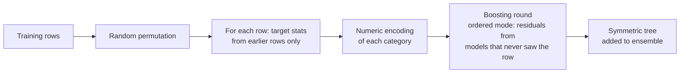

CatBoost, developed at Yandex, is a gradient boosting library built around **categorical features**. Real business data is full of them (country, product, device, plan), often with hundreds of levels. CatBoost encodes them with a careful, leakage-free form of target statistics, can train with a matching technique called **ordered boosting**, and uses **symmetric trees** that are fast at prediction time. It also has a reputation for good results with its default settings. This lesson explains those ideas, trains CatBoost on the shared churn dataset, and closes the module's boosting section with an honest comparison of XGBoost, LightGBM and CatBoost.

## The problem with encoding categories

You have seen two ways to turn a category into numbers:

- **One-hot encoding** creates one column per level. With 1,000 cities that is 1,000 sparse columns, and each tree split can only separate one city from the rest.
- **Target encoding** replaces each category with the mean target for that category, for example the churn rate of each region. That is a single, highly informative column.

Target encoding has a trap. If you compute the mean churn of region `r07` from all training rows, each row's own label is part of its encoded value. A region with a single customer gets an encoding equal to that customer's label, and the model learns to trust a feature that is pure leakage. On new data the encoding is far less informative. This mismatch is called **prediction shift**, a form of the [data leakage](/learn/machine-learning-fundamentals/training-validation-and-testing) you learned to avoid.

## Ordered target statistics

CatBoost's fix borrows an idea from online learning: encode each row using **only the rows that came before it** in a random ordering. For row $i$ with category $c$, the **ordered target statistic** is

$$
\hat{x}_i = \frac{\sum_{j < i,\ x_j = c} y_j + a \cdot P}{\big|\{j < i : x_j = c\}\big| + a}
$$

where the sums run over earlier rows with the same category, $P$ is a prior (for example the overall positive rate), and $a > 0$ is the weight of the prior. A category seen for the first time gets exactly the prior; as more rows of that category accumulate, the encoding moves towards the category's observed mean. A row's own label never influences its own encoding.

```python
import pandas as pd

toy = pd.DataFrame({"city": ["A", "B", "A", "A", "B", "A"], "y": [1, 0, 1, 0, 1, 1]})
prior, a = 0.5, 1.0
sums, counts, encoded = {}, {}, []
for city, target in zip(toy["city"], toy["y"]):
    s, c = sums.get(city, 0), counts.get(city, 0)
    encoded.append(round((s + a * prior) / (c + a), 3))   # uses only earlier rows
    sums[city], counts[city] = s + target, c + 1
toy["ordered_ts"] = encoded
print(toy)
```

```output
  city  y  ordered_ts
0    A  1       0.500
1    B  0       0.500
2    A  1       0.750
3    A  0       0.833
4    B  1       0.250
5    A  1       0.625
```

Row 2 sees one earlier `A` with label 1, so its encoding is $(1 + 0.5)/(1 + 1) = 0.75$. Row 3 sees two earlier `A` rows, both 1: $(2 + 0.5)/(2 + 1) \approx 0.833$. Its own label (0) plays no part. Early rows get noisy encodings, so CatBoost uses several random permutations of the data to average out that noise. At prediction time, the statistics from the whole training set are used.

CatBoost also builds **combinations of categorical features** on the fly (for example `plan` together with `region`) and encodes them the same way, capturing interactions you would otherwise engineer by hand.



## Ordered boosting

The same leakage appears in boosting itself. In standard gradient boosting, the residual for row $i$ is computed by a model that was trained on row $i$, so the residuals on training data are systematically smaller than they would be on unseen data. **Ordered boosting** applies the "only earlier rows" principle here too: the gradient for each row is estimated from a model built on the rows that precede it in the permutation. CatBoost implements this efficiently with a set of supporting models rather than one model per row. It matters most on small datasets, where the bias is largest, and it makes training slower. The default `boosting_type` depends on the data size, the hardware and the CatBoost version (for this lesson's 3,840-row training set, version 1.2 chose `"Plain"`), so set `boosting_type="Ordered"` explicitly when you want it. The ordered target statistics for categorical features are used either way.

## Symmetric (oblivious) trees

CatBoost's trees are **oblivious**: every node at the same depth uses the **same** split. A depth-6 tree therefore asks the same 6 questions of every example, and the 6 yes/no answers form a 6-bit index into a table of $2^6 = 64$ leaf values.

| | Ordinary tree | Oblivious tree |
| --- | --- | --- |
| Splits per level | Different at each node | One shared split per level |
| Prediction | Follow a path of comparisons | Compute a bit index, look up the leaf |
| Flexibility per tree | Higher | Lower, acts as regularisation |
| Prediction speed | Good | Very fast, vectorises well |

Each individual tree is weaker, but the restriction reduces overfitting and makes inference fast, which matters for low-latency serving.

## CatBoost in practice

The same synthetic churn dataset as in the [XGBoost](/learn/supervised-learning-algorithms/xgboost) and [LightGBM](/learn/supervised-learning-algorithms/lightgbm) lessons:

```python
import numpy as np
import pandas as pd
from sklearn.model_selection import train_test_split

rng = np.random.default_rng(42)
n = 6000
df = pd.DataFrame({
    "tenure_months": rng.integers(1, 72, n),
    "monthly_spend": rng.normal(60, 20, n).round(2),
    "support_calls": rng.poisson(1.5, n),
    "plan": rng.choice(["basic", "standard", "premium"], n, p=[0.5, 0.3, 0.2]),
    "region": rng.choice([f"r{i:02d}" for i in range(40)], n),
})
region_effect = dict(zip(sorted(df["region"].unique()), rng.normal(0, 0.8, 40)))
plan_effect = {"basic": 0.6, "standard": 0.0, "premium": -0.6}
logit = (0.5 - 0.05 * df["tenure_months"] + 0.6 * df["support_calls"]
         + df["plan"].map(plan_effect) + df["region"].map(region_effect))
y = (rng.random(n) < 1 / (1 + np.exp(-logit))).astype(int)

X_train, X_test, y_train, y_test = train_test_split(df, y, test_size=0.2, random_state=0, stratify=y)
X_train, X_val, y_train, y_val = train_test_split(X_train, y_train, test_size=0.2, random_state=0, stratify=y_train)
```

CatBoost takes the string columns as they are. You only name them in `cat_features`:

```python
from catboost import CatBoostClassifier

model = CatBoostClassifier(
    iterations=2000,
    learning_rate=0.05,
    depth=6,
    l2_leaf_reg=3.0,
    cat_features=["plan", "region"],
    early_stopping_rounds=50,
    random_seed=0,
    verbose=0,
)
model.fit(X_train, y_train, eval_set=(X_val, y_val))   # string columns, no encoding

print("best iteration:", model.get_best_iteration())
print("test accuracy:", round(model.score(X_test, y_test), 3))
print(model.predict_proba(X_test.head(3)).round(3))
```

```output
best iteration: 142
test accuracy: 0.735
[[0.368 0.632]
 [0.506 0.494]
 [0.583 0.417]]
```

By default, when an `eval_set` is given, CatBoost keeps the model from the best iteration. Feature importances (by default, how much each feature changes predictions on average, normalised to sum to 100):

```python
imp = pd.Series(model.get_feature_importance(), index=model.feature_names_)
print(imp.sort_values(ascending=False).round(1))
```

```output
tenure_months    31.3
region           26.6
support_calls    23.1
plan             14.8
monthly_spend     4.2
dtype: float64
```

The irrelevant `monthly_spend` gets the smallest share. Finally, the defaults:

```python
plain = CatBoostClassifier(cat_features=["plan", "region"], random_seed=0, verbose=0)
plain.fit(X_train, y_train)
print("defaults: iterations =", plain.tree_count_,
      " learning rate =", round(plain.learning_rate_, 4))
print("test accuracy with defaults:", round(plain.score(X_test, y_test), 3))
```

```output
defaults: iterations = 1000  learning rate = 0.0183
test accuracy with defaults: 0.741
```

With no tuning, CatBoost trains 1,000 trees with a learning rate it picked automatically from the dataset size and iteration count, and lands in the same range as the tuned run. These outputs come from CatBoost 1.2.x.

> [!TIP]
> Pass categorical columns as strings (or integers) and list them in `cat_features`. Do not one-hot or label-encode them yourself first, or CatBoost treats them as ordinary numbers and its main advantage disappears. Missing categorical values should be a string such as `"missing"`; numeric `NaN` is handled natively.

## Key hyperparameters

| Parameter | Default | Effect |
| --- | --- | --- |
| `iterations` | 1000 | Number of trees; use with `early_stopping_rounds` |
| `learning_rate` | Chosen automatically | Shrinkage per tree |
| `depth` | 6 | Depth of each symmetric tree (4 to 10 typical) |
| `l2_leaf_reg` | 3 | L2 penalty on leaf values |
| `cat_features` | None | Names or indices of categorical columns |
| `one_hot_max_size` | Small (2 on CPU here) | Categories with at most this many levels are one-hot encoded instead |
| `boosting_type` | Depends on data and hardware | `"Ordered"` or `"Plain"` |
| `auto_class_weights` | None | `"Balanced"` re-weights imbalanced classes |
| `random_seed` | 0 | Reproducibility |

## Choosing between XGBoost, LightGBM and CatBoost

All three are mature, accurate implementations of gradient-boosted trees, and on many datasets their tuned accuracy is close. The differences that matter are practical:

| | XGBoost | LightGBM | CatBoost |
| --- | --- | --- | --- |
| Tree growth | Level-wise by default | Leaf-wise | Symmetric (oblivious) |
| Categorical features | Native with `enable_categorical=True` and pandas `category` dtype | Native, groups categories by gradient statistics | Ordered target statistics plus automatic combinations; strings accepted directly |
| Training speed | Fast with `hist` | Often fastest on large data | Can be slower to train on CPU, especially with many categorical features |
| Prediction speed | Good | Good | Very fast, thanks to oblivious trees |
| Defaults | Need tuning (learning rate 0.3) | Need tuning (`num_leaves` interacts with data size) | Usually strong out of the box |
| Small-data overfitting | Moderate | Highest risk without limits | Lower, thanks to symmetric trees and leakage-free encodings |
| Early stopping in the sklearn API | Constructor argument | Callback | Constructor or `fit` argument |

> [!KEY]
> No boosting library wins everywhere. Use CatBoost when categorical features are central or you want strong results with little tuning; LightGBM when training speed on large data matters most; XGBoost as a well-documented, widely deployed all-rounder. Whatever you pick, validate with early stopping and compare candidates on the same validation data using the metrics in Module 15.

## Exercises

**1.** Extend the toy ordered-statistics loop with a seventh row, city `B` with label 0. What encoding does it get?

<details>
<summary>Show solution</summary>

Before row 6, city `B` has appeared twice with labels 0 and 1, so the sum is 1 and the count is 2: $(1 + 0.5)/(2 + 1) = 0.5$.

</details>

**2.** Show the leak in naive target encoding: compute each region's mean churn on the training set, add it as a column, and check how the encoded value of single-customer categories relates to the label.

<details>
<summary>Show solution</summary>

```python
train = X_train.assign(churn=y_train)
naive = train.groupby("region")["churn"].transform("mean")
counts = train.groupby("region")["churn"].transform("size")
```

For any category with a single row, `naive` equals that row's own label, so the feature contains the answer; rare categories are nearly as bad. Here every region has 79 to 117 training rows, so the leak is mild. It is most dangerous with high-cardinality features.

</details>

**3.** A depth-4 oblivious tree is used for prediction. How many leaf values does it store, and how many comparisons does each prediction need?

<details>
<summary>Show solution</summary>

It stores $2^4 = 16$ leaf values. Each prediction makes exactly 4 comparisons, one per level, combines the 4 results into a 4-bit index, and looks up that leaf.

</details>

```quiz
[
  {
    "q": "Why is naive target encoding of categories risky?",
    "options": ["It creates too many columns", "Each row's own label leaks into its encoded value, especially for rare categories", "It cannot handle numeric features", "It only works for regression"],
    "answer": 1,
    "why": "Encoding with means that include the row's own target leaks the label, so the model overrates the feature and performance drops on new data."
  },
  {
    "q": "How does CatBoost's ordered target statistic avoid that leak?",
    "options": ["It encodes each row using only rows that precede it in a random permutation", "It uses one-hot encoding instead", "It removes rare categories", "It encodes categories alphabetically"],
    "answer": 0,
    "why": "A row's encoding is computed from earlier rows plus a prior, so its own label never contributes."
  },
  {
    "q": "What is special about CatBoost's symmetric (oblivious) trees?",
    "options": ["They are grown leaf-wise", "They have no depth limit", "Every node at the same depth uses the same split, so prediction is a bit-index lookup", "Each tree uses a different loss"],
    "answer": 2,
    "why": "Sharing one split per level makes trees more regular and prediction very fast."
  },
  {
    "q": "Your data has many high-cardinality string columns and you have little time to tune. Which library is the natural first choice?",
    "options": ["Plain scikit-learn `GradientBoostingClassifier` with one-hot encoding", "LightGBM with `num_leaves=255`", "XGBoost with label-encoded integers", "CatBoost, passing the columns in `cat_features`"],
    "answer": 3,
    "why": "CatBoost is designed for categorical data, accepts strings directly and usually performs well with defaults."
  }
]
```
