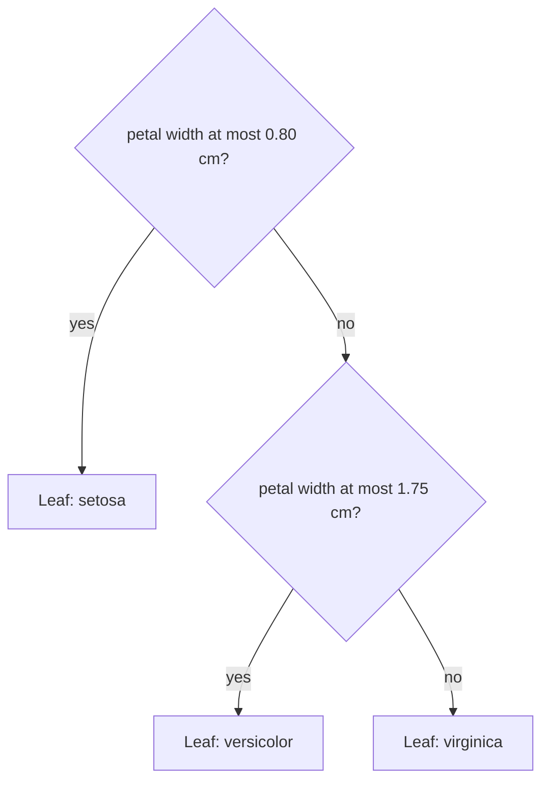

A decision tree makes predictions by asking a sequence of yes/no questions about the features: is petal width at most 0.8 cm? Is income above 40,000? Each answer sends the example down one branch until it reaches a leaf that holds the prediction. Trees are easy to read, need almost no preprocessing, handle numbers and categories together, and capture non-linear patterns and interactions automatically. On their own they overfit easily, but they are the building block of random forests and gradient boosting, the models that dominate tabular data in practice.

## How a tree predicts

Here is a real tree, learned from the iris flower data with a depth limit of 2:



Each internal node tests one feature against one threshold. Each leaf predicts the majority class of the training examples that ended up there (for classification) or their mean target value (for regression). Geometrically, every split cuts the feature space with a line parallel to an axis, so a tree divides the space into rectangular boxes, each with a constant prediction.

## Choosing a split: impurity

Training a tree means choosing, at each node, the feature and threshold that best separate the classes. "Best" is measured by **impurity**: how mixed the labels in a node are. A node with only one class is pure (impurity 0).

The **Gini impurity** of a node with class proportions $p_1, \dots, p_K$ is

$$
G = 1 - \sum_{k=1}^{K} p_k^2
$$

It is the probability that two examples drawn at random from the node have different labels. For two classes it ranges from 0 (pure) to 0.5 (a 50/50 mix).

The **entropy**, from [Entropy](/learn/essential-mathematics-for-machine-learning/entropy), is

$$
H = -\sum_{k=1}^{K} p_k \log_2 p_k
$$

which ranges from 0 (pure) to 1 bit for a 50/50 two-class node.

A split sends $n_L$ examples left and $n_R$ right from a node of $n$ examples. Its quality is the weighted average impurity of the children:

$$
\text{score} = \frac{n_L}{n} G_L + \frac{n_R}{n} G_R
$$

The algorithm picks the split with the lowest score. With entropy, the equivalent is to maximise the **information gain**, the parent's entropy minus the weighted child entropy.

## A split, step by step

Take six examples with one feature $x$ and binary labels $y$. The candidate thresholds are the midpoints between consecutive sorted values. Step through the search for the best Gini split:

```trace
{
  "title": "searching for the best Gini split",
  "code": [
    "def gini(labels):",
    "    p = sum(labels) / len(labels)",
    "    return 1 - p**2 - (1 - p)**2",
    "",
    "x = [2, 3, 5, 7, 8, 9]",
    "y = [0, 0, 1, 1, 1, 0]",
    "best = None",
    "for t in [2.5, 4, 6, 7.5, 8.5]:",
    "    left = [yi for xi, yi in zip(x, y) if xi <= t]",
    "    right = [yi for xi, yi in zip(x, y) if xi > t]",
    "    score = (len(left) * gini(left) + len(right) * gini(right)) / len(y)",
    "    print(t, round(score, 3))",
    "    if best is None or score < best[1]:",
    "        best = (t, score)",
    "print(\"best:\", best[0], round(best[1], 3))"
  ],
  "steps": [
    { "line": 6, "vars": { "x": "[2, 3, 5, 7, 8, 9]", "y": "[0, 0, 1, 1, 1, 0]" }, "note": "Three of each class, so the parent node has Gini 1 - 0.5^2 - 0.5^2 = 0.5, the maximum for two classes." },
    { "line": 10, "vars": { "t": "2.5", "left": "[0]", "right": "[0, 1, 1, 1, 0]" }, "note": "Threshold 2.5 isolates one example. The left child is pure (Gini 0); the right is 3/5 class 1, so Gini = 1 - 0.36 - 0.16 = 0.48." },
    { "line": 14, "vars": { "t": "2.5", "score": "0.4", "best": "(2.5, 0.4)" }, "out": ["2.5 0.4"], "note": "Weighted: (1 x 0 + 5 x 0.48) / 6 = 0.4. It is the first candidate, so it becomes the best so far." },
    { "line": 11, "vars": { "t": "4", "left": "[0, 0]", "right": "[1, 1, 1, 0]", "best": "(2.5, 0.4)" }, "note": "Left is pure. Right is 3/4 class 1: Gini = 1 - 0.5625 - 0.0625 = 0.375." },
    { "line": 14, "vars": { "t": "4", "score": "0.25", "best": "(4, 0.25)" }, "out": ["2.5 0.4", "4 0.25"], "note": "(2 x 0 + 4 x 0.375) / 6 = 0.25. Lower than 0.4, so threshold 4 is the new best." },
    { "line": 12, "vars": { "t": "6", "left": "[0, 0, 1]", "right": "[1, 1, 0]", "score": "0.444", "best": "(4, 0.25)" }, "out": ["2.5 0.4", "4 0.25", "6 0.444"], "note": "Both children are 2-to-1 mixes with Gini 4/9. Splitting in the middle looks natural but separates the classes badly." },
    { "line": 12, "vars": { "t": "7.5", "left": "[0, 0, 1, 1]", "right": "[1, 0]", "score": "0.5", "best": "(4, 0.25)" }, "out": ["2.5 0.4", "4 0.25", "6 0.444", "7.5 0.5"], "note": "Both children are 50/50, so this split gains nothing at all over the parent." },
    { "line": 12, "vars": { "t": "8.5", "left": "[0, 0, 1, 1, 1]", "right": "[0]", "score": "0.4", "best": "(4, 0.25)" }, "out": ["2.5 0.4", "4 0.25", "6 0.444", "7.5 0.5", "8.5 0.4"], "note": "The mirror image of threshold 2.5, with the same score." },
    { "line": 15, "vars": { "best": "(4, 0.25)" }, "out": ["2.5 0.4", "4 0.25", "6 0.444", "7.5 0.5", "8.5 0.4", "best: 4 0.25"], "note": "The tree splits at x <= 4. It would then repeat the same search inside the right child, which is still impure." }
  ]
}
```

Using entropy instead gives the same winner here. The parent entropy is 1 bit, and the information gain for each threshold is:

| Threshold | 2.5 | 4 | 6 | 7.5 | 8.5 |
| --- | --- | --- | --- | --- | --- |
| Weighted Gini (lower is better) | 0.400 | **0.250** | 0.444 | 0.500 | 0.400 |
| Information gain in bits (higher is better) | 0.191 | **0.459** | 0.082 | 0.000 | 0.191 |

Gini and entropy almost always choose similar splits. Gini is slightly cheaper to compute (no logarithm) and is scikit-learn's default.

## Growing the whole tree

The full algorithm (called CART) is greedy and recursive:

1. At the current node, try every feature and every candidate threshold, and pick the split with the lowest weighted impurity.
2. Split the data and repeat on each child.
3. Stop when a node is pure, or a stopping rule fires: maximum depth reached, too few samples to split, or no split improves impurity enough.

"Greedy" means each split is chosen for its immediate benefit, without looking ahead. Finding the globally optimal tree is computationally intractable, so every practical library grows trees this way. For **regression trees**, the impurity is the variance (mean squared error) of the targets in a node, and each leaf predicts the mean of its targets.

## Decision trees in scikit-learn

```python
from sklearn.datasets import load_iris
from sklearn.tree import DecisionTreeClassifier, export_text

iris = load_iris()
tree = DecisionTreeClassifier(max_depth=2, random_state=0)
tree.fit(iris.data, iris.target)
print(export_text(tree, feature_names=iris.feature_names))
```

```output
|--- petal width (cm) <= 0.80
|   |--- class: 0
|--- petal width (cm) >  0.80
|   |--- petal width (cm) <= 1.75
|   |   |--- class: 1
|   |--- petal width (cm) >  1.75
|   |   |--- class: 2
```

That is the tree drawn at the top of this lesson. Now watch what depth does on the harder breast cancer data:

```python
from sklearn.datasets import load_breast_cancer
from sklearn.model_selection import train_test_split

X, y = load_breast_cancer(return_X_y=True)
X_train, X_test, y_train, y_test = train_test_split(X, y, test_size=0.25, random_state=42, stratify=y)

for depth in (1, 2, 3, 5, None):
    t = DecisionTreeClassifier(max_depth=depth, random_state=0).fit(X_train, y_train)
    print(f"max_depth={str(depth):<5} leaves={t.get_n_leaves():>2}  "
          f"train={t.score(X_train, y_train):.3f}  test={t.score(X_test, y_test):.3f}")
```

```output
max_depth=1     leaves= 2  train=0.923  test=0.923
max_depth=2     leaves= 4  train=0.958  test=0.909
max_depth=3     leaves= 7  train=0.977  test=0.944
max_depth=5     leaves=15  train=0.995  test=0.951
max_depth=None  leaves=18  train=1.000  test=0.937
```

With no limit, the tree keeps splitting until every leaf is pure and reaches 100% training accuracy, but test accuracy drops. This is [overfitting](/learn/machine-learning-fundamentals/underfitting-and-overfitting): the deepest splits memorise individual training points.

> [!WARNING]
> An unrestricted decision tree will always overfit noisy data. Control its size with `max_depth`, `min_samples_leaf` or `ccp_alpha` (cost-complexity pruning), and choose the value on validation data, never on the test set.

| Hyperparameter | Effect | Typical starting point |
| --- | --- | --- |
| `max_depth` | Maximum number of questions on any path | 3 to 10 |
| `min_samples_leaf` | Minimum examples in each leaf; smooths predictions | 1 to 50 |
| `min_samples_split` | Minimum examples needed to split a node | 2 to 20 |
| `max_features` | Number of features considered per split | All (forests use fewer) |
| `criterion` | Impurity measure | `"gini"` or `"entropy"` |
| `ccp_alpha` | Prunes branches that add little | Tune with cross-validation |

## Strengths, weaknesses and when to choose it

| Strengths | Weaknesses |
| --- | --- |
| Readable rules you can show to non-experts | Overfits unless constrained |
| No feature scaling needed | Unstable: small data changes can produce a very different tree |
| Captures non-linearities and interactions | Axis-aligned, step-shaped boundaries |
| Fast to train and predict | A single tree is rarely the most accurate model |

> [!KEY]
> A tree repeatedly picks the feature and threshold that most reduce impurity. Use a single shallow tree when you need rules a person can audit. When you need accuracy, use many trees together: random forests and gradient boosting, the next topics in this module.

## Exercises

**1.** Compute by hand the Gini impurity of a node with 8 examples of class A and 2 of class B, and its entropy.

<details>
<summary>Show solution</summary>

Proportions are 0.8 and 0.2. Gini = $1 - 0.64 - 0.04 = 0.32$. Entropy = $-(0.8 \log_2 0.8 + 0.2 \log_2 0.2) \approx 0.722$ bits.

</details>

**2.** Fit `DecisionTreeClassifier(min_samples_leaf=10, random_state=0)` on the breast cancer training data and compare its number of leaves and test accuracy with the unrestricted tree.

<details>
<summary>Show solution</summary>

```python
t = DecisionTreeClassifier(min_samples_leaf=10, random_state=0).fit(X_train, y_train)
print(t.get_n_leaves(), round(t.score(X_test, y_test), 3))
```

```output
10 0.951
```

Requiring at least 10 examples per leaf gives 10 leaves instead of 18. Training accuracy falls below 100% because the tree can no longer isolate single points, and test accuracy rises from 0.937 to 0.951.

</details>

**3.** Why do decision trees not need feature scaling, when linear models and KNN do?

<details>
<summary>Show solution</summary>

A split only asks whether a value is above or below a threshold. Multiplying a feature by a constant, or applying any order-preserving transformation, moves the thresholds but not which examples go left or right, so the tree is unchanged.

</details>

```quiz
[
  {
    "q": "What is the Gini impurity of a node where all examples belong to one class?",
    "options": ["0.5", "1", "0", "It depends on the number of examples"],
    "answer": 2,
    "why": "With one class, p = 1 for that class, so G = 1 - 1^2 = 0: the node is pure."
  },
  {
    "q": "How does a decision tree choose a split at a node?",
    "options": ["It picks the feature most correlated with the target", "It tries candidate features and thresholds and picks the one giving the lowest weighted child impurity", "It picks a random feature and the median threshold", "It looks ahead to find the globally optimal tree"],
    "answer": 1,
    "why": "CART is greedy: it evaluates candidate splits at the current node and keeps the one that most reduces impurity."
  },
  {
    "q": "An unrestricted tree reaches 100% training accuracy but lower test accuracy than a depth-5 tree. What is happening?",
    "options": ["Underfitting", "Data leakage", "The impurity criterion is wrong", "Overfitting: the deepest splits memorise noise in the training data"],
    "answer": 3,
    "why": "Without limits, the tree splits until every leaf is pure, fitting noise that does not generalise."
  },
  {
    "q": "What does a regression tree predict in a leaf?",
    "options": ["The mean target value of the training examples in that leaf", "A linear function of the features", "The median of all training targets", "The most common target value overall"],
    "answer": 0,
    "why": "Regression trees split to reduce variance and predict the average target of the training examples that fall in each leaf."
  }
]
```
